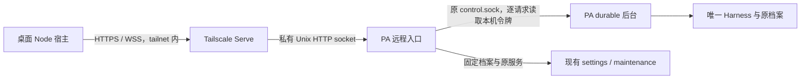

# Agent Note: Personal 通过 Tailscale Serve 统一桌面聊天与设置连接

Status: implemented

普通配置保存、回执与按对象等待由[设置保存与生效](2026-10-25-personal-settings-versions.md)收窄；本文的 HTTPS/WSS、认证与原档案绑定继续适用，旧维护回执沿原解释恢复。

## 问题

拥有者要求将 PA 聊天和设置的两条 SSH 连接统一为 Tailscale HTTPS／WebSocket。个人后台由 durable 持有会话，旧聊天使用共享控制协议，设置又依赖独立 SSH 停存启；只替换 socket 不能接上新后台，删除传输也不能丢失设置维护。实施入口、确认范围与验收证据由[工单](../../../../.scratch/personal-tailscale/issues/01-migration-plan.md)持有。

## 决定

PA 聊天和设置使用同一个 tailnet 内的 HTTPS 地址，HTTPS 承载查询与写入，WSS 只推送状态和消息事件。Code 继续使用原控制面；PA 直接消费 durable 的事实，不构造旧 Runtime 的任务和事件。拥有者于 2026-10-24 确认统一 PA 聊天与设置、删除两条 SSH 连接，并仅在自己的 tailnet 内单拥有者使用。

### 连接与部署

远程入口放在 `apps/ruukoto`，由独立 systemd 单元监督，与后台同账户运行，只管理部署时固定的一个档案、程序与 `ruukoto-backend.service`。它不创建 Harness，不读取活跃 SQLite 或重建会话，不接收远端提供的 shell、单元名或程序路径。它独立于后台存活，是完整保留停存启的必要条件；启动失败和后台离线仍可读取维护结果与恢复原服务。

Tailscale Serve 负责 tailnet 内 HTTPS、证书与反向代理，禁止 Funnel。应用不自行监听公网或 loopback TCP，也不实现证书续期。远程入口的配置、socket 与维护记录固定放在运行账户的 `~/.config/ruukoto-remote/`，目录 0700、socket 与文件 0600，不向严格校验的个人档案顶层随意加文件。该路径属于现有 `personalProtectedRoots` 的 `.config` 保护根；启动核实规范路径、账户、权限和 socket 字节长度，拒绝符号链接与任意外部状态目录。受限模式的文件、搜索、命令及 native grants 均须拒绝开放该根，完全访问沿用既有同账户例外。Serve 的 Unix socket 目标由管理员配置，后台账户不获得 Tailscale operator 权限。部署使用经探针验证且包含相关安全修复的稳定版，不能仅凭版本下限认定全部验收通过。

此拓扑的 Unix socket 能力已从[官方固定版本源码](https://github.com/tailscale/tailscale/blob/v1.104.2/ipn/ipnlocal/serve.go)与[TS-2026-005 公告](https://tailscale.com/security-bulletins#ts-2026-005)核实；后者要求修复非 root operator 可配置特权 socket 的漏洞。源码事实不等于生产版本与实际 WSS 链路已验证。

### 拥有者认证

拥有者于2026-10-24确认「Tailscale 加独立应用凭据，保留应用级隔离」。网络规则、Serve拥有者身份与应用凭据三者同时成立才允许业务请求及WS Upgrade；不提供仅凭Tailscale身份的降级入口。凭据按每个桌面安装独立生成，Electron与MyGo不共享一把秘密。它隔离同一获准设备上未持凭据的网络程序，包括能自定义HTTP头的Coding宿主调用；不承诺抵御宿主注入、内存读取、用户主动放行其他应用读取钥匙串或完整账户控制。

Tailscale grants/ACL 限制访问来源为拥有者用户设备，PA 的 Serve 仅发布 TCP 443。拥有者将原全网 grant 的 src 改为固定用户，保留其他用途所需的 dst/ip；合并策略须核对其他广泛 allow，窄规则不会覆盖既有放行。远程入口对每个 HTTP 请求及 WS Upgrade 验证 Serve 注入的固定 `Tailscale-User-Login`，不使用显示名称或头像。身份缺失、与部署配置不符、带 tag 而没有用户身份的客户端均拒绝；共享节点的其他用户不自动取得拥有者权限。服务器本身可带 tag，桌面来源使用拥有者的用户身份。

身份头只可信于root管理的Serve到私有socket这条路径。其安全前提是服务器root与PA运行账户已经属于可信域；服务器上的同账户完全访问任务本就能读取本机控制令牌，不额外承诺抵御该权限。若未来要求隔离能够以PA账户任意执行的服务器代码，需另行调整OS身份与权限，不能只再加一个该账户可读取的token。[官方身份头说明](https://tailscale.com/docs/features/tailscale-serve#identity-headers)明确Serve会替换客户端伪造头，tagged来源不带用户头，而共享用户也可能带有效用户头。

桌面Node宿主在HTTPS与WS握手中通过 `Authorization: Bearer` 携带应用凭据，服务器验证索引ID、256位随机秘密的SHA-256摘要、active状态及固定档案/拥有者关联；摘要按常数时间比较。凭据不放URL、cookie、WS子协议或请求日志，也不转发给个人后台。全部业务接口在认证前不返回档案、历史或设置；认证失败只给安全分类，不返回存储内容。原先无应用凭据方案的固定客户端标记头删除，真实Authorization承担认证；入口仍拒绝带 `Origin` 的请求和CORS预检，不允许浏览器借网络身份访问。

客户端只接受完整HTTPS origin，禁止URL中的凭据、query、fragment和任意路径，WSS从同一origin派生；不跟随重定向，不关闭TLS校验。外层连接JSON仅保存非秘密配置，安全存储内的载荷也绑定规范origin、凭据ID、配对后取得的remote实例身份及档案身份；不能通过修改外层JSON把旧秘密发送给另一个地址。地址或档案变更重新配对，凭据不跨目标复制；后台每次启动的运行代次变化不要求重新配对。原 `control.token` 始终留在服务器，remote每次连接后台读取新值，不出现在任何响应或诊断中。

### 配对与登记恢复

服务器引导式管理入口提供开启配对、列出已配对桌面及撤销选定桌面。命令通过同一受保护目录内的第二个 `admin.sock` 请求remote，socket为0600、只供服务器本机账户/root管理，不经Serve发布；公开socket没有开启配对或管理其他凭据的路由，也不根据请求头伪装成本机调用。CLI和HTTPS登记都由同一remote持有认证状态写入，CLI不另开写入者。

remote实例身份在拥有者显式初始化认证状态时随机生成并持久保存，与规范origin、owner、档案身份及格式版本同属认证状态；remote进程或个人后台重启不改变它。没有状态、状态损坏或版本不支持时，业务入口关闭，不自动建空状态或丢弃旧凭据；本机管理入口只提供诊断与显式初始化/恢复，不能绕过坏状态重新开放。重建已丢失的状态属于显式重新安装，产生新remote身份，旧绑定及凭据不会继承。

默认没有配对窗口。拥有者在服务器向导选择开启后，remote生成12位随机base32配对码，5分钟有效，同一时刻只有一个窗口，全部来源累计最多5次错误兑换；到期、取消或次数耗尽即关闭，重启也使未完成窗口失效。窗口固定原origin、remote实例身份、档案及owner，配对码只展示给本机向导，不写日志或URL。窗口摘要、错误次数和凭据记录在同一个私有认证状态文件中原子提交，写入失败停止接纳认证相关操作，不能报告成功。短码是一次授予能力，应保密；知道短码的获准进程仍可能抢先兑换，该设计不宣称能抵御配对码泄露。

桌面选择“配对”后，Node宿主生成凭据ID与256位随机秘密，先将候选凭据成功保存并读回核实，再发出唯一允许未登记候选凭据的 `POST /pair`。请求携带用户输入的短码、候选Authorization及固定配对参数；仍验证Serve拥有者身份、origin和无Origin，且不得访问任何业务处理。秘密由程序管理，不显示给用户或renderer。候选记录不覆盖原active凭据；安全存储失败时不发兑换请求。

remote在同一串行提交中验证并消费配对窗口、登记active凭据及原请求摘要；只有原子替换、同步成功后才应答，响应不包含秘密。相同凭据ID重放必须先核实原秘密、owner与请求摘要：相同只返回原登记结果，不再消费窗口；不同拒绝。撤销记录保留为墓碑，迟到登记不能重新激活。凭据索引、摘要、创建/撤销状态属于remote受保护状态，不是会话或模型上下文；不增加另一套用户系统、刷新令牌或登录会话。

配对应答丢失时，桌面保留原候选凭据，先用它查询认证握手；成功后核实产品、remote实例与档案，并把绑定信息写回安全存储及连接配置，完成后才开放业务操作。尚未查到登记不能证明原请求未到达；如需重发，显式重发原凭据ID、秘密与相同配对参数，不自动生成第二份。窗口已经失效且原凭据确实未登记时，由拥有者重新开启配对；本机配置落盘失败时保留候选及原关联，重开继续核实。凭据已登记但本机秘密实际丢失时，从服务器向导撤销原条目再配对，不回传或恢复服务器没有保存的明文。

### 双壳的秘密存储

`DesktopHost` 注入内部的读取/保存/删除窄接口，业务连接仍由共用Node宿主持有；renderer只调用配对、连接、断开等业务动作并获取非秘密状态，不能指定任意钥匙串service/account、请求返回秘密或创建通用凭据读写桥。短码作为一次性表单输入在提交后清空；长期凭据不经过 `DesktopBridge`、preload、通知或界面事件。

Electron复用当前44.7.2已经具备的 `safeStorage` 异步接口，等app ready后调用。加密密钥存于macOS Keychain，凭据及绑定信息的密文存于应用私有0600文件，经原子保存和读回解密确认；不是把凭据条目直接存入Keychain，也不自写加密。该版本的SDK解密失败只给普通Error，不能按结构化属性区分临时不可用与密文损坏；两者统一保留原密文并停止认证，不解析message或当作缺失重配。`shouldReEncrypt` 与可独立校验的本机载荷损坏分别处理，重加密成功前不覆盖原密文。平台语义及接口见[固定版本官方说明](https://github.com/electron/electron/blob/v44.7.2/docs/api/safe-storage.md)与[实现](https://github.com/electron/electron/blob/v44.7.2/shell/browser/api/electron_api_safe_storage.cc)。

MyGo在Go主进程内增加薄的Security.framework适配，使用登录用户Keychain的generic-password及应用访问控制；不增加通用凭据依赖、命令行security调用或可被任意程序执行的读密钥helper，不把通用Node程序列为钥匙串可信应用。凭据服务名固定为本应用，查找键由宿主绑定推导，不启用跨应用共享或iCloud同步；当前ad-hoc构建不假定拥有data-protection Keychain所需的entitlement，见[Apple Keychain说明](https://developer.apple.com/documentation/technotes/tn3137-on-mac-keychains)。

Go与Node仅在既有私有管道新增专用凭据请求/应答帧，分别关联方向和本次sidecar代次，载荷有界。`transport.go` 在内部截获处理，不能进入 `Desktop.event`、`updates.Emit` 或MyGo绑定导出；关闭、超时及迟到应答不交给新sidecar。系统提示等异步处理不能阻塞管道读取循环或造成“Go等待Node、Node等待Keychain”的死锁；秘密不会进入原通用日志与错误回显。Electron仅需主进程适配，MyGo原生桥编入现有Go应用，不塞入Agent执行监督器的原生构建。

钥匙串锁定、授权被拒绝、临时不可用和损坏均保留原记录并停止认证；“条目不存在”单独分类，不把读取失败当作缺失自动换凭据、明文落盘或重新配对。只由拥有者解锁/重新连接触发重试，不后台反复弹系统提示。当前两壳均为ad-hoc签名，更新可能重新询问Keychain授权；签名检查成功不证明更新访问体验稳定，必须在真实双壳验收，见[Electron签名要求](https://www.electronjs.org/docs/latest/tutorial/code-signing#macos-apis-that-require-code-signing)。

受信外壳不能充当任意程序取密钥的跳板。Electron生产构建使用现有electron-builder的 `electronFuses` 关闭RunAsNode、NODE_OPTIONS和Node调试入口，开启ASAR完整性校验与仅从ASAR加载；生产入口在读取凭据前拒绝远程调试参数及外部renderer地址，不让 `ELECTRON_RENDERER_URL` 等开发覆盖载入任意页面。开发/测试构建使用独立命名空间与测试凭据，不读取生产配对；这些选项的作用见[固定版本fuses说明](https://github.com/electron/electron/blob/v44.7.2/docs/tutorial/fuses.md)。

MyGo启动sidecar前验证本应用签名及资源完整性，`launch.json`随签名资源记录固定Node规范路径与构建时摘要；Node变更须重建，不能按可编辑路径改跑任意程序。只启动已核实的sidecar及随应用签名的依赖，清除Node预加载、调试、模块搜索、动态加载、TLS降级和外部测试入口等注入环境，固定参数并禁用SIGUSR1开启调试；基线Node22.19已提供[对应参数](https://nodejs.org/download/release/v22.19.0/docs/api/cli.html#--disable-sigusr1)。两壳的 `host.getEnvironment`/`environment.adoptEnvironment` 同样不能把登录环境中的注入或TLS降级变量重新带回凭据宿主；Code后台及终端需要的原环境沿各自显式参数传递，不能用破坏其启动配置换取宿主清洗。启动校验失败不读钥匙串；生产构建不从环境改userData或加载未核实代码。MyGo的ESM sidecar打包后仅为Node内置模块提供require；ws等已打包依赖不能借可选原生扩展向应用外加载代码，真实bundle管道回归同时核实可启动与外部模块拒绝。两壳真实验收必须证明通用Node/security/另一应用未经用户授权不能取密钥，RunAsNode/调试/替换资源不能借已授权外壳取得凭据；单测与codesign命令通过不能代替这一项。

### 撤销、重配与在途操作

撤销由服务器管理向导选择原条目，remote先持久化revoked，再禁止该凭据的新准入、停止关联订阅并关闭该凭据的HTTP/WS连接，完成后才报告撤销成功。HTTP接收完请求体、等待队列后，在实际业务准入前再次核实active；仅在最早解析头时检查一次不够。若认证状态写入失败或结果不可核实，入口停止接受业务并关闭连接，恢复后读回原记录，不声称已撤销。原凭据ID与摘要墓碑保留，已撤销凭据不能通过配对重放恢复。

撤销阻止后续准入与新推送，不取消已经接纳的模型任务、审批决定或维护流程，也不能收回已经发到网络的字节；这些操作仍按原请求核实。关闭客户端或删除本机密文/Keychain条目只表示本机停止使用，不等于服务器撤销；界面须明确区分。首版不新增远程管理其他凭据的页面，丢失设备和全部桌面均不可用时仍可由服务器向导撤销、重配。轮换采用先配对新凭据、验证后撤销旧凭据，无自动刷新机制。

remote检测到owner、origin或档案身份与持久绑定不同，先关闭业务准入和旧连接并持久撤销全部旧凭据、失效配对窗口；本机向导确认新绑定后才允许重新配对。撤销落盘失败则入口保持关闭，不能只以内存视为完成；以后从A改到B再改回A，旧凭据仍为revoked，不能因为当前值相同而复活。WS最长连接寿命为五分钟，期满重新走完整认证；Tailscale策略或设备撤销是否立即终止既有WSS仍需真实验证，不能用SSH的撤销保证替代。应用凭据撤销由remote自行执行，无须等待Tailscale连接寿命。

### HTTPS 与 WSS 契约

| 接口 | 责任 |
| --- | --- |
| 握手 | 返回协议版本、产品 `ruukoto`、持久remote实例身份、档案身份、后台运行代次、在线/维护状态与实际能力；档案身份沿用现有实现，不误称数据库UUID，运行代次不充当remote身份 |
| 配对 | 仅在本机向导开启的短时窗口登记已由桌面安全保存的候选凭据；不返回秘密，不接纳业务操作 |
| 输入提交与查询 | 复用 `/inputs`、`/input` 的原键、正文指纹和 durable admission；HTTP 应答只表述接纳或实际查询状态 |
| 聊天历史 | 增加有界的主会话时间线分页及正文补读；现有 `/messages` 仅是截断诊断列表，`/history` 要求检索词，二者都不能冒充完整时间线 |
| 设置 | 复用 `/settings`、修订比较、未决阻断、实际后台环境检测；不把配置已保存等同于模型/MCP 测试成功 |
| 维护 | 固定档案的检查、显式单项停存启、原操作查询与显式恢复；不开放通用命令执行 |
| WSS 事件 | 后台持有原生订阅，远程入口认证并转发；先快照，后有序事件，断线后重新取快照；不承载写操作 |

对外只放行桌面实际使用的路由、HTTP 方法和 settings op，不透明暴露全部本机管理接口，尤其不把本机导出路径或通用 `/stop` 直接作为远程能力。后台仍验证业务输入、来源、修订与权限；远程入口认证不替代业务授权。写请求绑定握手核实的原档案，后台运行代次变化淘汰在途 UI 结果，档案变化停止采用旧草稿、选项及请求。

WSS 复用本地已安装 `pi-durable@1.3.0` 的 `watchEvents`：快照与后续提交订阅原子捕获，积压时上游替换为新快照。该接口标记 experimental，适配集中在个人 app；只投影桌面所需的消息、工具、队列和运行状态，不直接把原生全量 entries 作为网络首帧。纯浏览器可用的PA协议类型唯一放在 `packages/view/src/personal-protocol.ts`，个人app仅以开发类型依赖消费，桌面沿已有view依赖消费，不让桌面直接依赖产品包。网络投影带运行代次和单次订阅内顺序，发现缺口或溢出重新同步；顺序不持久化，也不是跨重启恢复游标。已完成正文通过 entry 引用和分页读取，超长实时工具输出有界并明确可补读的位置。宿主业务状态（如未决审批与问题）若不在 AgentEvent 中，以已有查询重新读取，不能声称 watchEvents 覆盖一切。

未决业务状态在首次连接、重连、相关事件和页面重新可见时查询；在线且存在运行或未决工作时，以有界间隔补查，最多一个同类在途查询，退出或断线停止定时器。由此覆盖工具停在审批、没有后续模型事件的情况，通知沿现有偏好消费实际查询结果。动作按后台来源与状态分别核实：IM 问题可由 local 查询或取消，但回答仍回原平台；不能把“不能代答/代批”扩大为隐藏所有可用操作。

HTTP 沿用 128 KiB 请求、256 KiB 响应预算，较大内容分页；输入仍按既有 16 KiB 限制。WS 单帧至多 256 KiB、单连接待发送至多 1 MiB，超限关闭观察流并要求快照恢复，不删除消息或阻塞模型执行；分页快照须固定同一订阅切点。30 秒心跳、10 秒无响应关闭，普通断线从 0.5 秒退避至最多 8 秒并带抖动，配置变化、关闭与明确认证/协议拒绝终止重试。复用已安装 `ws`，消费包声明自己的依赖；不写 WebSocket 实现。

连接断开先停止所属原生订阅并释放缓冲，只结束观察。后台停止先拒绝新 Upgrade、停止全部订阅并关闭已升级 socket，再等待在途 HTTP handler、关闭 Harness 和释放档案锁；不能只调用 HTTP `server.close()` 就认为 WS 已关闭。远程入口退出同样回收代理两端的流，但不把观察端关闭转换成取消后台工作；有已接纳维护时，进程停止后按持久阶段核实，不静默声称流程完成。

### 设置停存启与应答丢失

远程入口复用 `personal-maintenance.ts` 和 `dispatchPersonalSettings` 的真实单元、进程、账户、档案锁、修订与 blockers 核实。只有原 systemd 环境可证明时提供写管理，未知 CLI 环境与受管开发实例继续只读。单次操作按检查→记录意图→优雅停止原服务→确认退出与取锁→再次比较修订→保存→按原服务启动→读回执行；停止、保存和启动各自的事实分别报告。

完整停存启由远程入口持有，避免桌面退出后流程丢失，也保证多个桌面窗口不能交错维护。独立私有状态目录按操作键保存原档案、目标、原修订、请求摘要、阶段和结果，不落完整草稿、凭据或服务环境；同一时刻最多一条未决记录，已完成键及其终态回执保留，不被下一操作覆盖。各阶段在副作用前持久标记；同键同参只查询已有结果，异参拒绝，未决时拒绝另一项写入。A完成后执行B再收到迟到的A，仍只返回A原回执，不能重新执行。入口崩溃后只核实原阶段，不自动重做保存或强杀。原操作接纳后，单纯客户端断开不取消服务器已接纳的维护；恢复原服务与人工结束核实仍需明确动作。服务端是维护进展的权威，本机只保留原请求关联和待核实输入，不再另存一套维护阶段。

输入在发送前保存原请求键、正文和档案关联；丢答后按原键查询，只有确认没有接纳且正文相同才显式用原键恢复，不换新键、不自动重发。已有 LocalInputDoc 与 admission 不原子，保留中间崩溃的核实路径。批准、取消、问题回答和设置保存均沿各自原回执或实际状态核实，不能因为 HTTPS 可以重试就统一重放。

| 失败 | 必须保持的事实与下一步 |
| --- | --- |
| Tailscale 离线、DNS 或短暂断线 | 展示未连接；只自动恢复观察与只读查询，任务继续 |
| 身份不符、TLS、产品或协议不符 | 停止连接并给出对应修复入口，不回退 SSH 或跳过校验 |
| 钥匙串锁定、拒绝、临时不可用或损坏 | 保留原凭据记录，停止认证，由拥有者解锁/重连；不回退明文或仅Tailscale认证 |
| 配对应答丢失或本机绑定保存失败 | 保留原候选凭据，查询原登记，未核实前不开放业务；不自动换一份凭据 |
| 应用凭据已撤销 | 终止旧连接且停止自动重试；服务器向导重新配对，已接纳工作仍按原请求核实 |
| 请求发出后超时、代理 502/503 或响应损坏 | 写结果待核实；代理错误不能证明后台未执行 |
| 已保存但启动失败 | 报告已保存，保留原操作，显式恢复原服务；不再保存一次 |
| 停止未核实、锁占用或未知外部效果 | 保留占用与原记录，不强杀、不继续写配置 |
| 档案变化或旧代次响应晚到 | 丢弃旧显示结果，保留原待核实记录，不向新档案发送 |

### 桌面呈现与删除范围

Electron 与 MyGo 共用 Node 宿主的一个 PA 连接管理器，renderer 仍经既有桥调用。`DesktopUpdate` 增加可辨别的 PA 数据类型，PA 状态投影从 `CodeState` 分离；复用消息、工具和设置的展示组件，不将 durable 数字身份包装成旧数据库对象。同档案完整设置读取按在途promise合并，完成或失败即释放；切页时旧动画panel重挂载的读取不能使新页误报管理忙，其他查询和维护写入继续互斥。设置页只保留一个 PA 地址与连接状态；离线仍可编辑地址，连接成功后核实身份再保存绑定，普通用户无需填写远端目录、Node、程序、服务名或令牌。

拥有者于2026-10-24确认首版交付文本聊天、完整历史、实时工具状态、提问/审批、工作管理与全部现有设置；旧附件上传、Continue、Context和会话级模型菜单另排。首版据此覆盖当前新PA的文本主会话、分页历史、实时文字/工具活动、输入接纳与结果核实，以及模型/Skills/MCP完整设置维护。审批与提问按既有来源资格展示：桌面只操作原本允许local拥有者处理的事项；原IM平台绑定的批准不能因共享主会话被桌面代批。后台工作取消按durable工作语义接线，不能拿后台 `/stop` 充当停止回答。现有个人接口没有主Submission停止入口，首版不新增；它与后台工作取消不同，用户回答未单独指定新增该能力。旧专属功能在PA页面不显示无对应入口，Code保留；PA原本就不支持Plan，不把它记录为此次删除的能力。需要权限选择时仅按现有 `/permissions` 的入口默认权限呈现，不伪造Code会话模式。

迁移删除旧 `PersonalController` 的共享控制协议接线、PA 专用 SSH 进程/转发/读取令牌代码，以及设置控制器的 SSH 执行和程序检测。Code/TUI 仍使用的 control、pending、恢复和投影保留。新地址配置不从 SSH host 猜出 ts.net 域名；已有 `personal.json`、`personal-settings.json` 与旧待核实文件留在原处，停止加载为新连接，不覆盖、移动、删除或自动导入。旧聊天未决不转为 durable 输入。各桌面 Host 负责读取自己应用目录中的旧维护记录，部署切换前关闭全部旧客户端并核对未决清单；服务器不能证明所有桌面都没有本地 journal。旧设置未决必须先沿原身份核实或在服务器人工核实，未解决时阻止该桌面切换维护关联；用户可用服务器管理入口核实，不保留隐蔽 SSH 回退。

### 既有笔记审计

| 既有决定 | 分类与处理 |
| --- | --- |
| [桌面客户端](../../proposed/architecture/2026-10-15-desktop-client.md) | 部分重叠；取代 PA SSH 和不做 WS 的范围，Code、宿主隔离与输入恢复保留；互链 |
| [个人本机管理](../../implemented/architecture/2026-10-17-personal-local-management.md) | 部分重叠；本机仍为私有 Unix HTTP，增加独立远程入口；单 Harness、锁与本机令牌保持；互链 |
| [Personal SSH 设置](../../implemented/feature/2026-10-21-personal-settings-ssh.md) | 部分重叠；取代桌面 SSH 与本机维护阶段归属，原服务、修订和未知效果规则保留；互链 |
| [Personal 页面](../../implemented/feature/2026-10-21-desktop-personal-pages.md)与[设置规划](../../proposed/feature/2026-10-21-desktop-settings-management.md) | 部分重叠；保留真实字段、版本与来源，统一连接并增加 durable 聊天；互链 |
| [MyGo外壳](../../implemented/architecture/2026-10-17-desktop-mygo-experiment.md) | 部分重叠；共用Host与私有管道保留，新增仅宿主之间的凭据帧及Go钥匙串适配；互链 |
| 个人设置机器入口、正式个人入口、后台与终端、双产品、渐进交互、执行/IM/工具笔记 | 仅复用各自持有的协议、生命周期和权限，该决定不改其业务决定；不复制正文 |

没有完全吸收或需归档的笔记。旧篇的独立决定保留，在入口标明被取代的 PA 连接范围；旧桌面与设置规格保留历史验收，明确 HTTPS/WSS 决定取代其 SSH 和不做 WS 的限制。

## 备选方案

- 继续 SSH，或仅把 SSH 放到 Tailscale 地址上：复用现有认证与停存启，改动最少；无法实现拥有者指定的 HTTPS/WebSocket 和删除旧连接，因此不选。
- PA 后台直接监听 HTTPS：少一个进程；停止后台后无法保存配置并恢复服务，也将证书维护混入后台生命周期，因此只适合远端设置退为只读的另一种产品范围。
- 只用Serve身份头：无需配对与本机秘密存储，但获准设备上的其他HTTPS程序也能行使PA管理权，无法达到拥有者确认的应用级隔离，因此不选。
- Serve到loopback HTTP并校验应用凭据：易于接入普通反向代理，但本机其他账户能绕过Serve伪造网络身份；既然官方支持私有socket，就保留文件权限与固定owner检查，再叠加已确认的应用凭据。
- 服务器生成长期秘密后返回桌面：服务端便于统一发行，但回复丢失或桌面保存失败会产生已发行而无法使用的秘密；选择桌面先安全保存、服务器仅登记摘要，省去pending/activation和秘密重发。
- 两壳共用命令行读密钥helper：代码可能更少，但Keychain识别的是helper，不能自动验证调用helper的程序；采用Electron内置safeStorage与MyGo进程内原生接口，避免新建调用者认证服务。
- 给旧 ControlConnection 加 WebSocket transport：可保留 renderer；正式 PA 没有旧协议的 Task/快照语义，会形成兼容层并重新引入旧运行模型，因此选择原生 PA 投影。
- 新建持久事件序号与重放库：支持按游标精确补增量；现有原子快照与事件订阅足以恢复桌面，额外账本形成第二份权威，暂不选。快照大小成为实际瓶颈时先收窄投影与分页。

## 验证

离线回归覆盖认证原子提交、撤销墓碑、候选配对恢复、HTTP/WS准入、历史分页、快照切点、慢消费者、维护原键回执和双壳私有帧。真实 tailnet 已证明默认系统TLS、Serve覆盖伪造身份头、私有socket及WSS；隔离Linux systemd完成13项停存启、断线、崩溃和启动失败核实。真实Host与renderer状态闭环完成文本流、最终正文、统一设置连接和Code隔离；两个隔离签名桌面应用均已通过真实安全存储配对、聊天与退出重开，服务器确认每条标记输入仅执行一次。各项证据与未覆盖范围由工单持有，mock模型不代替真实模型或IM验收。

## 后果

桌面只需一个地址，服务器持有维护全过程，观察断线不取消已接纳工作。配对候选和原请求保留关联，恢复不换键；认证状态和维护账本增加私有落盘、独占锁与故障恢复责任。两条PA SSH运行入口删除，旧配置与未决记录原地保留，生产切换仍须核对全部旧客户端。

新增依赖是Tailscale的节点身份、策略、DNS、证书与Serve状态，以及单档案remote进程。HTTPS证书主机名进入公开证书透明度日志，应采用不含敏感信息的节点名；这不代表公开服务，见[官方HTTPS说明](https://tailscale.com/docs/how-to/set-up-https-certificates)。测试机器关闭Tailscale DNS时曾得到198.18.x.x地址，启用后恢复正常，运行前须核实实际解析。

原生事件接口仍为experimental，投影、分页和有界队列负责限制网络与桌面内存。支持多用户、浏览器/手机，或抵御宿主代码执行、内存读取与完整账户控制时，须重审身份和来源规则。

Keychain锁定/拒绝/损坏与完整更新授权矩阵、非拥有者或tagged来源、实际策略/设备撤销及整机重启仍有未验范围，不能由单测、签名校验或局部存储探针代替。实现已落地不等于工单验收或生产部署通过。
