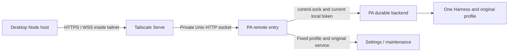

# Agent Note: Unify personal desktop chat and settings over Tailscale Serve

Status: implemented

[Settings publication](2026-10-25-personal-settings-versions.md) narrows ordinary saves, receipts, and per-object waiting. HTTPS/WSS, authentication, and original-profile binding remain governed here; old maintenance receipts recover under their original interpretation.

## Problem

The owner requested one Tailscale HTTPS/WebSocket connection instead of separate PA chat and settings SSH connections. Personal sessions belong to durable, whereas old chat spoke the shared control protocol and settings independently stopped/saved/restarted through SSH. Replacing a socket cannot supply durable semantics, and deleting SSH must not lose settings maintenance.

## Decision

On 2026-10-24 the owner confirmed one HTTPS address for PA chat/settings, deletion of both SSH paths, and single-owner use inside the owner's tailnet. HTTPS handles reads/writes; WSS only observes state/message events. Code keeps its control plane. PA consumes durable facts without fabricating old Runtime tasks/events.

### Deployment and trust

`apps/ruukoto` owns a separately supervised systemd remote process under the backend account. Deployment fixes its single profile, program, and `ruukoto-backend.service`. It neither creates a Harness nor reads active SQLite/reconstructs sessions, and never accepts remote shell, unit, or executable paths. Independence from the backend preserves maintenance-result lookup and original-service recovery while the backend is offline.

Serve owns tailnet HTTPS, certificates, and reverse proxying; Funnel is prohibited. The app listens on neither public nor loopback TCP and implements no certificate renewal. Remote configuration, sockets, and journals live in the account's `~/.config/ruukoto-remote/`: directory 0700, sockets/files 0600, not arbitrary additions to the strictly validated personal profile. Startup checks canonical path, account, permissions, and socket byte length, rejecting symlinks or external state-directory overrides. Existing `.config` protection in `personalProtectedRoots` must apply to restricted file/search/command access and native grants. Full access retains its same-account exception. An administrator configures Serve's Unix target; the PA account gets no Tailscale operator privilege.

Use a probed stable Serve version with required security fixes. Unix-socket support was checked in [v1.104.2 source](https://github.com/tailscale/tailscale/blob/v1.104.2/ipn/ipnlocal/serve.go); [TS-2026-005](https://tailscale.com/security-bulletins#ts-2026-005) addresses non-root operators selecting privileged sockets. Source/version facts do not prove production deployment or the real WSS path.

### Owner and application authentication

Network policy, fixed Serve owner identity, and an independent application credential must all succeed for every business request and WS Upgrade. There is no Tailscale-only fallback. Each desktop installation generates its own credential; Electron and MyGo do not share a secret. This isolates network programs on an otherwise permitted device, including Coding-host requests that can set arbitrary HTTP headers. It does not defend against host injection, memory reading, an owner authorizing another Keychain reader, or complete account compromise.

Tailnet grants/ACLs restrict sources to the owner's user devices; Serve publishes only TCP 443. The owner narrowed the old broad grant's src while retaining dst/ip needed elsewhere. Audit every broad allow: a narrow grant does not override an existing permissive one. Each request/Upgrade verifies the configured `Tailscale-User-Login`, never display name/avatar. Missing/mismatched identities and tagged clients without user identity fail; another user on a shared node gains no implicit owner authority. The server may be tagged; desktop sources use the owner's user identity.

Identity headers are trusted only on root-managed Serve's private-socket path. Server root and the PA account are trusted; same-account full-access tasks can already read the local token. Isolating arbitrary server code running as PA requires different OS identities, not another token readable by that same account. [Serve documentation](https://tailscale.com/docs/features/tailscale-serve#identity-headers) explains replacement of forged client headers, absent user headers for tagged sources, and valid headers for shared users.

The Node host sends `Authorization: Bearer` in HTTPS and WS handshakes. Remote checks the credential index ID, a constant-time comparison of the SHA-256 digest of its random 256-bit secret, active state, and fixed profile/owner binding. Never put secrets in URLs, cookies, WS subprotocols, logs, or backend forwarding. Before authentication, business routes disclose no profile/history/settings; failures expose only safe classifications. Remove the old unauthenticated client-marker header. Reject `Origin` requests and CORS preflight rather than granting browsers access through network identity.

Accept only a complete HTTPS origin, with no embedded credentials, path, query, or fragment; derive WSS from it. Follow no redirects and never disable TLS verification. Outer connection JSON is nonsecret. Secure payloads bind normalized origin, credential ID, and paired remote/profile identity, so editing outer JSON cannot redirect an old secret. Address/profile changes require pairing anew, not credential copying. A backend run-generation change does not. `control.token` stays on the server; remote rereads it for each backend connection and never returns/logs it.

### Pairing and recovery

The server wizard opens pairing, lists paired desktops, and revokes a selected desktop through a second 0600 `admin.sock` in the protected directory, local-account/root only and never published by Serve. Public routes cannot open pairing/manage other credentials or impersonate local calls through headers. The same remote process serializes CLI and HTTPS authentication-state writes; CLI is not a second writer.

Explicit initialization generates and persists a remote ID with origin, owner, profile identity, and format version. Neither remote nor backend restart changes it. Missing/corrupt/unsupported state closes business admission; do not silently create empty state or discard credentials. Local administration offers diagnosis and explicit initialization/recovery, not a bypass. Replacing lost state is an explicit reinstall with a new remote identity and no inherited credentials/bindings.

Pairing is closed by default. The wizard opens one five-minute window with a random 12-character base32 code and at most five wrong attempts across all sources. Expiry, cancellation, exhausted attempts, or restart closes it. The window binds original origin/remote/profile/owner. Show the code only in the local wizard, not logs or URLs. Window digest, error count, and credentials commit atomically in one private authentication file; write failure stops authentication admission and cannot report success. The short code grants one capability: an admitted program knowing it can race redemption, so code leakage is not covered by this design.

On Pair, Node generates the ID/secret, securely stores the candidate and verifies readback before `POST /pair`. This is the only route permitting an unregistered candidate; it still checks Serve owner, target origin, and absence of Origin, and cannot execute business operations. Send the entered code, candidate Authorization, and fixed pairing parameters. The renderer/user never receives the long-lived secret. Candidates do not overwrite active credentials; secure-store failure sends nothing.

Remote serially validates/consumes the window and registers the active credential plus request digest, responding only after atomic replacement and synchronization. Responses contain no secret. Reusing a credential ID first verifies the original secret, owner, and request digest: an identical replay returns the original registration without consuming another window; a mismatch fails. Revoked IDs retain digest tombstones and cannot reactivate. This protected authentication state is not conversation/model context and adds no user system, refresh token, or login session.

After a lost pairing response, retain the candidate and query the authenticated handshake. Verify product/remote/profile, then persist secure binding plus connection configuration before enabling business actions. Not finding registration does not prove the original request never arrived. Any resend is explicit with the original ID, secret, and parameters, never an automatically generated second credential. If the window expired and the original is confirmed unregistered, reopen pairing through the owner. Local configuration-write failure retains candidate/association for reopening and verification. If a registered secret is actually lost locally, revoke that entry server-side and pair anew; the server cannot return plaintext it never stored.

### Secret storage in both shells

`DesktopHost` injects a narrow internal read/save/delete interface. Shared Node owns business connections; renderer only requests pairing/connect/disconnect and receives nonsecret status. No arbitrary Keychain service/account selection, secret-returning renderer call, or generic credential bridge is allowed. Clear the one-time code after form submission. Long-lived secrets never traverse DesktopBridge, preload, notifications, or UI events.

Electron 44.7.2 uses existing asynchronous `safeStorage` after app ready. Keychain holds its encryption key; encrypted credentials/bindings live in private 0600 application files, atomically saved and read back/decrypted. This is not a direct Keychain credential item or custom cryptography. That SDK exposes generic Error on decryption failure, not a structured temporary-failure/corruption discriminator. Preserve ciphertext and stop authentication in either case; do not parse messages or treat failure as absence. Handle `shouldReEncrypt` and independently detectable payload corruption separately, preserving original ciphertext until re-encryption succeeds. See [fixed-version API](https://github.com/electron/electron/blob/v44.7.2/docs/api/safe-storage.md) and [implementation](https://github.com/electron/electron/blob/v44.7.2/shell/browser/api/electron_api_safe_storage.cc).

MyGo embeds a thin Security.framework adapter in its Go process, using login-Keychain generic-password items and app access control. No generic credential dependency, `security` CLI, executable secret helper, or trust grant to generic Node. Service naming is app-fixed; host bindings derive lookup keys. No cross-app sharing/iCloud sync; ad-hoc builds do not assume data-protection-Keychain entitlements ([Apple guidance](https://developer.apple.com/documentation/technotes/tn3137-on-mac-keychains)).

Existing private Go/Node pipes carry bounded, dedicated credential request/reply frames with direction and sidecar generation. `transport.go` intercepts them before Desktop.event, updates.Emit, or exported MyGo bindings. Closing, timeout, and late replies cannot deliver to a new sidecar. Async system prompts must not block pipe reading or deadlock Go waiting for Node waiting for Keychain. Generic logs/errors must not echo secrets. The native bridge belongs in the Go app, not the Agent execution supervisor build.

Locked/denied/temporarily unavailable/corrupt storage preserves records and stops authentication; absence is separate. No plaintext fallback, automatic replacement/pairing, or repeated background system prompts. Retry follows owner unlock/reconnect. Both shells are ad-hoc signed; updates may prompt again. Signature verification does not prove update access UX ([Electron requirements](https://www.electronjs.org/docs/latest/tutorial/code-signing#macos-apis-that-require-code-signing)).

A trusted shell must not become another program's secret reader. Electron production `electronFuses` disables RunAsNode, NODE_OPTIONS, and Node debugging, and enables ASAR integrity and ASAR-only loading. Before reading credentials, reject remote-debug arguments and external renderer URLs such as `ELECTRON_RENDERER_URL`. Development/tests use separate namespaces and test credentials, never production pairings ([fixed-version fuse semantics](https://github.com/electron/electron/blob/v44.7.2/docs/tutorial/fuses.md)).

MyGo verifies its signature/resources before launching the sidecar. Signed `launch.json` fixes Node's canonical path/build digest; changing Node requires rebuilding, not editing an executable path. Launch only verified sidecar/signed dependencies, with fixed arguments and stripped preload/debug/module-search/dynamic-loader/TLS-downgrade/external-test injection environments. Disable SIGUSR1 debugging ([available in baseline Node 22.19](https://nodejs.org/download/release/v22.19.0/docs/api/cli.html#--disable-sigusr1)). `host.getEnvironment`/`environment.adoptEnvironment` must not reintroduce injection/TLS variables. Code backend/terminal environments pass explicitly through their own parameters; do not break those launches to sanitize the credential host. Failed startup checks read no Keychain. Production userData cannot be redirected through environment variables. Bundled ESM sidecar require supports Node builtins only; optional native extensions of bundled dependencies such as ws cannot load outside code. Real bundle/pipe checks must verify both startup and outside-module refusal.

Real dual-shell acceptance must show that generic Node/security/another app cannot read credentials without owner authorization, and RunAsNode/debug/resource replacement cannot exploit an authorized shell. Unit tests and codesign alone cannot prove this.

### Revocation and in-flight work

The server wizard selects the original entry. Remote persists revoked state first, then blocks new admission, stops associated subscriptions, closes that credential's HTTP/WS connections, and only then reports success. Recheck active state after body reception/queue waiting, immediately before business admission; a header-time check alone is insufficient. A failed/unverifiable authentication-state write closes business admission/connections; recover by reading original state, not claiming revocation. Keep ID/digest tombstones permanently against pairing replay.

Revocation prevents later admission/pushes, not already admitted model tasks, approvals, maintenance, or bytes already sent. Verify those by their original request. Closing a desktop or deleting its local ciphertext/Keychain item stops local use, not server authorization; UI must distinguish them. No first-version remote page manages other credentials; the server wizard works for lost/all-unavailable desktops. Rotation pairs/verifies a new credential before revoking the old, with no automatic refresh.

Changed owner/origin/profile first closes admission/old connections, persistently revokes every old credential, and invalidates pairing. Only local confirmation permits pairing for the new binding. Failed persistence keeps entry closed. Returning A to B to A never revives A's revoked credentials. WS lifetime is at most five minutes before full reauthentication. Real immediate WSS termination after tailnet policy/device revocation remains unverified; SSH revocation behavior is not evidence. Application revocation is remote-owned and does not wait for that lifetime.

### HTTPS/WSS protocol

Handshake returns version, product `ruukoto`, persistent remote identity, existing profile identity (not a claimed database UUID), backend generation, online/maintenance state, and actual capabilities. Pairing only registers a securely saved candidate in a local-opened window. `/inputs` and `/input` preserve keys/body fingerprints/durable admission; HTTP success means admission or actual query state, not task completion. Main-chat history has bounded timeline pagination and body reads; diagnostic `/messages` truncation and search-only `/history` are not a full timeline. Settings preserve revisions, blockers, and actual backend-environment checks; saving is not successful model/MCP testing. Maintenance offers fixed-profile checks, explicit single-operation stop/save/start, original-result lookup, and explicit recovery, not arbitrary commands.

Allow-list only desktop-used routes/methods/settings ops; do not expose every local route, local export path, or general `/stop`. Backend validates business input, provenance, revision, and authority in addition to remote authentication. Writes bind the handshaken profile. A new backend generation discards stale UI responses; a changed profile stops applying old drafts/options/requests.

WSS uses installed `pi-durable@1.3.0` experimental `watchEvents`: atomic snapshot/subscription capture, then ordered commits; backlog can replace events with a fresh snapshot. The personal app owns the adapter. Project only desktop messages/tools/queue/run state, not every native entry in the first network frame. Browser-safe types live solely in `packages/view/src/personal-protocol.ts`; personal consumes them as a development type dependency, desktop through its existing view dependency, never through the product package. Generation and within-subscription sequence detect gaps/overflow and trigger resync; the sequence is not persisted or a restart cursor. Completed bodies are read by entry reference/pagination; bounded live tool output identifies where full content can be read.

Pending approvals/questions not represented by AgentEvent are queried on first connect, reconnect, relevant events, and page visibility. While online with running/pending work, bounded polling allows only one same-kind in-flight query; stop timers on disconnect/exit. This covers tools awaiting approval without further model events. Notifications consume actual queried state. Eligibility remains action-specific: local may inspect/cancel an IM question while only its original platform may answer it; no-answer/no-approve does not mean hide every available operation.

HTTP budgets remain 128 KiB request, 256 KiB response, and 16 KiB input. Page larger data. WS limits are 256 KiB/frame and 1 MiB pending/connection; overflow closes observation and requires a new snapshot, never deletes history or blocks model execution. Paged snapshots share one subscription cut. Heartbeat every 30 seconds, close after 10 seconds unanswered. Ordinary reconnect backs off with jitter from 0.5 to 8 seconds; configuration change, explicit close, or definitive auth/protocol refusal ends retries. Reuse installed ws with each consumer declaring its dependency.

Disconnect first stops its native subscription and frees buffers, ending observation only. Backend stop refuses new Upgrade, stops subscriptions/closes upgraded sockets, then awaits HTTP handlers, closes Harness, and releases the profile lock; HTTP server.close alone is insufficient. Remote exit releases both proxy stream ends without canceling backend work. Accepted maintenance is verified from durable phase after process stop, never silently marked complete.

### Maintenance and lost responses

The original stop/save/start path uses `personal-maintenance.ts`/`dispatchPersonalSettings` to verify unit/process/account/profile lock/revision/blockers. Unknown CLI environments and managed dev instances remain read-only when the original systemd environment cannot be proven. Verify, persist intent, gracefully stop the original service, prove exit/acquire lock, compare revision again, save, start the original service, and read back. Report stop/save/start separately. Ordinary online settings publication now follows the superseding settings note rather than requiring this sequence for every save.

Remote owns the entire accepted maintenance operation so desktop exit cannot lose it or multiple windows interleave it. A private operation-key ledger stores original profile/target/revision/request digest/phase/result, not full drafts/secrets/service environment. At most one unresolved record; retain completed keys/final receipts. Persist each phase before effects. Same key/parameters queries the old result, differing parameters fail, and unresolved work blocks another write. A late A after B returns A's receipt, never reexecutes. After crash, verify the original phase; do not automatically save again or force-kill. Client disconnect does not cancel accepted maintenance; service restoration/manual verification completion still require explicit action. The server is authoritative; local state retains only request association and unresolved input, not duplicate maintenance phases.

Before input send, persist key/body/profile. After lost response, query that key; only proven nonadmission with identical body permits explicit same-key restoration. Never automatically resend or replace the key. LocalInputDoc and admission are not atomic, so preserve intermediate-crash verification. Approval, cancellation, question answer, and settings save follow their own receipts/state rather than generic HTTPS retry.

| Failure | Required behavior |
| --- | --- |
| Tailnet/DNS/transient disconnect | Show disconnected; automatically restore observation/read-only queries only; tasks continue |
| Identity/TLS/product/protocol mismatch | Stop and offer the relevant repair, with no SSH fallback or skipped verification |
| Locked/denied/unavailable/corrupt secure storage | Preserve credentials, stop authentication, wait for owner unlock/reconnect |
| Lost pairing response/local binding save failure | Retain candidate, verify original registration, allow no business before verification |
| Revoked credential | Close and stop retrying; server wizard pairs anew; verify admitted work by original request |
| Timeout/proxy 502 or 503/corrupt response after send | Write outcome remains unresolved; proxy failure does not prove nonexecution |
| Saved but failed to restart | Report saved, retain original operation, explicitly restore service without saving again |
| Unverified stop/occupied lock/unknown external effect | Retain occupancy and records; no force-kill or further configuration write |
| Changed profile/late old-generation response | Discard stale display result, preserve unresolved original, send nothing to new profile |

### Desktop scope and removal

Electron/MyGo share one Node PA connection manager behind the existing bridge. Discriminated PA DesktopUpdate data is separate from CodeState; reuse presentation components without wrapping durable numeric identities as legacy DB objects. Coalesce full-settings reads by in-flight promise for the same profile, releasing on success/failure; an animated old panel remount must not falsely make the new page busy. Other queries and maintenance writes remain mutually exclusive. Settings shows one address/status; edit offline and save binding only after successful identity verification. Users need no remote directory, Node, program, service, or token fields.

The confirmed first version covers text main chat, full paged history, live text/tools, admission/result verification, questions/approvals, work management, and existing model/Skills/MCP settings. Attachment upload, Continue, Context, and session model menus were deferred. Local eligibility cannot approve IM-bound requests merely because main chat is shared. Work cancellation follows durable work, not backend `/stop`; no new main-Submission stop API was included. Hide unsupported PA-only controls while preserving Code. PA never supported Plan, so this is not its removal. Permission selection uses existing `/permissions` entry defaults, not fabricated Code session modes.

Delete old PersonalController shared-protocol wiring, PA SSH processes/forwarding/token reads, and settings SSH/program detection. Keep Code/TUI control, pending/recovery, and projections. Do not infer ts.net from SSH host. Keep `personal.json`, `personal-settings.json`, and unresolved files in place without overwriting/moving/deleting/importing; no old pending chat becomes durable input. Each DesktopHost inspects its own old maintenance journal. Before cutover close all old clients and check unresolved inventories; the server cannot prove all desktop-local journals are empty. Unresolved old settings must be verified under original identity or manually on the server before that desktop changes its maintenance association. No hidden SSH fallback remains.

This partially supersedes PA transport in [desktop architecture](../../proposed/architecture/2026-10-15-desktop-client.md), [local management](2026-10-17-personal-local-management.md), [SSH settings](../feature/2026-10-21-personal-settings-ssh.md), [personal pages](../feature/2026-10-21-desktop-personal-pages.md), and [settings planning](../../proposed/feature/2026-10-21-desktop-settings-management.md). Preserve their independent Code/host isolation, original-request recovery, local Unix HTTP/Harness/lock/token, and real-field/provenance rules. [MyGo](2026-10-17-desktop-mygo-experiment.md) retains shared Host/private pipes, adding host-only credential frames. Other entry/lifecycle/IM/tool decisions remain their owners; no note was fully absorbed or archived.

## Alternatives considered

- Keep SSH, possibly over tailnet: smallest reuse of authentication/maintenance, but fails the owner's HTTPS/WSS and deletion requirement.
- Put HTTPS in the backend: one fewer process, but stopping it removes save/restart access and couples certificates to backend lifecycle. Suitable only if remote settings become read-only, a different scope.
- Trust Serve headers alone: avoids pairing/secrets, but every admitted device program could manage PA, violating application isolation.
- Serve to loopback plus app credentials: conventional proxying, but local other accounts can bypass Serve and forge network identity. A private socket preserves filesystem and owner checks too.
- Generate/return secrets server-side: centralized issuance, but lost responses/local-save failures strand secrets. Desktop-secure-save-before-registration needs no pending activation or secret retransmission.
- Share a command-line Keychain helper: less shell code, but Keychain authenticates the helper, not its caller. Built-in Electron storage and in-process Go avoid a new caller-authentication service.
- Add WS to old ControlConnection: retains renderer code, but PA lacks legacy Task/snapshot semantics and would regain an obsolete runtime compatibility layer.
- Persist event cursors/replay storage: precise incremental recovery, but current atomic snapshots/subscriptions suffice and a second ledger becomes another authority. First narrow/page projection if snapshot size becomes a real bottleneck.

## Consequences

One desktop address replaces two SSH paths; server-owned maintenance survives observation loss. Original candidates/keys preserve recovery identity. Authentication and maintenance add private persistence, exclusive ownership, and crash-recovery obligations. Old configurations/unresolved records stay in place, and production cutover must check every old client.

Dependencies now include tailnet identity/policy/DNS/certificates/Serve and one fixed-profile remote process. HTTPS hostnames appear in public certificate-transparency logs, so choose nonsensitive node names; that does not make the service public ([official HTTPS explanation](https://tailscale.com/docs/how-to/set-up-https-certificates)). A test machine with Tailscale DNS disabled resolved to 198.18.x.x and recovered when enabled; verify actual resolution. Experimental native events need bounded projection/pagination/buffers. Multiuser, browser/mobile, or resistance to host code/memory/account control requires renewed identity/source design.

Historical evidence formerly under `.scratch/personal-tailscale/issues/01-migration-plan.md` is offline provenance. It reports offline auth atomicity/tombstones/pair recovery/HTTP-WS admission/history/snapshot/slow-consumer/maintenance-key/private-frame regressions; real tailnet system TLS, forged-header replacement, private sockets, and WSS; 13 isolated Linux systemd stop/save/start/disconnect/crash/start-failure cases; and real Host/renderer streaming, final bodies, unified settings, and Code isolation. Both isolated signed shells paired via real secure storage, chatted, and reopened; the server observed each marked input once. Mock models do not establish real-model or IM acceptance.

Keychain locked/denied/corrupt cases and the full update-authorization matrix, nonowner/tagged sources, actual policy/device revocation, and full-machine restart still have unverified scope. Unit tests, codesign, and isolated storage probes cannot close those gaps. Implementation status is not complete acceptance or production-deployment approval.
