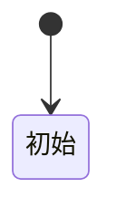
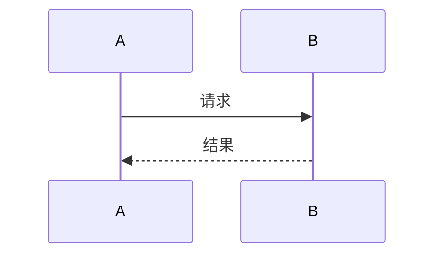

# <模块名>

<!--
  【维护提醒】
  1. 只写 HEAD 怎么运作：现在时，不写演进史与修订流水。
  2. 标题与正文都不出现 issue、ADR、工单编号；溯源靠「设计依据」链接到 .agents/notes/。
  3. 六节齐全；某节当前没有内容时保留标题并写明原因。
  4. 术语按 CONTEXT.md；机制名、工具名、状态名原样保留，供检索。
  5. 本模板复制到 docs/modules/<模块>.md 使用，下面的相对链接按该位置写。
-->

## 职责与边界

<一段说清负责什么、不负责什么；不负责的部分点名它归哪个模块>

## 对外接口

<谁调用它、它调用谁；协议名、工具名、命令名、事件名逐一列明>

| 调用方 | 入口 | 说明 |
|---|---|---|
| | | |

## 数据与状态

<表与字段、状态机、落盘位置与生命周期；状态机用 Mermaid>

## 主要流程

<正常路径的关键步骤与分支；跨模块时序用 Mermaid sequenceDiagram>

## 不变量与失败处理

<必须始终成立的约束；失败、超时、取消、重启时各自的行为>

## 设计依据

- [<笔记标题>](../../.agents/notes/<lifecycle>/<class>/<yyyy-mm-dd-topic>.md)：<一句话说明它解释了什么>
