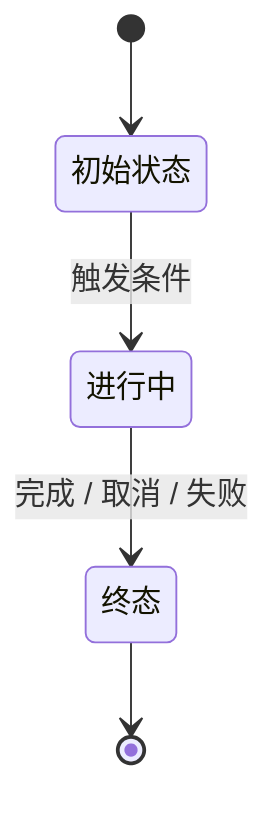
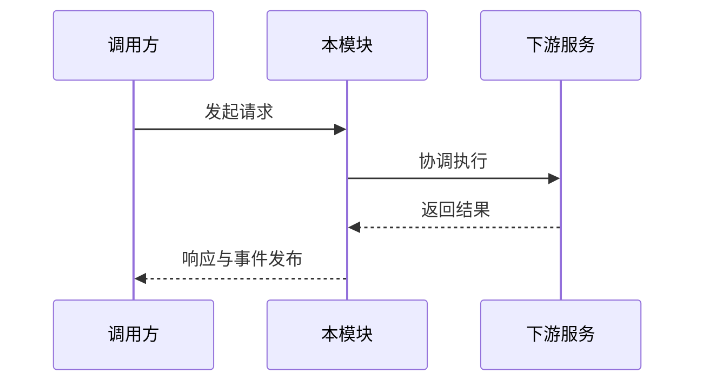

# <模块名>

<!--
  【维护准则】
  1. 准确性绝不是唯一要求，可读性和美观性同样重要。
  2. 善用表格、列表、Mermaid 图表，拒绝无排版的纯文字大段。
  3. 讲清楚意图、机制与拓扑，不复述代码细节与异常枚举。
  4. 只写当前行为（现在时），不保留演进史与讨论流水。
-->

## 职责与边界

<简明清晰地阐述本模块在系统中的核心定位、解决什么问题、核心职责有哪些。>

### 核心职责
- **核心能力 A**：<简要说明>
- **核心能力 B**：<简要说明>

### 边界与非职责
- **不负责 X**：转由 [<相关模块>](<相对路径>.md) 负责。

## 对外接口

<本模块向外暴露的核心入口、协议、命令或宿主工具。统一使用结构化表格列出：>

| 入口 / 接口名 | 调用方 / 消费者 | 核心功能与关键契约 |
|---|---|---|
| `<入口函数或类>` | `<调用者>` | `<核心说明与关键行为>` |

## 数据与状态

<核心数据实体模型、持久化位置与状态流转机制。>

### 核心状态机

### 数据实体与存储划分

| 数据实体 / 存储形式 | 落盘位置 / 载体 | 生命周期与关键作用 |
|---|---|---|
| `<实体名>` | `<SQLite / JSONL / 文件>` | `<保存内容与生命周期>` |

## 主要流程

<主干正常执行路径与关键业务场景。配合 Mermaid 时序图与结构化步骤说明：>

1. **第一阶段（请求接入）**：<步骤说明>
2. **第二阶段（处理与分发）**：<步骤说明>
3. **第三阶段（结果收尾与广播）**：<步骤说明>

## 不变量与失败处理

<系统运转中必须始终保证的底线约束，以及在超时、进程崩溃重启、用户取消时的确定性行为。>

- **核心不变量**：<约束描述>
- **幂等性与去重保证**：<说明>
- **异常收敛与重启恢复**：<说明>

## 设计依据

<关联到 .agents/notes/ 中记录核心决策与方案取舍的笔记。>

- [<决策笔记标题>](../../.agents/notes/<lifecycle>/<class>/<yyyy-mm-dd-topic>.md)：<一句话说明该决策解决的核心问题或设计动机>
