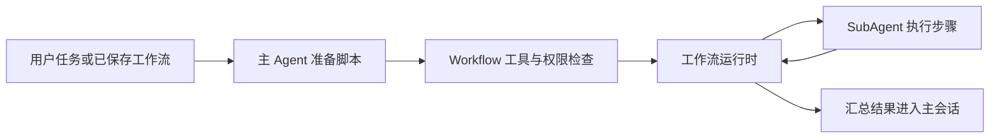

# Claude Code 工作流机制调研

查询日期：2026-10-12。任务入口：[Agent 工作流调研与方案入口](issues/01-workflow-design.md)。外部事实以当日官方资料为准；仓库核对基点为 `d1b1b543c3ad6063331bbe1bf6328396392f38e4`。本文记录研究结果与待讨论的适配启示，不构成 Ruukoto 已批准设计。

## 结论

Claude Code 已有正式命名的 Dynamic workflows：模型为当前任务生成 JavaScript 编排脚本，由运行时驱动多个 SubAgent，最终回传汇总结果。它已超出“把步骤写进 skill，由模型逐轮执行”的机制。官方团队于 2026-06-02 发布的介绍说明了这一转变；其核心价值是把循环、分支、并发和中间数据移出主模型上下文，让模型集中完成各步骤内的工作。[官方介绍](https://claude.com/blog/a-harness-for-every-task-dynamic-workflows-in-claude-code)

可重复的是编排程序，不是模型每次给出的答案。对于 Ruukoto，最值得研究的是“宿主执行编排、SubAgent 执行步骤、中间结果交给程序”，以及这三者之间的身份、权限、取消和恢复关系；支持何种脚本语言仍需后续选型。

## 实际执行机制

一次工作流的概念路径如下；这是依据官方说明整理的结构图，不代表其内部类或线程模型。[扩展机制总览](https://code.claude.com/docs/en/features-overview)

脚本使用 `agent(prompt, options)` 启动步骤，`parallel()` 等待并发工作，`pipeline()` 组织逐项处理；JSON、数组及普通 JavaScript 控制流负责整理数据。官方例子覆盖分类路由、并行收集后汇总、独立交叉验证、候选筛选、竞争评选和按停止条件循环。可以为步骤选择模型与工作副本隔离；这些编排模式不要求先声明静态 DAG。[官方模式与原语说明](https://claude.com/blog/a-harness-for-every-task-dynamic-workflows-in-claude-code#how-dynamic-workflows-work)

脚本可保存为项目或个人命令，接受入参并展示阶段进度。脚本自身不能直接读写文件、运行 shell 或加载模块；阶段间人工签核需拆成多次运行。[保存与限制](https://code.claude.com/docs/en/workflows#edit-a-saved-script)

`Workflow` 是有权限检查的内置工具，并在后台执行；界面通过 `/workflows` 查看进度、暂停和停止。它与 `TaskCreate` 等清单工具分开，后者记录状态和依赖，不等于脚本执行器。[工具定义](https://code.claude.com/docs/en/tools-reference)

## 恢复、失败与副作用

恢复按启动次序复用已完成结果前缀；首个失败或提示词变化及其后续步骤重跑，包括已经完成的步骤。可在原会话续接；缓存缺失时报错。[恢复规则](https://code.claude.com/docs/en/workflows#which-agents-run-again)

停滞重试不保留该次对话，保留已改文件。最终失败时，直接等待会报错，`parallel()`／`pipeline()` 则留下 `null` 并继续。[停滞处理](https://code.claude.com/docs/en/workflows#when-an-agent-stalls-and-restarts) 对 Ruukoto 的启示是汇总须区分未完成与已验证无问题，丢弃失败项不能作为全量成功的证据。

据此可确定：它具有会话级结果持久化与重放能力，但上述恢复不是“仅重算受影响 DAG 节点”，也不能推出外部操作恰好执行一次。当前已核实资料没有给出任意文件写入、网络请求与步骤结果原子提交或自动补偿的承诺；对有副作用步骤，重跑可能遇到上次已生效的状态。这是适配时必须另行解决的问题。

## 硬约束、软指导和版本

权限规则由 Claude Code 执行；提示词、`CLAUDE.md` 只能影响模型准备做什么，不能改变允许执行什么。工作流启动和子步骤工具操作需要分别考虑；允许启动一次编排不应被理解为其一切副作用获准。[权限规则](https://code.claude.com/docs/en/permissions#permission-system)

并发上限是运行约束，`workflowSizeGuideline` 是给模型的规模建议；两者需分别设计。[配置变更记录](https://github.com/anthropics/claude-code/blob/main/CHANGELOG.md)

功能仍在快速变化。官方 changelog 当前顶部为 `2.1.296`，下列数字是相关能力的版本节点，不能当成当前版本：[官方 changelog](https://github.com/anthropics/claude-code/blob/main/CHANGELOG.md)

| 版本节点 | 对研究的影响 |
| --- | --- |
| `2.1.248` | 新增 `/workflow-authoring`，提供脚本编写参考。 |
| `2.1.269` | 支持配置工作流并发上限，范围 1–256。 |
| `2.1.271` | 部分交互订阅场景在用量限额时等待恢复；不能推广到 headless、SDK 或所有限额。 |
| `2.1.295` | Hooks 新增 `onFailure: "block"`，可将启动失败、超时等异常转成阻断。 |
| `2.1.296` | 新增 `CLAUDE_CODE_WORKFLOW_SUBAGENT_MODEL`，单独指定工作流 Agent 模型。 |

Dynamic workflows 已面向付费计划、API 和主要云提供方提供，Pro 需启用。[可用性](https://code.claude.com/docs/en/workflows) Agent teams 仍明确标为实验功能、默认关闭，两者的发布状态应分别核实。[Agent teams 状态](https://code.claude.com/docs/en/agent-teams)

## 与其他机制的分工

| 机制 | 提供什么 | 与工作流的关系 |
| --- | --- | --- |
| Skills／custom commands | 按需加载的说明和可调用流程；旧 custom commands 已并入 skills。 | 模型解释步骤，可引用工作流脚本；说明本身不是执行状态机。[Skills](https://code.claude.com/docs/en/skills) |
| `CLAUDE.md`／rules | 常驻或按路径加载的指导。 | 约束模型意图，具体权限由宿主执行。[扩展比较](https://code.claude.com/docs/en/features-overview#compare-similar-features) |
| Subagents | 独立模型上下文和工具执行。 | 工作流的执行原语；普通委派由主模型逐轮协调。[Subagents](https://code.claude.com/docs/en/sub-agents#manage-subagent-context) |
| Agent teams／Tasks | 同伴消息、任务认领与依赖解除。 | 由 lead 与同伴协调；有任务依赖不等于持久编排。进程内同伴不随 `/resume` 恢复。[Teams](https://code.claude.com/docs/en/agent-teams#limitations) |
| Hooks | 生命周期事件上的脚本或判断。 | 可以阻断匹配动作；`PostToolUse` 已晚于副作用，无法撤销；触发可靠不等于检查结果必然正确。[Hooks](https://code.claude.com/docs/en/hooks-guide#limitations) |
| Plan mode | 调研规划与工具权限模式。 | 不负责调度步骤或保存编排结果。[权限模式](https://code.claude.com/docs/en/permissions#permission-modes) |
| Headless／Agent SDK | 程序化运行 Agent、结构化输出与会话续接。 | 可承载外部编排；也能在宿主权限控制下使用 Workflow，不能据此推定有独立于模型回合的启动 API。[Headless](https://code.claude.com/docs/en/headless)、[Workflow 审批](https://code.claude.com/docs/en/workflows#approve-the-plan-before-it-runs) |

## Ruukoto 可复用点与待讨论差异

以下是当前代码事实与研究启示，不是实现任务清单。

| 当前事实 | 适配时需要讨论 |
| --- | --- |
| [skills.ts](../../packages/agent/src/skills.ts) 加载文本，识别 `name`、`description`、`disable-model-invocation`；[todo.ts](../../packages/agent/src/todo.ts) 维护三状态工作清单。 | 不能把技能或清单直接视为已有可执行工作流。 |
| [SubAgentManager](../../packages/runtime/src/subagents.ts) 已有工作、身份与任务分离，以及幂等委派、复用、取消、消息和工作副本；每父会话最多三个活动子执行任务，SubAgent 不能继续委派。 | 先核实复用这些能力的方式与容量需求；工作流不应绕过身份和已有授权。 |
| [ParentDelivery](../../packages/runtime/src/parent-delivery.ts) 将子结果送给父模型：main／scheduled 唤醒，dev 下一轮注入。 | Claude 式编排需让程序消费中间结果，明确最终汇总何时才送达主 Agent。 |
| [运行时](../../docs/modules/runtime.md) 对效果未知不自动重发；[scheduler](../../docs/modules/scheduler.md) 提供时间触发的独立任务。 | 编排恢复必须与效果未知约定一致；定时触发和步骤执行分别建模，不能照搬停滞自动重试。 |

最小后续验证应覆盖四类场景：串行与并发步骤的数据传递；中间步骤失败后究竟重跑哪些已完成步骤；写入生效但结果未记录时中断；取消后子进程未退、旧结果晚到及再次启动。验证记录要能区分逻辑步骤、执行尝试、操作效果和最终送达。

## 证据缺口

本轮只读官方资料并核对仓库，没有运行真实 Claude Code 工作流。Agent SDK TypeScript 整页超出浏览工具大小限制，Markdown 入口亦未成功读取，因此没有核实 `Workflow` 完整输入输出类型、宿主直接启动能力和具体事件协议；官方公开仓库已读取到的是说明与 changelog，不能据此臆测运行时源码。

缓存匹配是否包含模型、工具配置、脚本版本或文件内容，落盘提交顺序，以及所有失败类型的重试与取消契约，仍需指定版本实测或取得更完整的官方契约。本文没有宣称这些能力不存在，也没有将第三方项目或用户 issue 的猜测当作官方实现。
