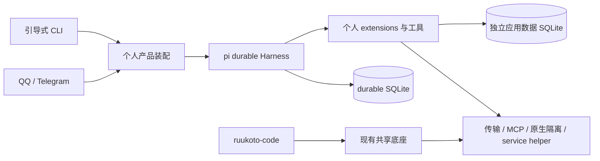

# 个人 Agent 迁移至 pi durable

Status: ready-for-agent

本文记录 2026-10-17 拥有者 Q1–Q18 访谈的已确认要求；完整方案已在 Q19 确认。理由与备选见[决策提案](../../.agents/notes/proposed/architecture/2026-10-17-personal-pi-durable.md)，实施顺序与证据见[工单](issues/01-migration-plan.md)。本次交付是方案，不是迁移实现或上线授权。

## 目标与非目标

个人 Agent 采用 pi durable，减少其自研执行底座的维护。durable 是会话、执行、队列和恢复的唯一运行权威；个人端不再围绕旧 Runtime 维护兼容层。选型已确定，后续验证用于证明实现达标。

Coding Agent 的用户行为、存储格式、运行依赖与既有功能保持；允许调整内部模块以拆分个人端。两个产品继续同仓，但不再要求共用一套运行时。旧底座仍服务 Coding，不能将个人迁移解释为全仓旧底座可以删除。

不迁移旧业务数据与在途执行，不兼容个人端旧 TUI/桌面/控制面协议，不保留个人开发会话、worktree 汇总、编码验证、旧工作流脚本及定义库、GitHub 自动评审。不新建插件市场、跨产品调用或记忆同步机制。

## 拥有者确认

| 访谈 | 已确认决定 |
| --- | --- |
| Q1 | 首要目标是减少自研底座维护。 |
| Q2 | Coding 行为和数据保持，允许内部拆分；沿题目边界保持其运行依赖。 |
| Q3 | durable 接管个人端运行机制，个人端允许重新设计。 |
| Q4 | 已决定采用 durable，围绕它完成迁移方案。 |
| Q5、Q9 | 只保留个人助理能力，移除 GitHub 自动评审与编码专用流程。 |
| Q6 | IM 加引导式 CLI，不兼容旧客户端。 |
| Q7 | 新实例从零开始，旧资料仅归档。 |
| Q8、Q12 | 保留安全约束并简化交互，仍提供自动审查、请求确认和完全访问三种模式。 |
| Q10、Q17 | 保留长期可复用子 Agent；一层委派，一个子 Agent 同时服务一项工作；取消工作不关闭身份，停止核实后才可复用。 |
| Q11 | 不保留旧工作流语言和定义库。 |
| Q13、Q14 | 默认自动审查；保留可查看、可撤销的长期操作授权。 |
| Q15 | 安全工作自动恢复；未知写入暂停所属工作核实，主聊天和其他工作继续；完全访问也遵守。 |
| Q16 | 短暂停机切换，旧积压不自动执行，未完成委托重新提交。 |
| Q18 | 确认下列个人能力、恢复与 Coding 不回归场景为切换前验收依据，并检查个人端脱离旧运行状态机和协议。 |
| Q19 | 独立方案审查完成后，确认完整方案并结束访谈；实施与部署另行推进。 |

## 产品范围

| 能力 | 新个人端要求 |
| --- | --- |
| 主会话 | QQ 私聊与 Telegram 私聊绑定同一拥有者，共用一个持续主会话；身份不由消息正文决定。 |
| 后台工作 | 主 Agent 可以委派并继续聊天，工作支持进度、追加说明、取消与最终汇报；汇报固定发起入口，不随当前聊天入口改变。 |
| 长期 SubAgent | 身份与上下文跨工作保留；空闲不占模型/进程；支持继续委派及显式关闭，关闭后历史与产物仍保留。 |
| 定时任务 | 独立上下文执行，支持现有一次性、每日、每周与时区需求，等待整项工作收尾后汇报；每计划一个未完成运行，漏期合并，避免恢复后集中重放。 |
| 长期记忆 | 可写入、查找、修订和撤销，保留版本与 durable 来源引用；与会话历史、临时进度分开。 |
| 应用数据 | 保留结构化数据、schema/revision、查询与审计回执能力；破坏性或批量操作沿既有授权规则处理。 |
| 技能与 MCP | 技能由拥有者配置，参考内容不增加权限；MCP 保留显式端点、工具范围与凭据核实。 |
| 服务管理 | 沿用受控 helper 的服务白名单、修订核实和操作身份，不开放模型任意 root 权限。 |
| 通用工具 | 个人事务所需的文件、命令、网络、检索、浏览器、图片与产物能力逐项接入，保留来源、权限及完整结果读取；不连带引入编码工作区流程。 |
| 配置与运维 | 引导式 CLI 配置 provider/model、拥有者入口、凭据、技能/MCP、权限与服务；支持状态、授权管理和诊断。IM 提供工作控制及审批。内部键、版本和 ID 由程序管理。 |

客户端断开不取消工作。CLI 管理运行中实例时通过最小本机认证接口访问由后台持有的状态，不另开 Harness 争写同一存储；离线配置仅在确认实例停止时进行。不复制旧控制协议与客户端事件投影。

## 运行与存储设计

实现先集中在已有 `apps/ruukoto`。Pi 依赖固定为已发布 `1.3.0`；Coding 的 `0.85.1` 留在原调用方，不跨产品交换 SDK 对象。只有两个产品实际共用且不持有任务状态的实现才提取或复用，不为新产品复制原包层级。

| 事实 | 持有者与约束 |
| --- | --- |
| 会话历史、模型/工具轮次、队列、执行状态、压缩 | durable 原生记录；不双写旧 Task 表或旧 JSONL。 |
| 主会话、拥有者绑定、权限与审批、工作来源、子 Agent 索引、调度计划、发送意图与核实状态 | durable documents 与自定义任务；关系和执行意图尽量同 commit 写入，不镜像另一份运行状态。 |
| 长期记忆 | durable documents/entries，带稳定身份、版本和来源；不引入旧项目表、MemoryStore 或核心 Db。检索实现按实际数据规模保持简单。 |
| 应用数据 | 复用现有独立 AppDataStore 和查询实现，改装工具入口；逻辑操作键在执行前持久化，重放用原键。业务变更与回执在应用库自身事务提交，durable 按回执核实结果。 |
| 凭据、产物与 OS 执行身份 | 继续按受保护文件和真实运行单元管理，durable 保存引用及必要核实事实；跨文件与数据库不宣称原子。 |

AppDataStore 回执字段允许记录 durable 任务/会话身份，但 `op_id` 必须区分同一任务里的多次调用。应用库缺失或实例身份不符时停止相关工作，不能自动建空库后据此宣称旧操作没有执行。其他外部写入同样先看可核实回执，查不到才进入效果未知处理。

单个 personal 存储只允许一个后台拥有者，启动前取得实例锁，失败不启动 IM 或恢复任务。长期运行使用 SQLite；本次默认验收进程崩溃恢复，不声称断电时最近提交必然保留。备份和升级只在一致状态进行，记录框架、产品和业务扩展版本；遇未支持的旧记录/扩展版本拒绝执行，不用当前定义补猜旧任务。

上下文、工具定义、记忆和动态提示须能从存储重建。采用 durable 的持久 system entries、sections、documents 与 compaction；若 hook 改写实际请求，必须在发出前保存对应输入。产物缺失、输入证据落盘失败或来源无法核实时不继续依赖该资料的调用。v1.3.0 的 `beforeRequest` 普通异常会被报告后继续，不能以“写快照失败后 throw”作为拦截；需要真正阻止 provider 发出的记录边界，并用请求计数为零的反例验收。

## 长期子 Agent 与工作归属

长期索引关联子 Agent 身份与 durable Conversation；每次委派建立 durable Task，并保存来源、目标会话、稳定 requestId 和 Submission 引用。创建身份、建立执行及占用更新使用同一 durable commit；任务进度从原生 Task/Submission 读取。

采用独立持有的持久子会话，避免把会话寿命绑定到一次工作。会话配置显式设定，不能依赖不存在的父级隐式继承。一次只允许一个工作占用该子 Agent，等待取消/停止核实期间继续占用；追加说明只归属于当前工作，不能把另一项工作塞进同一会话队列。

每次委派的工具与访问范围重新按当前工作来源收窄；长期上下文不携带上次工作授权，单次批准不继承。子 Agent 不创建下一层，不直接联系拥有者；同工作协作沿主 Agent 可核实的归属通信。

工作取消先落盘阻止新执行，再由委派任务的取消处理停止目标会话当前执行，并核实外部进程。`Submission.abort()` 只撤回尚未进入上下文的输入，不能单独承担已开始工作的取消。`Conversation.abort()` 的范围覆盖当前执行与排队输入，因此单工作占用是必要约束。旧结果与迟到事件保存为事实，但不启动下一步、不复活已取消工作。

## 权限、恢复与外发

三种模式沿用既有安全含义：请求确认在受限环境内执行、越界等待拥有者；自动审查使用同一受限环境，既有允许范围内的外部读取可经独立无工具审查，无法确定或审查失败转拥有者；完全访问使用后台账户已有权限并免逐次操作审批，仍核实宿主身份、任务归属与操作结果。它不额外赋予 OS 权限，也不能绕过效果未知暂停。

默认自动审查。默认模式变更作用于新工作；已运行工作的实际权限由其已记录授权决定，不因主会话配置或长期上下文自动扩大。子工作、定时运行固定来源授权，并在执行前复核撤销与目标变化。长期授权仅由绑定拥有者明确创建，范围不可隐式扩大，查询、撤销及再次使用均可追溯。

审批等待、操作快照和消费状态持久化。重启后的未消费审批可继续等待，但执行前仍核对原拥有者入口、配置代次、参数、权限与活动工作；不符即失效。批准消费之后丢失结果属于待核实效果，不能靠重新批准重发。

| 中断位置 | 恢复要求 |
| --- | --- |
| 输入已提交但平台确认丢失 | 用原平台消息键定位原 submission；不重复受理。 |
| 模型流中断 | durable 保留记录并按其规则重试，允许产生额外模型费用；不可把 partial 当最终答复。 |
| 可安全重复的工具 | 宿主确认恢复时权限、配置与资源仍有效后，才允许框架重跑。 |
| 写操作已开始，结果无法核实 | 暂停所属工作并登记受影响操作；禁止其自动再次调用、换请求键或派给子 Agent 重试。主会话可报告和接受其他独立工作。 |
| 工具/进程停止未核实 | 保留执行身份与资源占用，不允许旧 SubAgent 或资源被下一项工作复用。 |
| 已知执行成功而结果提交缺失 | 优先按稳定操作键查询外部/业务回执，补记已核实结果；没有可靠证据则保持未知。 |
| 审批等待或纯人工等待 | 恢复等待及有效性检查，不消耗旧批准启动新操作。 |

未知效果由宿主硬性拦截，不能只给模型一段“不要重试”的提示。暂停记录允许拥有者查看证据、确认已生效/未生效或结束工作；只有核实结果足以决定安全下一步后才解除。通知本身失败或效果未知时保留状态，CLI 与后续主聊天能查到，不通过循环重发通知制造副作用。

入站先持久化再推进平台水位；QQ/Telegram 同一消息不会建立两份工作。回复与审批目标固定平台、账号、拥有者及配置代次，入口变更使旧发送失效，不改发另一入口。发送成功只在确认后记录；超时、断线等结果未知不自动发送第二次，明确未发送的限流可按平台要求延迟。最终报告按工作固定键登记一次，不以“最新回复”推断对应工作。

## 切换与归档

1. 在隔离档案与测试入口完成所有保留能力及故障验收，确认 Coding 回归。切换前重新配置新实例需要的模型、拥有者绑定、凭据与服务，不从旧档案自动复制。
2. 安排短暂停机，停止旧 scheduler/outbox 与 IM 连接，停用旧服务的自动重启；核实旧后台和独立执行单元全部停止。停止无法核实时不接入新实例。
3. 原地保留旧档案及对应代码/依赖版本，形成受保护的一致备份和清单；不改写、移动或删除已提交会话。归档不接入新系统，不新增历史查看产品；不能启动会自动写恢复记录的旧后台来浏览原件。
4. 登记新的渠道接管边界。Telegram 根据真实平台水位确定后续输入，QQ 结合可核实消息身份与时间边界过滤旧重投；单靠本地时间不能保证时停止接管并查清。边界之前的积压不执行，暂停窗口里的未受理委托由拥有者重新提交。
5. 启动新 personal，只接管已配置的拥有者入口；观察主聊天、后台工作、审批与定时回报。新档案不得覆盖归档。
6. 需要回退时先停用并核实新实例；回退只回退代码，旧版本也使用另一个全新空白档案并重新配置，不加载旧档案或 durable 档案中的任务、已登记入站、通知和计划。两份原档案继续归档，不向旧格式转换新数据。重新设定平台接管边界后再接入；仅改变平台水位不足以阻止旧库里的积压自动执行，因此不通过启动旧备份恢复业务运行。

## 验收矩阵

| 编号 | 必须证明的结果 | 证据方法 |
| --- | --- | --- |
| A1 | 个人端唯一运行权威为 durable，版本各自解析，Coding 行为/数据保持 | 依赖与入口检查；真实安装构建；Coding 原有产品入口、生命周期、SubAgent、工作流及受影响底层回归；Coding 旧格式测试档案启动前后核对相关 schema/历史。 |
| A2 | QQ/TG 共用主会话、后台工作不阻塞聊天、输入去重 | 离线平台替身覆盖重复消息与提交后崩溃；真实 QQ 与 Telegram 各验收一次，并交叉确认共享上下文。 |
| A3 | 长期子 Agent 可反复委派、仅一工作占用、取消不影响他项 | 同会话多次委派，取消/迟到结果/下一次委派竞态，重启恢复身份；真实进程停止核实。 |
| A4 | 定时独立执行、漏期合并、整项结束才回报 | 可控时间与重启用例，含定时派生子工作、取消、时区及夏令时；真实 IM 最终回报。 |
| A5 | 三模式、默认自动审查、长期授权及撤销有效 | 受限执行真实 Linux 探针、审查失败转人工、跨入口/配置代次审批拒绝、批准单次消费、长期授权撤销及子任务不能扩权。 |
| A6 | 未知写入暂停且不换方式重试，其他工作仍运行 | 在外部效果完成与结果提交之间注入崩溃；分别覆盖 IM 外发、应用数据、服务操作和命令；自动恢复后观察调用计数及工作状态。 |
| A7 | 长期记忆、应用数据、技能/MCP及服务管理可用 | 来源与版本测试；应用数据同键重放/异参拒绝/库身份变化；MCP 实际服务与凭据校验；测试服务通过现有 helper 执行授权操作。 |
| A8 | 模型实际输入可重建，压缩不删除历史 | 比较捕获的请求与 entries/documents/输入快照，覆盖记忆、技能、工具变更、hook 与 compaction；缺证据时不得发请求。 |
| A9 | 存储失败、双进程、版本变化不会误执行 | 锁冲突、缺扩展/旧扩展版本、存储写失败、模型流与工具中断测试；验证失败可见且副作用不重放。 |
| A10 | 最终报告与审批始终发原入口，未知发送不重复 | 发送前/后崩溃、目标换代、取消与迟到结果；核对固定发送键与平台调用次数。 |
| A11 | IM/CLI 可完成配置、工作与授权操作，旧客户端没有隐式依赖 | 真实引导流程、断线后查询和有界诊断；不要求用户输入内部 ID 或请求键；实际操作者确认可用。 |
| A12 | 停机交接不双收/双发，归档不被写入 | Linux 旧服务自动重启与独立 scope 停止演练；平台水位/旧重投反例；旧档案含已登记入站、待发送通知、有效计划时，空白档案回退仍不执行它们；核对归档内容指纹。 |

离线替身、真实 OS、真实模型和真实 IM 分开记证据。真实模型按仓库开关显式启用；缺凭据或环境时记待验证，不能代替为通过。修改先跑 `npm run check:static` 与对应最窄用例，按实际共享改动扩大 Coding 回归；不因方案覆盖面大就提前跑无改动的全量测试。

## 方案状态

产品取舍与完整共同理解已确认，独立方案审查无未解决阻断。框架能力与代码边界已只读核查，尚未安装新版依赖、运行迁移原型或执行任何真实平台验证；实施与上线是后续工作。
