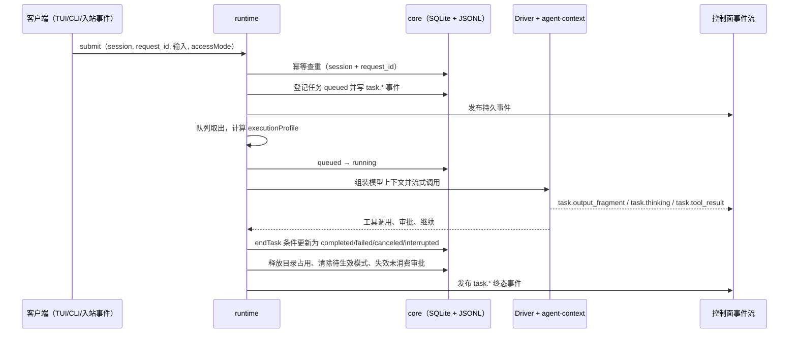
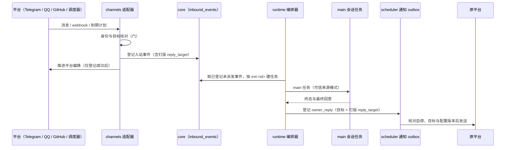
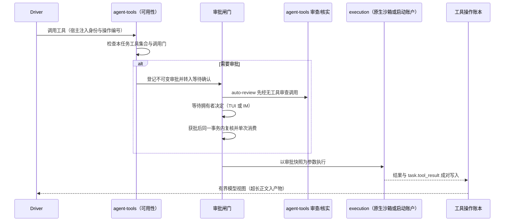
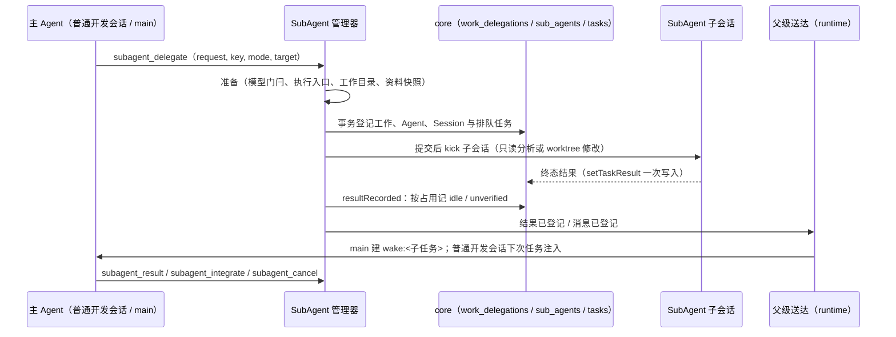

# 架构总览

Ruukoto 后台任务运行时以单仓库交付 `ruukoto` 个人 Agent 和 `ruukoto-code` Coding Agent。本页列出模块与四条跨模块主流程；细节见[模块文档](modules/)。

## 模块地图

| 模块 | 一句职责 | 主要依赖方向 |
| --- | --- | --- |
| [products](modules/products.md)（`apps/ruukoto`、`apps/ruukoto-code`） | 持有各产品入口、能力声明与专属装配 | 注入共享 runtime，调用共享 CLI；产品包互不依赖 |
| [runtime](modules/runtime.md) | 拥有任务生命周期、会话身份、队列与 SubAgent 委派的编排 | 依赖 core 的存储、agent-context 的模型装配、agent-tools 的工具、execution 的执行边界；被 control 与 channels 驱动 |
| [core](modules/core.md) | 定义数据布局、schema、任务状态机与会话身份判定 | 不依赖其他模块，被全部模块依赖 |
| [agent-context](modules/agent-context.md) | 组装每次模型调用的上下文：资料范围、历史、参考块、压缩与记忆 | 依赖 core 的存储与会话文件；被 runtime 的驱动循环调用 |
| [agent-tools](modules/agent-tools.md) | 决定会话有哪些工具，并经统一审批与操作账本执行 | 依赖 core、execution；被 runtime 装配 |
| [execution](modules/execution.md) | 在原生沙箱或当前启动账户下执行工具 | 依赖 core 的路径与身份；被 agent-tools 调用 |
| [control](modules/control.md) | 提供控制面 socket、拥有者认证与协议 | 调用 runtime 与 core；被 tui 消费 |
| [tui](modules/tui.md) | 共享 CLI、交互终端与配置中心 | 界面只经 control 协议连接后台；CLI 的 `server` 入口在本进程装配 runtime |
| [channels](modules/channels.md) | 拥有者 IM 入口、图片入站与 GitHub 事件来源 | 依赖 core 登记入站事件；驱动 runtime 建任务；经 scheduler 的 outbox 外发 |
| [scheduler](modules/scheduler.md) | 持久调度计划与通知 outbox 的发送账本 | 依赖 core；驱动 runtime 建唤醒任务；经 channels 发送 |
| [deploy](modules/deploy.md) | 部署的系统身份、单元、提权入口与服务管理 | 不参与运行时调用；定义当前账户的后台与可选服务 OS 授权 |

六个共享包在 `packages/{core,agent,channels,runtime,control,tui}`。agent-context、agent-tools 与 execution 属于 agent，scheduler 属于 channels；各 app 的 `product.ts` 声明差异。

运行时值依赖为 `agent → core`、`channels → agent/core`、`runtime → channels/agent/core`、`control → core`、`tui → control/runtime/agent/core`；control 通过注入的 Runtime 实例提供服务。反向类型引用在 devDependencies 声明。ESLint 拒绝未声明依赖、越层值引用与跨包相对路径。worker、schema 与控制面协议单点持有。

## 主流程一：任务生命周期

任务由会话提交产生，持久化后由队列串行执行，终态在一个事务内收尾。

要点：

- 提交幂等键的唯一范围是会话；同键同参重放返回原任务，同键异参报 `request_conflict`。重试先核实原请求，不换键重复提交。
- 任务携带 `accessMode`、`planMode`、权限版本与授予路径；模式与范围进入幂等比较，切换只在无执行中工具的边界生效。
- 执行画像（会话类别、SubAgent 工具集、资料受限、计划资格）在任务开始算一次并钉到任务结束；工具集变化时重建 SDK 会话。
- 终止状态只有 `completed`、`failed`、`canceled`、`interrupted`；所有在线终态路径都经同一个收尾事务，只有当前状态仍在起点集合时才继续。
- 目录占用按任务释放；同一工作目录同时只允许一个写任务。
- 后台重启把 `running`／`awaiting_confirmation` 定为 `interrupted`（原因 `backend_restart`），未决审批标 `stale`，有排队任务的会话暂停自动调度，由拥有者用 `resume-queue` 显式恢复。

## 主流程二：入站消息到回复

入站消息先成为持久事件，再建 main 任务，结果沿发起入口回送。

要点：

- 绑定拥有者的私聊取创建时 main 默认模式；其他外部事件按入口约束固定模式，正文不能指定权限来源。平台身份不等于通用控制面访问权。
- 先持久化再推进平台偏移：崩溃或断线后平台重投命中原外部 id，不重复建任务。
- 回复目标在收件时钉版（平台、账号、chat 与配置版本）；派发、任务启动与终态回复都复核，配置变化不改发。
- 结果分类统一：可证明未发送记 `failed`、超时与断线记 `effect_unknown`，都不自动重发；平台限流退回 `pending` 按建议时间重试。
- 未被识别的入口消息默认拒绝；拥有者私聊可执行 IM 审批命令，但只作用于原平台、原账号与原配置版本。

## 主流程三：工具调用与审批

模型调用工具后，宿主先判定可用性，越界操作进入审批闸门，执行发生在执行边界内。

要点：

- 工具可用性是唯一来源：会话类别清单减去宿主按任务的收窄（计划模式、GitHub 评审、项目关闭的 Web Search），激活、发送前检查与调用门共用同一集合。
- 审批是结构化且不可变的：绑定目标、内容指纹、方法与完整 URL、凭据名称与用途；批准经条件更新单次消费，其他 URL／方法／正文／任务不能复用。
- 完全访问的所有已开放工具免操作审批，仍核实活动任务、权限版本、目标、修订与凭据，记录真实任务授权及操作结果。
- 效果分类是硬边界：审批未消费一律已知未执行；只读工具中止记无写入效果；其余效果无法核实的记 `effect_unknown`，不重放。
- 工具输出在上游截断前捕获为产物文件，中断或写失败保留已捕获部分并标 `partial`；按任务归属可跨重启按 id 读取。

## 主流程四：SubAgent 委派

主 Agent 登记工作委托，创建独立上下文的 SubAgent，结果回到父级。

要点：

- 只有拥有者直接提交或经拥有者 IM 入口核实身份的任务可以委派；定时唤醒、子任务回报与其他来源拒绝。
- 一层委派：SubAgent 不能再派生下一层，也不能与拥有者直接交互。
- 委派能力固定为只读分析（`read`、`read_artifact`）或修改（`read`／`edit`／`write`／`bash`／`read_artifact`），模式沿本次发起任务的有效授权，单次批准与长期授权不继承。
- 修改委派在 Git 目标上为每项工作创建独立 worktree 副本，子任务不提交不推送，由主 Agent 用 `subagent_integrate` 汇总到父工作区待提交区；非 Git 目标直接写入并与父会话按目录占用串行。
- 送达与登记分开：结果与消息的登记只是投递登记，进入父模型调用才算送达；已取消的工作不建唤醒、不注入，队列循环在唤醒启动前再检查一次。
- 任务终态、TUI 退出与空闲都不关闭 SubAgent；关闭是独立列，关闭后拒绝新委派但保留历史与产物。
- 后台重启时排队的委派任务定 `interrupted` 不自动继续；宿主固定评审的排队任务由编排器启动恢复自动继续；占用未核实的旧执行保留占用并由拥有者用 `resume-queue` 释放。

## 一条消息穿过全部模块

一次请求的路径：`channels` 把平台消息变成入站事件，`runtime` 建任务并在队列里取出，`agent-context` 组装上下文，`agent-tools` 判定可用性并取审批，`execution` 在边界内执行，`core` 存下每一步的事实，`control` 把事件流推给 `tui`，`scheduler` 的 outbox 把结果送回原平台。

## 设计依据

- [后台任务与终端](../.agents/notes/implemented/architecture/2026-09-19-detach-terminal-from-task-runtime.md)：后台与客户端分离、事件流恢复与请求幂等的基础决定。
- [两个 Agent 产品](../.agents/notes/implemented/architecture/2026-10-02-two-agent-products.md)：两个产品共用一个仓库与一套控制面，各自独立档案与实例锁。
- [同仓 workspaces 分包](../.agents/notes/implemented/architecture/2026-10-11-in-repo-workspace-packages.md)：产品装配、共享包与 import 检查的归属。
- [工具工作进程与受限容器](../.agents/notes/implemented/architecture/2026-09-20-tool-worker-per-task-container.md)：执行边界的形态与失败策略。
- [Coding Agent 的原生受限执行](../.agents/notes/implemented/architecture/2026-10-10-native-execution-sandbox.md)：原生工具链、停止核实与占用保留。
- [会话历史与模型上下文](../.agents/notes/implemented/architecture/2026-09-19-preserve-session-history.md)：历史与上下文的分工，决定了 core 与 agent-context 的边界。
- [工作委托、SubAgent 与任务](../.agents/notes/implemented/architecture/2026-10-03-work-delegation-subagent-task.md)：委派三层数据模型与一层派生的来源。
- [人类文档与决策记录](../.agents/notes/implemented/process/2026-10-09-split-agent-and-human-docs.md)：本页与模块文档的读者分层与固定节约定。
