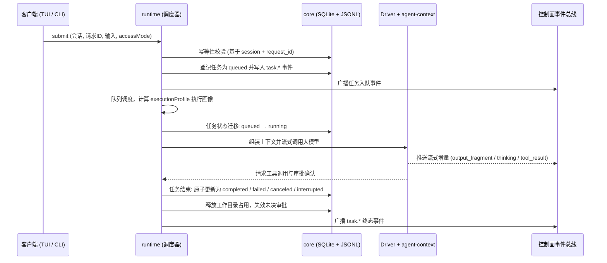
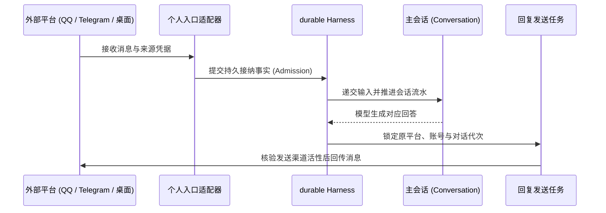
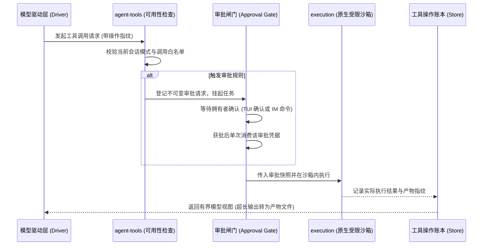
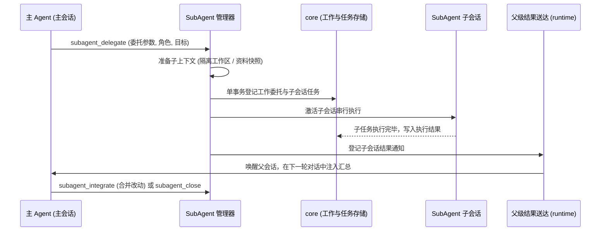

# 架构总览

Ruukoto 在同一个代码仓库中交付两个独立定位的 Agent 产品：
- **`ruukoto`（个人 Agent）**：面向个人日常事务与长效助理，由 durable 原生持久层持有会话与运行状态；
- **`ruukoto-code`（Coding Agent）**：面向软件工程与复杂编码任务，依托共享 Runtime 底座与多任务调度编排。

各模块的深度设计与技术契约见 [modules/](modules/)。

## 模块地图

系统由应用层（Apps）与核心包（Packages）组成，严格遵循自顶向下的单向依赖：

| 模块 | 核心职责 | 主要依赖关系 |
| --- | --- | --- |
| [products](modules/products.md)（`apps/`） | 产品入口装配与命令行引导（`ruukoto` / `ruukoto-code`） | 装配底层各包；两产品实现独立，互不依赖 |
| [personal-durable](modules/personal-durable.md) | 个人 Agent 的持久会话、任务治理、IM/本机/远程接入与工具链 | 依赖 Pi 1.3.0 与底层系统能力；正式与开发入口共用装配 |
| [runtime](modules/runtime.md) | Coding 任务生命周期、串行队列、调度协调与 SubAgent 编排 | 依赖 `core`、`agent`、`execution`；被 `control` 与 `channels` 驱动 |
| [core](modules/core.md) | 数据布局定义、SQLite Schema、任务状态机与会话身份识别 | 系统最底层，不依赖任何 workspace 包，被全仓依赖 |
| [workflows](modules/workflows.md) | 持久化工作流定义库、后台执行引擎与多步骤控制 | 依赖 `core` 事务管理与 `agent` 的脚本沙箱环境 |
| [agent-context](modules/agent-context.md) | 组装模型调用上下文：工作区资料、历史滑动窗口、参考快照与记忆 | 依赖 `core` 的数据存储；由 `runtime` 驱动循环调用 |
| [agent-tools](modules/agent-tools.md) | 工具可用性判定、审批闸门介入与不可变操作账本 | 依赖 `core` 与 `execution`，由 `runtime` 统一装配 |
| [execution](modules/execution.md) | 原生受限沙箱与工具工作进程，管理文件系统挂载与进程退出核实 | 依赖 `core`；工具由 `agent-tools` 调用并执行 |
| [control](modules/control.md) | 控制面 Unix Socket、拥有者令牌认证与双向 RPC 协议 | 调用 `runtime` 与 `core`；被 `tui`、`desktop` 与 `view` 消费 |
| [view](modules/view.md) | Web 与桌面界面的状态投影、历史读取编排及客户端模型定义 | 依赖 `core` 与 `control` 中可在浏览器运行的模块 |
| [desktop](modules/desktop.md)（`apps/desktop`） | 跨平台桌面客户端宿主与本地窗口渲染 | Node 宿主连接控制面与 HTTPS/WSS 远程服务 |
| [tui](modules/tui.md) | 终端交互界面、共享 CLI 分发与离线配置中心 | 经由 `control` 协议与后台解耦通信；纯 CLI 提供独立管理入口 |
| [channels](modules/channels.md) | 外部 IM 通道（QQ / Telegram）、图片入站管道与 GitHub 事件源 | 依赖 `core` 登记事件并触发 `runtime` 任务 |
| [scheduler](modules/scheduler.md) | 时间触发规则引擎与外部通知发件箱（Outbox） | 依赖 `core` 存储；驱动 `runtime` 定时任务并通过 channels 发送 |
| [deploy](modules/deploy.md) | 生产部署的 systemd 服务单元、系统提权入口与环境权限管理 | 不参与运行时代码调用；定义操作系统层级凭据与单元配置 |

> 共享包的核心依赖分层为：`core` ← `agent` ← `execution` ← `runtime` ← `control` ← `view/tui`。

## 主流程一：任务生命周期

在 Coding Agent 底座中，一次用户输入或定时调度会触发一个完整的任务生命周期。任务先写入持久存储，再按会话排队执行，终态在单一事务中原子收尾：

### 核心机制
- **幂等性保障**：以 `(sessionId, requestId)` 二元组为唯一键。同键同参重放直接返回原任务，同键异参报错拒绝。
- **动态执行画像（`executionProfile`）**：在任务开始时根据会话身份、代码写入目标与安全模式计算并固化，任务运行期间不可变更。
- **终态收敛**：任务终态严格收敛为 `completed`、`failed`、`canceled`、`interrupted` 之一，所有收尾动作（清理目录占用、作废未决审批）均在单一事务中执行。
- **异常恢复**：后台进程若意外重启，所有未决任务被标记为 `interrupted`（原因 `backend_restart`），防止任务孤立挂起。

## 主流程二：入站消息到回复

个人 Agent 的各外部接入端（QQ、Telegram、本机终端、PA 桌面）统一汇总到 durable 主会话，严格遵循持久接纳与原路回传：

### 核心机制
- **原路回传**：消息发送端与回复接收端严格绑定。回复任务必须核验原接入平台的有效性与账号代次，禁止串流发向错误终端。
- **幂等接纳**：重复接收的消息基于平台消息 ID 去重，定位既有处理事实，绝不重复生成多份回复任务。
- **断线韧性**：客户端界面临时关闭或网络抖动不影响后台既有会话的执行，会话与分析工作在后台完整推进。

## 主流程三：工具调用与审批

当模型发起工具调用时，系统通过可用性过滤与权限闸门评估风险；越界或写操作进入人工审批通道，并在受控沙箱内安全执行：

### 核心机制
- **动态可用性判定**：根据会话类别、计划模式（Plan Mode）及安全模式实时收窄工具集，未授权工具在调用前即被拦截。
- **不可变审批快照**：审批项强绑定目标资源、命令指纹与操作参数。拥有者批准仅对该特定快照生效一次，杜绝越权复用。
- **沙箱隔离执行**：真实命令与脚本执行被限制在原生沙箱边界内，执行完毕后系统严格核实进程树完全退出。

## 主流程四：SubAgent 委派

主 Agent 可将复杂工作分解并委派给拥有独立上下文的子 Agent（SubAgent），各子任务独立推进并受控归集：

### 核心机制
- **单层委派模型**：SubAgent 由主会话统一发起与管理，子 Agent 禁止再嵌套派生下级，避免无节制的递归调用。
- **工作区隔离**：代码修改类委派优先在独立的 Git worktree 中执行。主会话通过 `subagent_integrate` 显式审查并合入子分支改动。
- **生命周期独立**：子任务的完成不等于子会话销毁。子会话保留独立历史与产物以供复查，直至主 Agent 显式关闭。

## PA桌面连接

PA 桌面客户端（Desktop）通过安全的远程协议与服务端通信：
- **通信链路**：Tailscale Serve（HTTPS / WSS）→ 本地私有 Remote 服务（校验拥有者身份与应用凭据）→ 独占的 durable Harness 实例。
- **安全与配对**：桌面首次接入需在服务端通过本机终端管理向导进行显式配对；凭据支持随时吊销。
- 详细安全机制见 [桌面](modules/desktop.md)，生产部署步骤见 [部署说明](../deploy/systemd/README.md)。

## 设计依据

- [后台任务与终端](../.agents/notes/implemented/architecture/2026-09-19-detach-terminal-from-task-runtime.md)：后台与客户端分离、事件流恢复与请求幂等的基础决定。
- [两个 Agent 产品](../.agents/notes/implemented/architecture/2026-10-02-two-agent-products.md)：两个产品同仓交付，各自独立运行、档案与实例锁。
- [同仓 workspaces 分包](../.agents/notes/implemented/architecture/2026-10-11-in-repo-workspace-packages.md)：产品装配、共享包与 import 检查的归属。
- [工具工作进程与受限容器](../.agents/notes/implemented/architecture/2026-09-20-tool-worker-per-task-container.md)：执行边界的形态与失败策略。
- [Coding Agent 的原生受限执行](../.agents/notes/implemented/architecture/2026-10-10-native-execution-sandbox.md)：原生工具链、停止核实与占用保留。
- [会话历史与模型上下文](../.agents/notes/implemented/architecture/2026-09-19-preserve-session-history.md)：历史与上下文的分工，决定了 core 与 agent-context 的边界。
- [工作委托、SubAgent 与任务](../.agents/notes/implemented/architecture/2026-10-03-work-delegation-subagent-task.md)：委派三层数据模型与一层派生的来源。
- [人类文档与决策记录](../.agents/notes/implemented/process/2026-10-09-split-agent-and-human-docs.md)：本页与模块文档的读者分层与固定节约定。
