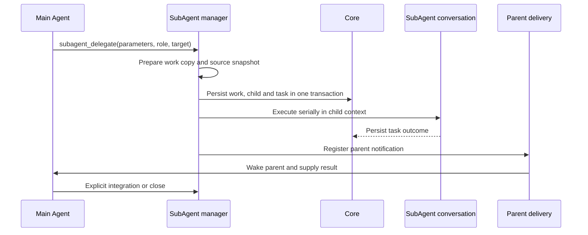

# Architecture

Ruukoto is one software-work assistant. Its application composes the shared runtime for workspace conversations, queued tasks, one-level delegation, workflows and scheduling; TUI, Electron and MyGo are clients of the same local backend.

Detailed designs and contracts live in [modules](modules/).

## Module Map

Applications compose the packages; dependencies flow toward the shared foundations. Some entries below describe a subsystem within a package, not a separate workspace package.

| Module | Responsibility | Main dependencies and callers |
| --- | --- | --- |
| [products](modules/products.md), `apps/ruukoto/` | Sole application composition and CLI entry points | Assemble packages and consume core profile bootstrap |
| [runtime](modules/runtime.md) | Task lifecycle, per-conversation queues, SubAgents and scheduling | `core`, `agent` and execution; driven by control and the scheduler |
| [core](modules/core.md) | Data layout, SQLite schema, task states and conversation identity | No workspace dependencies |
| [workflows](modules/workflows.md) | Versioned definitions, persistent runs and step controls | Core transactions and the agent script sandbox |
| [agent-context](modules/agent-context.md) | Model context, history selection, reference snapshots and memory | Core storage; called by the runtime |
| [agent-tools](modules/agent-tools.md) | Tool availability, approvals and immutable operation records | Core and execution |
| [execution](modules/execution.md) | Native sandbox, tool workers and verified process exit | Part of the agent execution layer; uses core |
| [control](modules/control.md) | Unix socket, owner-token authentication and RPC | Runtime and core; serves clients |
| [view](modules/view.md) | Browser-safe state and history projections | Browser-safe core/control contracts |
| [desktop](modules/desktop.md), `apps/desktop/` | Electron/MyGo hosts and desktop rendering | Node host connects to verified local control; MyGo retains private native-browser frames |
| [tui](modules/tui.md) | Terminal UI, CLI and offline configuration | Control protocol and activated core profile |
| [channels](modules/channels.md) | Retained scheduling time calculations | Consumed by the runtime scheduler |
| [scheduler](modules/scheduler.md) | Time rules and independent scheduled runs | Core and runtime; no IM outbox |
| [deploy](modules/deploy.md) | Native OS prerequisites | Linux user-systemd and platform execution setup |

At package level, `core` underpins `agent`, which supports `runtime`; `control` exposes runtime operations to clients. Product composition supplies callbacks where runtime dependencies would otherwise point backward.

## Flow 1: Task Lifecycle

Coding input and scheduled execution are persisted before being queued. Task state and its events commit together; broadcasts follow the commit. JSONL history is a separate authority, not part of that SQLite transaction.

```mermaid
sequenceDiagram
  participant Client as TUI / CLI
  participant Runtime as Runtime
  participant Store as Core SQLite
  participant Driver as Driver + context
  participant Control as Control events
  Client->>Runtime: submit(conversation, requestId, input, mode)
  Runtime->>Store: Check idempotency; persist queued task and event
  Runtime->>Control: Broadcast committed event
  Runtime->>Runtime: Select task and freeze executionProfile
  Runtime->>Store: queued → running
  Runtime->>Driver: Assemble context and stream model output
  Driver-->>Control: Output, thinking and tool fragments
  Driver-->>Runtime: Tools and approval requests
  Runtime->>Store: Commit terminal state, release occupancy, invalidate approvals
  Runtime->>Control: Broadcast terminal event
```

- `(sessionId, requestId)` is unique: identical replay returns the original task; changed parameters are rejected.
- `executionProfile` fixes identity, write target and access policy when execution starts.
- Terminal states are `completed`, `failed`, `canceled` and `interrupted`; finalization is transactional.
- After an unexpected backend restart, unfinished shared-runtime tasks become `interrupted` with `backend_restart` rather than silently remaining active.

## Flow 2: Profile Activation and Clients

Every stateful entry selects the same canonical raw data/agent/control/pending tuple. Core inspects supported predecessors under exclusion, publishes a preparation reserving one instance ID, installs bound roles and publishes one activation marker. Offline model setup occurs only after activation and does not require a ready backend.

In-process callers receive `ProfilePaths`; spawned children receive the complete raw tuple and resolve the same activation. Clients verify layout, instance and protocol before using the resolver-owned temporary socket. Persistent control storage and pending journals remain separate from that endpoint. [Storage](modules/core.md) owns initialization and recovery; [usage](usage.md#6-fresh-profiles-and-old-data) explains effective paths and rejection.

## Flow 3: Tool Execution and Approval

Availability checks first restrict the model's tool set. The access policy then determines which operations require approval. An approval is valid for one fixed operation, not a general permission increase.

```mermaid
sequenceDiagram
  participant Driver as Model driver
  participant Tools as Tool availability
  participant Gate as Approval
  participant Exec as Execution
  participant Ledger as Operation ledger
  Driver->>Tools: Tool call and operation fingerprint
  Tools->>Tools: Check identity, mode and allowlist
  alt Approval required
    Tools->>Gate: Persist immutable request; suspend task
    Gate->>Gate: Receive owner decision; consume once
  end
  Tools->>Exec: Execute under the selected policy and snapshot
  Exec->>Ledger: Record outcome and artifact identity
  Ledger-->>Driver: Bounded result; oversized output becomes an artifact
```

Tool availability can narrow with conversation identity, plan mode and access mode. Targets, parameters and command fingerprints remain bound to the approval. Restricted execution uses the native sandbox; full access instead uses the starting account without a task sandbox. Stopping must verify the execution unit is gone before releasing its occupancy.

## Flow 4: SubAgent Delegation

A main Agent can delegate to independent child contexts and collect their results. The product supports one delegation level: its SubAgents do not create their own SubAgents.



Code-writing delegation uses an isolated work copy where required. `subagent_integrate` explicitly brings reviewed changes into the parent. Completing a task does not destroy its SubAgent: identity, history and artifacts remain available until explicit closure, and the work copy is retained.

## Design Rationale

- [Backend tasks and terminal separation](../.agents/notes/implemented/architecture/2026-09-19-detach-terminal-from-task-runtime.md): event recovery and request idempotency.
- [Single product](../.agents/notes/implemented/architecture/2026-11-10-single-product.md): clean composition cutover and fresh profiles without old import.
- [Workspace packages](../.agents/notes/implemented/architecture/2026-10-11-in-repo-workspace-packages.md): package ownership and imports.
- [Tool workers](../.agents/notes/implemented/architecture/2026-09-20-tool-worker-per-task-container.md) and [native execution](../.agents/notes/implemented/architecture/2026-10-10-native-execution-sandbox.md): execution boundaries and verified stopping.
- [History and context](../.agents/notes/implemented/architecture/2026-09-19-preserve-session-history.md): separate authorities.
- [Work, SubAgents and tasks](../.agents/notes/implemented/architecture/2026-10-03-work-delegation-subagent-task.md): delegation identity and lifecycle.
- [Human docs and decisions](../.agents/notes/implemented/process/2026-10-09-split-agent-and-human-docs.md): documentation audiences.
