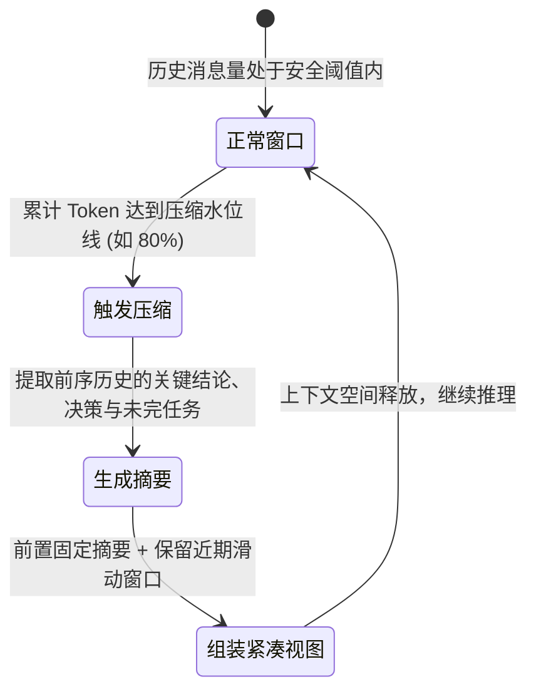
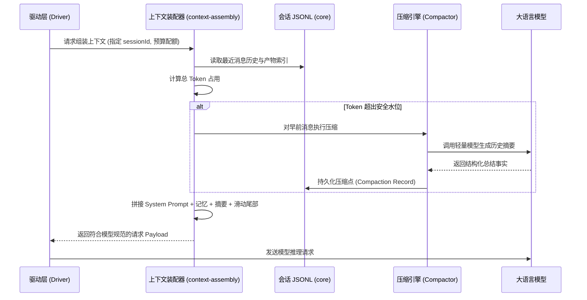

# 上下文装配与记忆压缩

## 职责与边界

`agent-context` 模块（对应 `packages/agent/src/` 中的上下文与记忆组件）负责在每次调用大模型前，动态组装出最契合当前任务目标与 Token 预算的上下文窗口（Context Window）。

### 核心职责
- **上下文装配（`ContextAssembly`）**：将系统提示、工作区参考资料、历史消息、长期记忆与技能说明融合成模型输入，并在发送前核实选择与预算；当前任务的必留输入含原始要求与本任务已接入的全部引导（按 `ruukotoSourceTaskId` 区分来源）。
- **有损上下文压缩（Context Compaction）**：当会话长度逼近模型的上下文窗口上限时，通过语义提取算法将早前历史归纳为高质量摘要，保留关键上下文的同时释放窗口空间。
- **长期记忆管理（`memory`）**：提供基于版本链的长期事实检索、显式更新与撤销机制，支持跨会话沉淀用户偏好与关键业务事实。
- **技能库注入（Skills）**：从后台账户的 `$HOME/.agents/skills/` 固定技能版本，注入名称与描述，模型按需加载正文和引用资料；正文给出技能目录，目录中的脚本经现有命令工具按其目录路径执行，脚本源码默认不读取。

### 边界与非职责
- 会话消息在磁盘上的权威只读 JSONL 存储归 [core](core.md)。
- 任务的状态流转与流式调用驱动归 [runtime](runtime.md)。
- 工具的调用执行与沙箱隔离归 [execution](execution.md)。

## 对外接口

| 核心接口 / 类 | 调用方 | 职责与行为描述 |
|---|---|---|
| `beginContextAssembly` | Driver (模型驱动) | 建立任务级装配器，固定参考资料、来源与配置选择 |
| `ContextAssembly.assemble` | Pi 上下文钩子 | 生成本轮历史视图，选择摘要、消息与附件 |
| `ContextAssembly.prepareSend` / `afterSend` | Driver 发送适配 | 发送前复核并保存选择记录与请求快照，发送后记录实际用量 |
| `planCompaction(history, limits)` | 上下文编排层 | 纯函数计算当前历史是否超过压缩水位线，规划需要归纳的历史区间 |
| `selectContext(options)` | 上下文编排层 | 执行滑动窗口选择，生成包含摘要与最新消息的上下文视图 |
| `MemoryStore` | 模型工具 / TUI | 长期记忆的增删改查门面，提供多版本追溯与撤销支持 |
| `loadSkillLibrary` / `listSkillLibrary` / `getSkillDetail` | 运行时 / 客户端 | 固定目录发现、只读分页与详情；正文按内容哈希形成快照 |

## 数据与状态

### 1. 上下文结构与压缩演进

### 2. 模型上下文组成切片

一次组装后的模型请求 Payload 严格遵循自顶向下的层级结构：

| 上下文切片 | 内容与来源 | 动态行为 |
|---|---|---|
| **System Prompt** | 宿主角色定位、安全边界与行为规范 | 静态内置，针对不同产品微调 |
| **参考快照 (References)** | 项目指令、技能名称与描述、当前任务说明 | 按任务固定选择；技能正文经工具结果或显式调用进入历史 |
| **长期记忆 (Memories)** | 检索到的用户偏好与跨会话事实 | 按语义相关度召回或由用户显式绑定 |
| **压缩摘要 (Compaction)** | 被压缩历史的高层语义提炼 | 仅在触发压缩后出现，替代老旧消息 |
| **消息滑动窗口 (Messages)** | 近期的用户输入、模型回复与工具执行结果 | 保持原汁原味的流式对话历史 |

Pi 1.3.0 将系统提示与工具声明保存在 `TranscriptContext.messages` 的系统条目中。预算、发送资格与请求快照从同一份最终消息读取，动态 MCP 注册也进入实际请求的工具声明。原系统条目保留在 JSONL，压缩序号只计算对话；快照仍分别保存系统提示、工具定义和对话，旧 JSONL 只读重建。

## 主要流程

### 上下文装配与压缩主要流程

1. **历史拉取与预算评估**：从权威 JSONL 文件中拉取完整对话历史，按当前模型上下文上限评估是否需要进行截断或压缩。
2. **两阶段平滑压缩**：
   - 第一阶段（提取）：调用专用模型提炼早期多轮对话的技术决策、修改的文件路径与待办事项；
   - 第二阶段（缝合）：将生成的摘要固化为压缩点，与未被压缩的近期待处理消息无缝衔接。
3. **安全上下文输出**：过滤掉超长且已落入产物文件的工具大输出，仅保留结构化摘要与文件引用，保证请求轻量。

## 不变量与失败处理

- **底层历史只读不可篡改**：上下文压缩仅作用于模型视窗内的投影视图，底层的会话 JSONL 文件永远保持完整且单向追加，绝不物理删除历史消息。
- **发送前预算复核**：最终消息、系统提示、工具声明、图片与响应额度共同计入预算；无法形成有效选择时拒绝发送。
- **选择失败保持可见**：压缩、附件或来源选择失败记录在装配器上，由发送前检查抛出 `ContextSendBlocked`；不靠静默丢弃历史继续任务。

## 设计依据

- [会话历史与模型上下文](../../.agents/notes/implemented/architecture/2026-09-19-preserve-session-history.md)
- [有损上下文压缩与视图选择](../../.agents/notes/implemented/architecture/2026-09-26-lossy-context-compaction.md)
- [技能统一从宿主 HOME 发现](../../.agents/notes/implemented/simplification/2026-10-28-home-skills-discovery.md)：固定来源、任务钉版与历史保留。
