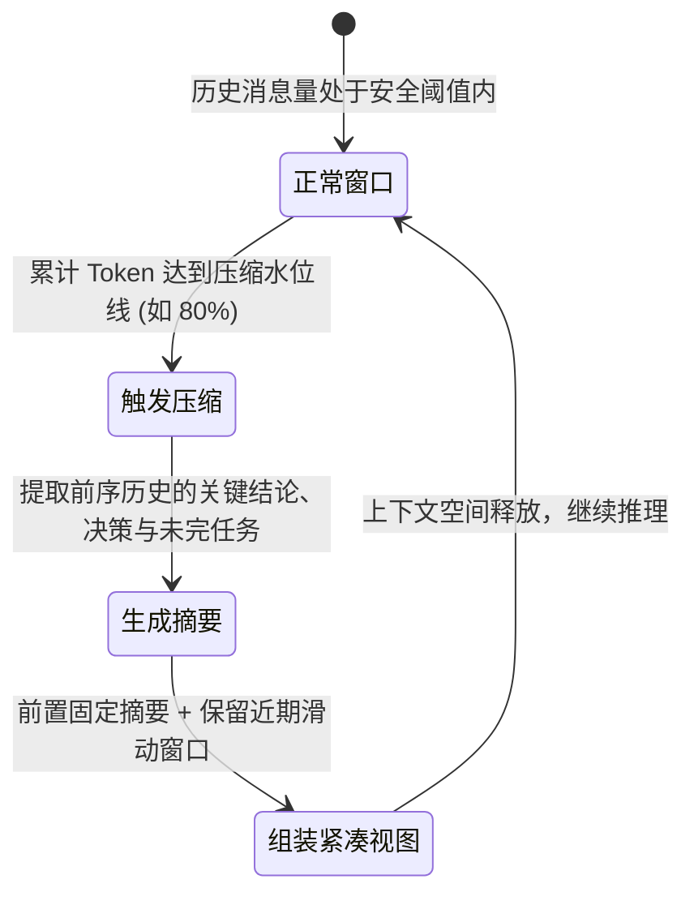
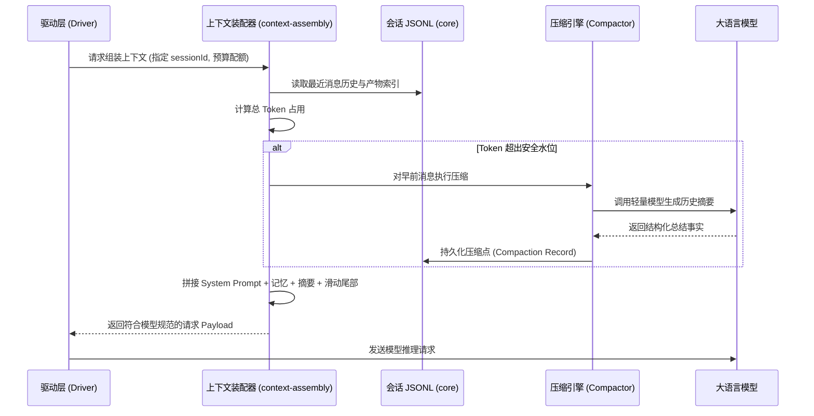

# 上下文装配与记忆压缩

## 职责与边界

`agent-context` 模块（对应 `packages/agent/src/` 中的上下文与记忆组件）负责在每次调用大模型前，动态组装出最契合当前任务目标与 Token 预算的上下文窗口（Context Window）。

### 核心职责
- **上下文装配（`assembleContext`）**：将系统提示词（System Prompt）、工作区参考资料、历史消息滑动窗口、长期记忆与技能说明融合成规范的模型输入。
- **有损上下文压缩（Context Compaction）**：当会话长度逼近模型的上下文窗口上限时，通过语义提取算法将早前历史归纳为高质量摘要，保留关键上下文的同时释放窗口空间。
- **长期记忆管理（`memory`）**：提供基于版本链的长期事实检索、显式更新与撤销机制，支持跨会话沉淀用户偏好与关键业务事实。
- **技能库注入（Skills）**：根据当前任务的意图动态加载技能指南与参考规范，并将其以快照形式嵌入上下文。

### 边界与非职责
- 会话消息在磁盘上的权威只读 JSONL 存储归 [core](core.md)。
- 任务的状态流转与流式调用驱动归 [runtime](runtime.md)。
- 工具的调用执行与沙箱隔离归 [execution](execution.md)。

## 对外接口

| 核心接口 / 类 | 调用方 | 职责与行为描述 |
|---|---|---|
| `assembleContext(spec)` | Driver (模型驱动) | 组装当前模型调用的完整 Payload（包含 Prompt、消息序列、工具定义与 Token 预算） |
| `planCompaction(history, limits)` | 上下文编排层 | 纯函数计算当前历史是否超过压缩水位线，规划需要归纳的历史区间 |
| `selectContext(options)` | 上下文编排层 | 执行滑动窗口选择，生成包含摘要与最新消息的上下文视图 |
| `MemoryStore` | 模型工具 / TUI | 长期记忆的增删改查门面，提供多版本追溯与撤销支持 |
| `SkillStore` | 运行时 / 客户端 | 扫描、加载并校验技能 Markdown 文件，提供带内容哈希的不可变快照 |

## 数据与状态

### 1. 上下文结构与压缩演进

### 2. 模型上下文组成切片

一次组装后的模型请求 Payload 严格遵循自顶向下的层级结构：

| 上下文切片 | 内容与来源 | 动态行为 |
|---|---|---|
| **System Prompt** | 宿主角色定位、安全边界与行为规范 | 静态内置，针对不同产品微调 |
| **参考快照 (References)** | 工作区结构、当前任务说明、激活的技能规范 | 按任务动态注入，运行中只读 |
| **长期记忆 (Memories)** | 检索到的用户偏好与跨会话事实 | 按语义相关度召回或由用户显式绑定 |
| **压缩摘要 (Compaction)** | 被压缩历史的高层语义提炼 | 仅在触发压缩后出现，替代老旧消息 |
| **消息滑动窗口 (Messages)** | 近期的用户输入、模型回复与工具执行结果 | 保持原汁原味的流式对话历史 |

## 主要流程

### 上下文装配与压缩主要流程

1. **历史拉取与预算评估**：从权威 JSONL 文件中拉取完整对话历史，按当前模型上下文上限评估是否需要进行截断或压缩。
2. **两阶段平滑压缩**：
   - 第一阶段（提取）：调用专用模型提炼早期多轮对话的技术决策、修改的文件路径与待办事项；
   - 第二阶段（缝合）：将生成的摘要固化为压缩点，与未被压缩的近期待处理消息无缝衔接。
3. **安全上下文输出**：过滤掉超长且已落入产物文件的工具大输出，仅保留结构化摘要与文件引用，保证请求轻量。

## 不变量与失败处理

- **底层历史只读不可篡改**：上下文压缩仅作用于模型视窗内的投影视图，底层的会话 JSONL 文件永远保持完整且单向追加，绝不物理删除历史消息。
- **Token 预算硬性截断护栏**：组装器输出的字符数与 Token 估算值必须严格小于目标模型的最大接收能力，超限时宁可截断老旧工具输出，绝不抛给下游 API 导致 400 报错。
- **压缩过程无状态幂等**：若压缩模型调用失败或网络超时，系统平滑退化为按简单消息条数硬滑动窗口丢弃旧消息，保证主流程任务不被阻塞。

## 设计依据

- [会话历史与模型上下文](../../.agents/notes/implemented/architecture/2026-09-19-preserve-session-history.md)
- [有损上下文压缩与视图选择](../../.agents/notes/implemented/architecture/2026-09-26-lossy-context-compaction.md)
