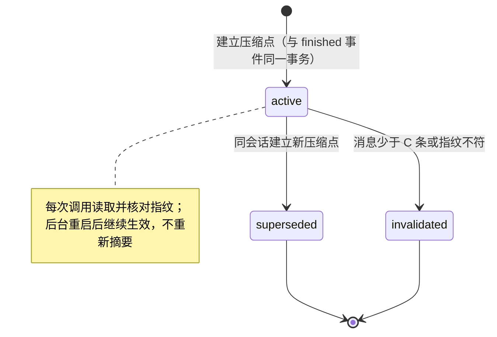
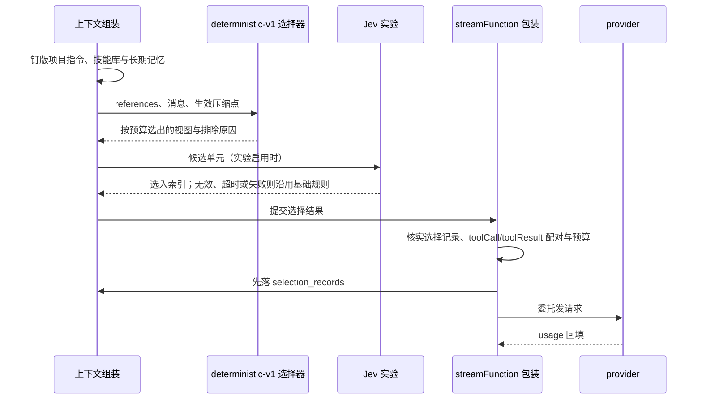

# 模型上下文、历史与记忆

## 职责与边界

本篇负责**把一次模型调用的输入组装出来**，并维护组装所需的资料：会话历史的索引与检索、拥有者提供的参考内容（项目指令与技能）与使用中积累的长期记忆。它同时持有统一的资料访问范围（`data_grants` 授权与默认范围）、上下文选择策略 `deterministic-v1`、上下文压缩（压缩点、两层压缩与水位）、Jev 上下文筛选实验、选择记录，以及按会话保存的模型选择。

它不负责的部分点名归属：工具参数校验、计划模式工具白名单与审批策略归 [agent-tools](agent-tools.md)——本篇只写工作清单的上下文保底与计划模式的计划说明参考块；会话历史的落盘格式与原子追加归 [core](core.md)（pi JSONL 是消息历史的唯一权威副本）；任务状态机、队列暂停与 `continue` 建任务归 [runtime](runtime.md)；执行边界的容器与执行账户归 [execution](execution.md)；命令参数与运行步骤只在 [usage](../usage.md) 出现一次。

一条贯穿全篇的分工：**会话历史只追加、可查阅；有损处理只作用于模型上下文**。压缩、清理、移出与 Jev 筛选都只产生本次调用的视图，绝不改写会话历史，也不启用 pi 的 compaction。

## 对外接口

调用方与入口：

| 调用方 | 入口 | 说明 |
|---|---|---|
| runtime / Driver | 组装（`packages/agent/src/context-assembly.ts`） | 任务开始时钉版项目指令、技能库与长期记忆，每次调用重新组装视图并把结果写成选择记录 |
| runtime / Driver | 选择器（`packages/agent/src/context-selector.ts`） | 纯函数策略 `deterministic-v1`，入参为参考块、消息、记忆与生效压缩点，出参为视图与排除原因 |
| runtime / Driver | 压缩（`packages/agent/src/compaction.ts`） | 规划压缩点、解析条目引用、调用摘要模型并落盘 `context_checkpoints` |
| 宿主包装 | `streamFunction` 包装 | 委托 provider 之前核实选择记录、toolCall/toolResult 配对与预算，先落记录再发请求 |
| pi | `estimateTokens` | 估算口径来源：chars/4 加 CJK 校准，再乘校准系数 1.5 |
| pi | `generateSummaryWithUsage` | 第二层压缩的摘要生成函数，只用这一个上游能力 |
| 模型 | 资料与记忆工具 | `history_search`、`history_read`、`memory_list`、`memory_read`、`memory_save`、`memory_revoke`、`skill` |
| control | `get_project_jev` / `set_project_jev` | Jev 实验的按项目配置读写；写入要 `project_id`、完整的 `enabled` / `credential` 与 `expected_version` |
| config-tui | 模型目录、默认模型与摘要模型 | 摘要模型未设置时用任务记录的模型选择 |

拥有者入口（完整参数见 [usage](../usage.md)）：

| 入口 | 命令 |
|---|---|
| 资料授权 | `ruukoto grant create --from <项目> --to <项目> --category history\|artifact\|memory`、`ruukoto grant list [--all]`、`ruukoto grant revoke <id>` |
| 历史检索 | `ruukoto history-search <关键词> [--project P] [--session S] [--task T] [--role R] [--since T] [--until T] [--limit N] [--scan-limit N] [--cursor base64]`；TUI `/search <关键词>` |
| 长期记忆 | `ruukoto memory list\|show\|save\|revoke\|restore`；TUI `/memory` |
| 项目指令 | `ruukoto project set-instructions <项目id> <文件...>` |
| 选择记录 | `ruukoto selection-records --task <id> \| --session <id>`；TUI `/context` |
| 技能 | TUI `/skill <名称> [参数]`、`/skills`；CLI `ruukoto submit … "/skill:<名称> …"` |
| 模型选择 | TUI `/model`；CLI `models [--provider provider] [--offset 0] [--limit 100]`、`set-model <session> <provider/model> --thinking <level>`、`resume-queue <session> --model provider/model --thinking level` |
| Jev 凭据 | `ruukoto credentials add --name jev-myproject --host api.typesafe.ai --header authorization --purpose jev_context --secret-env JEV_API_KEY` |

对外可见的标记（读者的检索入口）：`[项目指令]`、`[技能目录]`、`[技能 <名称> · 版本 … · …]`、`[继续来源：本任务继续已中断任务 <id>；其原始要求如下]`、`[长期记忆 <id> v<N> · <类别> · <范围>]`、`[压缩摘要 · 较早的 <S> 条消息 · 至 <summary_until>]`、`[已清理 · <工具名> · 原 <N> 字符 · 成功|失败 · history_read session_id=<会话> entry_id=<条目>]`、`[较早的 <N> 轮交互未进入本次上下文 · <起> 至 <止>]`。

## 数据与状态

**会话历史。** pi JSONL 是消息历史的唯一权威副本，只追加。SQLite 的 `history_index` 是可重建的位置索引：会话、条目 id、角色、时间戳、字节偏移，**不含消息正文**。任务边界由 `ruukoto_task_start` / `ruukoto_task_end` custom 条目标记；任务没有结束标记（崩溃、中断）时其字节范围延伸到文件尾。

**压缩点（`context_checkpoints`）。** 字段：`summarized_count`（S，分支前 S 条消息由摘要替代）、`cleared_count`（C，≥ S，[S, C) 的工具结果换成占位说明）、`summary`、`summary_until`（第 S 条消息的 UTC 时间）、`cleared_refs`（toolCallId → 条目 id）、`summary_model`、`summary_status`（`ok | failed | none`）、失败原因、提示版本 `compaction-v2`、`usage`、估算前后、建立它的任务与调用序号或手动请求来源。部分唯一索引保证每个会话至多一行 `active`；新建时旧行在同一事务里改为 `superseded`。S 与 C 只落在单元边界：完整交互的开头，或当前任务已完成批次的开头。

**选择记录（`selection_records`）。** 每次模型调用前落一条：任务/会话、调用序号、策略与配置版本（生效预算配置的 FNV-1a 哈希）、模型、项目指令来源版本、纳入/排除的消息索引与原因（含 `unpaired_tool_call:<id>`、`source_scope_revoked`）、纳入/排除的记忆 id 与版本、被有界替换的工具结果片段范围（`capped_tool_results`）、各项估算与预算（被摘要与清理的消息序号不逐条记入，估算明细含 `compactionSummary`）、本次视图使用的压缩点 `checkpoint_id`；发送后回填实际 provider usage。记录失败即阻断发送。排除原因只记录索引与类别，不含其他项目的标题或片段。Jev 实验在同一行的 `experiment` 中保存状态、请求与响应模型、配置版本、阈值、候选索引及概率、基础规则的选入索引、耗时、是否发出请求、Jev 用量、估算费用与回退原因，不保存候选正文或凭据；未运行实验的调用该字段为 null。旧记录没有压缩点与实验字段。

**长期记忆。** SQLite 当前版本加追加式修订；类别限于 preference / convention / decision / experience。每条必须关联来源（历史条目、产物或拥有者说明），来源必须存在且当前可访问。代理创建的内容标记 author=agent。按任务钉版：任务开始时钉住当时生效记忆的 id 与顺序（项目优先 → 更新时间倒序；资料受限会话为空），之后每次调用只对这些 id 重读当前内容并按钉住的顺序排列。注入有独立预算（默认 2000 估算 token）与单条 32 KiB 上限。

**技能库。** 固定为 `<agentDir>/skills/`（本机 `~/.ruukoto/agent/skills/`，服务器 `/var/lib/ruukoto/agent/skills/`），无配置项；开发实例用自身 profile 下的 `agent/skills/`，不继承日常实例。含 `SKILL.md` 的目录即一个技能，整包复制的嵌套目录照常扫描，跟随符号链接；只使用 `name`、`description`、`disable-model-invocation`，`allowed-tools` 等其他字段不生效。任务开始时（与项目指令同一时点）钉版目录与全部 `SKILL.md` 正文，版本为钉版内容的 sha256，写入选择记录 `skillVersion`。

**资料授权（`data_grants`）。** 来源项目、目标项目与类别（history / artifact / memory）。拥有者在控制面创建，可查看、可撤销；撤销自后续查询与上下文注入起生效。默认范围是：本项目历史、产物、记忆加个人共享记忆。

**Jev 实验配置。** 按项目保存启用状态与凭据引用（凭据 `purpose` 为 `jev_context`），默认关闭，启用从下一任务生效。控制面以 `get_project_jev` / `set_project_jev` 读写，写入要提供 `project_id`、完整的 `enabled` / `credential` 与 `expected_version`，并发旧版本保存会失败。每个 Jev 凭据只绑定一个项目，普通 `http_request` 不可借用；`JEV_API_KEY` 由拥有者的可信环境提供，值为原始 key，宿主发送时添加 `Bearer`。

**模型选择。** 会话默认模型与思考档位持久化在会话上，新会话继承启动默认值。后台启动可传 `--model provider/model --thinking off`，模型 ID 中后续斜杠会保留；未指定 `--model` 时取 `default-model.json` 持久默认（含思考档位），再回退到目录首个模型；未指定 `--thinking` 时沿用持久默认档位，没有则为 `off`。合法档位由该模型能力校验。

## 主要流程

手动压缩由 `packages/agent/src/manual-compaction.ts` 的 `inspectManualCompaction` 与 `generateManualCompaction` 校验旧点、规划完成历史并生成候选，落盘与会话占用由 Runtime 承担。规划保留最后完整 assistant 批次及其后尾部，不把最近已完成任务当作当前任务，不额外保留旧请求或清单；跳过自动水位、收益和冷却，只在摘要完整成功时生成新点。旧终态孤儿沿共享配对规则剔除模型视图，历史仍原样保留。

范围推进时摘要旧摘要与新增覆盖原文；不推进且有指引时仅改写旧摘要，无指引则无需调用。固定中文规则要求保留要求、决定、未完成工作、阻塞与下一步，本次指引补充在其后。完整 SDK 摘要请求（系统提示、固定指令、旧摘要、新覆盖及指引）计入输入预算，失败不采用自动路径的只清理降级。统计按同一配置计算完成历史视图与摘要，不包含下一任务的参考块、工具定义和输入；无效旧点明确失败并作废。

分支历史使用新的 pi ID、header 与文件，原条目内容、顺序和 ID 保留，准备时不调用源 SessionManager 的分支 API。有效压缩点核对覆盖范围与 `checkpointFingerprint` 后独立复制，生成任务与调用来源保留；后续父子压缩互不修改。工作清单从复制历史中最近成功 `todo_write` 的配对参数恢复，分支模型视图以 `[工作清单]` 任务参考块保底，后续成功调用覆盖它；工具账本不复制。

历史图片进入模型上下文时，宿主核实限定来源，发送前再核对当前归属、资料授权、MIME、字节数及哈希。缺失、损坏或越范围引用阻断请求。孤儿工具记录按 assistant 批次清理，不用后续任务复用的调用 ID 补齐旧批次；完整历史仍保留原记录。

**统一资料访问范围。** 代理身份（项目/会话/任务）由宿主注入，工具参数中的任何 id 都不改变身份；`granted_paths` 与完全访问模式只作用于文件与命令执行，不扩大资料 API 范围。默认范围包含本项目历史、产物、记忆与个人共享记忆；跨项目读取只来自拥有者创建的 `data_grants`。QQ 等未识别入口没有项目身份，默认拒绝。

**历史索引与检索。** 索引增量更新只吸收完整换行结尾的记录；文件被替换或截断、索引缺失时重建派生索引，绝不改写源文件；完整行损坏则明确报错。搜索是字面关键词匹配（中文按原文匹配），支持角色、时间、会话、任务过滤，带命中数与扫描上限，可用游标继续；达到扫描上限时如实返回「结果不完整」。`history_search` 限定在授权范围内的会话；`history_read` 按条目 id 加字节范围读取原文分段。

**一次模型调用的组装。**

策略 `deterministic-v1` 的必留项是：宿主系统指令、参考块（项目指令、技能目录、继续来源任务要求、计划说明）、按记忆预算选入的长期记忆、当前任务输入、最新完成的工具批次。历史按完整交互（一轮用户、助手与工具消息）为单元由近及远纳入，toolCall 与 toolResult 不可拆分。当前任务的工具循环按已完成批次取最近部分：任务输入与最新批次必留，更早批次由近及远在预算内纳入；连必留项都装不下时才以 `context_budget_exceeded` 中断。

**参考块与视图顺序。** 块文本由各自来源产出：技能目录在 `skills.ts`，计划说明在 `plan-mode.ts`，项目指令与继续来源在组装时紧挨钉版读取。选择器收统一的 `references` 输入（分类、位置、文本），只管位置、预算与记账；长期记忆有单独预算，记忆块由选择器生成；项目指令与技能库的版本由组装写入选择记录。分类登记在选择器的分类表（`/context` 的分类与估算键共用）；必留内容超预算时，失败说明按该表逐项列出各分类的估算与合计。视图顺序是：项目指令 / 技能目录 / 长期记忆 → 历史 → 继续来源 / 计划说明 → 当前任务。前缀消息只有前三类（块头不含版本，记忆按任务钉版）；继续来源与计划说明只属于当前任务，插在当前任务输入之前，不打断其前的历史。记忆没有变化、没有继续来源与计划说明、历史未移出且 Jev 关闭时，同一会话连续调用中前一次的消息序列是后一次的前缀，提示缓存覆盖整段历史。

**系统提示。** 由宿主按会话类别固定为三份之一（`SYSTEM_PROMPTS`，`packages/agent/src/session-factory.ts`）：普通开发会话、main、SubAgent（含 GitHub 评审 SubAgent）。pi 只在末尾追加 `Current working directory: <cwd>`，不输出默认模板的工具段、guidelines 与 pi 文档路径；装配时显式传入 `systemPrompt` 与空 `appendSystemPrompt`，pi 不查找也不读取工作区 `.pi/` 与 agentDir 下的 `SYSTEM.md` / `APPEND_SYSTEM.md`，拥有者没有自定义附加提示的入口。「参考资料与当前要求冲突时以当前要求为准、不能改变访问模式与权限」统一写在系统提示里；参考块与技能正文的块头只保留名称、id、类别与范围。MCP、`web_search` 结果与新闻快照的外部资料警示逐条保留。

**项目指令。** 拥有者显式配置工作区相对路径。基准目录取 `project.rootDir?.cwdReal ?? session.cwdReal`（工作区组织归属 `workspace_project_id` 只决定展示，不参与基准与配置来源判定）：带根目录归属的工作区读取前按 realpath、dev 与 ino 核实根目录身份（`verifyDirIdentitySync` 同步变体），根目录失效或被替换时拒绝读取替代目录并给出明确说明，不退回会话子目录；无根目录归属的项目按会话目录解析。任务开始时从基准目录经受限读取钉版：realpath 后必须仍在基准目录内，缺失、不可读与超大分别说明，不取祖先目录文件。内容捕获为任务产物，版本 = 内容哈希 + 产物 id，任务内固定，只写入选择记录，下一任务重新读取即为刷新入口。指令作为带标记的参考消息注入一次，不能变更控制面身份、审批规则或权限模式。

**继续与配对的异常恢复。** 人工继续已中断任务时，原任务要求作为带任务 id 的必留参考消息注入，不会只发一句「继续」就丢失原要求。崩溃恢复可能留下缺配对的消息：选择器先把这类孤儿 toolCall/toolResult 从模型视图剔除（历史原文不动，选择记录记 `unpaired_tool_call:<id>`），最终检查对剔除的 id 豁免配对核对；其余配对残缺仍拒绝发送。

**超长工具结果。** 只在模型视图中替换为有界节选：首尾保留、中间省略计数、附 `history_read` / `read_artifact` 引用；历史与产物原文不变，被替换的片段范围记入选择记录 `capped_tool_results`。单个文本段上限 80,000 字符，足以容纳 pi `read`/`bash` 的 50 KB 输出与 64 KB 单页（`read_artifact` 单次上限 64 KB、`history_read` 单页）加头部，只兜底 `http_request`、`request_file_access` 等真正超大的结果。上限只取决于消息本身、不按位置区分：同一条消息的视图不随后续调用变化。

**图片引用。** 私聊图片的会话历史只保存 `ruukotoMediaRefs`（产物、任务、会话 ID、MIME、字节数及内容哈希）。选择时恢复带空 data 的标准图片占位块，按现有 SDK 图片估算计入预算；发送前按引用读取并验证不可变产物，生成真实 `image` 内容块。prompt 快照只保存 `image_ref`，不重复保存完整 base64。`resumesTaskId` 继续链的源图片绑定本轮用户消息，因此源交互被压缩或移出时仍能重放；摘要不保留视觉细节。

**预算。** 预算 = 模型 contextWindow − maxTokens（输出）− thinking 预算 − 下一批工具结果预留 − 估算安全边际。估算用 pi `estimateTokens`（chars/4）加 CJK 校准（每 CJK 字符按 1 token 计）再乘校准系数 1.5。选择记录的配置版本即生效预算配置的 FNV-1a 哈希，配置变化即变化。

**上下文压缩的规划与执行。** 适用范围是普通开发会话与 main；SubAgent 会话（含 GitHub 评审）的执行画像是资料受限，选择器收到 `compaction: null`：不压缩，超预算时照旧整轮移出，也不加移出标记。记 H' = min(高水位, 输入预算)，高水位是 200,000 估算 token（`SelectorBudgetConfig.compactionHighWater`，计入配置版本），低水位 0.5 H'、保护尾部 0.15 H'、最小收益 0.2 H'，都用选择器的估算口径。按生效压缩点选择后，不做预算移出时的视图估算超过 H' 才规划新压缩点。保护尾部由新到旧累计到 0.15 H' 的完整单元（至少含最新批次）；必留单元与保护尾部不进覆盖范围。先把 C 推到保护尾部开头（第一层），估算仍高于低水位时推进 S（第二层），取能压到低水位的最小单元边界。估算降幅（摘要块按约 4,000 字的上限计）不到 0.2 H' 时不建压缩点，也不调用摘要模型。

第一层：把 [S, C) 中正文超过 2,000 字符或含图片的工具结果整条换成占位说明（条目 id 在建压缩点时解析一次会话文件得到，查不到时改为「原文需重新执行工具获取」）。toolCallId 与 isError 不变；`skill`、`todo_write` 的结果、toolCall 参数与 assistant 文本不清理。

第二层：输入为上一版摘要加 [旧 S, 新 S) 的原消息，调用 pi 的 `generateSummaryWithUsage`（结构化格式，工具结果截到 2,000 字符）；提示要求用中文、保留路径/命令/函数名/错误原文、把拥有者的要求与决定写入 Constraints & Preferences 与 Key Decisions、区分拥有者原话与资料中的指令、全文约 4,000 字以内。模型配置了摘要模型就用它，否则用任务记录的模型选择；经 `modelCatalog.resolve` 与 `modelRuntime.streamSimple` 调用（不经最终检查包装），不带思考参数、单次尝试、超时 180 s、输出上限 16,384 token，触顶按失败处理。覆盖段估算超过摘要模型输入预算时按失败处理。停止任务时与 Jev 一起中止摘要请求；等待结束后任务已停止或已切换就不发主模型请求，否则重新读取选择输入。

**压缩后的视图顺序。** 前缀参考块 → 摘要块 → 移出标记（如有）→ [S, n) 的历史（[S, C) 按第一层清理）→ 继续来源 / 计划说明 → 当前任务输入 → 当前任务批次。S 伸进当前任务时，任务输入原样排在摘要块之后。Jev 只对 [S, n) 内的单元做取舍。压缩后仍超输入预算时沿用由近及远纳入，装不下的更早单元移出，视图加一条 `[较早的 <N> 轮交互未进入本次上下文 · <起> 至 <止>]`。

**压缩的事件与展示。** `task.context_compaction` 在开始调用摘要模型时发一条（phase `started`），压缩点落盘时发一条（phase `finished`，与压缩点同一事务；摘要失败且清理收益不足时 `checkpointId` 为 null）。TUI 事件流显示「正在压缩上下文…」与「上下文已压缩：清理 N 条结果、摘要 M 条消息，估算 A → B」，摘要失败时写明只做了清理及原因。`/context` 分解出「压缩摘要」一类，并显示压缩点（摘要替代条数与截至时间、清理条数、建立它的任务与调用序号或手动请求来源、摘要模型或失败原因）。系统提示的共同段说明 `[压缩摘要]`、`[已清理]`、`[较早的 … 未进入本次上下文]` 三种标记的含义与找回原文的方法。

**技能。** 服务器维护用 `sudo cp -r <技能目录> /var/lib/ruukoto/agent/skills/` 并保持后台账户可读；修改从下一任务生效，无需重启。main 与普通开发会话注入「技能目录」参考消息（只含名称与描述，不含主机路径与 `disable-model-invocation` 技能），计入固定预算，超预算按 `context_budget_exceeded` 中断，不截断；SubAgent（含 GitHub 评审）不注入目录、不装配 `skill`。`skill` 宿主工具只读，任何访问模式都不产生审批：只传 `name` 返回钉版正文与版本（仅显式调用的技能被拒绝）；再传 `path` 读取该技能目录内的引用文件——相对路径、不含 `..`、realpath 仍在技能目录内、普通 UTF-8 文本，调用时读取（不钉版）并附文件 sha256。`skill` 结果不做视图上限截取。显式调用时 TUI `/skill <名称> [参数]` 提交输入为 `/skill:<名称> [参数]` 的任务，不回显命令行；CLI `ruukoto submit … "/skill:<名称> …"` 走同一路径并沿用 `request_id` 去重。任务开始时展开为带技能名与版本的正文块加参数，作为用户消息进入历史。不受 `disable-model-invocation` 限制；未知技能名使任务失败并列出可用技能。Telegram 与 QQ 私聊不识别 `/skill:`。

**Jev 上下文筛选实验。** 实验按项目配置、默认关闭，启用从下一任务生效。启用后当前任务及有界的候选历史文本会发送给 TypeSafe；停用阻止后续 Jev 请求并丢弃迟到结果，已经发送的内容无法撤回。宿主仍保留当前任务、项目指令、继续来源和最新工具批次，按完整交互及预算组装输入；筛选只影响当次模型上下文，不修改或删除会话历史和长期记忆。版本固定 `jev-1.13.0`。当前阈值为 0.5，单次超时 2 秒；最多评估 24 个候选，当前任务与每个候选文本分别限 8 KiB，整个请求限 24 KiB，响应限 64 KiB。不能完整表示为允许文本或超过限额的候选沿用基础规则。普通账号没有已确认的零保留保证，拥有者应先核实账户访问资格、credits 与自身的数据处理要求。

**长期记忆的写入与注入。** 修改经预期版本号条件更新；撤销是停用而非删除；恢复旧版本是创建一条新修订。已撤销与旧版本不自动注入。代理只能写当前项目的记忆，个人共享与跨项目写入只有拥有者能做。引用受限来源的派生记忆在后续读取与注入时仍重校来源范围。任务钉版读取失败时每次调用都阻断发送。

**选择记录的落盘与统计。** 每次调用前落一条记录并在发送后回填 provider usage；记录失败即阻断发送。主模型 usage 可保留 provider 提供的缓存读写用量及费用；Jev 费用按记录中的单价和日期估算、单独列出，缺失用量表示未知，不能解释为零费用，也不能仅按输入 token 的变化声称净成本下降。主模型尚未发送的尝试通过 `task.context_experiment` 事件保留任务及会话归属。`/context` 查看当前会话最近一轮的预算组成、排除原因、压缩点与当前调用的实验结果。

**按会话选择模型。** TUI 用 `/model` 选择后台已配置的提供方与模型，再选择合法思考强度；Esc/q 取消，后台确认后才更新显示，底栏显示后续任务的模型选择。选择持久化到会话，新会话继承启动默认值；切换只影响之后提交的新任务，运行中和已排队任务保留提交时的配置。继续中断任务创建新任务，采用本次提交的选择。CLI 的 `set-model` 保存选择，`submit`/`continue` 自动取得当前会话完整选择，也可用 `--model` 与 `--thinking` 显式指定。

**工作清单的上下文保底。** 当前任务最近一次成功 `todo_write` 所在的工具批次与最新批次同级必留，不作 Jev 候选，token 计入 `/context` 的「当前任务」。以往任务仍按整轮保留或移出，不单独保底：上一任务整轮被移出时模型看不到旧清单，需要时自行重写。不做每次调用注入，因为清单一改就会让其后整段历史的提示缓存失效。`todo_write` 的参数校验与适用会话归 [agent-tools](agent-tools.md)。

**计划模式的上下文。** 任务输入照原样保存、显示与发给模型；宿主按任务 `planMode` 注入计划说明，要求持续调研和完善计划、不修改文件、长期记忆或外部状态，`bash` 只运行只读命令，执行前由拥有者手动切换模式。说明与继续来源一起插在当前任务输入之前，属于任务级参考块，`/context` 显示「计划模式」类别。回答格式自由，宿主不解析步骤，进度交给工作清单。提交时最终选择保存为任务的 `planMode=true` 与 `accessMode=auto-review`，会话默认模式变化不改写排队、运行或等待审批中的任务；会话默认值本身持久化并带版本更新、事件广播与重连刷新，持续到拥有者手动更换，普通开发会话通过 `/mode` 或 Shift+Tab 选择 Plan，CLI 可用 `set-session-mode <session> plan` 保存默认选择，`submit/continue --mode plan` 只覆盖本次提交。`continue` 创建新任务，采用提交时的会话默认值，显式一次性模式优先；不读取源任务输入或 `resumesTaskId` 链决定模式，旧批准不继承。TUI 的模式列表与循环按会话资格展示 Plan，Esc 取消不保存；底栏显示当前任务模式，与后续任务默认值不同时另显示会话默认模式，任务标识来自后台 `planMode`；切换普通开发会话时，Plan 按已有设置同步路径保存到目标会话并覆盖目标原默认值，新提交等待保存完成。TUI 的 `/plan` 按未知命令处理；CLI 与 API 的 `/plan …` 作为普通输入，历史文本保持原样；任务不从文本或继续链识别 Plan。提交摘要保存原请求参数，未显式模式以缺省值表示；第一次接收才固定当时的最终模式，同键同参重试返回原任务，之后更换默认值不会重复建任务或改写原任务模式。工具白名单、审批策略与任务级 `switch_mode` 的限制归 [agent-tools](agent-tools.md)。

## 不变量与失败处理

**历史只追加，有损只在视图。** 会话历史（JSONL）不变，索引是派生数据且可重建，绝不改写源文件；压缩、清理、移出、截断与 Jev 筛选只作用于模型上下文。不启用 pi 的 compaction，也不做自动删除原始历史。

**压缩点确定性与前缀稳定。** 同一压缩点加同一组消息得到同一视图；两次压缩之间视图前缀不变，提示缓存只在每次压缩时失效一次。压缩点带 `fingerprint`，等于前 C 条消息的角色、时间戳与工具调用 id 的 SHA-256；每次调用读取生效压缩点并核对指纹，消息少于 C 条或指纹不符时改为 `invalidated` 并按无压缩点处理；后台重启后压缩点继续生效，不重新摘要。摘要只是参考内容，不是拥有者指令，也不是授权依据。

**压缩的失败与冷却。** 摘要失败（报错、超时、触顶、输入超限、摘要模型不可用）只保留第一层（仍按最小收益判断是否建压缩点），`summary_status = failed` 并记下原因；本任务内视图估算比失败时再增长 0.2 H' 之前不尝试新的摘要，冷却只在内存，重启后可再试。摘要失败且清理收益不足时 `finished` 事件的 `checkpointId` 为 null。必留内容超预算（`context_budget_exceeded`）与 provider 的 `context_overflow` 仍中断任务并暂停队列，不触发压缩、不自动重试、不做静默摘要或丢弃。

**发送前检查是硬性的。** pi 的 `context` 钩子异常被捕获后仍会继续运行，因此选择结果不落库为「待发送」就拒绝发送：宿主包装 `streamFunction`，在委托前校验选择记录存在、toolCall/toolResult 配对、预算充足，然后先落选择记录再发请求。选择过程中的其他失败（记忆读取、压缩点落盘等）记为 `context_selection_failed`，同样中断并暂停队列，只是原因分开显示。

**资料的拒绝保证。** 所选模型不支持 image 时拒绝请求；文件或引用校验失败时也不发送缺图请求。授权撤销后停止自动注入派生记忆（选择记录记 `source_scope_revoked`），`memory_read` 明确拒绝；拥有者明确开放新的适用范围后恢复可读。Jev 缺少有效凭据时不发送请求，QQ 群聊与 chat 角色项目不开放本实验。

**Jev 的回退边界。** 无效回答、超时或服务失败回退 `deterministic-v1`，不自动重试；基础规则也无法满足预算时仍中断任务。拥有者取消任务会中止在途请求，不会在回退后继续发送主模型请求。本实验不会自动切换为所有项目的默认策略。

**技能与规模上限。** 单个 `SKILL.md` 或引用文件上限 64 KiB，超限的技能不进入技能库；缺少描述、YAML 错误、同名冲突（按路径排序先到先得）等诊断经 `/skills` 查看。未知技能名使任务失败并列出可用技能。技能是拥有者提供的参考内容，不增加工具或权限；其中的脚本只作为文本返回，不原地执行。

**记忆的并发与来源。** 并发旧版本保存明确报错，不静默覆盖；代理创建的内容不能冒充拥有者确认；来源必须存在且当前可访问。

**模型选择的拒绝语义。** 缺模型、凭据或不支持的档位会拒绝整次变更；目录中认证材料可用不代表远程连通性或额度已验证。同一请求键重试先核实原任务，保留原任务模型选择；应答不明确时核实原请求键，不能换键重复提交。模型设置应答丢失时，连接仍在则查询会话状态、已断线则以重连快照为准；被其他客户端修改时刷新；都不自动重发覆盖其他客户端。显式带上 `--model`/`--thinking` 运行期间，在线设置的默认模型只写入文件，重启去掉参数后生效。

**重启后的补选。** 后台重启后队列仍暂停。旧排队任务若未记录模型，TUI 恢复时显示数量和待补选择，确认后补齐；CLI 需 `resume-queue <session> --model provider/model --thinking level` 显式确认。旧终态任务显示「模型配置未记录」。旧版待确认输入先核实是否已接收；明确未接收但缺少模型字段时保留原文，需拥有者重新选择后提交。

**部署后核对。** 按天统计压缩次数与估算降幅；若模型频繁用 `history_read` 读回被清理的结果，说明清理过狠，应调高清理阈值或保护尾部。

## 设计依据

- [手动上下文压缩由会话操作提交滚动摘要](../../.agents/notes/implemented/feature/2026-10-11-manual-context-compaction.md)

- [独立历史快照与限定来源](../../.agents/notes/implemented/feature/2026-10-11-branch-session-snapshot.md)

- [完整保留会话历史，单独组装模型上下文](../../.agents/notes/implemented/architecture/2026-09-19-preserve-session-history.md)：解释会话历史与模型上下文为何分开管理、历史为何只追加且可查阅，以及必留内容超预算时为什么中断而不是丢弃。
- [模型上下文有损压缩：压缩点、分层压缩与前缀稳定](../../.agents/notes/implemented/architecture/2026-09-26-lossy-context-compaction.md)：解释有损处理为什么只作用于模型上下文、水位与分层怎么定、压缩点为何落盘复用，以及为什么必须保持前缀稳定。
- [入站图片先暂存，按任务提升并在发送前恢复](../../.agents/notes/implemented/architecture/2026-10-07-inbound-image-staging.md)：解释会话历史为什么只保存图片引用与元数据、发送前才恢复图片并复核，以及模型不支持图片时的拒绝。
- [Plan 作为持续会话选择并固定采用自动审查](../../.agents/notes/implemented/feature/2026-10-08-plan-session-mode.md)：解释计划模式为什么是持久会话选择、任务级固定字段从哪来，以及计划说明为什么只是约束而非全面只读保证。
