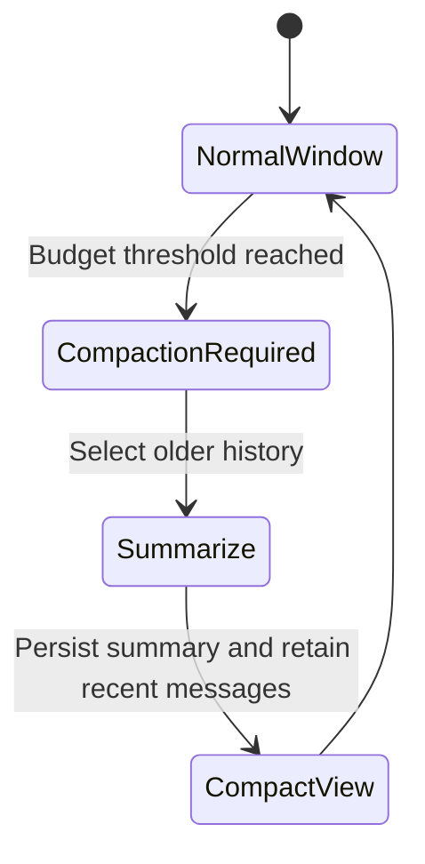
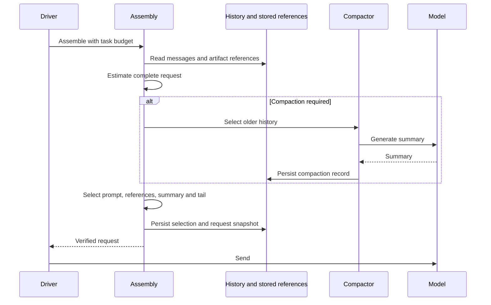

# Context Assembly and Memory

## Responsibilities and Boundaries

The context and memory components in `packages/agent/src/` assemble each model request from fixed references, history, memory and skill information, then verify its selection and token budget before sending. Required current-task input includes the original request and all consumed guidance, distinguished by `ruukotoSourceTaskId`. Same-task question results and trusted internal reports retain their own identities rather than replacing that original request.

Compaction makes a lossy model view without deleting history. Memory has explicit versioned update/revocation. Skills come from the backend account's `$HOME/.agents/skills/`: the task pins versions, advertises names/descriptions, and loads bodies/references on demand. A loaded body supplies the skill directory; existing command tools execute its scripts by path without reading their source by default.

[Core](core.md) reads authoritative JSONL history; [runtime](runtime.md) owns tasks and model driving; [execution](execution.md) owns tool processes.

## Public Interfaces

| Entry | Caller | Purpose |
| --- | --- | --- |
| `beginContextAssembly` | Driver | Fix task references, sources and configuration |
| `ContextAssembly.assemble` | Pi context hook | Select summary, messages and attachments |
| `prepareSend` / `afterSend` | Driver adapter | Recheck and persist selection/request snapshots; record actual usage |
| `planCompaction(history, limits)` | Context orchestration | Plan whether and which history needs compression |
| `selectContext(options)` | Context orchestration | Select summary and recent messages |
| `MemoryStore` | Tools/TUI | Versioned memory queries, updates and revocation |
| `loadSkillLibrary` / `listSkillLibrary` / `getSkillDetail` | Runtime/clients | Fixed-root discovery, paged reads and content-hashed snapshots |

## Data and State

| Request component | Source and lifetime |
| --- | --- |
| System prompt | Host identity, behavior and safety policy |
| Reference snapshots | Project instructions, skill catalog and task references, pinned for the task |
| Memory | Relevant or explicitly selected persistent facts |
| Compaction | Stored summary replacing selected older history in the model view |
| Recent messages | User, assistant and tool history retained in the selected window |

Side chat uses only its first-open frozen parent-history snapshot and subsequent side-chat history. It has a dedicated system prompt and independent compaction, without project instructions, memories, skill/role catalogs, Jev or live parent-progress references.

Dynamic reports use `ruukoto_agent_report_context` provenance plus actual effective message references and a request binding. A custom marker alone is not consumption proof: the report body must appear in the sent request and an eligible response must follow. Different sources keep separate verification and reporting rights. Compaction, recall and branch reads use effective contributions without reviving omitted report text.

Pi 1.3.0 stores system prompts and tool declarations in system entries of `TranscriptContext.messages`. Budgeting, send eligibility and request snapshots read the same final messages, including dynamically registered MCP tools. Original system entries remain in JSONL; compaction ordinals count conversation entries only. CUA result eligibility additionally verifies the exact persisted host-operation identity against the outgoing projection; SDK call ids are reusable, and unpersisted results require SDK rebuilding rather than using contaminated manager memory. See [tools and approvals](agent-tools.md). Snapshots still separate system prompt, tool definitions and conversation content; old JSONL is reconstructed read-only.

## Main Flows

Compaction extracts earlier decisions, file references and unfinished work, fixes a compaction point, then joins it to retained recent messages. Oversized tool output remains retrievable through artifact references instead of being repeatedly injected in full.

## Invariants and Failure Handling

- Compaction changes the model view, not authoritative historical messages.
- The final budget includes messages, prompt, tool declarations, images and response allowance. Invalid selection blocks sending.
- Compaction, attachment and source-selection failures remain attached to the assembly and surface as `ContextSendBlocked` at pre-send validation; history is not silently dropped to continue.
- Model-visible host input must be reconstructible from persisted selection, versions and request records.

## Design Rationale

- [Preserve session history](../../.agents/notes/implemented/architecture/2026-09-19-preserve-session-history.md)
- [Lossy context compaction](../../.agents/notes/implemented/architecture/2026-09-26-lossy-context-compaction.md)
- [Home skills discovery](../../.agents/notes/implemented/simplification/2026-10-28-home-skills-discovery.md)
- [Next-request report delivery](../../.agents/notes/implemented/feature/2026-10-30-coding-report-delivery-boundary.md)
