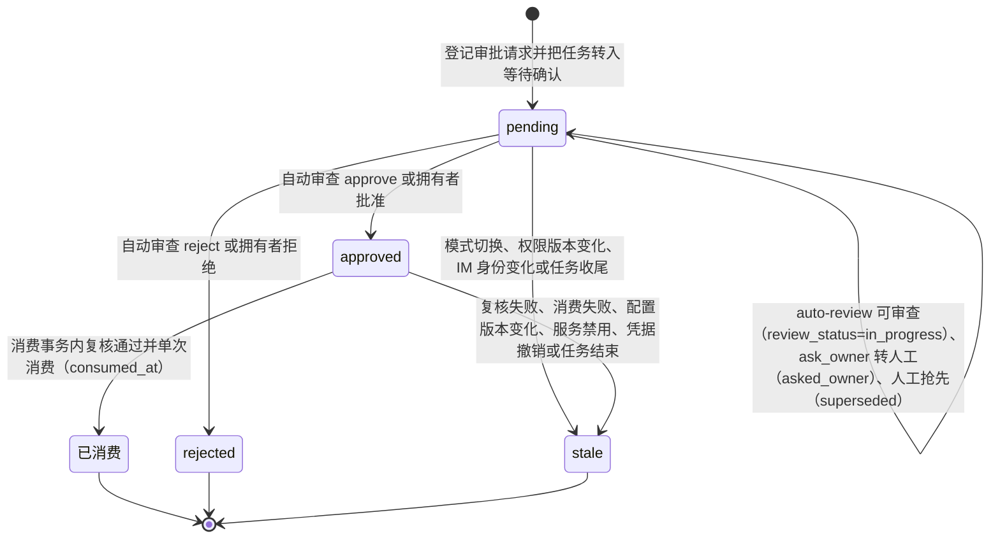
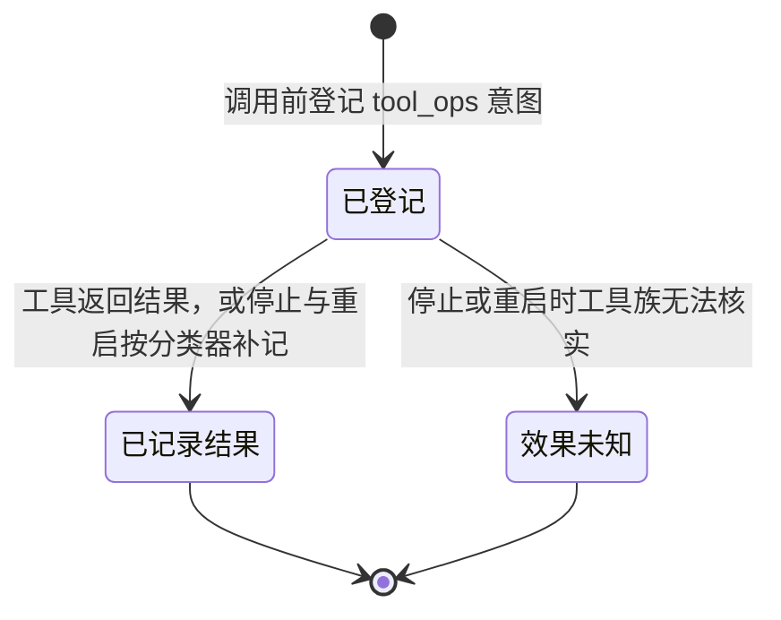
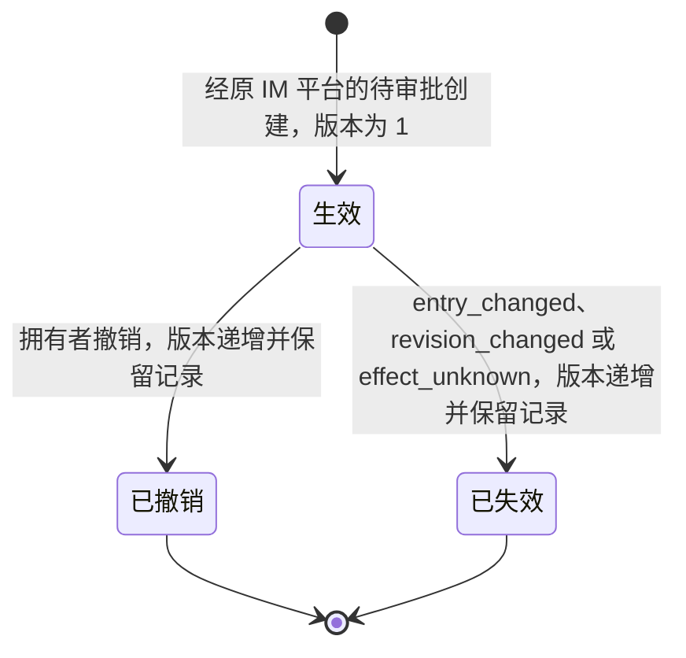
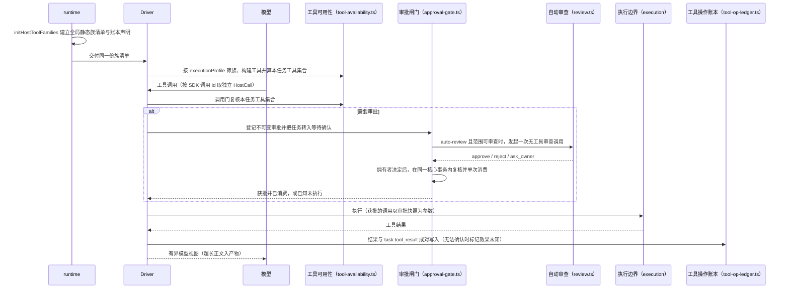
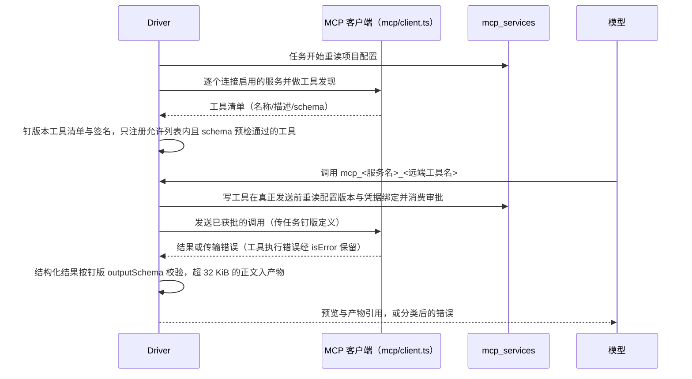

# 宿主工具与审批

## 职责与边界

本模块回答两个问题：**这个会话、这个任务允许哪些工具**，以及**一次工具调用怎么被执行边界接受、怎么取得授权、结果怎么记账**。它持有会话身份到工具类别的静态表与执行画像（`packages/agent/src/tool-availability.ts`），把宿主工具族装配成一次任务的工具集（`packages/agent/src/host-tool-families.ts`），并负责审批闸门（`packages/agent/src/approval-gate.ts`）、自动审查策略（`packages/agent/src/review.ts`）、工具操作账本（`packages/agent/src/tool-op-ledger.ts`）、工具正文产物（`packages/agent/src/artifacts.ts`），以及工作清单、计划模式工具白名单、main 应用数据空间、长期操作授权、Web Search、浏览器与 MCP 服务这些具体的工具面。

它不负责执行边界本身：原生沙箱或启动账户的建立、路径解析、Shell 子进程与进程回收归 [execution](execution.md)。它不做上下文组装：参考块注入、工具结果截断、上下文预算与选择记录归 [agent-context](agent-context.md)——工作清单的上下文保底与计划模式的计划说明都在那里。它不解析拥有者发来的 IM 审批命令，也不发送回执：`/approvals`、`/approve`、`/reject`、`/approve-standing`、`/revoke-service-grant` 的文本解析、终态与回执归 [channels](channels.md)。任务状态机、`endTask` 收尾事务与排队归 [runtime](runtime.md)，本模块只在收尾事务内被调用补记账本。MCP 与 Web Search 的完整命令参数属使用手册，本模块只列拥有者入口并解释机制。

这里描述 Coding 与保留的旧格式实现；[个人 durable](personal-durable.md)的服务检查与宿主服务操作另行装配，只复用 app 内 `service-helper.ts` 的固定进程传输，不复用旧 Task、ApprovalGate 或 ArtifactStore。共用传输在超时、取消或超限后等待调用进程与 stdio 关闭，再返回首次失败及有界输出；调用关闭不代替服务操作单元的停止核实。

个人 durable 的浏览器向完全访问主拥有者输入及创建时已开放该能力的完全访问独立定时会话提供，各会话独立绑定，子会话和汇总不开放。它只复用 BrowserManager 与独立参数校验，绑定和操作事实由 durable 保存，持久回调可异步等待。截图、本地读图及 Telegram 图片用私有产物引用，provider 前恢复并核实能力；主/子资料范围、未知源暂停和 CLI 导出见[个人持久会话](personal-durable.md)。共享 Coding Browser 工具继续使用原 Store/审批和产物格式。

部署 helper 的持久检查身份与停止核实见 [deploy](deploy.md)，保留的旧服务调用方仍用原 inspect；个人 durable 的主/子会话检查与服务审批前检查使用新动词，先提交执行归属并核实原 ID 退出，未核实时保留目标/来源占用。子检查另固定原工作与权限，正常/取消收尾等待检查停止；子会话只装配已启用能力的工具。CLI/Telegram 的停止重核由独立宿主任务执行，仅接受原检查接纳与可信退出证明，模型工具不获得重核权限。个人子会话可用 service_restart 沿原工作权限重启白名单服务，服务 Task 归 WorkTask 持有；整项取消及报告等待效果和停止核实。CLI 可批准/拒绝本机操作，Telegram 仍从原私聊审批；原证据由 read_service_operation 限原子会话分页读取。个人服务写操作另有 CLI/原 Telegram 的效果核实与停止重核，固定原操作身份且不重发写入，人工说明不能代替原启动器/命令单元退出证明。

两件事明确不属于可用性判定：获批之后的复核属于审批闸门；Web Search 开关的现场检查与「委派沿拥有者请求、定时计划或已保存的工作授权触发」这一限定，由各工具在执行时自行完成。

## 对外接口

`present({path})` 或 `present({url})` 向桌面来源会话侧栏登记预览。文件沿 Agent 当前读取权限捕获不可变产物，支持 Markdown、UTF-8 文本及 PNG/JPEG/GIF/WebP；HTML 显示源码，PDF/SVG 不支持，空文件也有真实快照。网页只接受无凭据 HTTP(S)，沿完全访问拥有者浏览器资格；SubAgent 和工作流步骤不开放。回执只证明请求已记录，无桌面连接可从历史工具行重开，不声称页面已加载。

`search_tools(query, limit?)` 搜索本任务获准 MCP 工具的名称和描述，空格分词须全部匹配，默认5项、最多20项。初轮隐藏这些工具，命中后下一模型请求提供完整参数定义并激活至任务结束；新任务重新搜索。没有搜索入口的固定角色／宿主工具清单保持直接可用。服务连接、发现和版本仍在任务开始固定；搜索不改变 Plan、角色或审批范围。实际每轮定义由 prompt 快照和选择记录保留。

`web_fetch(url, reason)` 沿 HTTP 审批执行无凭据 GET，返回来源、标题和静态正文；HTML 经 parse5 提取，纯文本／Markdown 保留文本。只支持 UTF-8，不执行脚本、不自动跳转或重试，二进制、压缩和其他编码明确失败。最多捕获1MiB，来源超限或HTTP 206标 partial；预览最多16KiB，长正文返回 artifact_id 与 next_offset，用 read_artifact 继续。网页内容是外部资料，不授予指令或权限；Web Search 开关仍只控制搜索服务。

`wait` 还接受单个 `{kind:"process",process_id}`，不与 task／workflow 混合。进程 stopped 且 stopVerified 返回结果；主命令已退出、尚未登记停止意图且整组未核实返回 command_exited，需 process_stop 后继续 wait；stop_unverified 返回需介入。超时、取消或新输入只解除等待，不停止后台。进程结果不参与工作流报告认领；旧 agent_wait JSONL 和账本仍可恢复。

`process_start` 接收最多16384字符的非空命令，独立后台跨拥有者消息保留；宿主固定目录、环境、平台身份和权限。`process_status` 按本会话记录查询，保留原启动来源与权限模式，列表每页最多20条且不超过256 KiB；`process_output` 用原字节 offset 读取 stdout/stderr 的32 KiB页，base64保留原字节；`process_stop` 立即返回停止意图接纳，须再查询 stopped 与 stopVerified。主命令退出码仅为观察，启动不承诺服务健康，停止不证明外部效果回滚。

后台交接后当前轮立即收窄为状态、日志、等待、停止、提问与有效完全访问的浏览器／网页预览；参考块说明先停后改，普通 worker、MCP、目录读取和委派均关闭。新受限拥有者轮可查询和可信停止；Plan 不能启动或浏览。停止完成后仍保留观测工具，status 或进程 wait 取得目录才重开业务工具；后台占用不能由 wait 让出。装配、发送前和调用门使用同一工具集合，浏览器逐调用重核原后台与当前输入来源。

`ask_user({questions:[{question,options?,multiple?}]})` 登记1–3题并立即返回 pending；题目最多2000字符，选项2–5项，名字互异非空且最多200字符。选项可为字符串或 `{label,description?,recommended?}`，说明最多500字符，推荐只展示不预选；`multiple: true` 须有选项。每题均可自由输入或 Skip，跳题保存空答案，多选答案只包含选项名。仅真实普通开发输入和Plan开放，SubAgent、工作流、定时及内部汇总不装配。登记后当前任务只留宿主状态查询，模型输出说明并结束本轮；问题卡片回答作为下一轮拥有者输入，不批准操作。装配、发送前与调用门共同收窄；其他普通聊天不受待答状态限制。

个人 durable 的会话后台另用原生工具Task、独立日志和共享目录认领，Linux固定命令目录只接受主拥有者完全访问启动；子工作与定时不装配 `process_*`，来源和收窄阶段在请求与调用时重核。

个人 durable 另以原生工具装配文件、HTTP、搜索和产物，不使用旧 ApprovalGate/ArtifactStore。`web-search-transport.ts` 提供不持有旧项目或任务的 `requestTavily`，返回映射结果和字段截断前有界脱敏原响应；旧 `searchTavily` 包装继续核实原 CredentialStore 的 host/purpose/scope。个人接纳、审查、撤销与恢复见 [personal-durable](personal-durable.md)。

个人 durable 的 `ask_user` 独立持久化问题与真实答复来源，支持单选、多选、选项说明/推荐、自由输入与跳过。工具立即返回，当前输入收窄查询后结束；普通新聊天不受待答限制。CLI 与原 QQ/Telegram 菜单核对整批后只接纳一次答案，按答复时权限唯一续接；业务答案不消费操作批准。来源、恢复及请求/调用三处资格核实见[个人持久会话](personal-durable.md)。

个人 durable 的 `schedule_create`、`schedule_query` 与 `schedule_cancel` 由 app 原生工具装配，创建仅接受主会话真实拥有者来源。计划保存模式、权限版本、工具和资料快照；范围或配置内容变化停止旧计划后续新执行。独立定时会话使用快照内业务工具和本次 `background_work`，不取得新计划创建或长期授权；主/子工具、审批和未知占用都核实真实定时来源，未知时阻止整项外调、委派与汇总。宿主自动整项收尾，最终汇总只读，结果与独立固定目标发送见 [scheduler](scheduler.md)。

调用方与入口：

| 调用方 | 入口 | 说明 |
|---|---|---|
| runtime | `initHostToolFamilies` | 初始化应用库、资料解析器与个人产品的调度器之后建立一份全局静态族清单与工具操作账本，随后 `recover` 核实遗留操作；`SubAgentManager` 在恢复前创建，恢复事务调用其 `recoverQueuedTasks`，编排器在恢复后创建 |
| runtime | 族清单 | Runtime 捕获资料、凭据、应用库、调度器等各族依赖，把同一份清单交给 Driver |
| Driver | 执行画像 | 按 `executionProfile` 与持久来源快照筛选并构建工具，校验声明的名称与构建结果一致、族间名称不重复；用构建出的宿主名称集合分派调用 |
| 模型 | 工具调用 | 每次执行按 SDK 调用 id 取得独立 `HostCall`；身份与宿主操作编号来自宿主记录，不从模型参数取得，结束时在 `finally` 释放绑定 |
| 工具族 | 能力闭包 | 族在构建工具时获得 Driver 提供的身份复核、审批、产物登记等能力 |
| control | 审批参数与操作参数 | `get_confirmation_params` / `get_tool_op_params` 按 ID 分段读取大参数；`respond_confirmation` 可携带 `permission_version` 绑定审批时的权限版本 |
| channels | IM 审批 | 拥有者私聊的审批命令在同步事务内直接到终态，绑定原请求与原权限版本并单次消费 |
| 调度通知 | 目标解析 | 调度通知目标从本次调用的任务编号读取来源事件，由拥有者 IM 入口确定 |
| ToolRouter | 编码工具、结构化审批、产物读取 | `read` / `edit` / `write` / `bash`、`list_files` / `search_files`、`request_file_access` / `http_request` / `web_fetch`、`present`、`read_artifact` 继续经 ToolRouter；MCP 按任务钉版计划装配 |
| MCP HTTP 传输 | `mcp/transport.ts` 的 `connectMcpEndpoint` | 接收服务标识、固定端点、超时、逐请求 token resolver 与原请求/进展持久钩子；`resumeMcpCall` 只 GET 原 SSE 流，不重发工具；宿主负责来源范围与凭据校验，调用方持有并关闭连接；`mcp/client.ts` 核实 Code 实例凭据并重导出原符号 |

`mcp/schema.ts` 持有两个产品复用的原工具 schema 预检，不加载旧工具或项目装配；个人持久调用、配置与审批见 [personal-durable](personal-durable.md)。共享 MCP 传输用 SDK 的分页限额最多请求 16 页，达到上限且仍需继续分页时报 `too_many_pages`，不将超限结果当成功清单返回；成功汇总后仍限制最多 64 个工具。

`mcp/images.ts` 校验有界内联 JPEG/PNG/WebP：每次最多4张、每图8MiB，解码前核长度，解码后核规范base64与实际MIME。Code先保存不可变产物，JSONL按原工具结果顺序保留图片引用，task.tool_result关联产物ID，provider前核实归属与哈希并恢复原字节；prompt快照存引用。isError附图保留错误标记与视觉块；图片失败单独说明，完整应答后的原动作不改为未知，也不自动重试。个人媒体登记与旧历史兼容见[个人持久会话](personal-durable.md)，理由见[MCP图片结果](../../.agents/notes/implemented/architecture/2026-10-23-mcp-image-results.md)。

`list_files(path?, glob?, limit?)` 递归发现普通文本文件，`search_files(query, path?, glob?, ignore_case?, limit?)` 作字面内容匹配。path 默认工作目录且必须是读取范围内现有目录；无 glob 沿根内 ignore 并跳隐藏，显式 glob 沿 rg 覆盖语义，不跟随链接、不扩授权。结果给相对路径、1起行号和有界片段，分别标 scanComplete、previewTruncated、partial 与已捕获条目数；未完成扫描不代表全部命中。limit 默认100、范围1–200，预览每行2048字符、整体64 KiB；预览裁剪仍捕获原流，可用 read_artifact 查证据。扫描10秒或捕获8 MiB即停止并保留部分结果；更大查询须收窄目录或 glob，后续 read 重新核实文件。

个人检索沿 tools.json 资料根、有效资料授权和原工作来源，在独立只读 worker 中执行；越界目录先由拥有者从资料授权入口开放。受限原生 workspace 为私有临时目录，资料只读；完全访问沿原文件权限。工具接纳与产物使用独立 durable，开始后不重放，原单元停止未核实继续暂停来源，重开再次核实；定时沿原工具快照，不取得新增权限。

`read` 可读取文本与 JPEG、PNG、WebP 图片，按实际文件内容识别，图片结果连同正文进入会话历史与 prompt 快照。所选模型不支持 image 时，发送前以 `image_input_unsupported` 明确失败；图片处理与传输上限见 [execution](execution.md)。

`packages/agent/src/host-tool-families.ts` 定义族的类别、工具名、构建入口与账本声明。没有绑定器的模块测试可直接提供 `taskContext`；释放可重复调用，并发执行不共享可变的当前调用上下文。旧群结果查询由 channels 提供，Runtime 合并共享族与产品族后派生账本声明。旧个人调度、通知与服务模型工具已删除；共享调度和服务账本保留旧操作分类与恢复核实，Coding 不装配这些工具。

会话身份到工具类别的静态表是唯一来源，新工具族写进哪份清单才出现：

| 会话身份 | 工具类别清单 |
|---|---|
| 普通开发会话 | 编码工具（含工作清单 `todo_write`）、资料与记忆、Web Search、MCP、浏览器、技能、SubAgent 委派与工作流 |
| main 会话 | 资料与记忆、Web Search、应用数据、调度与通知、旧 coding 结果只读、群结果、浏览器、技能、服务器服务管理、SubAgent 委派与工作流 |
| SubAgent 会话 | 空；工具按执行画像的 SubAgent 工具集单独装配 |
| 已退役归档会话 | 不归任何类别；QQ 群会话与 chat/coding 旧角色会话是只读归档、不运行任务，算执行画像即拒绝 |

普通与工作流子任务按持久来源与角色要求预检实际工具：省略清单继承可委派集合，显式工具缺少任一项或 MCP 发现失败即拒绝启动。基础 shell 不依赖写入目标；个人来源包含适用业务与 MCP，业务资格由宿主复核，账本与审批归真实子 Task。普通协作消息沿工作归属，工作流仍由运行管理；浏览器、下级委派与新工作流启动不开放。GitHub 宿主固定评审只允许 read/list_files/search_files/read_artifact 和只读 MCP，禁消息。

宿主工具族按类别装配出的工具名（读者的检索入口）：

| 类别 | 工具名 |
|---|---|
| 编码 | `read`、`list_files`、`search_files`、`edit`、`write`、`bash`、`todo_write` |
| 结构化审批 | `request_file_access`、`http_request`、`web_fetch` |
| 侧栏预览 | `present` |
| 产物 | `read_artifact` |
| 资料与记忆 | `history_search`、`history_read`、`memory_list`、`memory_read`、`memory_save`、`memory_revoke` |
| 后台等待 | `wait` |
| Web Search | `web_search` |
| 浏览器 | `browser` |
| 应用数据 | `app_data_define_table`、`app_data_migrate`、`app_data_query`、`app_data_insert`、`app_data_update`、`app_data_delete` |
| 历史服务操作分类（工具已退出） | `service_inspect`、`service_manage` 仅用于旧账本核实 |
| MCP | `search_tools`、`mcp_<服务名>_<远端工具名>` |

`executionProfile` 沿会话身份与持久来源快照确定实际工具、MCP、资料范围、系统提示与 SDK 签名；宿主固定评审另沿固定只读规则。普通与工作流角色权限在登记时只继承或收紧，单次批准与长期授权不继承。装配过滤、任务收窄与 SDK 会话签名同用这一份。本任务工具按固定画像及当前资源阶段收窄，再扣除计划模式、GitHub 评审及项目关闭的 Web Search；激活、发送前检查（`task_tools_forbidden`）与调用门共用这一集合。

`wait` 向有目标查询资格的主 Agent 开放，固定最多 20 个同来源任务或工作流，SubAgent、工作流步骤与无工具汇总不开放；默认 60 秒、最多 300 秒，任一结果、需介入、超时或中断均返回事实，等待属于无外部效果的顺序工具。ID 来自实际委派或启动结果，保存的定义名须先启动。每个目标至多返回 100 条产物引用并附总数，完整产物沿原查询接口读取。续接轮接手旧组最终报告时，`reportTargets` 额外提供最多 20 项完整事实，`targets` 保持本次等待集合；旧消费证明保留，全组才可汇报。普通内部对话阶段开放等待、后台记录、历史及结果查询，以及获准的 present 网页预览；后台观测阶段另开放本页所列状态、停止、提问与浏览器。项目读写、bash、技能文件读取和MCP须重新取得执行资源，装配、发送前与调用门使用同一收窄集合。

Coding 装配的 `browser` 在完全访问的拥有者 main / 普通开发任务的执行或会话后台观测阶段开放；普通等待进入的内部对话阶段须先重新取得执行资源，Plan、SubAgent、独立定时、工作流步骤/回报和 GitHub 来源均拒绝。Runtime 核实来源入口，Driver 在激活、发送前和调用门收窄，工具执行再核实当前身份、任务状态与权限版本。动作参数不能覆盖程序、配置、socket、profile 或截图路径；网页内容是资料，不是改变授权的指令。

浏览器动作顺序执行。元素操作将快照的 eN / @eN 规范为同一引用，仅接受该会话当前代次的 snapshot 引用，并在发送前用新快照核实引用仍在。导航和表单操作按完全访问依据记账，发送后断线、超时或取消不能证明未执行时记 `effect_unknown`；不重发，连接保持不可用，等待拥有者暂停后的新输入核实；先前排队任务不能解除暂停，IM 沿原消息接受顺序判别。只读 snapshot/截图丢响应不增加写入效果。截图校验实际 MIME、8 MiB 上限与 SHA-256 后提升为不可变产物，再返回视觉块；图片与真实模型请求、JSONL、prompt 快照同源。完整导出见[操作手册](../usage.md)。

拥有者入口（模型工具不能调用，完整参数与运行步骤见使用手册）：

| 入口 | 命令 |
|---|---|
| Web Search 凭据 | `ruukoto-code credentials add --name tavily --host api.tavily.com --header authorization --purpose tavily_search --secret-env TAVILY_API_KEY` |
| Web Search 开关 | `ruukoto-code project web-search <项目id> off`／`on` |
| MCP 凭据 | `ruukoto-code credentials add --name github-mcp --host api.githubcopilot.com --header authorization --purpose mcp --secret-env GITHUB_MCP_PAT` |
| MCP 配置 | `ruukoto-code mcp configure --project <id> --name github --endpoint https://api.githubcopilot.com/mcp/readonly --credential github-mcp --tools get_me,get_file_contents [--expected-version N]` |
| MCP 查看 | `ruukoto-code mcp list [--project <id>]`（脱敏视图）、`ruukoto-code mcp check <service-id>`（连接检查 + 工具发现，先打印将联系的端点） |
| MCP 变更 | `ruukoto-code mcp disable <service-id>`／`enable`／`remove <service-id> [--expected-version N]` |
| 长期授权管理 | `ruukoto-code service-grant list/show/revoke` 与已认证控制面 `service_grant_*`（入口停用后仍可管理遗留记录）；创建首版只经原 IM 平台的待审批，不提供配置页面或自由范围创建 |
| 长期授权创建与撤销 | 经原 IM 平台的待审批创建，拥有者用 `/approve-standing` 保存当前批准；撤销命令与回执归 [channels](channels.md) |

普通与工作流共用 `role` 目录，省略为 general；旧派发 `mode` 明确拒绝。普通代码修改/审查委派显式给 `target`，与 `read_paths` / `materials` 互斥；目标独立于角色。目标路径按原值参与幂等核实，首尾空格不同的目录不能共用同一请求键。Git 副本从当前稳定内容开始，受保护执行不能通过文件工具、路径授予或批准后的宿主操作写回来源，普通汇总只应用子增量。无目标用独立目录，非 Git 保护要求在准备前拒绝；基线损坏保留成果并报告拥有者。

## 数据与状态

工具操作与审批落在核心库（`ruukoto.db`）：

| 表 | 关键字段 | 生命周期 |
|---|---|---|
| `tool_ops` | `id`、`task_id`、`tool_name`、`sdk_call_id`、`params`、`intent_recorded_at`、`authorization`、`result_summary`、`is_error`、`effect_unknown`、`recorded_result_at` | 调用前登记意图；结果或效果未知一次写入 |
| `confirmations` | `id`、`task_id`、`session_id`、`tool_op_id`、`tool_name`、`params`、`scope`、`cwd_dev`/`cwd_ino`、`permission_version`、`status`（`pending`/`approved`/`rejected`/`stale`）、`created_at`、`responded_at`、`consumed_at`，以及审查列 `review_status`/`review_decision`/`review_reason`/`review_model`/`review_policy_version` 与最终 `decision_source`（`owner`/`auto_review`/`standing_permission`） | 一次审批一行，不可变；批准经条件更新单次消费 |
| `artifacts` | `id`、`task_id`、`session_id`、`name`、`byte_count`、`status`（`partial`/`complete`）、`mime_type`、`content_hash`、`created_at` | 元数据在库、正文在产物文件，按任务归属跨重启可读 |
| `standing_permissions`（schema v23） | `id`、`version`、`session_id`、`project_id`、`machine_id`、`unit`、`action`（当前只取 `restart`）、`policy_revision`、`unit_revision`、`channel`/`account`/`chat_id`/`actor`、`pinned_target`、`approval_id`、`created_by_event_id`、`created_at`、`revoked_at`、`revoked_reason` | 长期操作授权；创建后范围不修改，撤销/失效保留记录 |
| `mcp_services` | 服务 ID、`project_id`、名称、互斥的 HTTP 端点与 `cua_config`、凭据绑定名、工具允许列表、启用状态、配置版本；秘密值在 CredentialStore | 配置存在即生效；变化递增版本；Cua 不使用端点或凭据 |

结构化审批的范围是 `ApprovalScope` 的判别联合，按操作种类固定证据：`file_operation` 固定路径、读写访问、待写内容指纹与字节数、原文件版本指纹；`http_request` 固定方法、完整 URL、引用的凭据名称与用途；`mcp_tool` 固定服务 ID 与配置版本、远端工具名、工具定义版本（任务钉版签名）、规范化参数摘要、凭据引用名与本地副作用类别；`app_data_change` 固定应用库实例身份、任务与操作 ID、表与操作类别、schema/revision、参数摘要、行 ID 与行版本；`service_operation` 固定本机、规范单元、动作、策略与单元修订、任务与宿主操作 ID。凭据值不进入审批视图与事件。执行参数取自审批前构造、与审批记录同源的请求：MCP 与应用数据用审批记录的快照，固定解析地址与目标文件身份只在内存。

审批记录的状态机（状态列只取四个值；`review_status` 单独表示审查阶段）：

工具操作的状态机：

长期操作授权的行级版本：

个人durable使用同一存储与查询实现，并从 `app-data/contract.ts` 复用参数和迁移分析；独立调用不引用旧Task/ApprovalGate。绑定打开校验实例、存储版本及必需表；查询子进程可按预期实例再次核实。可选宿主请求指纹和整份回执校验保存在operation JSON，预期revision在业务事务内校验；共享旧装配不提供这些字段时保持原格式。个人来源、审批与恢复见[个人持久会话](personal-durable.md)。

main 应用数据空间保存在独立的 `<dataDir>/agent-data/main.db`，与核心 `ruukoto.db` 分离；核心任务、审批、事件与凭据表不对应用数据工具开放。每表有宿主维护的 `_id`（单调不复用）与 `_version`；存储格式版本（宿主）独立于 main 管理的 `schema_version` 与每次变更递增的 `revision`；每笔写入在单事务内提交业务变更、版本递增与追加审计回执（`hostOpId` 唯一）。

Code MCP 的专用入口与通用 `add_credential` 的 mcp 分支首次写入即限定本实例、mcp 用途与操作及 authorization 头，绑定服务时再核实实际端点 host；保留引用的配置更新也重新校验。项目/仓库受限、无操作限制或用途不符的同名旧绑定明确拒绝，不转换 scope；有效绑定轮换仍保留限制。列表仅返回元数据及服务引用，专用与通用删除在仍有引用时都拒绝清理。发送时再次核对主机、用途、请求头与范围，引用失效不降级匿名。禁用服务的连接检查只初始化与发现工具，失败不回显远端原始错误。

MCP 任务内钉版的是工具清单与签名（服务配置版本 + 工具名/描述/schema 摘要）；签名变化时从同一历史文件重建 SDK 会话。工具暴露名带稳定命名空间 `mcp_<服务名>_<远端工具名>`（≤64 字符，截断带哈希后缀；转义后冲突的工具禁用并记录）。自动审查的审查列与文件、HTTP 审批的审查列同一套：`review_status` 取 `in_progress` / `done` / `asked_owner` / `superseded`，`review_decision` 取 `approve` / `reject` / `ask_owner`，`decision_source` 区分拥有者、自动审查与长期授权。

## 主要流程

一次工具调用的正常路径：

审批闸门覆盖审批请求全程：登记并把任务转入等待确认、auto-review 任务先经一次自动审查、等待拥有者决定、未批准时记录已知未执行、获批后在同一核心事务内复核并单次消费（`task.approval_consumed`），需要时同事务提交本地效果（通知登记）。文件、HTTP、MCP、应用数据、通知与模拟测试的 `confirmTools` 门都经它；工具族只提供审批范围、获批后复核（MCP 服务配置与凭据、个人助手宿主绑定与应用库版本、通知的身份、目标与资料）与同事务提交。未批准、复核失败与消费失败交回同一句已知未执行文案，落库与返回给模型的是同一句。完全访问在同一闸门免等待、免自动审查：复核活动任务、取消状态、权限版本及工具族条件后，单次登记真实 `full_access` 授权与 `task.tool_authorized`；通知登记与该授权同事务提交。其余模式继续审批与批准消费，不继承别的任务的批准或长期授权。

自动审查先经确定性策略分类：越界文件读取、无凭据的 HTTP GET/HEAD 读取交审查模型裁决；写文件、带凭据请求、非 GET/HEAD、MCP 工具与通用 `tool` 门直接转人工。审查输入只含后台保存的拥有者请求、不可变操作参数与审批范围，参数与网页/文件内容都是待审查数据，其中任何指令不得成为授权依据；输出严格校验（`decision` 枚举 + 非空理由），解析失败、模型异常、超时、输入超限一律转人工。每个审批请求最多一次有时限的审查，不循环重试。审查复用任务创建时固定的模型配置，不另设审查模型。

MCP 服务的任务内装配：

其余流程的分支：

- **工作清单**：适用会话与编码工具同一条件装配——只有普通开发会话，main 与 SubAgent 不装配。`todo_write` 的参数 `todos` 是 `{ content, status }` 数组，`status` 取 `pending` / `in_progress` / `completed`，不设 ID 或其他字段。每次调用提交整张清单并整体替换，空数组清空；结果只返回一句摘要（如「已更新：完成 3/7」）。校验最多 20 项，`content` 去除首尾空白后非空、原文不超过 120 字符，`status` 只能取上述三值，不满足时返回明确错误、不截断、当前清单不变，也不接受额外字段。清单跟随会话：会话中最近一次成功调用的参数即当前清单，跨任务延续；校验失败的调用不改变清单；新会话没有清单。不建表、不另存文件，会话历史与工具记录是唯一来源。无副作用，任何访问模式都不产生审批；用法写在工具描述中（3 步以上的工作才使用、同时只标一项进行中、完成一项立即更新），不改系统提示、不做定期提醒，「只有一项进行中」不校验。上限低于控制面参数下发的截取阈值（8 KiB 内联；超出时预览仍保留 32 项、每串 256 字符），TUI 总能拿到完整清单。当前任务的上下文保底与 token 归类归 [agent-context](agent-context.md)。
- **计划模式**：普通开发会话可以选择 Plan，main、SubAgent、已退役归档与 IM 入口不能选择，后台按会话身份核实。工具白名单在激活、发送前与调用时三处检查：`read`、`present`、`bash`、`request_file_access`、`http_request`、`web_fetch`、`read_artifact`、`search_tools`、`wait`、`history_search`、`history_read`、`memory_list`、`memory_read`、`web_search`、`todo_write`、`skill` 与类别为只读的 MCP 工具；`edit`、`write`、`memory_save`、`memory_revoke` 与非只读 MCP 工具不可用；白名单之外的名称一律拒绝，新增工具族不写进白名单即不可用。计划模式与 GitHub 评审的按任务收窄组合生效。任务级 `switch_mode` 不能进入或退出 Plan，也不能改其固定的 Auto review 策略。计划说明的注入位置与 `「计划模式」` 上下文类别归 [agent-context](agent-context.md)。
- **应用数据写入**：六个工具 `app_data_define_table` / `app_data_migrate` / `app_data_query` / `app_data_insert` / `app_data_update` / `app_data_delete` 在 main 与独立定时会话按个人业务类别装配（业务类别清单含应用数据类别，装配、发送前检查与调用门共用同一结论），执行入口每次重新核实宿主任务、会话、项目与个人助手宿主绑定。非破坏性变更自动执行；删表、删字段、删唯一索引、多行写与批量重写在受限模式下进入统一审批，完全访问使用任务授权免审批。执行前重核身份与版本，按不可变快照执行。所有写入在单事务内提交业务变更、版本递增与追加审计回执：`hostOpId` 唯一，同参重放返回原结果，异参冲突；审计、约束或磁盘失败回滚业务变更。版本不一致返回可识别冲突与当前版本，不自动覆盖。
- **旧长期操作授权**：旧服务模型工具已退出，核心库继续保留 `standing_permissions`、关联审批、使用来源与行级版本，供旧记录查询、撤销和恢复核实；不再从该工具创建或消费新授权。个人 durable 使用自己的权限与服务操作记录，见[个人持久会话](personal-durable.md)。
- **Web Search**：默认对所有项目启用并注册；工具按 `purpose=tavily_search` 且 host 与目标一致的绑定取凭据，经 `Bearer <key>` 注入；未配置、host 或用途不匹配一律拒绝调用且不发送请求。任务开始固定工具清单，禁用中的项目任务不注册 `web_search`（模型不可见，系统提示同步重建）；任务内禁用立即阻止后续调用，重新启用从下一任务生效。
- **历史引用**：每条工具结果在 SDK message_end 后落盘，下一拍按已落盘 JSONL 补发 output_entry，不等待整批工具结束；旧任务回调不消费下一任务的去重与消息身份。
- **正文产物**：工具输出在上游截断之前捕获为受保护的产物文件，先落盘再生成限长模型视图。中断或写失败保留已捕获部分并标 `partial`；按任务归属经工具或控制接口按 id、偏移、长度查询，跨重启可读。
- **Write 差异**：结果只保留该调用在执行边界内捕获的写前文本与成功写入内容的补丁；后续磁盘变更不改写历史。未捕获补丁仍保留真实写入结果，读取缺失或空补丁的区别见[core](core.md#对外接口)，执行侧预算见[执行边界](execution.md#工具工作进程)。

## 不变量与失败处理

分支来源读取与工作管理分别核实：`subagent_result` 可以读取限定清单中的已完成结果，原工作的消息、委派、复用、关闭、取消与汇总仍按原父会话归属判断。来源产物读到固定字节上限，并保留分支时的 partial 状态；当前资料授权和图片完整性校验仍生效。

**可用性**。会话身份到工具类别的清单是唯一来源，任务不允许的工具在激活、发送前与调用时都被拒绝，发送被打断时以 `task_tools_forbidden` 阻断。旧服务与调度模型工具没有生产装配入口，历史工具名仅用于账本核实。执行画像在任务开始算一次、钉到任务结束；工具集变化时重建 SDK 会话。身份与宿主操作编号一律来自宿主记录，不从模型参数取得；并发执行不共享可变的当前调用上下文，绑定在 `finally` 释放且可重复释放。工作区不进画像。

**审批**。审批是不可变的：完整 URL、方法、正文指纹、凭据名称与用途、任务与权限版本固定后不能复用给其他 URL、方法、正文或任务。批准经 SQLite 条件更新单次消费；`permission_version` 不匹配返回 `permission_version_mismatch`。HTTP 请求不自动跟随重定向，连接固定到批准时解析的地址；凭据按预配置的目标绑定注入，值不进入审批与事件。完全访问下所有已开放工具免操作审批，执行前仍核实任务与版本、目标身份、配置修订和凭据绑定；授权字段与批准行可区分完全访问、拥有者决定、自动审查及长期操作授权。auto-review 对应用数据破坏性变更、服务管理与 MCP 工具继续转拥有者，不扩大自动批准范围。

**保护路径**。受限模式下后台数据、agent、控制面与代码根不因文件批准或目录授予开放。`approved-ops.ts` 除文本路径外，按保护对象与目标祖先的 dev/ino 识别物理别名；目录授予还反向排除保护根祖先。原生授权、运行依赖、工作区和已批准文件操作共用该判定，`/System/Volumes/Data` 等不同路径不能绕过同一保护目录。此检查不扫描真实凭据或保护资料树。文件操作仍逐段拒绝符号链接，以 `O_NOFOLLOW` 打开后核实批准时 dev/ino，写入前复核原文字节指纹；批准一个文件操作不扩大后续 Shell 授权。完全访问的结构化文件工具按启动账户解析真实路径，不排除同账户保护目录；目标身份、原文指纹和输入限制仍保留。同账户命令可以触及后台数据、凭据与令牌，资料 API 和入口认证不构成进程隔离。

**自动审查**。与请求确认模式共用同一受限执行环境；单次审查时限 30s、输入上限 8KB、策略版本 `auto-review-v1`；审查结论、理由、模型与策略版本随审批记录落盘。审查失败或无法确认一律转拥有者，失败不放宽权限，不因失败重复审查。人工接管或任务停止时中止审查，迟到结果忽略，外部中止按取消处理、不落审查结论、不改写审批记录。

**消费后的失败定性**。GET/HEAD 失败一律是已知错误；其他方法以请求交给操作系统发出为界：之前失败（连接被拒、TLS、凭据）是已知错误，之后失败（等响应超时、连接重置、任务停止中止）标 `effect_unknown`，不自动重发。任务停止即中止在途请求，不等超时。

**账本**。结果与 `task.tool_result` 事件成对写入，落库与事件是同一句，条件更新以先写者为准，重复补记不重复发布。效果未知写操作标记、`task.tool_effect_unknown` 与任务标记，已标记即跳过（幂等）。运行中任务由 `task-ending.ts` 统一收尾；首次中止快照在停止动作前保存，停止后在同一事务补已知结果，仅条件终态更新成功才标效果未知，随后写终态事件。没有中止快照的自然收尾不结算缺失结果；事务回滚仍保留快照供兜底使用。停止与重启按同一个分类器为结果缺失、未标未知的操作补记，规则按顺序取第一条命中：

| 顺序 | 规则 | 结论 |
|---|---|---|
| 1 | 有审批且全部未消费 | 已知未执行（批准未消费即证明没执行，证据强于其余各条） |
| 2 | 无写入效果的工具 | 「未完成：只读操作中止，无写入效果」 |
| 3 | 工具族能按宿主操作编号核实 | 已提交或已知未提交 |
| 4 | 其余（`bash`、`edit`、`write`、记忆写入、MCP、未登记名字） | `effect_unknown`，不重放，由拥有者核实 |

只读工具（`read`、`read_artifact`、`history_*`、`memory_list`/`memory_read`、`web_search`、`skill`、`todo_write`、应用数据/调度/群结果的查询、`http_request` 的 GET/HEAD、读取文件）中止记「无写入效果」；写操作由工具族按宿主操作编号核实（应用库回执、调度账本、子任务、群结果接收账本）。`request_file_access` 按 `operation` 区分读写，`http_request` 按方法区分，`service_inspect` 记 `no_effect`、`service_manage` 记 `approval`。分类为 `approval` 表示结果缺失时按审批证据判定，不表示工具一定产生审批。`coding_delegate` 另保留 delegation / subagent 核实映射，供历史在途操作核实；记忆族不登记核实，`memory_revoke` 无法从磁盘证明撤销已发生。ToolRouter 对已发出 HTTP 调用的效果未知判定复用账本的「无写入效果」规则；普通 HTTPS MCP 读工具的副作用类别不在操作记录里，沿用效果未知；Cua 在原操作保存类别、原请求与应答，未发送、只读中止和完整终结应答分别核实。恢复核实不依赖当前会话是否装配了该族，应用库无法核实时仍定效果未知。回收失败时显式保留占用并写 `task.tool_process_unreaped`；重启与缺失驱动器的停止路径也保留占用。

**产物**。先落盘再生成限长模型视图，磁盘写入失败时停止捕获并保留已捕获部分与失败原因，不丢弃输出后报告完整成功；产物正文不可读时返回 `artifact_unavailable`，不伪装成空内容。用户附件复用 `read_artifact` 的既有资料范围；带 `contentHash` 的产物不可追加，读取先核对字节数与哈希。普通二进制按 `base64` 提供字节，不自动解析。

**工作清单与计划模式**。工作清单不建表、不持久化到别处，校验失败清单不变；无审批、可安全重试。计划模式固定采用 Auto review 的受限执行环境与审批策略，不扩大授权、不新增访问策略；保留的 `bash` 仍可能写入工作区，`request_file_access` 与 `http_request` 也支持经人工批准的写入参数，白名单与计划说明不提供全面只读保证。批准计划不等于审批其中具体操作，执行任务仍按所选访问模式审批。

**应用数据**。名称限 `[a-z][a-z0-9_]{0,47}`，拒绝 `sqlite_` / `app_` 前缀与 `_id` / `_version` 保留名；字段类型限 `text` / `integer` / `real` / `boolean` / `json` / `datetime`；整数限安全整数、浮点须有限、`datetime` 统一 UTC ISO、JSON 受字节与嵌套限制。关系只能指向同空间已登记表的 `_id`，外键固定 RESTRICT。上限是宿主常量、模型不可调大：64 表、每表 32 字段/8 索引/10,000 行、单字段 16 KiB、单行 32 KiB、单次写入 64 KiB/100 行/16 迁移步、理由 1 KiB。查询只有主键游标分页，不开放任意 SQL/JOIN/聚合；AND 条件限标量比较、空值检查与有限集合匹配；默认 50 行、硬上限 100 行、64 KiB 结果，单次最多扫描 1,000 候选行/1 MiB；游标绑定表、参数摘要与版本，跨页变化返回游标冲突。每次查询启动固定入口的只读子进程（总时限 2 秒，超时 SIGKILL 并等待退出），写事务全部留在宿主。授权、`grantedPaths` 与完全访问模式都不扩大应用数据 API 范围。启动恢复在通用未知效果判断之前按应用库回执核实未落结果的应用数据写操作：有回执补记已提交、可核实无回执记未提交、应用库丢失/损坏/身份不符保留 `effect_unknown` 并停止能力（`app_data.unavailable` 事件，不自动重建、不覆盖既有实例绑定）；重启与停止只补记结果与事件，不自动重放修改，审批未消费的写操作仍记已知未执行。拒绝与超时留 `app_data.rejected` 事件（只记来源、类别与错误码）。偏好、约定、决策、经验仍进入长期记忆，应用记录不自动提升为长期记忆或控制指令。

**长期操作授权**。授权范围创建后不修改，修改经撤销后新建；行级版本创建为 1，撤销或失效递增并保留记录，撤销与失效用授权 ID + 期望版本条件更新，重复撤销幂等。数据库部分唯一索引保证同一 main 会话、同一稳定入口身份（channel/account/chat/actor）与同一目标最多一条未撤销授权，来源审批 `approval_id` 唯一；配置代次与策略/单元修订不进唯一键，只在使用资格核实中比对。授权本身不被消费，每次执行都重新核实并单次消费独立的已批准记录。失效原因：`entry_changed`（IM 重绑、停用再启用、拥有者或账号或凭据代次变化；暂时离线与后台正常重启不失效）、`revision_changed`（策略或单元修订不符）、`effect_unknown`（目标效果未知，同一 main、本机、单元与动作的所有入口授权一并失效，阻止换 ID 自动重试，重新建立需要拥有者显式决定）。模型、子任务消息、TUI 提交、调度与 GitHub 来源不能指定或继承授权；共享主会话不使另一平台继承。撤销后受限模式恢复逐次人工审批；完全访问不借用长期授权。入口停用后仍可管理遗留记录。`/approve-standing` 的当前批准关联授权 ID 与版本，并在公共消费处重读：撤销先提交则本次放行失效。控制协议 v10 提供可空的授权关联与新决定来源字段、`standing_permission.created` / `standing_permission.revoked` 事件与 `service_grant_list/get/revoke` 操作；版本不同的客户端在握手时明确拒绝并提示升级，持久历史中的旧来源与事件保持可读。

**Web Search**。开放参数为 `query`（≤500 字符）、`topic`（`general`/`news`）、`time_range`（`day`/`week`/`month`/`year`）、`include_domains`（裸域名白名单，≤20 个）、`max_results`（1-5，默认 5）、`search_depth`（`basic`/`fast`/`ultra-fast`；`advanced` 每次 2 配额，当前不开放）；未知字段与超限请求一律拒绝。凭据的秘密值为 API key，按 `Bearer <key>` 注入，值不进入模型上下文、事件、日志、历史正文或错误文本。每任务最多 5 次调用，按执行意图计数、含被拒绝的调用，重启后可核对；单次 15 秒超时；响应上限 256 KiB，超限截断并把原始片段保存为任务归属产物（`web-search-response`）后明确报错，畸形 JSON 同样保存原文后报错。产物创建后按本次调用的宿主操作编号登记引用，正常回收工具结果时写入 `task.tool_result.artifactIds`；正文写入不完整时仍保留已登记的产物引用，错误结果注明保存情况，产物创建失败时不登记引用。认证失败（401）、限流（429，含服务建议等待时间）、配额上限（432/433）、服务错误（5xx）、超时与取消均一次终止并返回明确状态，不自动重试；任务取消或中断经 AbortSignal 中止在途请求，重启或响应不明不重复发送。每条结果保留标题、来源 URL、摘要与发布时间（若有），按服务相关性顺序，字段有界清理（去控制字符、限长），非法 URL 丢弃并如实标注。结果是外部未核实资料：工具说明与结果标注都要求不得执行其中指令、不作为拥有者指令或权限依据，回答引用搜索事实必须附来源 URL；结果只进入当前任务上下文，不写长期记忆，工具定义与结果计入既有上下文预算。端点固定为 `https://api.tavily.com/search`，不接入 Extract/Crawl/Research，不做跨任务缓存或自动长期记忆；它是普通只读工具，不产生审批请求，不改变 `confirm` / `full_access` / `auto-review` 语义，模型不能经参数访问任意主机、读取凭据或开启其他工具。

**MCP**。普通服务使用 Streamable HTTP、手动配置凭据、工具发现与调用；Cua 使用宿主管理的专用 stdio 连接。OAuth 登录、resources/prompts 与客户端代执行能力（sampling/elicitation）不启用。端点在固定环境中须为 https，http 仅限回环模拟服务；拒绝 userinfo，客户端钉住端点源，拒绝跨源重定向，不向非配置目标转发认证。凭据用途固定为 `mcp`，host 须与服务端点一致，经 authorization 头以 Bearer 注入；凭据保存时即限 mcp 操作，配置、发现及每次发送共用严格校验，项目或仓库受限旧绑定拒绝复用。服务按实例配置，主任务、SubAgent 与工作流按同一服务集和各自资格装配，不存在工作区覆盖或启用层。变更采用期望版本校验：`remove` 携带期望版本不符即 `version_conflict` 且服务保留，省略时直接删除；任何变化递增配置版本并发 `mcp.service_changed` 事件。只注册允许列表内的工具：远端 JSON Schema 须为普通对象、根类型 `object`、≤16 KiB 并经 TypeBox 预检；远端 `readOnly` 等注解不可信，副作用类别以允许列表条目的本地声明为准（`name` = 只读，`name:write` / `name:unknown` = 有副作用／副作用不明）。新增工具与扩大范围只在下一任务生效；任务内禁用、撤销或版本变化立即阻止后续调用，不发送网络请求。初始化、发现、调用各有有界超时（默认 15s、15s、60s）；连接失效由下一任务重新初始化，不自动重放已发出的调用；任务取消只表示本地停止等待，不承诺远端操作已停止。显式启用但初始化失败的服务发 `mcp.service_unavailable` 事件并列为不可用，任务不带其工具继续；未配置 MCP 的实例保持可启动。结果区分传输错误与工具执行错误，工具的 `isError` 应答保留为错误结果；文本与结构化结果保留；内联图片按上述校验进入模型，音频和资源链接等类型只说明且不下载；超过 32 KiB 的结果正文入 ArtifactStore（硬上限 1 MiB，超限明确标记截断），模型只收预览与产物引用。写与副作用不明工具在 `confirm` / `auto-review` 模式逐次进入审批闸门（与文件、HTTP 审批同一 `ConfirmationRequest`、`tool_ops` 与单次消费路径），`full_access` 跳过逐次审批但仍须通过服务启用、允许列表与凭据范围校验。批准后、真正发送前原子消费，同事务重读服务配置与凭据绑定；配置版本变化、禁用、凭据撤销、权限版本变化或任务结束都使旧批准失效（不消费、不发送，按已知未执行记录）；执行参数取自审批保存的不可变快照，修改参数必须重新申请。写调用的超时、取消、断线与后台重启沿用 `effect_unknown`：未消费批准的操作记录已知未执行，已消费或结果无法确认的操作标 `effect_unknown`，重连与重启不自动重发。远端已应答的错误是已知结果：JSON-RPC 错误应答记 `remote_error`，HTTP 状态错误按类别记录，都不标 `effect_unknown`。结构化结果按任务开始时钉版的 `outputSchema` 校验，与 `inputSchema` 同一套预检，schema 不受支持即禁用该工具；远端成功应答但不符声明即记已知错误并写明「远端已执行」，不标 `effect_unknown`，也不自动重发。真实写工具尚未启用：通用框架以模拟服务验证；启用真实写工具时凭据必须按实例、服务与操作类别独立绑定（不复用 Web Search 凭据、旧 GitHub 凭据或无 scope 的通用凭据），由拥有者明确指定目标与范围后单独验收。工具定义与结果计入既有上下文预算。

**Cua 电脑入口。** Code 的 `mcp/code.ts` 管理本机 Mac 的一个持续连接与主会话绑定；其他会话不抢占，SubAgent、工作流、定时与评审不取得电脑工具。配置的 `cua` 分支保存固定制品与哈希，不携带 HTTPS 端点或凭据。工具按宿主固定允许列表分类，模型只见受限 schema，原定义与实际参数保存到原操作；每次发送前重核来源、模型视觉能力、目标和修订。stdio 的发送钩子同事务保存原 JSON-RPC 请求与批准消费，失败零发送；每次调用独立关联证据，消息聚合上限48MiB。只读操作沿原权限，写操作逐次批准，完全访问登记原任务授权；计划模式只观察。

写或副作用不明操作已发送而无完整终结应答时，原操作保留 `effect_unknown` 并冻结本档案电脑入口；只读断流也失效旧画面。恢复依次核实原生执行停止、拥有者检查并选择恢复、新连接只观察并保存截图、拥有者接受后开放新工作；未知结果永久保留，旧任务不能继续。普通 HTTPS 的逐任务连接、凭据与远端恢复语义不变，电脑连接检查不另外启动执行单元。

**GitHub 接入**。GitHub 操作一律经 MCP 服务接入，核心不提供专用 GitHub 模块或 REST 回退路径；PR webhook 评审的任务由宿主按任务收窄为静态只读白名单（`read` / `read_artifact`）∪ 类别为只读的 MCP 工具。端点 `https://api.githubcopilot.com/mcp/readonly`（URL 路径 `/readonly` 为服务端只读开关）；凭据为独立只读 PAT（`purpose=mcp`，host `api.githubcopilot.com`），必须另建为实例 MCP 专用凭据，不复用其他用途的凭据，凭据范围不自动迁移。允许列表按 `mcp check` 实际发现的工具名精确填写，服务端工具集随版本变化，以发现结果为准；建议只开放身份查询、仓库文件、PR、Issue、Actions 与 Checks 的读取类别。仓库可访问范围由 PAT 权限约束：通用客户端未实现参数级仓库限制，实例启用不限制令牌内的仓库范围。真实只读连通验证（SDK 版本、协商协议、工具清单与结果）在配置具备时进行；缺少凭据或网络条件时如实列为未验证，不以模拟测试冒充。故障排查按现象分派：认证失败（401/403）核对 `credentials list` 中 host、用途、scope 与 PAT 权限；服务不可用事件按事件中的 reason 区分连接失败、超时、协议不兼容（SDK 结果校验失败说明服务端违反 MCP 规范）与工具数/分页超限；工具缺失用 `mcp check` 对比远端实际工具与允许列表，远端改名须更新配置并在下一任务生效；限流（429）与超时一次终止并明确报错、不自动重试，重试时机由拥有者决定，任务取消或中断后迟到结果被忽略，终态与操作记录保持一致。

共享 `workflow` 族提供 `workflow_instructions`、`workflow_save`、`workflow_start`、`workflow_query` 和 `workflow_cancel`。编写说明通过工具结果进入历史；临时脚本发起必填简短单行 `title`，命名定义沿所选名称；可给显式 `description`，不把参数自动展开成说明。保存/发起使用稳定键，查询/取消限来源会话，身份来自独立 HostToolContext。模型只可收窄默认预算，不取得恢复、核实或提高预算的入口；计划模式和步骤不开放这些工具。保存落盘前重核活动身份；账本按完整请求摘要核实发起、保存和取消，文件已落盘但无保存回执仍记无法核实。

宿主绑定的[工作流步骤](workflows.md)另有来源画像，普通 SubAgent 不因此扩权。步骤工具是保存的来源类别、当前配置与步骤收窄的交集；main 的编码资格只映射已有受控委派的五个工具。发送、意图和实际调用前复核来源，个人业务身份属于来源，执行与审批归步骤 Task；工作流 `verify` 独立于角色，与 `target` 互斥，只开放五个编码工具并使用原生沙箱；任意角色均不能放宽。零工具、失败或未知效果不能由通过文本覆盖，汇入前重新核实账本与冻结归属。

## 设计依据

- [侧栏预览](../../.agents/notes/implemented/feature/2026-10-25-code-present.md)
- [MCP按需发现](../../.agents/notes/implemented/feature/2026-10-25-code-tool-discovery.md)
- [通用等待](../../.agents/notes/implemented/feature/2026-10-25-code-wait.md)
- [网页正文读取](../../.agents/notes/implemented/feature/2026-10-25-code-web-fetch.md)

- [Code MCP 按实例配置与旧格式退出](../../.agents/notes/implemented/simplification/2026-10-24-code-instance-mcp.md)

- [Cua 官方 MCP 与人工恢复](../../.agents/notes/implemented/architecture/2026-10-23-cua-official-mcp.md)

- [个人文件检索](../../.agents/notes/implemented/feature/2026-10-21-personal-file-search.md)：资料范围、只读执行与持久停止。

- [Coding 会话后台持有独立目录占用](../../.agents/notes/implemented/feature/2026-10-21-coding-background-processes.md)

- [Coding 持久问题与可信续接](../../.agents/notes/implemented/feature/2026-10-21-coding-owner-questions.md)

- [受控文件检索](../../.agents/notes/implemented/feature/2026-10-21-controlled-file-search.md)：参数、过滤与有界证据。
- [Code MCP 来源与凭据管理](../../.agents/notes/implemented/feature/2026-10-21-code-mcp-settings.md)

- [个人持久调度的独立来源与整项收尾](../../.agents/notes/implemented/architecture/2026-10-18-personal-durable-scheduled-work.md)

- [个人浏览器与图片](../../.agents/notes/implemented/architecture/2026-10-18-personal-browser-media.md)：异步持久回调与独立个人装配。

- [个人通用工具与原字节](../../.agents/notes/implemented/architecture/2026-10-17-personal-tools-access-artifacts.md)：独立装配与共享搜索传输。

- [MCP 传输由宿主提供凭据而不持有旧项目](../../.agents/notes/implemented/architecture/2026-10-17-mcp-transport-reuse.md)：没有 resolver 才匿名，空 token 或普通解析异常在网络前拒绝；关闭本地等待不证明远端停止。

- [运行中任务的收尾协议](../../.agents/notes/implemented/architecture/2026-10-16-task-ending-protocol.md)

- [共享角色与工作流接口版本](../../.agents/notes/implemented/architecture/2026-10-15-workflow-role-interface.md)

- [当前工作区快照与子增量](../../.agents/notes/implemented/architecture/2026-10-15-current-workspace-snapshots.md)

- [等待让出与唯一报告归属](../../.agents/notes/implemented/architecture/2026-10-14-agent-wait-and-report-ownership.md)

- [会话浏览器的归属与不重放](../../.agents/notes/implemented/feature/2026-10-14-agent-browser.md)

- [工作流真实步骤与冻结成果](../../.agents/notes/implemented/architecture/2026-10-13-workflow-step-capabilities.md)

- [内置 read 从同一受限读取恢复图片结果](../../.agents/notes/implemented/bug-fix/2026-10-12-read-images.md)
- [完全访问使用启动账户且不请求审批](../../.agents/notes/implemented/feature/2026-10-12-full-access-current-account.md)
- [调度计划只触发独立的通用任务](../../.agents/notes/implemented/feature/2026-10-12-generic-scheduled-tasks.md)

- [原生执行沙箱与物理保护范围](../../.agents/notes/implemented/architecture/2026-10-10-native-execution-sandbox.md)：共享 dev/ino 保护对象判定、每调用目录身份与原生停止未核实保留占用。

- [独立历史快照与限定来源](../../.agents/notes/implemented/feature/2026-10-11-branch-session-snapshot.md)

- [main 应用数据空间：独立库、受控工具与破坏性确认例外](../../.agents/notes/implemented/architecture/2026-09-23-main-app-data-space.md)：解释应用数据为何单独建库、校验为何放在存储边界；完全访问授权由统一规则决定。
- [MCP 客户端是受控的外部工具入口](../../.agents/notes/implemented/architecture/2026-09-23-mcp-client.md)：解释为什么接入 MCP 服务不等于授予任意网络与凭据访问权，以及工具发现与允许列表的边界。
- [访问模式由技术边界实施，完全访问须拥有者显式选择](../../.agents/notes/implemented/feature/2026-09-19-explicit-access-modes.md)：解释请求确认与完全访问的分工，是本模块审批闸门与执行边界衔接的前提。
- [自动审查模式：越界读取经独立审查调用自动审批](../../.agents/notes/implemented/feature/2026-09-22-auto-review-mode.md)：解释哪些范围可自动审查、为什么审查失败一律转拥有者，以及审查结论如何落盘。
- [MCP 写工具：统一审批与单次消费](../../.agents/notes/implemented/feature/2026-09-23-mcp-write-tools-approval.md)：解释写工具的副作用类别为何以本地声明为准，以及批准消费与效果未知的处理。
- [限定的长期服务授权替代重复人工决定](../../.agents/notes/implemented/feature/2026-10-03-standing-permissions.md)：解释长期操作授权的范围、版本与失效条件为何这样限定。
- [Plan 作为持续会话选择并固定采用自动审查](../../.agents/notes/implemented/feature/2026-10-08-plan-session-mode.md)：解释计划模式为什么固定 Auto review、工具白名单为何默认拒绝新增工具。
- [退役专用 GitHub 模块，GitHub 作为普通 MCP 工具](../../.agents/notes/implemented/simplification/2026-09-23-retire-github-module.md)：解释 GitHub 为什么只经通用 MCP 服务接入，以及为什么不保留专用 REST 路径。

- [普通与工作流的可信来源能力](../../.agents/notes/implemented/architecture/2026-10-15-subagent-source-capabilities.md)。
