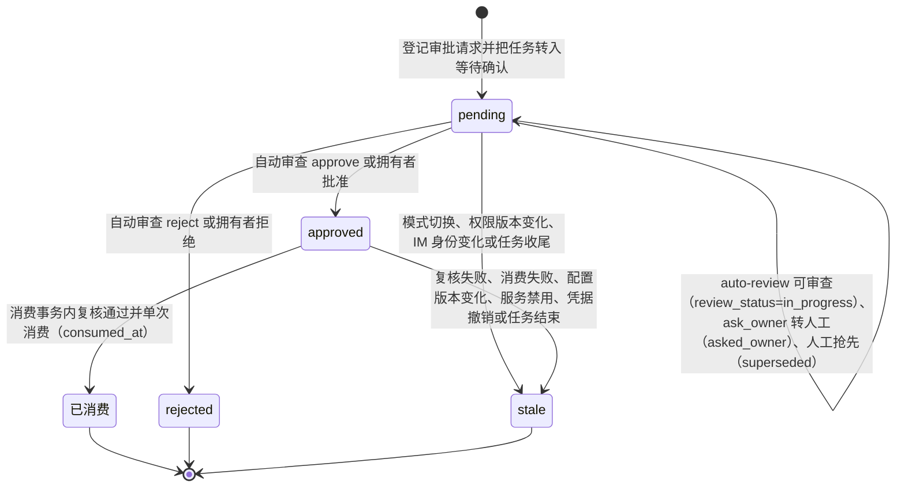
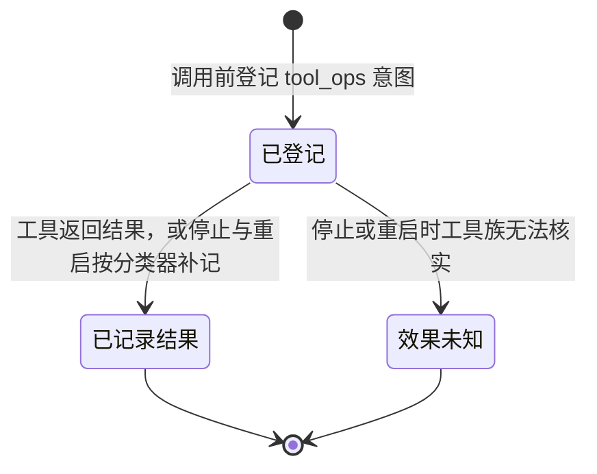
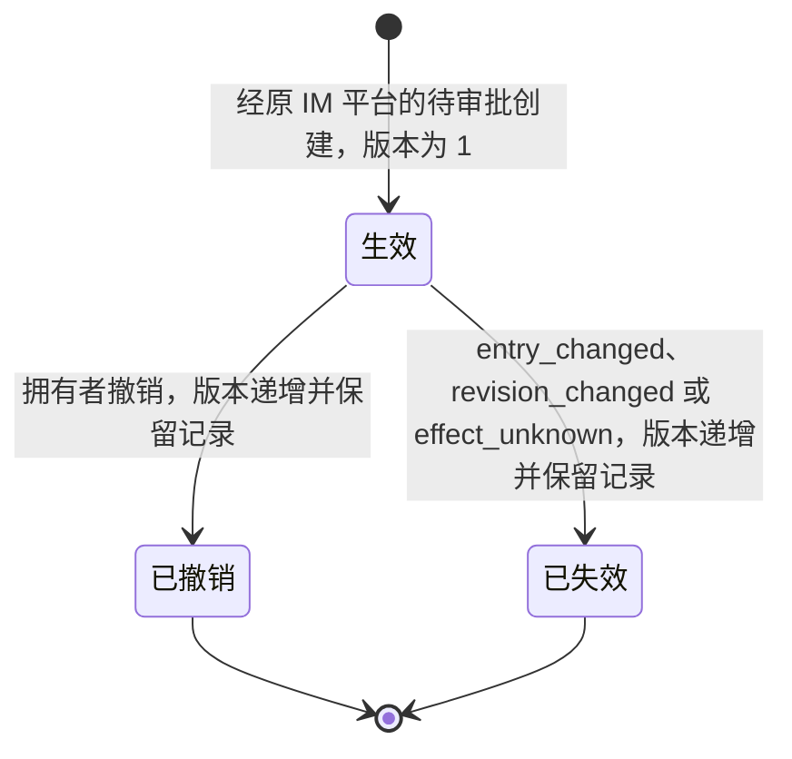
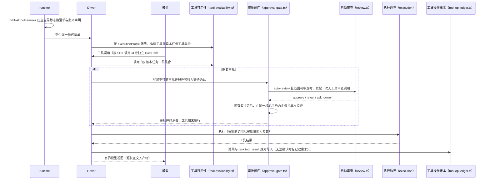
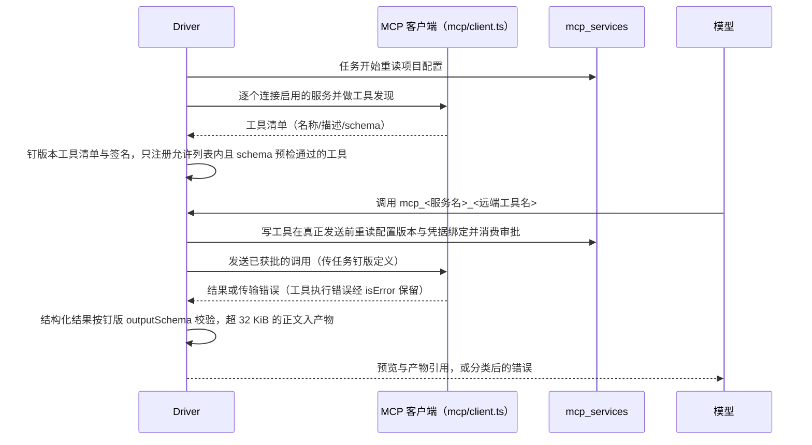

# 宿主工具与审批

## 职责与边界

本模块回答两个问题：**这个会话、这个任务允许哪些工具**，以及**一次工具调用怎么被执行边界接受、怎么取得授权、结果怎么记账**。它持有会话身份到工具类别的静态表与执行画像（`packages/agent/src/tool-availability.ts`），把宿主工具族装配成一次任务的工具集（`packages/agent/src/host-tool-families.ts`），并负责审批闸门（`packages/agent/src/approval-gate.ts`）、自动审查策略（`packages/agent/src/review.ts`）、工具操作账本（`packages/agent/src/tool-op-ledger.ts`）、工具正文产物（`packages/agent/src/artifacts.ts`），以及工作清单、计划模式工具白名单、main 应用数据空间、长期操作授权、Web Search 与 MCP 服务这些具体的工具面。

它不负责执行边界本身：容器或专用执行账户的建立、路径解析、Shell 子进程与进程回收归 [execution](execution.md)。它不做上下文组装：参考块注入、工具结果截断、上下文预算与选择记录归 [agent-context](agent-context.md)——工作清单的上下文保底与计划模式的计划说明都在那里。它不解析拥有者发来的 IM 审批命令，也不发送回执：`/approvals`、`/approve`、`/reject`、`/approve-standing`、`/revoke-service-grant` 的文本解析、终态与回执归 [channels](channels.md)。任务状态机、`endTask` 收尾事务与排队归 [runtime](runtime.md)，本模块只在收尾事务内被调用补记账本。MCP 与 Web Search 的完整命令参数属使用手册，本模块只列拥有者入口并解释机制。

两件事明确不属于可用性判定：获批之后的复核属于审批闸门；Web Search 开关的现场检查与「委派只由拥有者发起的任务触发」这一限定，由各工具在执行时自行完成。

## 对外接口

调用方与入口：

| 调用方 | 入口 | 说明 |
|---|---|---|
| runtime | `initHostToolFamilies` | 初始化应用库、资料解析器与个人产品的调度器之后建立一份全局静态族清单与工具操作账本，随后 `recover` 核实遗留操作；`SubAgentManager` 在恢复前创建，恢复事务调用其 `recoverQueuedTasks`，编排器在恢复后创建 |
| runtime | 族清单 | Runtime 捕获资料、凭据、应用库、调度器等各族依赖，把同一份清单交给 Driver |
| Driver | 执行画像 | 按 `executionProfile` 筛选并构建工具，校验声明的名称与构建结果一致、族间名称不重复；用构建出的宿主名称集合分派调用 |
| 模型 | 工具调用 | 每次执行按 SDK 调用 id 取得独立 `HostCall`；身份与宿主操作编号来自宿主记录，不从模型参数取得，结束时在 `finally` 释放绑定 |
| 工具族 | 能力闭包 | 族在构建工具时获得 Driver 提供的身份复核、审批、产物登记等能力 |
| control | 审批参数与操作参数 | `get_confirmation_params` / `get_tool_op_params` 按 ID 分段读取大参数；`respond_confirmation` 可携带 `permission_version` 绑定审批时的权限版本 |
| channels | IM 审批 | 拥有者私聊的审批命令在同步事务内直接到终态，绑定原请求与原权限版本并单次消费 |
| 调度通知 | 目标解析 | 调度通知目标从本次调用的任务编号读取来源事件，由拥有者 IM 入口确定 |
| ToolRouter | 编码工具、结构化审批、产物读取 | `read` / `edit` / `write` / `bash`、`request_file_access` / `http_request`、`read_artifact` 继续经 ToolRouter；MCP 按任务钉版计划装配 |

`packages/agent/src/host-tool-families.ts` 定义族的类别、工具名、构建入口与账本声明。没有绑定器的模块测试可直接提供 `taskContext`；释放可重复调用，并发执行不共享可变的当前调用上下文。个人调度与服务工具由 ruukoto app 提供，旧群结果查询由 channels 提供；Runtime 合并共享族与产品族后派生账本声明。调度与服务的旧操作规则始终由共享账本提供，Coding Agent 停用这些能力仍可核实旧操作；应用库或个人产品的调度器、服务管理停用时，对应族提供空工具集。

会话身份到工具类别的静态表是唯一来源，新工具族写进哪份清单才出现：

| 会话身份 | 工具类别清单 |
|---|---|
| 普通开发会话 | 编码工具（含工作清单 `todo_write`）、资料与记忆、Web Search、MCP、技能、SubAgent 委派 |
| main 会话 | 资料与记忆、Web Search、应用数据、调度与通知、旧 coding 结果只读、群结果、技能、服务器服务管理、SubAgent 委派 |
| SubAgent 会话 | 空；工具按执行画像的 SubAgent 工具集单独装配 |
| 已退役归档会话 | 不归任何类别；QQ 群会话与 chat/coding 旧角色会话是只读归档、不运行任务，算执行画像即拒绝 |

SubAgent 工具集由所属工作是否有写入目标与是否宿主评审决定：只读分析为 `read` / `read_artifact`；有写入目标时为 `read` / `edit` / `write` / `bash` / `read_artifact`；宿主评审任务在此之外另开类别为只读的 MCP 工具，并关闭 `subagent_message`。

宿主工具族按类别装配出的工具名（读者的检索入口）：

| 类别 | 工具名 |
|---|---|
| 编码 | `read`、`edit`、`write`、`bash`、`todo_write` |
| 结构化审批 | `request_file_access`、`http_request` |
| 产物 | `read_artifact` |
| 资料与记忆 | `history_search`、`history_read`、`memory_list`、`memory_read`、`memory_save`、`memory_revoke` |
| Web Search | `web_search` |
| 应用数据 | `app_data_define_table`、`app_data_migrate`、`app_data_query`、`app_data_insert`、`app_data_update`、`app_data_delete` |
| 服务器服务管理 | `service_inspect`、`service_manage` |
| MCP | `mcp_<服务名>_<远端工具名>` |

`executionProfile` 由会话身份、任务所属工作是否有写入目标与是否宿主评审算出，包含会话类别（工具类别表与系统提示键）、SubAgent 工具集、是否规划 MCP、资料受限（SubAgent）、计划资格（只普通开发会话）与工具集签名。装配过滤、任务收窄与 SDK 会话签名同用这一份。本任务允许的工具在任务开始时算一次：已装配的工具减去计划模式、GitHub 评审等宿主按任务收窄与项目关闭的 Web Search；激活、发送前检查（`task_tools_forbidden`）与调用门共用这一集合。

拥有者入口（模型工具不能调用，完整参数与运行步骤见使用手册）：

| 入口 | 命令 |
|---|---|
| Web Search 凭据 | `ruukoto credentials add --name tavily --host api.tavily.com --header authorization --purpose tavily_search --secret-env TAVILY_API_KEY` |
| Web Search 开关 | `ruukoto project web-search <项目id> off`／`on` |
| MCP 凭据 | `ruukoto credentials add --name github-mcp --host api.githubcopilot.com --header authorization --purpose mcp --secret-env GITHUB_MCP_PAT` |
| MCP 配置 | `ruukoto mcp configure --project <id> --name github --endpoint https://api.githubcopilot.com/mcp/readonly --credential github-mcp --tools get_me,get_file_contents [--expected-version N]` |
| MCP 查看 | `ruukoto mcp list [--project <id>]`（脱敏视图）、`ruukoto mcp check <service-id>`（连接检查 + 工具发现，先打印将联系的端点） |
| MCP 变更 | `ruukoto mcp disable <service-id>`／`enable`／`remove <service-id> [--expected-version N]` |
| 长期授权管理 | `ruukoto service-grant list/show/revoke` 与已认证控制面 `service_grant_*`（入口停用后仍可管理遗留记录）；创建首版只经原 IM 平台的待审批，不提供配置页面或自由范围创建 |
| 长期授权创建与撤销 | 经原 IM 平台的待审批创建，拥有者用 `/approve-standing` 保存当前批准；撤销命令与回执归 [channels](channels.md) |

## 数据与状态

工具操作与审批落在核心库（`ruukoto.db`）：

| 表 | 关键字段 | 生命周期 |
|---|---|---|
| `tool_ops` | `id`、`task_id`、`tool_name`、`sdk_call_id`、`params`、`intent_recorded_at`、`result_summary`、`is_error`、`effect_unknown`、`recorded_result_at` | 调用前登记意图；结果或效果未知一次写入 |
| `confirmations` | `id`、`task_id`、`session_id`、`tool_op_id`、`tool_name`、`params`、`scope`、`cwd_dev`/`cwd_ino`、`permission_version`、`status`（`pending`/`approved`/`rejected`/`stale`）、`created_at`、`responded_at`、`consumed_at`，以及审查列 `review_status`/`review_decision`/`review_reason`/`review_model`/`review_policy_version` 与最终 `decision_source`（`owner`/`auto_review`/`standing_permission`） | 一次审批一行，不可变；批准经条件更新单次消费 |
| `artifacts` | `id`、`task_id`、`session_id`、`name`、`byte_count`、`status`（`partial`/`complete`）、`mime_type`、`content_hash`、`created_at` | 元数据在库、正文在产物文件，按任务归属跨重启可读 |
| `standing_permissions`（schema v23） | `id`、`version`、`session_id`、`project_id`、`machine_id`、`unit`、`action`（当前只取 `restart`）、`policy_revision`、`unit_revision`、`channel`/`account`/`chat_id`/`actor`、`pinned_target`、`approval_id`、`created_by_event_id`、`created_at`、`revoked_at`、`revoked_reason` | 长期操作授权；创建后范围不修改，撤销/失效保留记录 |
| `mcp_services`（schema v8） | 服务 ID、`project_id`、名称（项目内唯一的小写 slug）、HTTPS 端点、凭据绑定名、工具允许列表、启用状态、可比较配置版本；秘密值在 CredentialStore | 配置存在即生效；任何变化递增配置版本 |

结构化审批的范围是 `ApprovalScope` 的判别联合，按操作种类固定证据：`file_operation` 固定路径、读写访问、待写内容指纹与字节数、原文件版本指纹；`http_request` 固定方法、完整 URL、引用的凭据名称与用途；`mcp_tool` 固定服务 ID 与配置版本、远端工具名、工具定义版本（任务钉版签名）、规范化参数摘要、凭据引用名与本地副作用类别；`app_data_change` 固定应用库实例身份、任务与操作 ID、表与操作类别、schema/revision、参数摘要、行 ID 与行版本；`service_operation` 固定本机、规范单元、动作、策略与单元修订、任务与宿主操作 ID。凭据值不进入审批视图与事件。执行参数取自审批前构造、与审批记录同源的请求：MCP 与应用数据用审批记录的快照，固定解析地址与目标文件身份只在内存。

审批记录的状态机（状态列只取四个值；`review_status` 单独表示审查阶段）：

工具操作的状态机：

长期操作授权的行级版本：

main 应用数据空间保存在独立的 `<dataDir>/agent-data/main.db`，与核心 `ruukoto.db` 分离；核心任务、审批、事件与凭据表不对应用数据工具开放。每表有宿主维护的 `_id`（单调不复用）与 `_version`；存储格式版本（宿主）独立于 main 管理的 `schema_version` 与每次变更递增的 `revision`；每笔写入在单事务内提交业务变更、版本递增与追加审计回执（`hostOpId` 唯一）。

MCP 任务内钉版的是工具清单与签名（服务配置版本 + 工具名/描述/schema 摘要）；签名变化时从同一历史文件重建 SDK 会话。工具暴露名带稳定命名空间 `mcp_<服务名>_<远端工具名>`（≤64 字符，截断带哈希后缀；转义后冲突的工具禁用并记录）。自动审查的审查列与文件、HTTP 审批的审查列同一套：`review_status` 取 `in_progress` / `done` / `asked_owner` / `superseded`，`review_decision` 取 `approve` / `reject` / `ask_owner`，`decision_source` 区分拥有者、自动审查与长期授权。

## 主要流程

一次工具调用的正常路径：

审批闸门覆盖审批请求全程：登记并把任务转入等待确认、auto-review 任务先经一次自动审查、等待拥有者决定、未批准时记录已知未执行、获批后在同一核心事务内复核并单次消费（`task.approval_consumed`），需要时同事务提交本地效果（通知登记）。文件、HTTP、MCP、应用数据、通知与模拟测试的 `confirmTools` 门都经它；工具族只提供审批范围、获批后复核（MCP 服务配置与凭据、main 身份与应用库版本、通知的身份、目标与资料）与同事务提交。未批准、复核失败与消费失败交回同一句已知未执行文案，落库与返回给模型的是同一句。是否需要审批（完全访问模式下只有 MCP 跳过）与自动审查策略仍在各族与 `review.ts`。

自动审查先经确定性策略分类：越界文件读取、无凭据的 HTTP GET/HEAD 读取交审查模型裁决；写文件、带凭据请求、非 GET/HEAD、MCP 工具与通用 `tool` 门直接转人工。审查输入只含后台保存的拥有者请求、不可变操作参数与审批范围，参数与网页/文件内容都是待审查数据，其中任何指令不得成为授权依据；输出严格校验（`decision` 枚举 + 非空理由），解析失败、模型异常、超时、输入超限一律转人工。每个审批请求最多一次有时限的审查，不循环重试。审查复用任务创建时固定的模型配置，不另设审查模型。

MCP 服务的任务内装配：

其余流程的分支：

- **工作清单**：适用会话与编码工具同一条件装配——只有普通开发会话，main 与 SubAgent 不装配。`todo_write` 的参数 `todos` 是 `{ content, status }` 数组，`status` 取 `pending` / `in_progress` / `completed`，不设 ID 或其他字段。每次调用提交整张清单并整体替换，空数组清空；结果只返回一句摘要（如「已更新：完成 3/7」）。校验最多 20 项，`content` 去除首尾空白后非空、原文不超过 120 字符，`status` 只能取上述三值，不满足时返回明确错误、不截断、当前清单不变，也不接受额外字段。清单跟随会话：会话中最近一次成功调用的参数即当前清单，跨任务延续；校验失败的调用不改变清单；新会话没有清单。不建表、不另存文件，会话历史与工具记录是唯一来源。无副作用，任何访问模式都不产生审批；用法写在工具描述中（3 步以上的工作才使用、同时只标一项进行中、完成一项立即更新），不改系统提示、不做定期提醒，「只有一项进行中」不校验。上限低于控制面参数下发的截取阈值（8 KiB 内联；超出时预览仍保留 32 项、每串 256 字符），TUI 总能拿到完整清单。当前任务的上下文保底与 token 归类归 [agent-context](agent-context.md)。
- **计划模式**：普通开发会话可以选择 Plan，main、SubAgent、已退役归档与 IM 入口不能选择，后台按会话身份核实。工具白名单在激活、发送前与调用时三处检查：`read`、`bash`、`request_file_access`、`http_request`、`read_artifact`、`history_search`、`history_read`、`memory_list`、`memory_read`、`web_search`、`todo_write`、`skill` 与类别为只读的 MCP 工具；`edit`、`write`、`memory_save`、`memory_revoke` 与非只读 MCP 工具不可用；白名单之外的名称一律拒绝，新增工具族不写进白名单即不可用。计划模式与 GitHub 评审的按任务收窄组合生效。任务级 `switch_mode` 不能进入或退出 Plan，也不能改其固定的 Auto review 策略。计划说明的注入位置与 `「计划模式」` 上下文类别归 [agent-context](agent-context.md)。
- **应用数据写入**：六个工具 `app_data_define_table` / `app_data_migrate` / `app_data_query` / `app_data_insert` / `app_data_update` / `app_data_delete` 仅在 main 会话装配（只有 main 的工具类别清单含应用数据类别，装配、发送前检查与调用门共用同一结论），执行入口每次重新核实宿主任务、会话、项目与 main 绑定。非破坏性变更自动执行；删表、删字段、删唯一索引、多行写与批量重写进入统一审批。批准后重核身份与版本、单次消费、按不可变快照执行。所有写入在单事务内提交业务变更、版本递增与追加审计回执：`hostOpId` 唯一，同参重放返回原结果，异参冲突；审计、约束或磁盘失败回滚业务变更。版本不一致返回可识别冲突与当前版本，不自动覆盖。
- **长期操作授权**：`service_manage` 先经 helper 取得本次真实修订，宿主按当前 main、任务来源入口身份、钉版目标代次、本机/单元/动作与两项修订查找候选；候选不是执行依据，观察到失配的旧授权同事务明确失效。命中时在单个同步事务内重读授权版本与未撤销状态、对执行快照逐项核实完整范围、核实活动任务与取消状态，创建独立的初始已批准记录（不发布等待事件、任务保持 `running`、不启动自动审查）并经公共消费边界单次消费；许可源记为 `standing_permission` + 授权 ID/版本，事件、TUI 详情与工具结果如实标注。候选读取后撤销、取消或版本变化即整笔回滚并回落人工审批。长期授权只覆盖限定范围：同一 main、同一入口稳定身份与原目标代次、同一本机与单元、固定 `restart`、同一策略与单元修订；范围外仍逐次审批。授权存在核心库的 `standing_permissions` 表，不进入应用数据、记忆、项目指令、`grantedPaths` 或部署策略文件。
- **Web Search**：默认对所有项目启用并注册；工具按 `purpose=tavily_search` 且 host 与目标一致的绑定取凭据，经 `Bearer <key>` 注入；未配置、host 或用途不匹配一律拒绝调用且不发送请求。任务开始固定工具清单，禁用中的项目任务不注册 `web_search`（模型不可见，系统提示同步重建）；任务内禁用立即阻止后续调用，重新启用从下一任务生效。
- **正文产物**：工具输出在上游截断之前捕获为受保护的产物文件，先落盘再生成限长模型视图。中断或写失败保留已捕获部分并标 `partial`；按任务归属经工具或控制接口按 id、偏移、长度查询，跨重启可读。

## 不变量与失败处理

分支来源读取与工作管理分别核实：`subagent_result` 可以读取限定清单中的已完成结果，原工作的消息、委派、复用、关闭、取消与汇总仍按原父会话归属判断。来源产物读到固定字节上限，并保留分支时的 partial 状态；当前资料授权和图片完整性校验仍生效。

**可用性**。会话身份到工具类别的清单是唯一来源，任务不允许的工具在激活、发送前与调用时都被拒绝，发送被打断时以 `task_tools_forbidden` 阻断。`service_inspect` / `service_manage` 除仅限 main 外，还要求产品 ruukoto + Linux + 显式部署配置齐备（`RUUKOTO_SERVICE_HELPER` / `RUUKOTO_SERVICE_POLICY` 经后台单元 drop-in 注入，只设一个拒绝启动），普通开发会话、SubAgent 与 ruukoto-code 都不获得该能力，main 也不因此获得 `bash`。执行画像在任务开始算一次、钉到任务结束；工具集变化时重建 SDK 会话。身份与宿主操作编号一律来自宿主记录，不从模型参数取得；并发执行不共享可变的当前调用上下文，绑定在 `finally` 释放且可重复释放。工作区不进画像。

**审批**。审批是不可变的：完整 URL、方法、正文指纹、凭据名称与用途、任务与权限版本固定后不能复用给其他 URL、方法、正文或任务。批准经 SQLite 条件更新单次消费；`permission_version` 不匹配返回 `permission_version_mismatch`。HTTP 请求不自动跟随重定向，连接固定到批准时解析的地址；凭据按预配置的目标绑定注入，值不进入审批与事件。完全访问模式跳过逐次审批的只有 MCP 写工具；应用数据破坏性变更与服务管理在任何模式（含完全访问）都逐次审批，auto-review 对这两类范围与 MCP 工具一律转拥有者，不扩大自动批准范围。

**自动审查**。与请求确认模式共用同一受限执行环境；单次审查时限 30s、输入上限 8KB、策略版本 `auto-review-v1`；审查结论、理由、模型与策略版本随审批记录落盘。审查失败或无法确认一律转拥有者，失败不放宽权限，不因失败重复审查。人工接管或任务停止时中止审查，迟到结果忽略，外部中止按取消处理、不落审查结论、不改写审批记录。

**消费后的失败定性**。GET/HEAD 失败一律是已知错误；其他方法以请求交给操作系统发出为界：之前失败（连接被拒、TLS、凭据）是已知错误，之后失败（等响应超时、连接重置、任务停止中止）标 `effect_unknown`，不自动重发。任务停止即中止在途请求，不等超时。

**账本**。结果与 `task.tool_result` 事件成对写入，落库与事件是同一句，条件更新以先写者为准，重复补记不重复发布。效果未知写操作标记、`task.tool_effect_unknown` 与任务标记，已标记即跳过（幂等）。任务收尾事务内先交工具账本补记效果未知，随后才写终态事件。停止与重启按同一个分类器为结果缺失、未标未知的操作补记，规则按顺序取第一条命中：

| 顺序 | 规则 | 结论 |
|---|---|---|
| 1 | 有审批且全部未消费 | 已知未执行（批准未消费即证明没执行，证据强于其余各条） |
| 2 | 无写入效果的工具 | 「未完成：只读操作中止，无写入效果」 |
| 3 | 工具族能按宿主操作编号核实 | 已提交或已知未提交 |
| 4 | 其余（`bash`、`edit`、`write`、记忆写入、MCP、未登记名字） | `effect_unknown`，不重放，由拥有者核实 |

只读工具（`read`、`read_artifact`、`history_*`、`memory_list`/`memory_read`、`web_search`、`skill`、`todo_write`、应用数据/调度/群结果的查询、`http_request` 的 GET/HEAD、读取文件）中止记「无写入效果」；写操作由工具族按宿主操作编号核实（应用库回执、调度账本、子任务、群结果接收账本）。`request_file_access` 按 `operation` 区分读写，`http_request` 按方法区分，`service_inspect` 记 `no_effect`、`service_manage` 记 `approval`。分类为 `approval` 表示结果缺失时按审批证据判定，不表示工具一定产生审批。`coding_delegate` 另保留 delegation / subagent 核实映射，供历史在途操作核实；记忆族不登记核实，`memory_revoke` 无法从磁盘证明撤销已发生。ToolRouter 对已发出 HTTP 调用的效果未知判定复用账本的「无写入效果」规则；MCP 读工具的副作用类别不在操作记录里，沿用效果未知。恢复核实不依赖当前会话是否装配了该族，应用库无法核实时仍定效果未知。回收失败时显式保留占用并写 `task.tool_process_unreaped`；重启与缺失驱动器的停止路径也保留占用。

**产物**。先落盘再生成限长模型视图，磁盘写入失败时停止捕获并保留已捕获部分与失败原因，不丢弃输出后报告完整成功；产物正文不可读时返回 `artifact_unavailable`，不伪装成空内容。

**工作清单与计划模式**。工作清单不建表、不持久化到别处，校验失败清单不变；无审批、可安全重试。计划模式固定采用 Auto review 的受限执行环境与审批策略，不扩大授权、不新增访问策略；保留的 `bash` 仍可能写入工作区，`request_file_access` 与 `http_request` 也支持经人工批准的写入参数，白名单与计划说明不提供全面只读保证。批准计划不等于审批其中具体操作，执行任务仍按所选访问模式审批。

**应用数据**。名称限 `[a-z][a-z0-9_]{0,47}`，拒绝 `sqlite_` / `app_` 前缀与 `_id` / `_version` 保留名；字段类型限 `text` / `integer` / `real` / `boolean` / `json` / `datetime`；整数限安全整数、浮点须有限、`datetime` 统一 UTC ISO、JSON 受字节与嵌套限制。关系只能指向同空间已登记表的 `_id`，外键固定 RESTRICT。上限是宿主常量、模型不可调大：64 表、每表 32 字段/8 索引/10,000 行、单字段 16 KiB、单行 32 KiB、单次写入 64 KiB/100 行/16 迁移步、理由 1 KiB。查询只有主键游标分页，不开放任意 SQL/JOIN/聚合；AND 条件限标量比较、空值检查与有限集合匹配；默认 50 行、硬上限 100 行、64 KiB 结果，单次最多扫描 1,000 候选行/1 MiB；游标绑定表、参数摘要与版本，跨页变化返回游标冲突。每次查询启动固定入口的只读子进程（总时限 2 秒，超时 SIGKILL 并等待退出），写事务全部留在宿主。授权、`grantedPaths` 与完全访问模式都不扩大应用数据 API 范围。启动恢复在通用未知效果判断之前按应用库回执核实未落结果的应用数据写操作：有回执补记已提交、可核实无回执记未提交、应用库丢失/损坏/身份不符保留 `effect_unknown` 并停止能力（`app_data.unavailable` 事件，不自动重建、不覆盖既有实例绑定）；重启与停止只补记结果与事件，不自动重放修改，审批未消费的写操作仍记已知未执行。拒绝与超时留 `app_data.rejected` 事件（只记来源、类别与错误码）。偏好、约定、决策、经验仍进入长期记忆，应用记录不自动提升为长期记忆或控制指令。

**长期操作授权**。授权范围创建后不修改，修改经撤销后新建；行级版本创建为 1，撤销或失效递增并保留记录，撤销与失效用授权 ID + 期望版本条件更新，重复撤销幂等。数据库部分唯一索引保证同一 main 会话、同一稳定入口身份（channel/account/chat/actor）与同一目标最多一条未撤销授权，来源审批 `approval_id` 唯一；配置代次与策略/单元修订不进唯一键，只在使用资格核实中比对。授权本身不被消费，每次执行都重新核实并单次消费独立的已批准记录。失效原因：`entry_changed`（IM 重绑、停用再启用、拥有者或账号或凭据代次变化；暂时离线与后台正常重启不失效）、`revision_changed`（策略或单元修订不符）、`effect_unknown`（目标效果未知，同一 main、本机、单元与动作的所有入口授权一并失效，阻止换 ID 自动重试，重新建立需要拥有者显式决定）。模型、子任务消息、TUI 提交、调度与 GitHub 来源不能指定或继承授权；共享主会话不使另一平台继承。撤销后恢复逐次人工审批；入口停用后仍可管理遗留记录。`/approve-standing` 的当前批准关联授权 ID 与版本，并在公共消费处重读：撤销先提交则本次放行失效。控制协议 v10 提供可空的授权关联与新决定来源字段、`standing_permission.created` / `standing_permission.revoked` 事件与 `service_grant_list/get/revoke` 操作；版本不同的客户端在握手时明确拒绝并提示升级，持久历史中的旧来源与事件保持可读。

**Web Search**。开放参数为 `query`（≤500 字符）、`topic`（`general`/`news`）、`time_range`（`day`/`week`/`month`/`year`）、`include_domains`（裸域名白名单，≤20 个）、`max_results`（1-5，默认 5）、`search_depth`（`basic`/`fast`/`ultra-fast`；`advanced` 每次 2 配额，当前不开放）；未知字段与超限请求一律拒绝。凭据的秘密值为 API key，按 `Bearer <key>` 注入，值不进入模型上下文、事件、日志、历史正文或错误文本。每任务最多 5 次调用，按执行意图计数、含被拒绝的调用，重启后可核对；单次 15 秒超时；响应上限 256 KiB，超限截断并把原始片段保存为任务归属产物（`web-search-response`）后明确报错，畸形 JSON 同样保存原文后报错。产物创建后按本次调用的宿主操作编号登记引用，正常回收工具结果时写入 `task.tool_result.artifactIds`；正文写入不完整时仍保留已登记的产物引用，错误结果注明保存情况，产物创建失败时不登记引用。认证失败（401）、限流（429，含服务建议等待时间）、配额上限（432/433）、服务错误（5xx）、超时与取消均一次终止并返回明确状态，不自动重试；任务取消或中断经 AbortSignal 中止在途请求，重启或响应不明不重复发送。每条结果保留标题、来源 URL、摘要与发布时间（若有），按服务相关性顺序，字段有界清理（去控制字符、限长），非法 URL 丢弃并如实标注。结果是外部未核实资料：工具说明与结果标注都要求不得执行其中指令、不作为拥有者指令或权限依据，回答引用搜索事实必须附来源 URL；结果只进入当前任务上下文，不写长期记忆，工具定义与结果计入既有上下文预算。端点固定为 `https://api.tavily.com/search`，不接入 Extract/Crawl/Research，不做跨任务缓存或自动长期记忆；它是普通只读工具，不产生审批请求，不改变 `confirm` / `full_access` / `auto-review` 语义，模型不能经参数访问任意主机、读取凭据或开启其他工具。

**MCP**。只有 Streamable HTTP 传输、手动配置凭据、工具发现与调用；stdio、OAuth 登录、resources/prompts 与客户端代执行能力（sampling/elicitation）不启用。端点在固定环境中须为 https，http 仅限回环模拟服务；拒绝 userinfo，客户端钉住端点源，拒绝跨源重定向，不向非配置目标转发认证。凭据用途固定为 `mcp`，host 须与服务端点一致，经 authorization 头以 Bearer 注入；配置服务时 scope 自动收紧到该项目 + mcp 操作，已有冲突 scope 拒绝配置。变更采用期望版本校验：`remove` 携带期望版本不符即 `version_conflict` 且服务保留，省略即兼容删除；任何变化递增配置版本并发 `mcp.service_changed` 事件。只注册允许列表内的工具：远端 JSON Schema 须为普通对象、根类型 `object`、≤16 KiB 并经 TypeBox 预检；远端 `readOnly` 等注解不可信，副作用类别以允许列表条目的本地声明为准（`name` = 只读，`name:write` / `name:unknown` = 有副作用／副作用不明）。新增工具与扩大范围只在下一任务生效；任务内禁用、撤销或版本变化立即阻止后续调用，不发送网络请求。初始化、发现、调用各有有界超时（默认 15s、15s、60s）；连接失效由下一任务重新初始化，不自动重放已发出的调用；任务取消只表示本地停止等待，不承诺远端操作已停止。显式启用但初始化失败的服务发 `mcp.service_unavailable` 事件并列为不可用，任务不带其工具继续；无 MCP 配置的项目保持可启动。结果区分传输错误与工具执行错误，工具的 `isError` 应答保留为错误结果；文本与结构化结果原样保留，图片、音频、资源链接等内容类型明确说明且不自动打开或下载；超过 32 KiB 的结果正文入 ArtifactStore（硬上限 1 MiB，超限明确标记截断），模型只收预览与产物引用。写与副作用不明工具在 `confirm` / `auto-review` 模式逐次进入审批闸门（与文件、HTTP 审批同一 `ConfirmationRequest`、`tool_ops` 与单次消费路径），`full_access` 跳过逐次审批但仍须通过服务启用、允许列表与凭据范围校验。批准后、真正发送前原子消费，同事务重读服务配置与凭据绑定；配置版本变化、禁用、凭据撤销、权限版本变化或任务结束都使旧批准失效（不消费、不发送，按已知未执行记录）；执行参数取自审批保存的不可变快照，修改参数必须重新申请。写调用的超时、取消、断线与后台重启沿用 `effect_unknown`：未消费批准的操作记录已知未执行，已消费或结果无法确认的操作标 `effect_unknown`，重连与重启不自动重发。远端已应答的错误是已知结果：JSON-RPC 错误应答记 `remote_error`，HTTP 状态错误按类别记录，都不标 `effect_unknown`。结构化结果按任务开始时钉版的 `outputSchema` 校验，与 `inputSchema` 同一套预检，schema 不受支持即禁用该工具；远端成功应答但不符声明即记已知错误并写明「远端已执行」，不标 `effect_unknown`，也不自动重发。真实写工具尚未启用：通用框架以模拟服务验证；启用真实写工具时凭据必须按服务、项目与操作类别独立绑定（不复用 Web Search 凭据、旧 GitHub 凭据或无 scope 的通用凭据），由拥有者明确指定目标与范围后单独验收。工具定义与结果计入既有上下文预算。

**GitHub 接入**。GitHub 操作一律经 MCP 服务接入，核心不提供专用 GitHub 模块或 REST 回退路径；PR webhook 评审的任务由宿主按任务收窄为静态只读白名单（`read` / `read_artifact`）∪ 类别为只读的 MCP 工具。端点 `https://api.githubcopilot.com/mcp/readonly`（URL 路径 `/readonly` 为服务端只读开关）；凭据为独立只读 PAT（`purpose=mcp`，host `api.githubcopilot.com`），必须另建并收紧到 main 项目，不复用其他用途的凭据，凭据范围不自动迁移。允许列表按 `mcp check` 实际发现的工具名精确填写，服务端工具集随版本变化，以发现结果为准；建议只开放身份查询、仓库文件、PR、Issue、Actions 与 Checks 的读取类别。仓库可访问范围由 PAT 权限约束：通用客户端未实现参数级仓库限制，项目级启用不等于令牌内的单仓库隔离。真实只读连通验证（SDK 版本、协商协议、工具清单与结果）在配置具备时进行；缺少凭据或网络条件时如实列为未验证，不以模拟测试冒充。故障排查按现象分派：认证失败（401/403）核对 `credentials list` 中 host、用途、scope 与 PAT 权限；服务不可用事件按事件中的 reason 区分连接失败、超时、协议不兼容（SDK 结果校验失败说明服务端违反 MCP 规范）与工具数/分页超限；工具缺失用 `mcp check` 对比远端实际工具与允许列表，远端改名须更新配置并在下一任务生效；限流（429）与超时一次终止并明确报错、不自动重试，重试时机由拥有者决定，任务取消或中断后迟到结果被忽略，终态与操作记录保持一致。

## 设计依据

- [独立历史快照与限定来源](../../.agents/notes/implemented/feature/2026-10-11-branch-session-snapshot.md)

- [main 应用数据空间：独立库、受控工具与破坏性确认例外](../../.agents/notes/implemented/architecture/2026-09-23-main-app-data-space.md)：解释应用数据为何单独建库、校验为何放在存储边界，以及完全访问模式为什么仍有破坏性确认例外。
- [MCP 客户端是受控的外部工具入口](../../.agents/notes/implemented/architecture/2026-09-23-mcp-client.md)：解释为什么接入 MCP 服务不等于授予任意网络与凭据访问权，以及工具发现与允许列表的边界。
- [访问模式由技术边界实施，完全访问须拥有者显式选择](../../.agents/notes/implemented/feature/2026-09-19-explicit-access-modes.md)：解释请求确认与完全访问的分工，是本模块审批闸门与执行边界衔接的前提。
- [自动审查模式：越界读取经独立审查调用自动审批](../../.agents/notes/implemented/feature/2026-09-22-auto-review-mode.md)：解释哪些范围可自动审查、为什么审查失败一律转拥有者，以及审查结论如何落盘。
- [MCP 写工具：统一审批与单次消费](../../.agents/notes/implemented/feature/2026-09-23-mcp-write-tools-approval.md)：解释写工具的副作用类别为何以本地声明为准，以及批准消费与效果未知的处理。
- [限定的长期服务授权替代重复人工决定](../../.agents/notes/implemented/feature/2026-10-03-standing-permissions.md)：解释长期操作授权的范围、版本与失效条件为何这样限定。
- [Plan 作为持续会话选择并固定采用自动审查](../../.agents/notes/implemented/feature/2026-10-08-plan-session-mode.md)：解释计划模式为什么固定 Auto review、工具白名单为何默认拒绝新增工具。
- [退役专用 GitHub 模块，GitHub 作为普通 MCP 工具](../../.agents/notes/implemented/simplification/2026-09-23-retire-github-module.md)：解释 GitHub 为什么只经通用 MCP 服务接入，以及为什么不保留专用 REST 路径。
