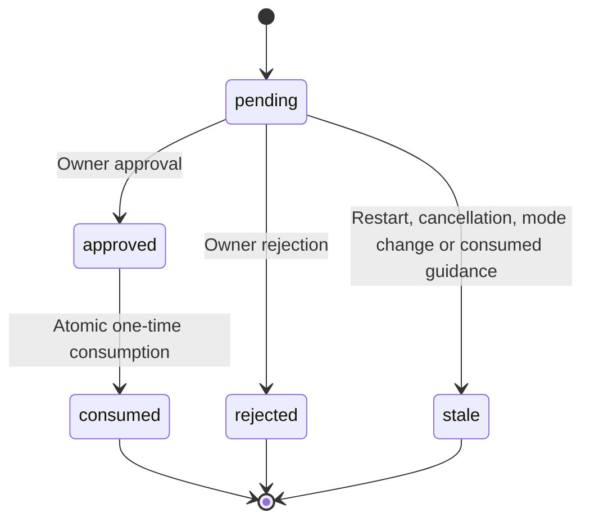
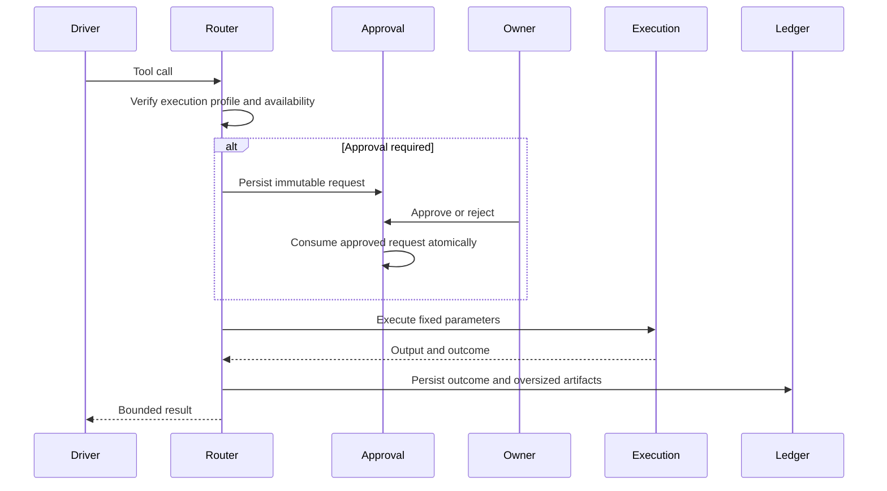

# Host Tools and Approvals

## Responsibilities and Boundaries

The agent-tools subsystem owns tool availability, host-tool assembly, approval and immutable operation records. It checks conversation identity, access mode and plan mode before exposing or running a tool. Operations that need additional permission bind fixed targets and parameters to a persistent approval request. Large outputs become artifacts with bounded model views.

Pi 1.3.0's official extensions own MCP connection, discovery and protocol handling; the host owns current eligibility, approvals, operation records and original-result artifacts. [Execution](execution.md) owns OS isolation and processes; [runtime](runtime.md) owns queues/finalization; [channels](channels.md) parses IM approval commands.

## Public Interfaces

| Entry | Caller | Purpose |
| --- | --- | --- |
| `buildHostToolSet` | Runtime startup | Assemble file, process, network, question and MCP families |
| `ToolRouter.executeTool` | Driver | Check eligibility, dispatch and record the result |
| `ApprovalGate.request` | Router | Persist operation fingerprint/parameters and suspend for approval |
| `ApprovalGate.resolve` | Control/IM | Record owner approval or rejection; approval is consumed once |
| `ArtifactStore` | Tools/execution | Persist output, patches and images; read bounded slices |

| Tool | Behavior |
| --- | --- |
| `read`, `edit`, `write` | Coding files; restricted mode limits them to the workspace and granted roots |
| `bash` | Restricted shell has no external network; pinned skill directories are read-only roots |
| `ask_user` | Persist one to three choice/free-text questions, wait within the original task, and return actual answers or explicit cancellation |
| `process_start`, `process_stop`, `process_status`, `process_output` | Persistent conversation backgrounds, logs and verified stopping |
| `web_fetch` | Credential-free page retrieval, bounded to 1 MiB |
| `present` | Register desktop file/image previews without writing the source |
| `tool_search` | Official discovery of currently eligible tools, retaining discovery state by branch |
| `mcp__<server>__<tool>` | Official names; discovery, declarations and calls intersect current source eligibility |

## Data and State

| Family | Restricted | Plan mode | Full access |
| --- | --- | --- | --- |
| Code reads/search | Granted roots | Granted roots | Starting account |
| Code writes | Granted roots | Disabled | Allowed |
| Shell | Sandbox, no external network | Disabled | Starting account and network |
| Start background processes | Disabled | Disabled | Allowed for eligible owner input |
| Owner questions | Allowed | Allowed | Allowed |
| MCP | Authorized reads need no per-call approval; writes/unknown effects follow approval policy | Read-only tools only | No per-call approval; eligibility and ledger checks remain |

Background status/output/stop remain recovery operations under their current eligibility checks; disabling startup is not a blanket ban on inspecting or stopping an existing process.

A pending `ask_user` retains the task's execution phase and occupancy. Answers, including Skip, and explicit cancellation settle the original tool call. Guidance cancels the pending question in its acceptance transaction. Ordinary messages, reports and client closure leave it waiting; task interruption or backend restart makes unanswered questions stale. In a mixed `[ask_user, write]` batch, the old write stays unexecuted until the model receives the question result and applicable guidance in the next request. Subsequent requests regain normal tools and may ask another batch.

The owner classifies ordinary MCP tools as `read/write/unknown` locally. Remote read-only hints do not grant permission. New services or broader permissions affect later tasks; revocation/tightening takes effect before the next call. Required named role/workflow/SubAgent tools must exist in the actual official registry before a model call. Side chat has no tools, MCP or host-data access; tool calls in its frozen historical snapshot are text only.

Code's managed Cua program exposes only the owner-allowlisted read and write sets; `get_guide` is a read-only guidance lookup and `run_steps` is a canonical batch of at most eight deterministic actions in one observed window plus a mandatory trailing observation. Window observation grants follow the content actually persisted and projected to the model: element actions need a delivered element token in the current snapshot, coordinate actions need the delivered screenshot for that window, and rereads, invalidation, freezing or rebinding drop the grants. A batch is one write under a single approval; the trailing observation does not authorize the batch itself. Only calls whose result can contain images require a vision-capable model.

`confirmations` stores targets, fingerprints, permission versions and decisions. `tool_ops` stores unique operation IDs, parameters, timing and outcomes. `artifacts` indexes content hashes, length and media type.

## Main Flows

## Invariants and Failure Handling

- Approval is single-use and bound to task, parameters and permission version; execution uses the approved snapshot.
- Artifacts carry SHA256 verification. Interrupted/incomplete output is explicitly partial.
- Before MCP transmission, approval consumption and execution-start facts commit; cancellation, service, credentials and parameters are checked again. Failure before sending is known not executed.
- Remote complete results and locally synthesized failures retain their actual provenance. A sent write/unknown-effect call with no conclusive reply stays `effect_unknown`, stops automatic business calls in that round and is never automatically replayed. Already-started concurrent calls retain their own outcomes.
- Original images and full text are saved before Pi preview processing.
- SDK disposal stops only its own conversation's Cua connection. Unverified stopping retains the original SDK and rebuild requirement; instance shutdown separately stops all connections.

## Design Rationale

- [Tool worker per task container](../../.agents/notes/implemented/architecture/2026-09-20-tool-worker-per-task-container.md)
- [Native execution sandbox](../../.agents/notes/implemented/architecture/2026-10-10-native-execution-sandbox.md)
- [Mcp client](../../.agents/notes/implemented/architecture/2026-09-23-mcp-client.md)
- [Mcp host responsibilities](../../.agents/notes/implemented/simplification/2026-10-26-mcp-host-responsibilities.md)
- [Same-task owner questions](../../.agents/notes/implemented/feature/2026-10-30-coding-owner-question-wait.md)
