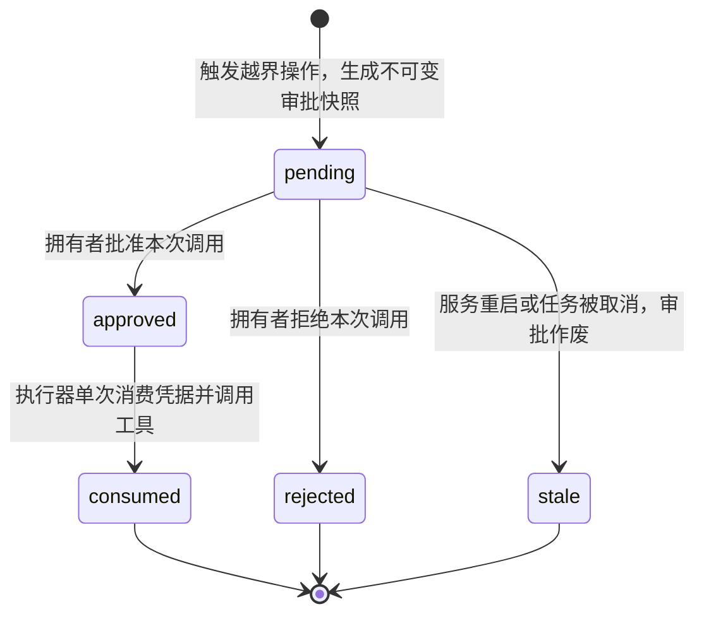
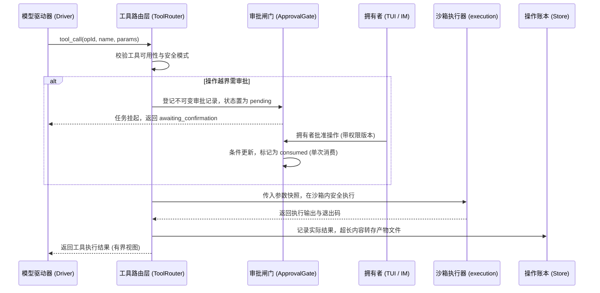

# 宿主工具与审批闸门

## 职责与边界

`agent-tools` 模块负责系统的工具准入控制、动态工具集装配、安全审批闸门（Approval Gate）与不可变操作记账。

### 核心职责
- **工具可用性判定（Tool Availability）**：依据会话分类、当前安全模式（受限审查 vs 完全访问）与计划模式（Plan Mode），动态筛选当前任务允许暴露给大模型的工具白名单。
- **审批闸门与确认机制（Approval Gate）**：对跨越工作区边界的文件修改、外部网络请求、系统提权等敏感操作实施拦截，生成不可变审批快照并挂起任务等待拥有者确认。
- **不可变操作账本（Tool Op Ledger）**：对每一次工具调用的发起参数、授权凭据、执行时间与返回结果进行严格的结构化审计记账。
- **超长产物管理（Artifacts）**：当工具输出（如大文件读取、Diff 补丁或截图）超过模型的单次传输限制时，自动将其捕获为磁盘产物文件，模型仅接收精简视图。
- **MCP 协议客户端集成**：通过标准 Model Context Protocol（MCP）动态发现外部服务工具，并无缝集成进统一审批与账本体系。

### 边界与非职责
- 工具在操作系统内核层面的沙箱隔离（Seatbelt/bubblewrap）与进程管理归 [execution](execution.md)。
- 任务排队状态机与收尾事务归 [runtime](runtime.md)。
- 移动端 IM 审批命令的协议解析归 [channels](channels.md)。

## 对外接口

### 1. 核心工具装配与路由组件

| 组件 / 接口 | 调用方 | 职责与行为 |
|---|---|---|
| `initHostToolFamilies` | Runtime 启动 | 初始化宿主工具族清单（文件、进程、网络、提问、MCP 等），提供统一工具构建入口 |
| `ToolRouter.call` | Driver | 工具调用的主调度入口：校验调用门资格，分派至沙箱或直接执行，并完成记账 |
| `ApprovalGate.create` | ToolRouter | 为敏感操作创建持久化的未决审批项，写入操作指纹与参数快照，挂起任务 |
| `ApprovalGate.respond` | 控制面 / IM | 拥有者提交批准（approve）或拒绝（reject）决定，获批凭据仅限单次消费 |
| `ArtifactStore` | 工具与沙箱 | 超长文本、补丁与图片产物的持久化存取入口，提供基于偏移量的分块读取能力 |

### 2. 核心内置工具族

| 工具名 | 工具族类别 | 作用描述与安全边界 |
|---|---|---|
| `read` / `edit` / `write` | 编码工具 | 源码的查看、局部替换与新建；受限模式下严格限制在工作区及授权目录内 |
| `bash` | 终端命令 | 在受限沙箱中执行 Shell 脚本；受限模式下禁用外网并限制访问敏感系统文件 |
| `ask_user` | 交互式提问 | 向拥有者登记 1~3 道选择题或自由文本问题，挂起当前轮次等待用户答复 |
| `process_start` / `stop` / `status` | 会话后台服务 | 启动持久后台进程（如开发测试服务器），支持日志流式查看与优雅终止 |
| `web_fetch` | 网络静态抓取 | 无凭据抓取指定网页并解析提取纯文本或 Markdown，大小受 1 MiB 严格限制 |
| `present` | 桌面内容预览 | 向客户端桌面侧边栏注册文件或图片预览卡片，不产生写副作用 |
| `search_tools` | 动态工具发现 | 在会话中按关键词检索已启用的 MCP 工具，命中后动态激活其 Schema |

## 数据与状态

### 1. 审批闸门状态机

### 2. 安全模式与工具白名单矩阵

系统在任务开始时根据会话安全模式严格收窄工具集：

| 工具族 | 受限模式 (Native Sandbox) | 计划模式 (Plan Mode) | 完全访问模式 (Full Access) |
|---|---|---|---|
| **代码只读** (`read`, `list_files`, `search_files`) | 允许 (限授权目录) | 允许 (限授权目录) | 允许 (继承当前账户) |
| **代码写与修改** (`edit`, `write`) | 允许 (限授权目录) | **完全禁用** | 允许 |
| **Shell 命令** (`bash`) | 允许 (沙箱内，无外网) | **完全禁用** | 允许 (继承当前账户与外网) |
| **后台服务** (`process_*`) | **禁用** | **禁用** | 允许 |
| **交互提问** (`ask_user`) | 允许 | 允许 | 允许 |
| **MCP 工具** | 需人工逐次审批 | 只读工具允许，写工具禁用 | 免操作审批，仅记录账本 |

### 3. 数据实体与存储

- **`confirmations`**：记录所有待决与历史审批项（审批 ID、目标资源、参数指纹、权限版本、创建时刻、终态）。
- **`tool_ops`**：记录每次工具执行的唯一操作编号（`opId`）、实际参数快照、执行耗时、成功状态与产物索引。
- **`artifacts`**：存储超长工具输出的元数据（文件哈希、字节长度、MIME 类型）。

## 主要流程

### 工具调用与审批流程

1. **调用拦截与合规性检查**：模型发出工具调用请求后，路由层首先核对当前任务的执行画像，非白名单工具直接报错拒绝。
2. **生成不可变审批快照**：若操作涉及敏感行为（如修改工作区以外的文件或执行未批准的命令），系统冻结当前调用参数生成审批快照，任务进入挂起状态等待确认。
3. **单次消费与记账**：拥有者批准后，凭据仅供本次执行消费一次，参数不可篡改。执行完成后结果如实入账，保障完整可审计性。

## 不变量与失败处理

- **审批凭据单次消费防重放**：每个审批 ID 仅对应一次工具执行。获批后通过原子条件更新消费凭据，任何其他任务、不同参数或二次调用绝无法复用旧授权。
- **参数不可篡改性**：审批通过后，执行器使用的参数直接取自审批时保存的快照对象，绝不从外部重新读取可变状态，杜绝参数注入攻击。
- **产物内容强一致性**：工具产物文件保存时计算 SHA256，读取时进行哈希校验；中断或写入不完整的产物明确标记为 `partial`，保证数据保真度。

## 设计依据

- [工具工作进程与受限容器](../../.agents/notes/implemented/architecture/2026-09-20-tool-worker-per-task-container.md)
- [Coding Agent 的原生受限执行](../../.agents/notes/implemented/architecture/2026-10-10-native-execution-sandbox.md)
- [MCP 客户端设计](../../.agents/notes/implemented/architecture/2026-09-23-mcp-client.md)
