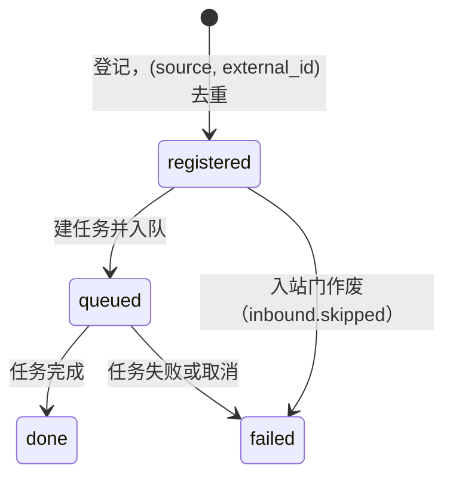
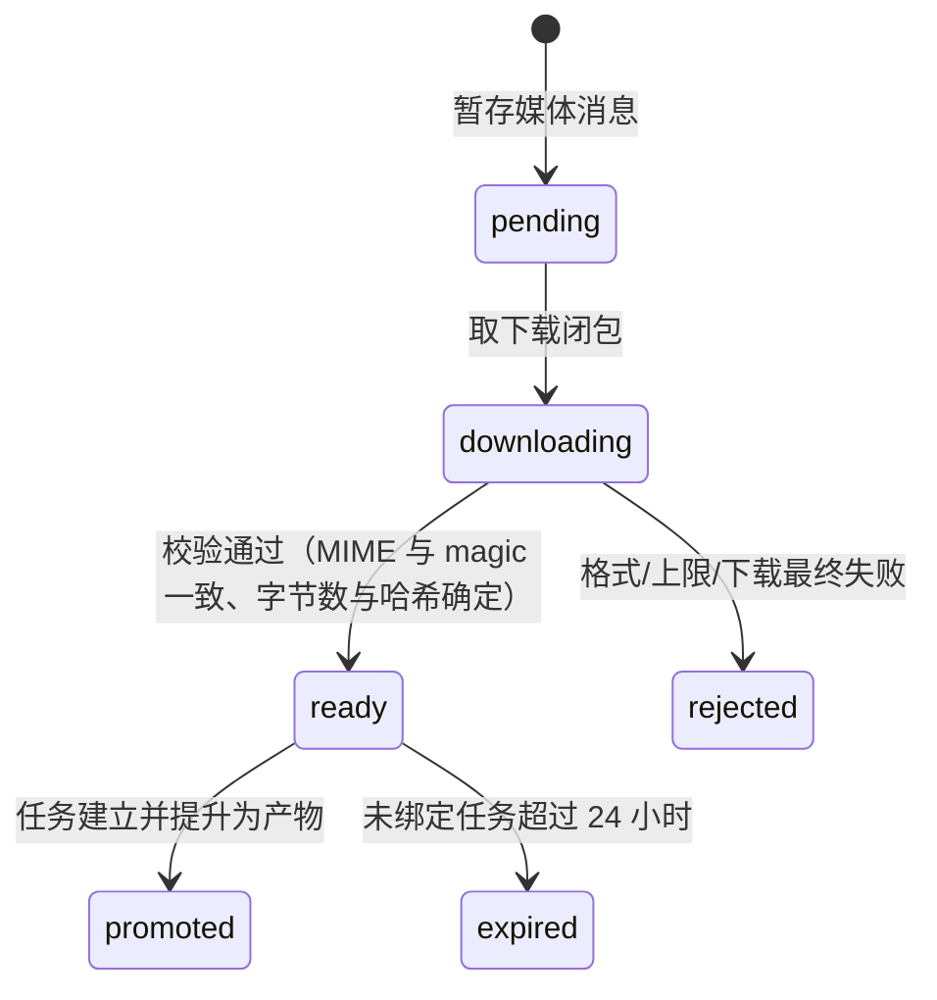
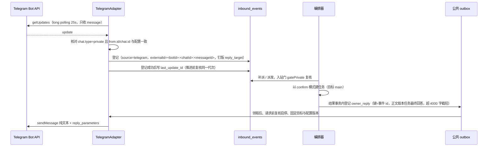
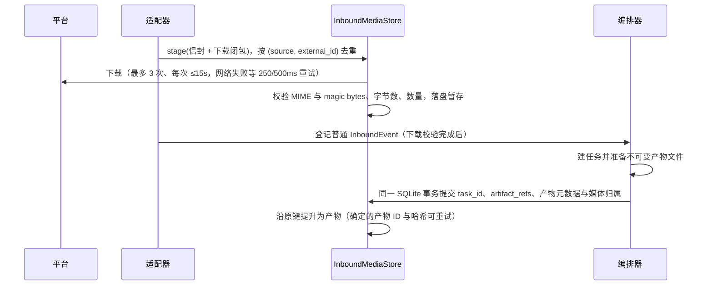
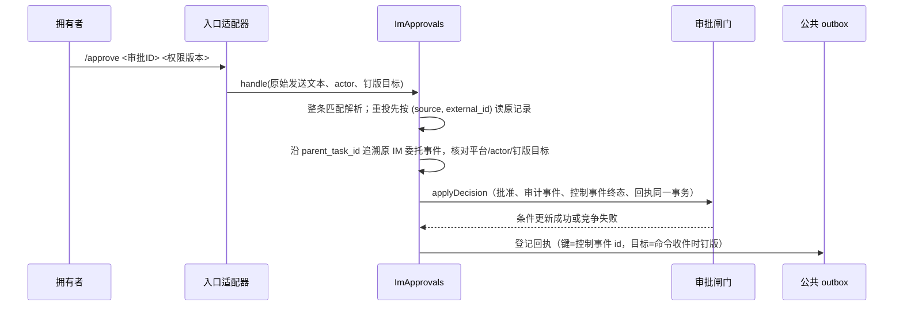
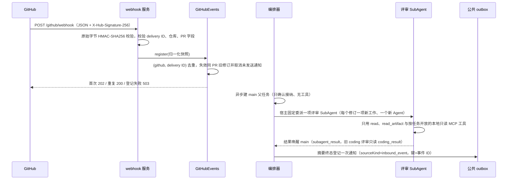

# 消息渠道与事件来源

## 职责与边界

本模块负责拥有者与 ruukoto 之间的双向消息通道，以及不进入拥有者入口表的外部事件来源。
它接收、校验并持久化入站消息，为每条消息钉定回复目标与配置代次，把已接纳的事件交给编排器
建任务，并在任务到达终态后把回复或工作最终汇报发回原入口。它同时承载 IM 审批命令：绑定
拥有者在私聊中查询、批准或拒绝已有受控操作，并管理服务 restart 的长期授权。GitHub PR
webhook 是事件来源而非拥有者 IM 入口，由本模块单独分派入站门，并负责只读评审的父子任务、
结果归属与一次性通知。

| 属于本篇 | 不属于本篇 |
|---|---|
| `ImEntry` 抽象、入口表 `ImEntries`、按来源 reconcile、回复与最终汇报的目标核对 | 通知 outbox 的领取、重试与状态机（见 [调度器与通知](scheduler.md)） |
| Telegram 入口、QQ 私聊入口、私聊图片入站 | 工作最终汇报的到期判定、发送键与正文构造（见 [运行时](runtime.md)） |
| IM 审批命令、长期授权命令、审批通知与回执 | 审批闸门与批准消费的核心事务（见 [运行时](runtime.md)） |
| GitHub PR webhook 事件来源、评审链路、修订失效与一次通知 | 通用 MCP 服务的配置与工具装配（见 [Agent 工具](agent-tools.md)） |
| QQ 群聊退役后的入站行为与只读归档（含 `chat_result_*` 复核） | 固定 coding 角色退役；旧实例的一次性导入（见 [运行时](runtime.md)） |

两个适配器始终创建：QQ 私聊与 Telegram 各是一个入口，共用主会话。启动配置停用
（`RUUKOTO_DISABLE_QQ` / `RUUKOTO_DISABLE_TELEGRAM`，Coding Agent 按产品边界强制）是适配器
的标志：不连接、不轮询、目标为 null，入站门以 `qq_private_unavailable` / `telegram_unavailable`
丢弃，与入口停用同义；outbox 视为发送器未加载而等待。入口的 `configure` / `setEnabled`
信任边界校验留在各自适配器，不合并。群聊能力不在本模块内：QQ 群聊外挂是独立程序，自行
管理群会话、历史与发送状态，经有限接口向 ruukoto 提供结果。

## 对外接口

### 拥有者 IM 入口（`ImEntry`，`src/runtime/im-entries.ts`）

| 成员 | 含义 |
|---|---|
| `source` | 入站来源，也是钉版目标的 channel（`telegram` / `qq_private`） |
| `replySkippedEvent` | 回复或汇报跳过时追加的持久事件：`telegram.reply_skipped` / `qq_private.reply_skipped` |
| `startupDisabled` | 启动配置停用标志；为真时不连接、目标为 null、入站作废 |
| `gatePrivate(event)` | 派发、任务启动与终态回复共用的门：来源、actor 与钉版目标逐项核对，返回 `run` / `wait` / `{drop}` |
| `expectedActor()` | 当前配置期望的 actor；未绑定或停用为 null |
| `replyCapChars()` / `capReply(text)` | 入口的单条回复字符上限与截短 |
| `externalIdPrefix(target)` | 钉版目标下登记的 externalId 前缀，核对消息确由同一账号与 chat 登记 |
| `usesCredential(name)` | 该入口是否引用某凭据 |
| `bumpGeneration()` | 在调用方事务内推进配置版本并追加 `telegram.config_changed` / `qq.config_changed` |
| `onConfigChanged()` | 配置事务提交后重建连接或轮询 |

`ImEntries` 持入口表并承担跨平台部分：`entry(source)` 按来源取入口；`channel(source)` 选择
发送器（非缺省入口只发自己，缺省 Telegram 可被测试经 `config.scheduler.channel` 覆盖）；
`target(source)` 返回当前钉版目标；`gate(event)` 按来源分派入站门，非入口来源返回 `run`；
`notificationTarget(sourceEvent)` 决定通知工具目标——QQ 来源任务只在钉版目标仍一致时发 QQ，
其余走缺省渠道；`applyConfig(source)` 在配置事务提交后重连并 reconcile；`reconcile(source)`
作废该来源门已拒绝的 registered 入站、按丢弃原因取消活动任务、撤销该来源 IM 审批与长期授权、
唤醒 main 与会话队列；`bumpForCredential(name)` 在凭据写入前于事务内单调推进引用它的入口
`config_version`；`reconcileAfterCredential(name)` 在凭据写入后重连并撤销旧代次授权；
`enqueueOwnerReply(event, task, outcome)` 在编排器结果事务内登记 owner 回复；
`sendWorkReport(report)` 在结果唤醒的结果事务内登记工作最终汇报。

### 适配器

- `TelegramAdapter`（`src/telegram/adapter.ts`）：`start` / `stop` / `onConfigChanged` /
  `status` / `target` / `available` / `send`，以及 `gatePrivate`、`expectedActor`、
  `replyCapChars`、`capReply`、`externalIdPrefix`、`usesCredential`、`bumpGeneration`。
- `QqAdapter`（`src/qq/adapter.ts`）：同一组方法，另有 `configure`（端点、凭据、登录账号、
  拥有者 QQ 号、`max_reply_chars` 的校验与写入）、`setEnabled`，以及 OneBot 客户端连接管理。
- 入站登记入口由 Runtime 提供给两个适配器：Telegram 的 `register` 与 QQ 的
  `registerPrivate`（可带 `commandText`、`media` 标记），统一落到 `inbound_events`。

### IM 审批与长期授权（`src/runtime/im-approvals.ts`）

`ImApprovals` 统一持有审批通知、命令解析、消费前复核、配置失效与长期授权候选；Runtime 只
提供入口查询、解除指定审批等待和服务能力检查。对外出口是 `notifyCreated(confirmation, task)`
（登记审批创建时的初始 IM 通知）、`consumeRecheck(confirmation, task)`（消费事务内的固定
身份复核）、`standingCandidate(task, scope)`（长期授权候选判定）与 `handle(input)`（控制
消息入口）。导出的纯函数 `parseImApprovalCommand(text)` 做整条命令解析。

拥有的者命令（完整参数与启用步骤见 [使用手册](../usage.md)）：

| 命令 | 作用 |
|---|---|
| `/approvals [页码]` | 待决审批分页列表（每页 5 条） |
| `/approval <完整审批ID> [偏移]` | 详情：工具／版本／范围概览 + 参数有界分段 |
| `/approve <完整审批ID> <权限版本>` | 批准，绑定原请求与原权限版本 |
| `/reject <完整审批ID> <权限版本>` | 拒绝 |
| `/approve-standing <完整审批ID> <权限版本>` | 保存长期授权并批准本次（仅服务 restart 审批） |
| `/service-grants [页码]` | 本入口长期授权分页列表（每页 5 条） |
| `/service-grant <完整授权ID> [偏移]` | 授权详情：范围／版本／存续原因／使用记录 |
| `/revoke-service-grant <完整授权ID> <授权版本>` | 带版本撤销长期授权 |

### 私聊图片入站（`src/runtime/inbound-media.ts`）

`InboundMediaStore` 统一负责下载、校验、暂存、提升与恢复；两个适配器只提供安全消息信封
（`source`、`externalId`、`actor`、`body`、`replyTarget`）和临时下载闭包
（`sizeBytes`、`declaredMime`、`download(signal)`）。编排器在任务落库后调用提升，Runtime 在
启动与每小时检查时调用恢复与清理。回执经公共 outbox 登记，`sourceKind = inbound_event`、
`sourceKey = media:<媒体消息ID>`。

### GitHub 事件来源（`src/github/webhook.ts`、`src/github/events.ts`）

- 传输层：HTTP 服务监听固定路径 `POST /github/webhook`，按原始字节校验签名，只做有界登记，
  不持有任务或发布能力。
- `GitHubEvents`：`register(snapshot)` 登记归一化快照并失效旧修订、`gate(event)` 决定入站
  门、`request(event)` 生成评审任务正文、`allowTool(task, name)` 收窄工具、`isReviewTask(task)`
  判定宿主评审任务、`resultData(task, outcome)` 写结果归属、`terminal(event, task, outcome)`
  登记一次通知、`verifyNotification(op)` 供 outbox 发送前复核来源。
- 启动配置经 `--github-webhook-config` 传入 `RuntimeConfig.githubWebhook`：`port`、
  `credential` 与非空 `repositoryIds` 必填，`host` 默认 `127.0.0.1`，`notifyChannel` 取
  `telegram` 或 `qq_private`（默认 Telegram）。未传文件即不开监听；对外 HTTPS 由部署侧反向
  代理到该入口。

### 出站与归档查询

- 回复、汇报与回执经 `SchedulerStore.insertOp` 登记：owner 回复用 `sourceKind = owner_reply`，
  IM 审批回执、媒体回执、GitHub 摘要用 `sourceKind = inbound_event`，审批创建通知用
  `sourceKind = confirmation`。
- 归档查询：`qq inbox` / `qq outbox`（旧群收发与接收账本）、`read_history`（群会话历史）、
  `chat_result_list` / `chat_result_accept`（旧群结果）、`ruukoto notify list|show`
  （`sourceKind = owner_reply` 等发送记录）、`ruukoto telegram status`、`ruukoto qq status`。

### 入口配置清单

配置命令只在此列出名称，完整参数与步骤见 [使用手册](../usage.md)：
`ruukoto credentials add`（Telegram bot token、QQ OneBot token、GitHub webhook 签名秘密）、
`ruukoto telegram configure | enable | disable | status`、`ruukoto qq configure | enable |
disable | status`、`ruukoto server --github-webhook-config`。配置中心也可绑定或清除拥有者
QQ 号。

## 数据与状态

### 表与字段

| 表 | 内容 |
|---|---|
| `telegram_config`（单行） | `api_base`、`credential_name`、`owner_user_id`、`owner_chat_id`、`enabled`、`config_version`、`last_update_id` |
| `qq_config`（单行） | `endpoint`、`credential_name`、`self_id`、`owner_user_id`、`groups`（历史值）、`enabled`、`max_reply_chars`、`queue_ttl_ms`（无读取方，列保留）、`config_version` |
| `inbound_events` | `source`、`external_id`、`actor`、`target_role`、`body`、`artifact_refs`、`reply_target`、`received_at`、`event_kind`、`status`、`task_id`；唯一键 `(source, external_id)` |
| `inbound_media_messages` | 媒体消息信封、`media_count`、`status`、`reason`、`event_id`、`task_id`；唯一键 `(source, external_id)` |
| `inbound_media` | `media_index`、`declared_mime`、`mime_type`、`byte_count`、`content_hash`、`file_name`、`status`、`reason`、`event_id`、`task_id`、`artifact_id`；唯一键 `(source, external_id, media_index)` |
| `notification_ops` | `source_kind`、`source_key`、`target`、`text`、`text_sha256`、`status`、`wait_reason`、`error_kind`、`platform_message_id`、`late_receipt`；唯一键 `(source_kind, source_key)` |
| `standing_permissions` | `version`、`session_id`、`machine_id`、`unit`、`action`、`policy_revision`、`unit_revision`、`channel`、`account`、`chat_id`、`actor`、`pinned_target`、`approval_id`、`created_by_event_id`、`revoked_at`、`revoked_reason` |
| `chat_result_acceptances` | `main_project_id`、`task_id`、`accepted_by_task_id`、`accepted_by_op_id`、`reason`、`summary`、`accepted_at` |
| `qq_sessions` / `qq_inbox` / `qq_outbox` | 旧群会话映射、收件登记（`status`、`recalled`、`recalled_at`、`reply_to_message_id`）、发送账本（`pending` / `sent` / `failed` / `unknown` / `canceled`） |

凭据只存于 CredentialStore：Telegram bot token 的 `purpose = telegram_bot`（host 须与 API
地址一致，配置后 scope 收紧到 `telegram_bot`），QQ token 的 `purpose = qq_onebot`（host 与
端点一致、`authorization` 头，配置后 scope 收紧到 `qq_onebot`），GitHub 签名秘密的
`purpose = github_webhook` 且 host 为 `github.com`。秘密值不进入启动 JSON、命令参数、任务
正文、历史、日志、事件或模型上下文；Telegram token 出现在请求 URL 中，错误信息写入日志、
账本或状态前按该请求捕获的 token 脱敏，覆盖轮换或删除后旧请求的迟到错误。

### 外部 id 与钉版目标

| 来源 | externalId 形状 |
|---|---|
| Telegram | `<botId>:<chatId>:<messageId>` |
| QQ 私聊 | `<登录账号>:<owner>:<message_id>` |
| GitHub | delivery ID |
| QQ 群（归档） | `account:group:message_id`（`dedup_key`） |

钉版目标 `reply_target` 记录 channel、account、chatId 与 `config_version`，在收件时按该次
轮询或事件捕获的配置与凭据固定。目标版本变化即开启新代次：旧代次的入站、审批与发送一律
失效且不改发。

### 状态机

入站事件（`event_kind = task`）：

`event_kind = im_approval` 的控制消息在同一同步事务内从登记直接到 `done` 或 `failed`，
`task_id = null`，不进入排队与派发。已登记的未派发事件由启动恢复与调度器每 30 秒补派
（所有来源）。

入站媒体（`inbound_media.status`；消息级为 `staging` → `ready` → `bound`，拒绝为
`rejected`，超时为 `expired`）：

配置代次：`config_version` 在任何配置变化时单调递增；凭据同名修改或删除在写入前也单调
推进，A→B→A 轮换不恢复旧代次。

## 主要流程

### Telegram 私有入站到回复

接收只接纳 `chat.type = private` 且 `from.id` / `chat.id` 与配置一致的文本或 photo，其余
不登记、不建任务、不调用模型，只记 `telegram.rejected`（update/chat/user id 与原因
`not_owner` / `not_private` / `non_text` / `unsupported_update`，不含正文）。转发
（`forward_origin` / `forward_date`）消息照常登记建任务，但其内容不解释为审批命令（不进入
`commandText`）。photo 取像素面积最大的 PhotoSize，先 `getFile` 再下载，caption 可为空，
回复图片消息的 caption 也可成为有界摘录。入站正文模板固定为
`[Telegram 私聊] chat … user … message … 时间 …`，回复某条消息时附
`回复关联：message <id>（本 bot / owner 发送）：<摘录 ≤500 字>`。入库事件建任务一律固定
`confirm` 模式，不继承 main 会话默认的完全访问。

派发、任务启动（`runQueueLoop`）与终态回复都经 `gatePrivate` 复核来源、actor（配置
owner user_id，不能由 chatId 推断）与钉版目标：版本未变的暂时离线等待恢复；停用、重绑或
目标变化明确失效，`reply_target = null` 的遗留消息不补造，其 registered/queued 工作失效，
历史与执行事实保留。Telegram 来源任务到达终态时，正文取本任务历史条目的最终回答（不取
会话最新一条）；失败、超时或未知只发宿主固定提示；目标不可用记 `telegram.reply_skipped`。
定时唤醒与旧 coding 子任务的唤醒不产生 `owner_reply`（main 需要时用 `notification_enqueue`
另行确认），通用 SubAgent 工作的收尾唤醒按最终汇报规则发回工作发起入口。

### 发送与断线

`sendMessage` 发送纯文本并带 `reply_parameters` 关联原消息。outbox 领取后、实际请求前再次
核对启停、固定目标与配置版本，不一致即 `target_changed`，可证明未发送。结果分类：

| 结果 | 分类 |
|---|---|
| 2xx 回执 | `sent` |
| 429 | 退回 `pending`，按 `retry_after` 再发 |
| 其他 4xx、连接未建立（ECONNREFUSED / ENOTFOUND 等） | `failed` |
| 5xx、超时、中途断开、回执不可解析 | `effect_unknown` |

`failed` 与 `effect_unknown` 不自动重发。渠道可用性等于轮询是否健康；离线时回复保持
`pending`。轮询失败即标离线，指数退避 1s → 30s（429 按 `retry_after`），重连后从持久偏移
继续；停止时先中止长轮询并等待循环退出，退出后停止写库。

### QQ 私聊入站

QQ 好友私聊与 Telegram 共用 main 会话，复用 NapCat OneBot v11 正向 WebSocket 连接。仅接收
固定 owner 的 `private/friend` 结构化文本或图片消息，可含回复消息 ID，不读取引用原文；图片
可以没有文字，多个图片段按原顺序处理。下载来源限图片段的 `url` / `file`；`file` 无 HTTP
来源时调用 OneBot `get_image`，远程 OneBot 返回宿主无法读取的本地文件路径时明确拒绝。临时
群私聊、陌生人、自身回声、附件和 CQ 字符串格式不触发任务。登录账号和事件 `self_id` 必须
匹配，`get_status` 与 `heartbeat.status` 同时检查 QQ 在线状态：WebSocket 存活但账号离线时
也不接收新任务。token 不进入历史、日志或模型输入。

消息先登记 `source = qq_private`，按 `<登录账号>:<owner>:<message_id>` 去重，再以原事件键
进入 main 队列；接收时固定回复目标和配置版本，派发与任务启动前复核，连接代次含配置版本
（配置或凭据变化即重建连接，旧连接上的事件不被接纳）。配置变化取消旧授权，离线保留已登记
工作等待；断线期间未登记的消息没有持久投递保证，接收缺口经 `qq.receive_gap` 如实记录，
不补抓平台历史。main 队列沿用角色的恢复规则：中断任务由拥有者决定继续，不套用无工具群会话
的自动恢复规则。

任务固定 `confirm` 模式；消息不能开启完全访问、修改角色或凭据。拥有者可经私聊审批命令批准
已有受控操作，其明确提出的编码请求可委派 coding。main 和 coding 不能直接查询原始 QQ 群项目
的历史、产物及带群来源的记忆，也不能通过委派资料或旧通知正文绕过；已有主会话内容仍跨平台
共享，不追溯清洗已复制或转述的内容。回复只读取本任务的最终回答，在结果事务内登记公共
`notification_ops` 的 `owner_reply`，按原平台和原 owner 发送，按 `max_reply_chars` 截短后
入账（默认 1500），单条纯文本并可引用原消息。明确失败为 `failed`；超时、断线、异步接受或
缺少有效消息 ID 的回执为 `effect_unknown`，均不自动重发。QQ 入站任务申请的新通知或定时发送
绑定收件时的 QQ 目标，经统一审批后发送；定时唤醒、子任务唤醒和直接 TUI 任务仍沿用 Telegram
默认目标。目标版本变化使旧操作取消，不切换到其他平台。

### 私聊图片入站与提升

只接收 JPEG、PNG、WebP，每条最多 4 张、每张最多 8 MiB；不转码或缩放；声明 MIME 与文件
magic bytes 必须一致，GIF、SVG、伪造 MIME、大小或数量超限永久拒绝。Telegram photo 的尺寸
列表代表同一张图片；媒体组按平台的独立消息处理。QQ 的多个图片段组成同一条用户消息。4xx
（429 除外）、格式与上限错误直接拒绝。Telegram 在普通事件登记成功，或媒体拒绝落账及回执
登记前不推进 update offset；QQ 在适配器内完成重试后保存拒绝事实。

接收按 `(source, external_id)` 去重，每张图片按消息与 `media_index` 去重。模型不支持 image
时将媒体消息记为 `rejected`、已登记事件记为 failed，并保留原消息与 `image_input_unsupported`
原因，不创建普通模型任务；继续任务或历史图片进入不支持视觉的模型时，Driver 在发出请求前
使任务明确失败；两种路径都使用固定模型能力回执。任务启动须确认该事件已绑定本任务。文件与
数据库没有跨文件事务，确定的产物 ID 和哈希核实让提升可以沿原键重试。会话历史及 prompt
快照保存稳定引用，视觉输入在发送边界从产物恢复。含图片消息的 caption／文字只作为任务输入，
不解析 `/approve` 等 IM 审批命令；出站保持文本。

启动时恢复下载完成未登记、登记未建任务及建任务未提升的窗口；未完成下载没有可恢复下载闭包
时明确拒绝，已完成文件在重新校验后继续登记。平台重新在线时补派并唤醒主会话队列。没有绑定
任务的暂存超过 24 小时清理并保留可核查状态，后台启动及之后每小时检查一次；已经创建任务但
尚未完成提升的恢复记录不清理，已绑定图片沿任务产物保留。格式或上限拒绝、下载最终失败、
视觉模型不支持分别使用三种宿主固定纯文本回执；原消息重投、重启补登共用同一发送键；发送前
核对拒绝账本、原拥有者与钉版目标，配置变化不改发，结果未知不重发。拒绝记录独立于普通任务
入站，不能被派发成模型任务。

**模拟验证**使用真实 Runtime／SQLite／文件和本地 Telegram Bot API、OneBot、模型服务：
`test/90-inbound-media.test.ts`、`test/95-media-adapters.test.ts`、`test/96-vision-driver.test.ts`、
`test/97-media-recovery.test.ts`。真实 Telegram／QQ 图片收发 smoke 尚未执行，模拟 payload
通过不表示真实平台已通过。

### IM 审批决定

命令解析只作用于适配器提交的原始发送文本（正文模板与引用摘录之前），整条匹配；已识别命令
但格式错误时宿主返回用法。自然语言、引用中的命令、转发内容、模型输出与群消息不会被解释为
批准；首版为纯文本命令，没有按钮或 callback 协议。命令以
`inbound_events.event_kind = im_approval` 持久化（`(source, external_id)` 幂等去重），在同步
事务内直接到 `done` / `failed`、`task_id = null`——不建任务、不调用模型、不进入普通登记与
派发，也不排在等待审批的普通任务后面；恢复派发显式排除控制类别，崩溃遗留的 registered
控制事件明确作废。回执准确区分「批准已接受，仍待执行前复核」「已拒绝」「已失效／已处理」，
不把决定接受说成操作成功。审批创建时在同一事务登记初始 IM 通知（`sourceKind = confirmation`，
键 `im-approval:<confirmationId>`，目标为原委托收件钉版）：工具与操作、范围概览、权限版本、
完整 ID 与查询／批准／拒绝命令；通知暂时发送失败不使操作获批。

决定经活动 Driver 的审批闸门，批准或拒绝、审计事件、控制事件终态与回执在同一事务提交，
提交后才唤醒等待者，中途写失败全部回滚。重复决定、相反决定或 TUI／自动审查抢先时，只有
pending 的第一次合法条件更新成功。列表、详情和决定只作用于原平台、原账号、原 owner、原配置
版本：宿主从审批的任务沿 `parent_task_id` 找到原 IM 委托事件（断链、循环、无来源或来源不是
普通 IM 委托一律拒绝，不从会话最近消息推断），并逐项核对 actor 与钉版目标，Telegram 的
`ownerUserId` 与 `chatId` 分别核对；另一平台、TUI 发起且没有 IM 来源的审批不开放，未经核实
身份不收到操作详情。委派链追溯深度上限为 16 层。批准已接受、尚未消费期间的重新绑定、停用
或凭据变化在统一的消费事务内再次拦截（IM 固定身份 + 配置版本）；消费即执行开始，此后不撤回
不重放。

长期授权命令中，`/approve-standing` 明确表示「保存持续授权并批准这一次」：创建只接受当前
pending 的 service restart 审批，范围完全来自原不可变审批记录（本机／单元／固定动作／策略与
单元修订），宿主同时核实活动 main 与任务、原入站归属、完整 ID、当前权限版本、当前 actor 与
固定目标，并同步重读部署策略；授权创建、当前决定与授权关联、审计事件、控制事件终态与回执
在同一事务提交，任何一步失败全部回滚。原 `/approve` 仍只批准一次，绝不隐式保存长期授权。
授权查看与撤销只核实入口稳定身份（channel / account / chat / actor，可对旧配置代次的记录操作
并明确标注入口已失效），使用放行的代次一致性在执行侧逐次核实。

### GitHub PR webhook 到一次通知

按原始字节校验 `X-Hub-Signature-256` 的 HMAC-SHA256，校验 delivery ID、仓库和 PR 字段。请求
正文最多 1 MiB，PR body 只保存前 4000 字符并标记截断。支持 `opened` / `reopened` /
`synchronize` / `ready_for_review` / `edited` / `closed` / `converted_to_draft`；签名有效的
`ping` 返回 200，其他合法事件或未支持 action 返回 202 并忽略。接纳事件先保存归一化 JSON
快照，`(github, delivery ID)` 去重；首次登记返回 202，重复返回 200；响应不等待模型或子任务，
登记失败返回 503。

宿主固定委派：入站事件异步创建 main 父任务，并由编排器为每个修订直接登记一个评审 SubAgent；
父任务只确认接纳且无工具；评审结果唤醒的 main 获得 `subagent_result` 与只读 `coding_result`；
会话、工作目录和 `confirm` 模式由宿主决定。PR 标题、正文和工具结果按资料处理，不能修改权限、
角色或发布策略，也不能执行 PR 代码。评审不占 main 委派名额，空闲后保留供查阅、不接受复用。

修订边界：已接收的签名快照按 `updatedAt` 比较；同一 PR 出现相同或更新时刻的不同 head/base、
关闭或 draft 状态时，旧结果标记过期，尚未发送的通知取消；同时间戳不同 SHA 也保守失效。模型
须在 MCP 采集前后核对 head/base，不能核对、分页不完整或 patch 缺失时明确说明；本地未观察到
变化不保证远端仍未改变，缺失 webhook 不自动补抓。

结果归属：事件快照记录 head/base SHA、`updatedAt` 与 PR 状态；评审 SubAgent 的完整最终回答
保存为普通报告 Artifact。`result_ref.review` 保存事件 ID、PR URL、仓库 ID、PR 编号、head/base
SHA、`artifactId` 与 `staleReason`，main 经 `subagent_result` 读取，旧 coding 评审结果仍可经
`coding_result` 只读查阅，拥有者经任务详情或 `read-artifact` 查看。产物保留原始分析，当前
有效性以任务结果为准，不建立旧 GitHub 草稿版本表。历史分页缺失或写入失败时保留 `partial`，
结果记录 `captureError` 并要求拥有者核实；只有完整读取到记录的总字节数才标记 `complete`。
通知只由该事件评审 SubAgent 对应的 main 摘要终态登记，`sourceKind = inbound_event` 与事件 ID
作为逻辑键，独立于 `owner_reply`，模型不能换目标或另建发送槽；发送前复核事件仍有效、入口仍
启用且固定 owner 目标未变。

### 配置与凭据变化、启动收尾

配置或凭据变化后，`config_version` 递增并即时重连：作废该来源门已拒绝的 registered 入站、
按丢弃原因取消活动任务、撤销该来源未消费的待决与已批准请求并解除等待，不波及共享 main 会话
中另一平台的工作；旧目标上未发送的操作因版本变化取消，不改发新目标；暂时离线只等待。重新
配置 Telegram 把轮询偏移归零，平台重投由外部 id 去重。

QQ 群聊退役后的启动收尾按状态幂等，重复升级或重启不重放：

| 遗留状态 | 收尾结果 |
|---|---|
| 群会话排队任务 | `canceled`，原因 `core_group_chat_retired` |
| 群会话运行中任务 | 由通用恢复定 `interrupted`（结果未知，不重放，`continue` 被拒绝） |
| 已登记未派发的 `qq_group` 入站事件 | 经入站门固定 drop 作废并写 `inbound.skipped` |
| 未终态收件（含完成但未发回复） | 记 `skipped` |
| 遗留 pending 发送 | 定 `unknown`（effect_unknown，不重发），对应收件记 `reply_unknown` |

### QQ 群聊退役后的入站与只读归档

群消息直接忽略：适配器收到群消息时不登记收件、不建会话、不建任务、不回复、不保存正文，也不
逐条记日志。撤回通知继续处理：`group_recall` 只给已登记的旧收件行打标记（不取消任务、不补发
回复），已接收群结果的撤回复核仍然有效；撤回只能在 NapCat 连接仍在、账号仍在群里时观测到，
连接中断或退群后发生的撤回无法得知。

`qq_config.groups` 原样保留为历史值（`qq status`、`/qq` 照常展示）；群增删写入口已不存在，
旧命令只打印退役提示；`queue_ttl_ms` 已无读取方（移出配置类型，列保留不迁移），
`max_reply_chars` 仍是私聊回复的字符上限；`qq_configure` / `qq_set_enabled` / `qq status`
只作用于私聊入口。

旧群资料为只读归档：`qq_inbox`（状态、撤回标记与时间、引用关联）、`qq_outbox`（发送账本）、
`qq_sessions` 映射、入站事件与 chat 任务行全部保留。`qq inbox` 每条记录附 main 的接收账本行
（接收时间、接收任务、理由、摘要快照）与当前复核结论（可用，或不可用的原因——归档缺失／
不一致、main 不可用、来源已撤回）；`qq outbox` 查账本；拥有者 `read_history` 可读群会话
历史。归档不能变成对话入口：`create_session` 拒绝群项目与角色项目（与 `open_workspace` 同一
判定），`submit` / `continue` 拒绝 `qq_group` 会话与 chat／coding 角色会话；`open_workspace`
认领与工作区迁移对角色／群聊项目的排除不变。隔离不因归档而扩大：AccessScope 按
`sessions.kind = 'qq_group'` 判定，不依赖 chat 角色行；main／coding／SubAgent 仍读不到群项目
原始历史、产物与带群来源的记忆；`chat_result` 资料仍不能用于 SubAgent 委派；已接收快照只对
main 开放。

群聊结果复核不变：`chat_result_list` 与 `chat_result_accept` 作用于归档中已完成且已记录结果的
旧群 chat 任务。列表只给来源元数据；接收保存至多 1000 个 Unicode 字符的摘要快照及接收任务、
操作和理由，不开放原始群历史或产物；接收前核对任务、会话、收件、入站事件与群映射相互匹配
（chained 校验失败即明确拒绝），并按同群时间窗保守排除可能含已撤回消息的结果。已接收摘要仍
可被 `notification_enqueue` / `schedule_create` 的 `{kind:'chat_result',task_id}` 引用（仍需
拥有者审批，完全访问模式也不例外）；查询、批准提交与发送前复核撤回与宿主来源——归档行缺失
或不一致、main 不可用或来源已撤回时取消该次发送并记 `source_revoked` 原因，不会只凭接收
快照正文继续发送。

**测试落点。** `test/85-retire-core-group-chat.test.ts` 覆盖：全新实例不引导 chat、群消息零新增
（收件／会话／任务／回复／模型调用），同连接 QQ 私聊与 Telegram 照常回复；归档查询（`qq inbox`
附接收与复核、`qq outbox`、`read_history`）、转 dev 会话与 `submit`／`continue` 全部拒绝；无
chat 角色行的隔离不变；已接收结果通知经批准正常发送、撤回／篡改阻断并记 `source_revoked`；
排队／在途／待发／未派发事件一次性收尾与三次启动幂等。旧数据由
`test/helpers/legacy-group-archive.ts` 按退役前（核心库 v24）持久形态播种；真实旧代码产生数据的
升级路径见 `.scratch/agent-direction/smoke-20-retire-group-chat.mts`（tx）。
`test/26-qq.test.ts` 保留传输状态、配置校验与 `qq_group` 资料身份；`test/40-qq-private.test.ts`
覆盖连接鉴权、身份核对、掉线重连与接收缺口；`test/49-chat-result-flow.test.ts` 用播种归档数据
覆盖接收／审批／撤回复核／不凭快照外发。

真实 QQ 群与 NapCat 没有入口（无真实群闭环可验），记为未实测；模拟模型与模拟 OneBot 的验证
不代表真实平台行为。

## 不变量与失败处理

**身份与代次**

- 只有在来源、actor 与钉版目标逐项一致时，入站才可派发、任务才可启动、回复才可发送；actor
  取自配置的 owner 标识，不得由 chatId 或会话最近消息推断。
- Telegram 的 `ownerUserId` 与 `chatId`、QQ 的 `self_id` 与 `owner_user_id` 分别核对；QQ 登录
  号与 owner 必须不同，私聊必须有 token 凭据，非回环端点必须配置 token。
- 平台身份不等于通用控制面访问权：IM 审批的身份、操作与范围仍由宿主核实，未核实身份不收到
  操作详情。
- 配置或凭据的任何变化都开启新代次；旧代次的入站、审批与发送一律失效且不改发。A→B→A 轮换
  不恢复旧代次。
- 凭据的同名修改或删除在写入前单调推进 `config_version` 并归零 Telegram 偏移；SQLite 与凭据
  文件没有跨文件事务，先保证旧授权失效。
- 秘密值必须留在 CredentialStore 与当次请求内：不进入模型上下文、事件、历史、日志、任务
  正文、启动 JSON 或命令参数；媒体账本与文件不保存 URL、平台 token 或平台错误正文。
- 启动配置停用与入口停用同义：入站明确作废而不是等待；outbox 视为发送器未加载而等待。

**入站与暂存**

- 先持久化再推进偏移或确认接收：登记失败不推进 Telegram offset；QQ 断线期间未登记的消息没有
  持久投递保证，接收缺口如实记 `qq.receive_gap`，不补抓平台历史。
- `(source, external_id)` 与 `(source, external_id, media_index)` 是幂等键；平台重投命中原键，
  不重复建任务、不重复下载。
- 图片校验必须同时满足数量、单张字节数、声明 MIME 与 magic bytes 一致；GIF、SVG、伪造 MIME、
  超限永久拒绝，不转码、不缩放、不切换模型。
- 回执与普通任务入站分离：拒绝记录不能被派发成模型任务，媒体消息的 caption／文字不解析审批
  命令。
- 未绑定任务的暂存超过 24 小时后清理并保留可核查状态；已绑定图片沿任务产物保留，任务已建但
  未完成提升的恢复记录不清理。

**审批**

- 只解析适配器提交的原始发送文本并整条匹配；自然语言、引用中的命令、转发内容、模型输出与群
  消息绝不解释为批准。
- 控制消息不建任务、不调用模型、不进入普通派发与恢复重放，不排在等待审批的普通任务后面；
  崩溃遗留的 registered 控制事件明确作废，不作为普通提示或新的批准重放。
- 批准绑定原请求与原权限版本，单次消费；重复决定、相反决定或 TUI／自动审查抢先时只有 pending
  的第一次合法条件更新成功，重复决定不改变已提交事实。
- 授权范围创建后不修改；授权与 `action = restart` 的约束、机器／单元／两项修订的钉版不得由
  用户或模型参数扩大，模型、子任务消息、TUI 提交、调度与其他平台不能创建、扩大或继承授权。
- 同平台重投先比对原类别、actor、原目标与规范命令并读取原回执；同键异命令拒绝，已完成的控制
  事件即使后来绑定变化也不改目标、不换发送键。

**发送与失败分类**

| 情形 | 处理 |
|---|---|
| 请求前发现目标变化或停用 | `target_changed` / `target_disabled`，可证明未发送 |
| 发送器未加载（启动配置停用） | 记 `sender_unavailable` 并等待，不取消 |
| 渠道暂时离线 | 记 `channel_offline` 并等待，回复保持 `pending` |
| 平台明确限流（429） | 只按原操作按 `retry_after` 延后，不换键 |
| 明确失败 | `failed`，不自动重发 |
| 超时、断开、异步接受、缺少有效消息 ID 的回执 | `effect_unknown`，不自动重发 |
| 来源失效（事件过期、入口停用、配置变化、归档缺失或来源撤回） | 取消未发送操作，必要时记 `source_revoked` |
| 结果未知或不一致 | 由拥有者核实，绝不重放 |

- 入站事件一律以宿主固定的 `confirm` 模式建任务；消息正文不能设置权限模式、修改角色或凭据。
- 回复只取本任务历史条目的最终回答，不取会话最新一条；目标必须与该事件收件时钉版的目标及当前
  固定目标一致，否则记 `<来源>.reply_skipped` 且不改发。
- 定时唤醒与旧 coding 子任务的唤醒不自动外发；只有通用 SubAgent 工作的收尾汇报按最终汇报
  规则发回工作发起入口。

**GitHub**

- 签名按原始字节校验；Webhook 的仓库允许列表只限制事件接纳，MCP 可访问的仓库仍由其服务配置
  和远端令牌权限决定。
- 评审只获得读取工具（`read`、`read_artifact` 与按任务开放的本地只读 MCP）；PR 文本是资料，
  不能修改权限、角色或发布策略，不能执行 PR 代码。
- Webhook 链路不发表评论、合并或自动修复；这些操作须由拥有者从可信入口发起并遵守既有工具与
  审批规则。修订检查不替代发布前核对远端状态。
- 未配置 MCP、读取失败或资料缺失必须在评审结果中说明，不经 REST 补抓；缺失 webhook 不自动
  补抓。
- Webhook review 不自动重试模型执行；父子任务与结果唤醒都有固定的 60 分钟时限，包含排队
  等待。重启沿用原事件、父子任务、产物和通知键补记，不重新评审。
- 通知只登记一次，模型不能换目标或另建发送槽；过期、停用或配置变化时取消未发送操作，已在途
  的操作按实际回执收尾。
- 历史 GitHub 表（`github_repo_bindings` / `github_drafts` / `github_publish_ops`）与
  `github.*` 事件、`github_publish` 审批记录保留为只读归档，可查看，不能响应执行；旧 CLI
  `ruukoto github …` 与 TUI `/github …` 只返回静态退役提示，不进补全与帮助。

**退役迁移（`src/runtime/github-retirement.ts`）** 在升级后首次启动自动执行，一次性且可重复：
中断后下次启动继续，未完成不标记成功。它做四件事：

1. 旧 `github_publish` 审批（`pending`／`approved` 未消费）一律失效（`stale`）。
2. 未决发布操作按证据定终态：批准已消费或无审批记录（完全访问路径可能无审批）→
   `effect_unknown`（是否已发送无法确认，绝不重发）；审批未消费 → `canceled`（可证明未发送）。
   每个被终结的操作落 `github.publish_settled` 事件并记录核对依据；终态操作不改写。
3. 草稿各版本正文、证据引用与本版本发布记录导出为原任务／会话的产物
   （`github-draft-archive-<草稿 id>-v<版本>`，经 `read-artifact` 查看）。
4. 导出清单（来源 ID／版本／产物对应、绑定无秘密配置、全部发布记录）写入
   `<数据目录>/github-archive-manifest.json`。

旧表保留为只读归档，不 `DROP`；全新数据库不再创建这些表。旧凭据的 host／scope／秘密值不被
迁移改变：带 scope 的凭据继续拒绝不匹配用途，同名轮换保留 scope。旧仓库绑定不自动转为 MCP
授权；新访问范围以通用服务配置、工具允许列表与远端凭据权限为准（通用层无参数级仓库限制时，
由令牌权限约束可访问仓库）。

**归档边界**

- 群消息不产生任何新的收件、会话、任务、回复或模型调用；归档不能变成对话入口。
- AccessScope 按 `sessions.kind = 'qq_group'` 判定，不依赖 chat 角色行；`chat_result` 资料不能
  用于 SubAgent 委派。
- 已接收摘要的外发必须逐次复核宿主来源与撤回状态，不凭快照正文继续发送。

## 设计依据

- [入站图片先暂存，按任务提升并在发送前恢复](../../.agents/notes/implemented/architecture/2026-10-07-inbound-image-staging.md)：解释媒体为何先暂存后提升、拒绝账本与恢复键的设计。
- [GitHub PR 事件的宿主只读评审与固定通知](../../.agents/notes/implemented/feature/2026-09-24-github-event-review.md)：解释 webhook 入口、宿主固定评审与一次通知的取舍。
- [QQ 私聊与 Telegram 共享 main，回复绑定原平台](../../.agents/notes/implemented/feature/2026-09-24-qq-private-shared-main.md)：解释两个入口共用主会话但回复与通知绑定原平台的原因。
- [Telegram 拥有者入口、固定回复与限流退回](../../.agents/notes/implemented/feature/2026-09-24-telegram-owner-entry.md)：解释轮询、钉版目标、发送结果分类与限流退回。
- [绑定拥有者的 IM 审批与原委托最终汇报](../../.agents/notes/implemented/feature/2026-10-02-im-approval-and-final-report.md)：解释审批命令的同步事务、身份归属与长期授权命令。
- [退役核心 QQ 群聊，旧群资料只读归档](../../.agents/notes/implemented/simplification/2026-10-02-retire-core-group-chat.md)：解释群消息忽略、撤回标记与归档复核的边界。
