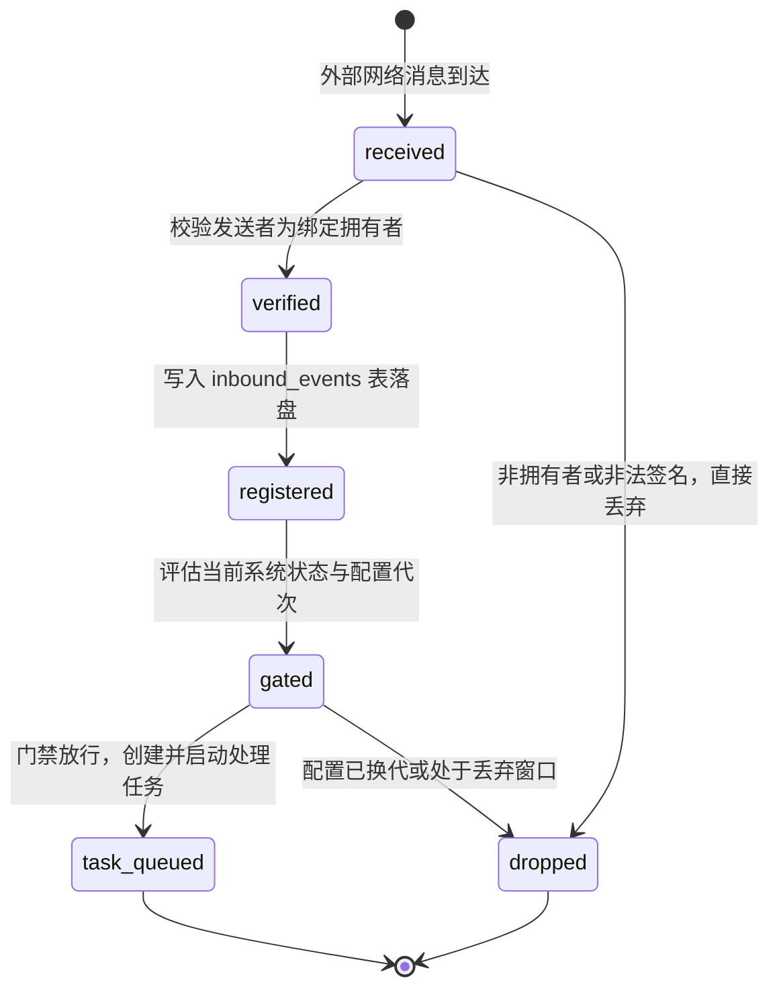
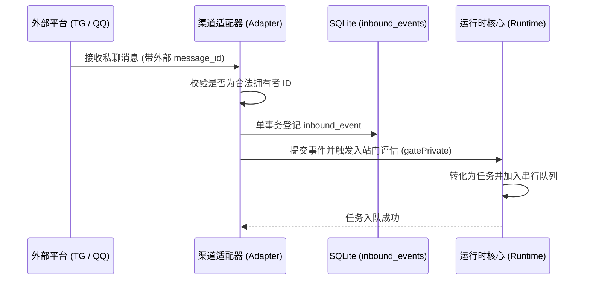

# 消息渠道与事件来源

## 职责与边界

`channels` 模块负责系统与外部通讯平台（Telegram、QQ）的双向消息对接，以及来自代码仓库（如 GitHub Webhook）的异步事件接入。

### 核心职责
- **双向拥有者消息适配**：接入 Telegram Bot 与 QQ 私聊（基于 OneBot 协议），实现消息接收、文本截短与原路回复。
- **入站多媒体管道（`InboundMedia`）**：负责外部图片的安全下载、MIME 与尺寸校验、本地暂存与向模型输入的提升。
- **IM 审批交互通道**：允许拥有者在聊天窗口中通过结构化命令（如 `/approve`、`/reject`）直接审批工具调用。
- **GitHub 事件源**：接收并验证 GitHub Webhook 签名，将 Pull Request 变动转化为受控的代码评审任务。

### 边界与非职责
- 发送通知的底层队列与重试调度归 [scheduler](scheduler.md)。
- 个人 Agent 的原生 durable 会话管理归 [personal-durable](personal-durable.md)。
- 任务在系统内部的状态流转归 [runtime](runtime.md)。

## 对外接口

### 1. 通道适配器与事件源

| 组件 | 对应平台 / 协议 | 核心方法与职责 |
|---|---|---|
| `TelegramAdapter` | Telegram Bot API | `start` / `stop` / `send`；管理 Telegram 轮询与长轮询连接，处理私聊会话 |
| `QqAdapter` | OneBot WebSocket | `configure` / `send`；管理与 OneBot 服务端（如 NapCat）的连接，处理好友私聊 |
| `InboundMediaStore` | 多媒体入站管道 | `stage` / `promote` / `recover`；完成入站图片的暂存、哈希校验与生命周期清理 |
| `GitHubEvents` | GitHub Webhook HTTP | 监听 Webhook 回调，校验签名，将 PR 变更转换为只读评审任务并触发通知 |

### 2. 移动端快捷审批指令

拥有者在私聊中可直接发送下列快捷指令完成审批，无需打开电脑终端：

| 快捷指令 | 参数格式 | 作用说明 |
|---|---|---|
| `/approvals` | `[页码]` | 查看当前待决的工具调用审批列表（每页 5 条） |
| `/approval` | `<审批ID>` | 查看特定审批项的详细参数、目标路径与操作指纹 |
| `/approve` | `<审批ID> <权限版本>` | 批准该操作（绑定审批快照，单次消费） |
| `/reject` | `<审批ID> <权限版本>` | 拒绝该操作，模型将收到审批被拒错误 |
| `/service-grants`| `[页码]` | 查看针对服务重启等高频操作的长期授权白名单 |

## 数据与状态

### 外部入站事件流转

外部消息接入后，经过严格的身份校验与门禁过滤，最终进入任务队列：

### 存储载体与关联表

- **`inbound_events`**：记录所有接纳的外部入站事实（消息来源、平台消息唯一键、发送者 ID、正文快照、配置版本）。
- **`inbound_media`**：记录入站图片的原始哈希、文件大小、MIME 类型及本地磁盘缓存路径。
- **钉版目标（Pinned Target）**：记录回复该事件时绑定的物理通道与平台账号代次，防止配置切换时串号。

## 主要流程

### 1. 外部消息接入与任务创建

### 2. 多媒体图片入站流程

1. **下载与校验**：适配器提取图片 URL 后由 `InboundMediaStore` 下载，严格限定单图最大 8 MiB、单条消息最多 4 张，且仅接受 JPEG/PNG/WebP。
2. **安全暂存**：图片落入本地缓存目录并计算 SHA256，未通过校验的文件立即清理。
3. **上下文提升**：任务被调度执行时，系统将本地图片引用按目标模型协议规范转换为对应的视觉输入 payload。

## 不变量与失败处理

- **精准原路回传**：回复消息必须且只能发送给触发该任务的原通道与原账号。配置代次发生变更时，旧待发回复直接作废，杜绝窜漏。
- **拥有者强校验**：除公网 Webhook 经由独立签名认证外，所有 IM 消息入站前必须精确匹配配置的 `expectedActor`，非拥有者消息在边界处即被丢弃。
- **图片安全硬上限**：对入站媒体文件的下载大小与并发重试次数设置严格硬限制，防止大文件攻击或恶意循环下载耗尽带宽。

## 设计依据

- [后台任务与终端](../../.agents/notes/implemented/architecture/2026-09-19-detach-terminal-from-task-runtime.md)
- [会话历史与模型上下文](../../.agents/notes/implemented/architecture/2026-09-19-preserve-session-history.md)
