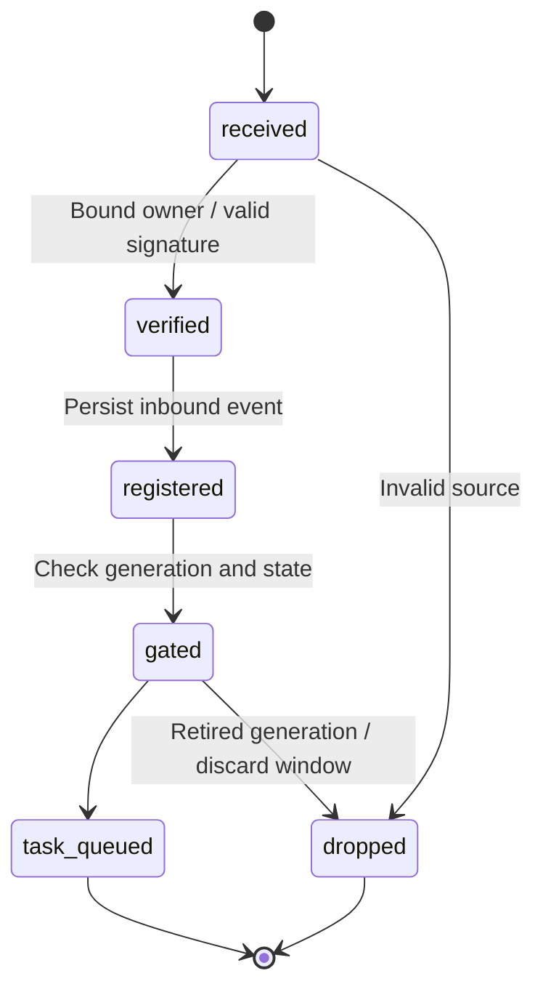
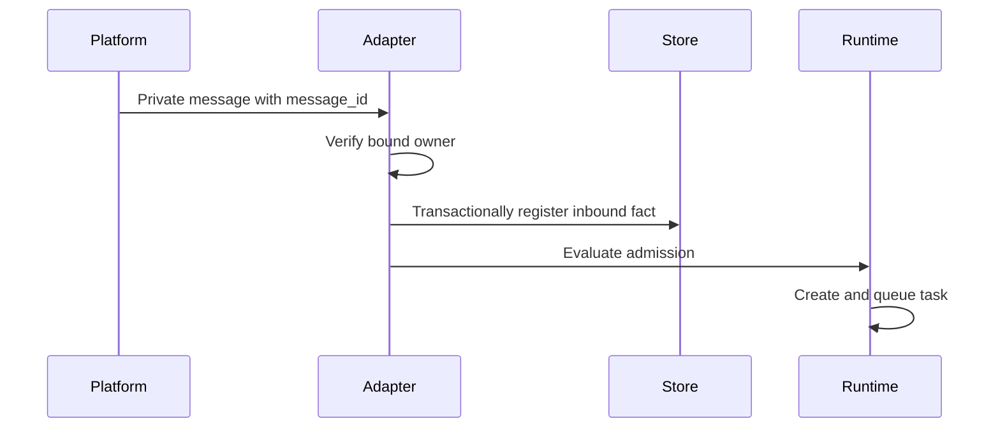

# Channels and Event Sources

## Responsibilities and Boundaries

The shared channels package adapts Telegram, QQ/OneBot and signed GitHub events to the shared runtime. It owns inbound identity checks, media staging and structured IM approval commands. Production Personal has [its own durable adapters](personal-durable.md); these shared-package interfaces are not its persistence authority.

The [scheduler](scheduler.md) owns notification outbox coordination; [runtime](runtime.md) owns task state.

## Public Interfaces

| Component | Platform | Responsibility |
| --- | --- | --- |
| `TelegramAdapter` | Telegram Bot API | `start`, `stop`, `send`; polling and private messages |
| `QqAdapter` | OneBot WebSocket | `configure`, `send`; friend-private-chat connection |
| `InboundMediaStore` | Inbound media | `stage`, `promote`, `recover`; validation, hashing and lifecycle |
| `GitHubEvents` | Signed HTTP webhook | Validate signature and turn PR changes into read-only review work |

The shared IM command protocol provides:

| Command | Arguments | Purpose |
| --- | --- | --- |
| `/approvals` | `[page]` | Pending approvals, five per page |
| `/approval` | `<approvalId>` | Parameters, target and fingerprint |
| `/approve` | `<approvalId> <permissionVersion>` | Approve the fixed snapshot for one consumption |
| `/reject` | `<approvalId> <permissionVersion>` | Reject the operation |
| `/service-grants` | `[page]` | Inspect scoped standing service permissions |

## Data and State

`inbound_events` retains source, platform message identity, sender, body snapshot and configuration version. `inbound_media` retains hashes, bytes, MIME and cache locations. Pinned reply targets retain the original channel/account generation.

## Main Flows

Media staging accepts JPEG, PNG and WebP, at most four images per message and 8 MiB per image. It downloads, validates and hashes each image, removes invalid staged files, then promotes verified references to the selected model's image input when execution starts.

## Invariants and Failure Handling

- Replies keep their original channel/account. A changed entry generation invalidates old unsent replies rather than redirecting them.
- IM identity must match configured `expectedActor`; GitHub uses its separate webhook signature check.
- Media size and retry/concurrency limits prevent unbounded downloads. Failed media validation must not silently claim successful image input.

## Design Rationale

- [Detach terminal from task runtime](../../.agents/notes/implemented/architecture/2026-09-19-detach-terminal-from-task-runtime.md)
- [Preserve session history](../../.agents/notes/implemented/architecture/2026-09-19-preserve-session-history.md)
