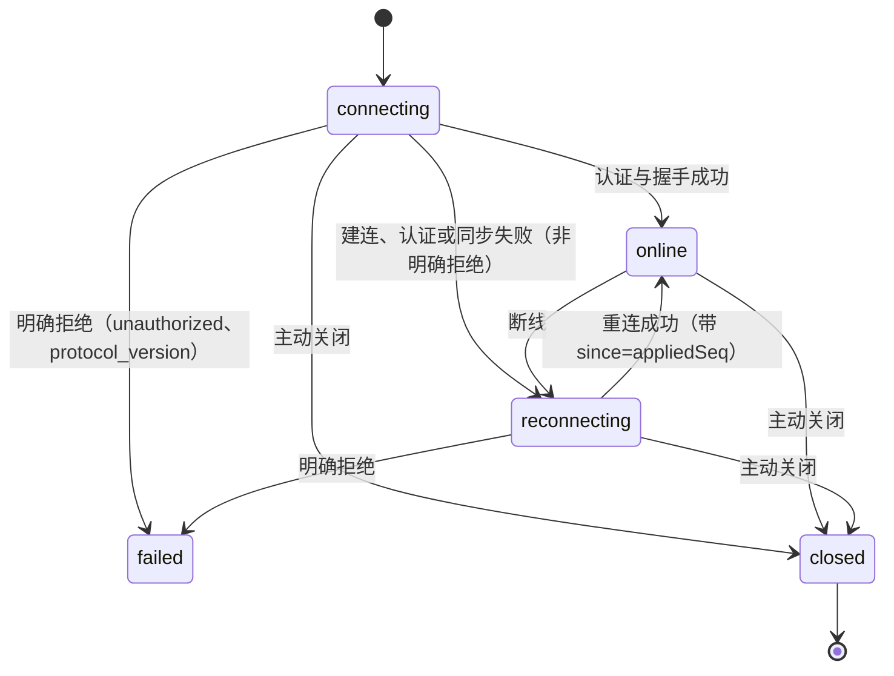
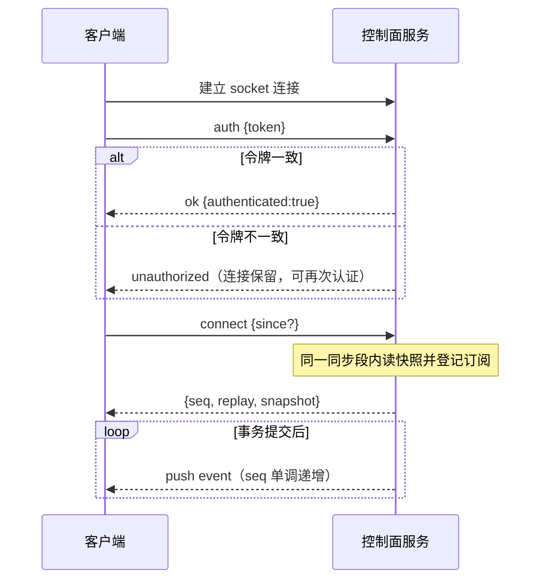
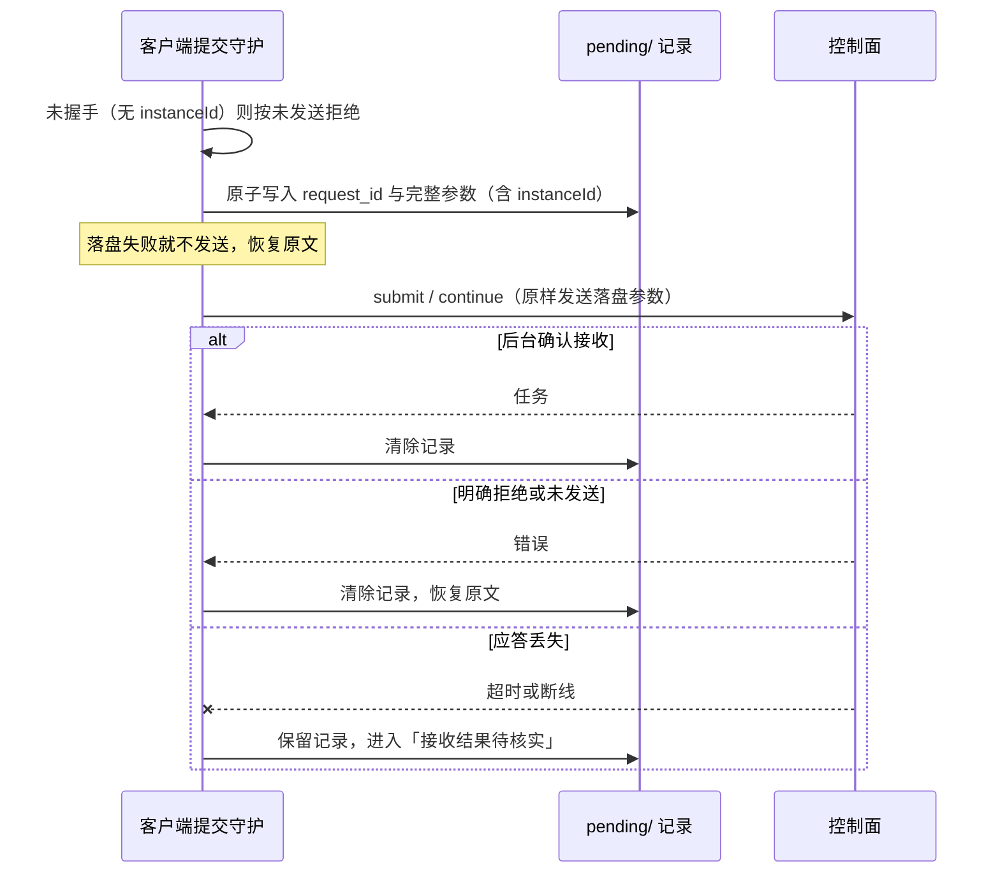

# 控制面

## 职责与边界

控制面（`packages/control/src/`）是后台对外的唯一进程边界：后台在受控目录的 Unix socket 上暴露换行分帧 JSON 协议，客户端经它认证、提交与查询任务、订阅事件。单个后台进程服务一个数据目录，控制面自己不做业务判断。

它负责：

- 控制面 socket 的建立、权限收紧与停止时的连接回收。
- 拥有者令牌认证：令牌的生成与复用、客户端按优先级解析令牌、认证先于任何请求。
- 协议版本协商、握手、请求与应答的帧形状。
- 持久事件流的推送、补发与游标。
- op 目录与参数校验，把请求派发到任务运行时与核心库。
- 提交幂等键的核对面，以及请求结果的四类分类。
- 所有发往客户端的载荷的有界化：线上载荷不携带完整大参数。

它不负责：命令的完整参数与用法见[操作手册](../usage.md)；任务的状态机、排队与执行语义见[任务运行时](runtime.md)；TUI 如何消费快照、事件与命令见[交互终端与配置中心](tui.md)；会话、工作区、schema 与会话身份的存储原语见[核心存储](core.md)；凭据、MCP、长期操作授权、工作委托、记忆、调度与 IM 入口的业务规则各自归其模块，控制面只做参数校验、能力边界与转发。控制面不直接打开核心数据库，也不成为绕过任务审批的入口。

## 对外接口

**监听点与帧。** 服务在 `<controlDir>/control.sock` 监听。请求是 `{v, id, op, params}`，应答是 `{v, id, ok, result|error}`，事件推送是 `{v, push:"event", event}`；每帧一行 JSON 加换行，空行忽略。当前协议版本是 `16`（`CONTROL_PROTOCOL_VERSION`，与 `PROTOCOL_VERSION` 同值）。

**拥有者认证。** 连接建立后第一个成功的操作必须是 `auth`（参数 `token`）。认证成功前，服务端对其他 op 一律回 `unauthorized`，不返回快照、不执行请求；连接保留，可以再次认证。令牌是 32 字节随机数的 hex，写入控制目录的 `owner.token`（0600）：缺失或内容去空白后不足 32 字符时后台启动时生成，已存在则复用。多用户部署由配置步骤把令牌以 0400、属主为拥有者放到拥有者可读的位置，再用 `RUUKOTO_OWNER_TOKEN_FILE` 指向它。

客户端按固定优先级取令牌：`RUUKOTO_OWNER_TOKEN` 环境变量 → `RUUKOTO_OWNER_TOKEN_FILE` 指定的文件 → 控制目录的 `owner.token`。两个环境变量两个产品同名（令牌是控制面身份，不是路径归属）。令牌不进命令行、工具环境、日志或待确认记录；比较用 `timingSafeEqual` 常数时间比较，长度不同也照样比较一次再否决。三个来源都取不到时客户端抛出带修复指引的错误，请求根本不发。

**探测。** 判定「后台是否在运行」的标准是 socket 可连、令牌认证通过、一次不带游标的 `connect` 成功，三者都成立才复用而不启动第二个实例；`protocol_version` 与 `unauthorized` 这类明确拒绝本身就证明后台在运行。按需拉起、退避重连与失败分类属 TUI 入口，见[交互终端与配置中心](tui.md)。

**op 目录。** `auth` 在派发之前单独处理；其余 op 由 `dispatch` 的 `switch (request.op)` 派发。未知 op 回 `unknown_op`。

| 类别 | op | 说明与能力边界 |
| --- | --- | --- |
| 连接与后台 | `ping`、`connect`、`stop` | `ping` 返回 `pong` 与 `stopping`；`connect` 是握手（见下）；`stop` 请求后台停止，立即回 `accepted` |
| 项目、会话与工作区 | `create_project`、`create_session`、`open_workspace`、`get_session`、`list_session_summaries`、`get_session_usage` | `create_project` / `create_session` / `open_workspace` 带可选幂等键 `request_id`；`list_session_summaries` 的 `project_id`（原身份）与 `workspace_id`（组织归属）互斥且必须给一个 |
| 旧数据迁移 | `preview_workspace_migration`、`apply_workspace_migration` | 预览只读；应用必须带 `instance_id`，另用 `request_id` 回执与 `expected_revision`（回退除外）防重 |
| 模型配置 | `list_models`、`get_model_config`、`set_session_model`、`save_model_catalog`、`set_model_api_key`、`remove_model_api_key`、`remove_model_provider`、`set_default_model`、`set_summary_model`、`test_model_connection` | 写操作按 `expected_version` 或 `expected_revision` 条件更新 |
| 任务 | `submit`、`continue`、`switch_mode`、`set_session_mode`、`interrupt`、`cancel`、`resume_queue` | `submit` 与 `continue` 带 `request_id`；`submit` / `continue` / `switch_mode` / `set_session_mode` 不能作用于子会话；`switch_mode` 不能进入或退出计划模式 |
| 任务查询 | `get_task`、`find_task`、`list_tasks`、`read_task_events` | `get_task` 返回快照水位 `seq`；`find_task` 按 `session_id` + `request_id` 核实请求是否已接收；`read_task_events` 按 `after_seq` / `limit` 分页 |
| 审批 | `respond_confirmation`、`get_confirmation_params`、`get_tool_op_params` | `respond_confirmation` 的 `decision` 是 `approve` / `reject`，可带 `permission_version`；后两者按 ID 分段读取完整参数 |
| 历史与产物 | `read_history`、`read_history_entry`、`read_tool_result`、`search_history`、`read_artifact` | `read_history` 是唯一权威历史的投影，分页与分段读；`read_artifact` 按任务与产物 ID 读正文 |
| 上下文与技能 | `list_selection_records`、`get_selection_record`、`get_context_breakdown`、`list_prompt_requests`、`read_prompt_snapshot`、`list_skills` | 选择记录与 prompt 快照分段读；`list_skills` 返回技能库目录与诊断 |
| 项目配置、资料授权与记忆 | `set_project_instructions`、`set_project_web_search`、`get_project_jev`、`set_project_jev`、`create_data_grant`、`revoke_data_grant`、`list_data_grants`、`list_memories`、`get_memory`、`save_memory`、`revoke_memory`、`restore_memory` | 写操作按 `expected_version` 条件更新；资料授权只能由拥有者此处创建与撤销 |
| 凭据 | `list_credentials`、`add_credential`、`remove_credential` | `list_credentials` 只有引用、不回显值；秘密值随请求传输，不进命令行、模型上下文、事件或日志 |
| MCP | `mcp_configure`、`mcp_list`、`mcp_set_enabled`、`mcp_remove`、`mcp_check` | 配置按项目、按 `expected_version` 条件更新；`mcp_check` 试连并列出可用工具 |
| QQ 与 Telegram | `qq_configure`、`qq_status`、`qq_set_enabled`、`qq_inbox_list`、`qq_outbox_list`、`telegram_configure`、`telegram_status`、`telegram_set_enabled` | 配置按 `expected_version` 条件更新；QQ 群收件与出站列表是只读归档 |
| 调度与通知 | `schedule_list`、`schedule_get`、`schedule_cancel`、`notification_list`、`notification_get`、`notification_cancel` | 只有查询与取消，控制面不获得发送或改目标的能力；取消必须给原因 |
| 长期操作授权 | `service_grant_list`、`service_grant_get`、`service_grant_revoke` | 只有查询与带 `expected_version` 的撤销；控制面不能创建或扩大授权，重复撤销幂等且不再发事件 |
| 工作委托与 SubAgent | `work_list`、`work_get`、`subagent_close`、`work_cancel` | 只读查询加两项显式关闭与取消；委派只能经模型的委派工具产生，控制面不能建委派 |

**握手。** `connect` 的 `since` 可选，是非负整数游标；返回 `{seq, replay, snapshot}`。快照读取与订阅注册在同一个同步段内完成，保证快照序号 `seq` 与实时推送之间无缺口；`replay` 是 `(since, seq]` 的补发事件，fresh connect（不带 `since`）为空。补发不推给监听者，由调用方先安装快照再按序应用。

`seq` 是快照截止的事件序号，`snapshot.instanceId` 是数据实例的稳定标识（新数据库分配新标识），`snapshot.execution` 是执行后端与说明（`local` 无隔离必须显式展示），`snapshot.defaultModel` 是后台启动默认模型。快照有界：全部活动任务加上每个会话最近结束的 20 条任务（更早的经 `list_tasks` 分页）、`pending` 状态的审批请求（参数为有界预览）、活动任务的产物、活动与中断任务的最新输出预览（缺失片段如实为空）。快照另带 `roleSessionIds`、`subAgentSessionIds`、`workDelegations` 与 `subAgents`。

**事件流。** 持久事件与状态变化在同一事务写入事件表，提交成功后才广播，回滚的事务不产生事件。事件体带单调递增的 `seq`，客户端按 `seq` 去重。慢客户端或断开很久的客户端不由服务端在内存里积压事件，重连时凭游标补发，补发不了就重取快照。事件携带消息 ID、正文段序号、UTF-8 字节偏移与段开始时间，接收端按偏移拼接完整正文；消息完成后仍以会话历史为准，事件投影不替代历史。

**请求结果分类（客户端契约）。** 请求失败时由产生错误的地方写定四类之一，调用方按分类处理而不列错误码：

| 分类 | 含义 | 产生处 |
| --- | --- | --- |
| `not_sent` | 未发送（已知未执行） | 连接不可用 `connection_unavailable`（含握手前提交）、客户端已关闭 `closed`、参数无法序列化、建连失败 `connect_timeout` / `connection_error` |
| `rejected` | 后台明确拒绝 | `ok:false` 且错误码不属于下一行集合 |
| `unknown` | 应答丢失，连接仍在 | 请求超时 `request_timeout`；`internal_error`、`response_too_large`、`mode_switch_unverified` |
| `disconnected` | 应答丢失，已断线 | 在途请求遇到 socket 关闭或出错、坏帧、超长帧、未换行残留、客户端主动关闭 |

`unknown` 与 `disconnected` 都是「应答丢失」，只看连接当时还在不在；二者都不自动重发。不是 `ControlClientError` 的异常保守按 `unknown` 处理。

**超时。** 客户端建连 5000 ms、认证 10000 ms、握手 15000 ms、普通请求 60000 ms。普通请求超时按 `unknown`，后台照常执行，迟到应答按 `id` 丢弃。

## 数据与状态

**控制目录。** 目录 `<controlDir>`（默认是数据目录的兄弟目录 `control/`，可用 `RUUKOTO_CONTROL_DIR` / `RUUKOTO_CODE_CONTROL_DIR` 覆盖）：

| 路径 | 权限 | 内容 |
| --- | --- | --- |
| `control.sock` | 0660（目录 0770） | 控制面 socket |
| `owner.token` | 0600 | 拥有者令牌，32 字节随机 hex |

**服务端内存状态。** 订阅连接集合、全部连接集合（含未订阅与未认证，停止时强制关闭以免 `close` 悬挂）、已认证 socket 的集合、停止标志。控制面自身不建业务表；业务记录都在核心库，控制面只把有界视图发给客户端。

**客户端连接状态机。**

退避重连的初始间隔 500 ms、上限 8000 ms；只有后台明确拒绝（令牌无效、协议不兼容）进 `failed` 并停止重试。重连只恢复观察：不发送 `resume_queue`、批准或继续请求。

**待确认请求记录。** 每个产品存档根下的 `pending/`（默认 `~/.ruukoto/pending` 或 `~/.ruukoto-code/pending`，`RUUKOTO_PENDING_DIR` / `RUUKOTO_CODE_PENDING_DIR` 可覆盖）：目录 0700、记录 0600，写临时文件再 `rename`。一条记录含 `requestId`、op（`submit` 或 `continue`）、完整请求参数、提交时握手返回的 `instanceId`、创建时间。解析不了的文件留在磁盘上单独列出，不静默丢弃；令牌等凭据永不写入这里。记录只代表「尚未确认接收」的请求，不是会话历史的副本。

**游标。** 两处去重：底层客户端丢弃 `seq` 不大于它记下的序号的推送，连接层丢弃 `seq` 不大于 `appliedSeq` 的事件，并且只在事件应用之后才前进游标。握手期到达的实时推送先缓冲，快照安装后再按序应用。

## 主要流程

### 启动监听与停止

后台启动时确保控制目录存在、生成或复用 `owner.token`，移除遗留的 socket 文件（上一条实例被强杀不会清理），再 `listen` 并把 socket 收紧到 0660；随后注册事务提交后的广播回调。停止时强制关闭全部连接（含未认证），清空订阅，关闭服务并删除 socket 文件。

### 建连、认证与握手

接上一条连接后，任何非 `auth` 的操作在认证成功前都被拒。`connect` 的 `since` 非法（非整数、负数或大于 `maxSeq`）回 `invalid_cursor`，要求重新取快照。

### 事件应用、缺口与重同步

客户端按 `seq` 去重；发现 `seq` 不等于 `appliedSeq + 1` 时重新同步快照与历史（不重新执行任务，不解除队列暂停），`invalid_cursor` 与 `cursor_too_old` 同样走这条路径。每次同步比对 `instanceId`：变了说明后台换了一个数据库，调用方据此处理待确认请求，不向空后台重发旧提交。

### 提交与提交幂等

提交（`submit`）与继续（`continue`）会真正启动任务，因此幂等键要比请求本身活得久：

核实只问一个问题：后台有没有收到这个 `request_id`。连接仍在时当场核实这一条，断线时每次回到 `online` 核实全部记录：查到就关联原任务并清除记录；明确未接收（`find_task` 返回空）才以原键原参数重发；查询失败、实例不符或缺模型时保留记录，不产生副作用，下次上线再核。记录里没有模型选择时不能原样重发，转为让拥有者确认后把原文恢复进原会话草稿。

### 审批应答

`respond_confirmation` 接受 `approve` / `reject`，可带 `permission_version` 绑定审批时的权限版本。权限版本不匹配回 `permission_version_mismatch`，该批准不可用。批准只适用于该次操作及明确列出的范围，在执行前单次消费。

### 断开、重连与数据实例变化

客户端断开只移除订阅，不取消任务、不触发恢复，也不发送 `resume_queue`、批准或继续。重连带 `since = appliedSeq` 重新握手（游标为 0 时不带），先安装快照、再应用补发事件（只补齐显示记录，不回滚状态）、再按序应用缓冲的实时事件；`instanceId` 变化时同样通知调用方。

### 停止

`stop` 请求后台停止，立即回 `accepted`；后台先拒绝新任务并暂停调度，再中断活动任务、回收工具进程、落盘后关闭，排队输入保留。进程信号与控制面 `stop` 走同一条关闭路径。

## 不变量与失败处理

**认证先于一切。** 认证成功前不返回快照、不执行请求；不论连接处于什么阶段都能先认证。令牌不进命令行、工具环境、日志或待确认记录。

**版本不匹配明确拒绝。** 版本检查在认证之前，服务端回 `protocol_version` 并在消息里写明双方版本，客户端提示升级而不是静默重试。持久事件中的旧格式兼容不代表线上协议向后兼容。

**错误码口径。** 只有小写蛇形的业务码原样进协议；系统错误码（`ENOENT`、`ERR_SQLITE_*` 等）与没带码的异常统一收口为 `internal_error`，原码留在消息里。非法 JSON 帧回 `bad_frame`（`id` 为空），缺 `id` 或 `op` 回 `bad_request`，未知 op 回 `unknown_op`。

**帧与载荷上限。** 所有发往客户端的载荷按序列化字节数设限，持久化层保持完整：

| 上限 | 值 | 行为 |
| --- | --- | --- |
| `MAX_FRAME_BYTES` | 1 MiB | 单帧上限；请求行超限时服务端销毁该连接、不回应答；应答超限时改回 `response_too_large`（请求已执行，只是结果装不进一帧） |
| 超限帧与非法帧（客户端侧） | — | 按断线处理（`frame_too_large`、`bad_frame`），不再使用该连接、不发送请求 |
| `PARAMS_INLINE_CAP` | 8 KiB | 事件与查询应答内联参数的上限；超限给结构保留的预览并标注 `paramsBytes` 与 `paramsTruncated`，完整参数经 `get_confirmation_params` / `get_tool_op_params` 按 ID 分段读取 |
| `PARAMS_PREVIEW_STRING_CAP` | 256 字符 | 预览对象中单个字符串的上限 |
| `FRAGMENT_TEXT_CAP` | 8 KiB | 运行中输出增量与思考文本尾部的上限，在源头有界化 |
| `SEGMENT_DEFAULT_BYTES` / `SEGMENT_MAX_BYTES` | 64 KiB / 256 KiB | 分段读取的默认页大小与上限 |
| `read_artifact` | 720 KiB 单次 | base64 开销后仍在 1 MiB 帧上限内 |
| `read_history` | `limit` 默认 50、最多 200 | 条目按末端向前收集到条目数或字节预算耗尽，`entry_text_cap` 默认 16 KiB（范围 256 B–256 KiB），`page_text_budget` 默认 192 KiB（范围 `entry_text_cap`–1 MiB） |
| `read_tool_result` | 每字段默认 16 KiB、最多 64 KiB | 读工具结果正文、Edit 补丁与 Write 调用原文 |
| `read_task_events` | `limit` 默认 100、最多 500 | 单页序列化字节上限 `SEGMENT_MAX_BYTES`；单个事件超过单页上限回 `event_too_large` |
| `connect` 补发 | 5000 条 | 超过回 `cursor_too_old`，要求重新取快照 |

**游标失败。** 非法游标回 `invalid_cursor`，补发区间过大回 `cursor_too_old`；两者都让客户端重新取完整快照，不重新执行任务。

**应答丢失不换键。** 任何 `unknown` / `disconnected` 的写请求都不自动换新键重发。有幂等键的（提交、工作区入口）按原键核实，确认未接收才以原键原参数重发；其余先查询后台状态，再由拥有者决定。「应答丢失」针对控制面请求，「效果未知」针对工具操作，两者不混称。

**提交幂等与冲突。** `request_id` 的唯一范围是会话；参数摘要是原文、显式模式（未指定时为 `null`）、授权范围、继续来源、模型选择与编排字段的哈希。同键同参重放返回原任务，同键异参回 `request_conflict`，客户端不换新键、不重发，展示冲突由拥有者处理。连摘要都没记录的旧任务一律回 `request_conflict`，请拥有者用 `find_task` 核实。

**乐观并发与配置应用边界。** 写操作按 `expected_version`、`expected_revision` 或 `(session_id, request_id)` 条件更新：版本不符回 `version_conflict`、`revision_conflict`、`row_version_conflict` 或 `schema_version_conflict`，不静默覆盖。provider、模型目录与 API key 的修改只在没有受影响的 `running` / `awaiting_confirmation` / `queued` 任务时应用；检查到应用完成之间，受影响 provider 的新提交与会话模型设置被拒绝（`model_config_busy`，可重试），占用时回 `model_config_blocked` 与任务数，不先改文件、不部分应用、不自动取消任务；删除 provider 或模型前核对引用（`provider_in_use`）。

**凭据变更的次序。** 登记或更新、删除凭据时，先递增引用它的 IM 配置代次使旧连接、旧入站与旧批准失效，再写凭据、重连适配器，然后才应答；SQLite 与凭据文件不宣称原子提交。

**能力边界。** 控制面不能创建或扩大长期操作授权：`service_grant_list` / `get` / `revoke` 只查询与带版本撤销，重复撤销幂等且不再发事件，入口停用后仍可管理遗留记录。委派只能经模型的委派工具产生，控制面不能建委派。调度与通知只查询与取消，不获得发送或改目标的能力。`subagent_close` 在存在活动任务（`queued` / `running` / `awaiting_confirmation`）时拒绝并给出任务 ID，已关闭时幂等、不再发事件；`work_cancel` 在登记事务内取消排队任务并给活动任务写取消意图，已取消时幂等返回原记录。

**数据实例与空后台。** `instanceId` 变化说明后台换了一个数据库；客户端按新实例处理待确认记录，不向空后台重发旧提交。旧序号在新库里没有意义：小于旧游标时回 `invalid_cursor` 走重新同步。

**已知上限。** 两端的帧大小口径不同：服务端按字符串长度（UTF-16 码元数）比较请求行，客户端只核对收到的帧（按 UTF-8 字节数），发送前不核对请求大小。超过服务端上限的请求会让连接被直接销毁，客户端把在途请求当成应答丢失；如果那是提交，待确认记录每次上线都会被核实，`find_task` 查不到就按原参数重发，连接又被销毁，按退避初值 500 ms 重连，如此循环。这是按代码推演的结论，未实际运行验证。

## 设计依据

- [任务由后台进程持有，终端只负责交互](../../.agents/notes/implemented/architecture/2026-09-19-detach-terminal-from-task-runtime.md)：解释任务为什么独立于交互入口、为什么需要独立认证与实例锁，以及持久事件带单调序号、按游标补发、提交携带 `request_id` 去重这套恢复机制。
- [限定的长期服务授权替代重复人工决定](../../.agents/notes/implemented/feature/2026-10-03-standing-permissions.md)：解释批准上的授权关联与新决定来源、`standing_permission.*` 事件，以及控制面只查询与撤销、不能创建或扩大授权的能力边界。
