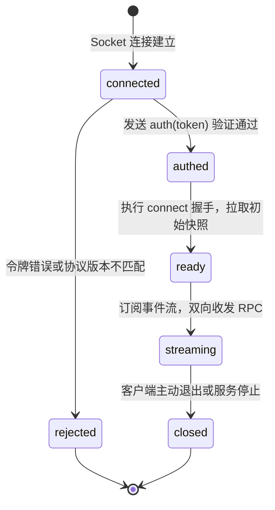
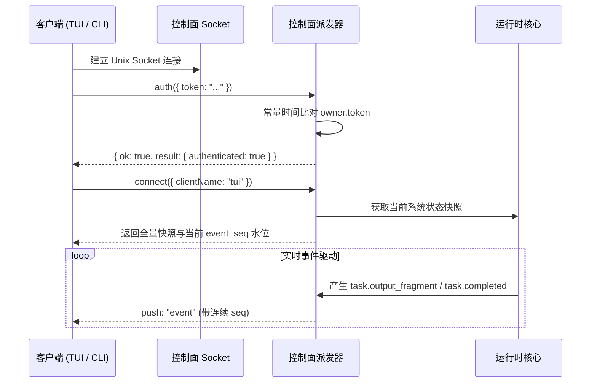

# 控制面协议与进程通信

## 职责与边界

`control` 模块（对应 `packages/control/src/`）是 Coding Agent 后台服务对外暴露的唯一进程间通信边界。它在受保护的 Unix Domain Socket 上提供结构化的 JSON-RPC 协议与双向流式事件广播。

> 注：本篇描述 Coding Agent 客户端协议；正式个人 Agent 采用原生的 durable 进程间通信与远程协议，见[个人持久会话](personal-durable.md)。

### 核心职责
- **Unix Socket 监听与访问控制**：在 `<controlDir>/control.sock` 建立本地套接字，收紧文件系统权限位（`0600`）。
- **拥有者令牌认证（Owner Token）**：采用常量时间算法比对随机认证令牌，强制要求所有业务请求前必须完成身份鉴权。
- **协议版本协商与分帧**：基于每行一个 JSON 对象的简洁分帧格式（行分隔），严格校验客户端与服务端的协议版本一致性。
- **持久事件流广播与补发**：维护单调递增的事件流水号（`seq`），向连接的客户端推送流式事件增量，支持断线重连按游标补发。
- **大载荷有界化**：对工具执行大输出、Diff 补丁与日志实施分段与有界截断，避免单个超大帧阻塞通信管道。

### 边界与非职责
- 任务排队、状态机流转与执行画像归 [runtime](runtime.md)。
- 终端界面全屏渲染与按需拉起进程管理归 [tui](tui.md)。
- 数据库落盘与会话元数据存储归 [core](core.md)。

## 对外接口

### 1. 通信协议帧规范

通信在 Unix Domain Socket 上进行，每帧以 `\n` 结尾：

| 帧类型 | 结构规范 | 核心字段说明 |
|---|---|---|
| **请求帧** (客户端 → 服务端) | `{ v, id, op, params }` | `v`: 协议版本号；`id`: 请求流水号；`op`: 操作名；`params`: 参数载荷 |
| **应答帧** (服务端 → 客户端) | `{ v, id, ok, result \| error }` | `ok: true` 返回业务数据 `result`；`ok: false` 返回结构化错误对象 `error` |
| **事件推送** (服务端 → 客户端) | `{ v, push: "event", event }` | `event` 包含单调递增的 `seq`、事件类型 `type` 与业务载荷 |

### 2. 控制面核心操作分类 (op 目录)

| 操作类别 | 代表性 op 名称 | 核心能力说明 |
|---|---|---|
| **鉴权与连接** | `auth`, `ping`, `connect`, `stop` | 令牌鉴权、服务活性探测、全量快照握手与服务优雅停止 |
| **任务与队列控制** | `submit`, `continue`, `interrupt`, `cancel`, `switch_mode`, `resume_queue` | 任务提交、在途任务中断与取消、模式切换（受限/完全访问）与队列恢复 |
| **状态与事件查询** | `get_task`, `list_tasks`, `read_task_events` | 任务执行状态检索与事件历史分页拉取 |
| **安全审批响应** | `respond_confirmation`, `get_confirmation_params` | 拥有者批准/拒绝敏感操作；按需分段读取超长审批参数 |
| **会话与工作区** | `open_workspace`, `create_session`, `branch_session`, `compact_session` | 映射工作区目录、新建会话、按已完成任务或当前安全尾拉取会话分支与手动触发历史压缩 |
| **模型与凭据配置** | `list_models`, `get_model_config`, `set_session_model`, `test_model_connection` | 动态查询模型目录、按会话切换模型、保存 API Key 与执行连通性测试 |
| **工作流控制** | `workflow_start`, `workflow_list`, `workflow_control`, `workflow_answer` | 启动自动化工作流、查询执行步骤、人工干预与问答提交 |
| **历史与产物读取** | `read_history`, `read_tool_result`, `read_artifact` | 只读解析 JSONL 会话历史、读取工具执行补丁与提取产物二进制片段 |
| **实例 MCP 管理** | `mcp_list`, `mcp_configure`, `mcp_check`, `mcp_set_enabled` | 管理实例服务、允许工具与本地效果类别，检查连接与发现工具 |
| **电脑恢复** | `mcp_cua_status`, `mcp_cua_stop`, `mcp_cua_observe`, `mcp_cua_accept` | 核实原执行停止、取得新观察并接受当前新图 |

电脑恢复在停止核实后直接调用 `mcp_cua_observe`；独立的 `mcp_cua_begin_recovery` 已退役，旧请求按未知操作拒绝。Personal 的原调用人工结束走其远程管理协议，入口见[桌面客户端](desktop.md#mcp-原调用收尾与电脑恢复)。

## 数据与状态

### 客户端连接与鉴权状态机

### 令牌分发与优先级解析

客户端解析拥有者认证令牌时，严格按以下优先级回退查找：
1. **环境变量**：`RUUKOTO_OWNER_TOKEN`（最高优先级，适合容器与自动化测试）；
2. **凭据文件路径**：`RUUKOTO_OWNER_TOKEN_FILE`（适合生产多用户部署）；
3. **默认凭据文件**：`<controlDir>/owner.token`（本地开发与单机默认）。

## 主要流程

### 客户端连接与事件订阅时序

1. **严格鉴权守卫**：连接建立后必须首先发起 `auth` 操作。在鉴权成功前，服务端对所有其他 op 调用均直接拒绝。
2. **快照与事件对齐**：客户端执行 `connect` 时获取最新系统快照与当前事件水位号（`seq`），后续增量事件按序追加，杜绝状态盲区。
3. **断线平滑恢复**：若客户端短暂断开，重连鉴权后传入上次处理的 `seq`，控制面直接从持久事件表中拉取未消费事件补齐。

电脑恢复沿“停止核实 → 新图观察 → 接受此观察”转发到运行时。控制面传递原恢复身份与当前观察，真实执行停止、图片保存和接受资格由运行时核实。

## 不变量与失败处理

- **鉴权先于一切业务**：未通过 `auth` 校验的连接，绝对无法触发任何数据读取、会话操作或任务提交。
- **常量时间比对（Timing-safe）**：服务端验证令牌时使用 `crypto.timingSafeEqual`，防止通过统计学旁路时序攻击推测令牌。
- **大参数有界传输防阻塞**：对于超过 1 MiB 的工具输出或大参数，控制面接口强制要求客户端按 offset 与 limit 分片读取，防止打爆内存与套接字缓冲区。
- **协议版本硬匹配**：当前协议为 `43`，版本检查先于认证与业务派发。不匹配时返回 `protocol_version`；旧客户端需升级，新客户端遇到旧后台需结束旧进程后重开入口。

## 设计依据

- [后台任务与终端](../../.agents/notes/implemented/architecture/2026-09-19-detach-terminal-from-task-runtime.md)
- [人类文档与决策记录](../../.agents/notes/implemented/process/2026-10-09-split-agent-and-human-docs.md)
- [MCP 宿主职责收缩](../../.agents/notes/implemented/simplification/2026-10-26-mcp-host-responsibilities.md)：删除独立电脑开始恢复操作，以协议升级明确拒绝旧客户端。
