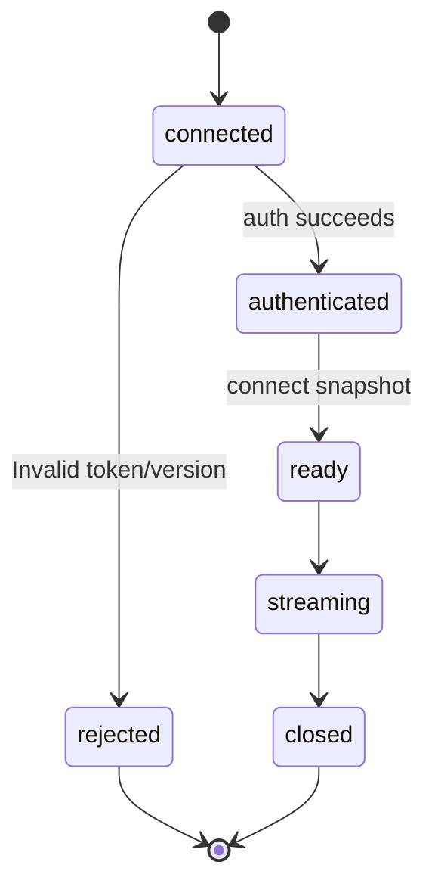
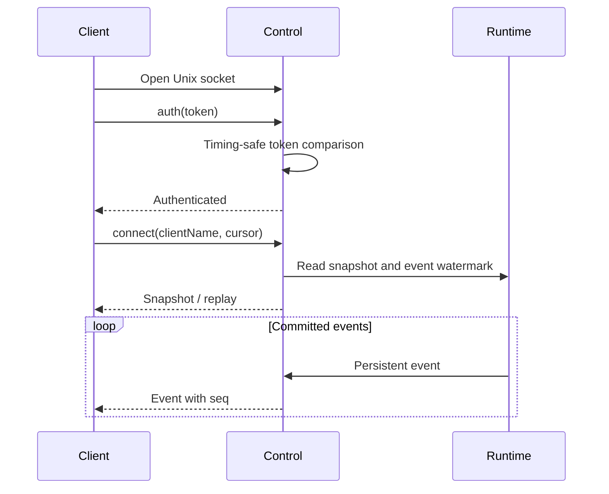

# Control Protocol

## Responsibilities and Boundaries

`packages/control/src/` exposes the Coding backend through a protected Unix socket with line-delimited JSON requests and bidirectional events. The socket at `<controlDir>/control.sock` uses mode `0600`; every business operation requires owner-token authentication. Production Personal has [separate durable and remote protocols](personal-durable.md).

Control validates protocol versions, authenticates, bounds large payloads and replays committed events by monotonic `seq`. [Runtime](runtime.md) owns execution; [core](core.md) owns storage; [TUI](tui.md) owns rendering and on-demand startup.

## Public Interfaces

Each frame ends in `\n`.

| Frame | Structure | Meaning |
| --- | --- | --- |
| Request | `{ v, id, op, params }` | Protocol version, request ID, operation and arguments |
| Response | `{ v, id, ok, result \| error }` | Result or structured error |
| Event | `{ v, push: "event", event }` | Persistent event with sequence, type and payload |
| Narrow client request | `{ v, push: "request", id, op, params }` | Only to a connection registered by `desktop_browser_register`; response uses the ordinary response frame |

| Operations | Purpose |
| --- | --- |
| `auth`, `ping`, `connect`, `stop` | Authenticate, inspect liveness, install snapshot and stop |
| `submit`, `continue`, `interrupt`, `cancel`, `switch_mode`, `resume_queue` | Task and queue lifecycle |
| `task_queue`, `queue_reorder`, `steer_task` | Persisted queue order and steering |
| `message_recall`, `message_recall_verify`, `message_recall_state` | Recall the latest effective owner input: stop affected execution, append history omissions and restore text/attachments to the initiating client; verify retries stop verification, state only queries |
| `get_task`, `list_tasks`, `read_task_events` | Task/event reads |
| `respond_confirmation`, `get_confirmation_params` | Owner decisions and bounded parameter reads |
| `open_workspace`, `create_session`, `branch_session`, `compact_session` | Workspace identity, new/branched conversations and explicit compaction |
| `open_side_chat`, `find_side_chat`, `submit_side_chat` | Prepare/reopen side chat, verify original request, submit plain text |
| `list_models`, `get_model_config`, `set_session_model`, `test_model_connection` | Model catalog, configuration and connection tests |
| `workflow_start`, `workflow_list`, `workflow_control`, `workflow_answer` | Workflow execution and owner interaction |
| `read_history`, `read_tool_result`, `read_artifact` | Read-only history, tool details and artifact slices |
| `mcp_list`, `mcp_configure`, `mcp_check`, `mcp_set_enabled` | Instance services, local effect classes and discovery |
| `mcp_cua_status`, `mcp_cua_stop`, `mcp_cua_observe`, `mcp_cua_accept` | Verify original execution stop, obtain and accept a fresh observation |
| `desktop_browser_register`, `desktop_browser_event`, `desktop_browser_chunk` | Bind browser connection, upload page facts and bounded image/snapshot chunks |

After verified Cua stopping, call `mcp_cua_observe` directly. Retired `mcp_cua_begin_recovery` is rejected as unknown. Personal's original-call finalization uses its own [desktop management protocol](desktop.md#mcp-call-finalization-and-computer-recovery).

## Data and State

Owner-token lookup is ordered: `RUUKOTO_OWNER_TOKEN`, then `RUUKOTO_OWNER_TOKEN_FILE`, then `<controlDir>/owner.token`.

## Main Flows

Version validation precedes authentication and dispatch. Authentication precedes business reads/writes. Snapshot and sequence align the client's starting state; reconnect reauthenticates and uses the last consumed sequence to recover missing events.

Computer recovery forwards the original recovery identity and fresh observation through **verify stop → observe → accept**. Runtime verifies real execution, image persistence and acceptance eligibility.

## Invariants and Failure Handling

- Unauthenticated connections cannot read data, manage conversations or submit work. Tokens use `crypto.timingSafeEqual`.
- Large output and parameters use bounded `offset`/`limit` slices rather than unbounded frames.
- Current protocol is `48`; mismatch returns `protocol_version`. Upgrade an old client, or explicitly stop an old backend before reopening a new client.
- The server binds MyGo browser provenance from the actual socket on `submit`, `continue` and `owner_question_answer`; client parameters cannot assert it.
- Browser events, chunks and narrow responses belong to the exact registered connection. Disconnect revokes it; another connection cannot inherit it.
- Browser snapshots/screenshots use at most 256 KiB per chunk and 8 MiB total, verified by SHA256, and are not replayed as persistent events.

## Design Rationale

- [Detach terminal from task runtime](../../.agents/notes/implemented/architecture/2026-09-19-detach-terminal-from-task-runtime.md)
- [Split agent and human docs](../../.agents/notes/implemented/process/2026-10-09-split-agent-and-human-docs.md)
- [Mcp host responsibilities](../../.agents/notes/implemented/simplification/2026-10-26-mcp-host-responsibilities.md)
