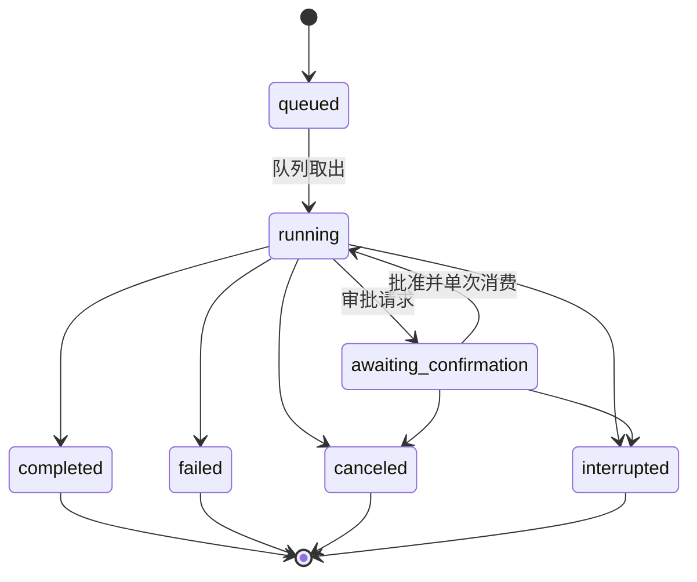
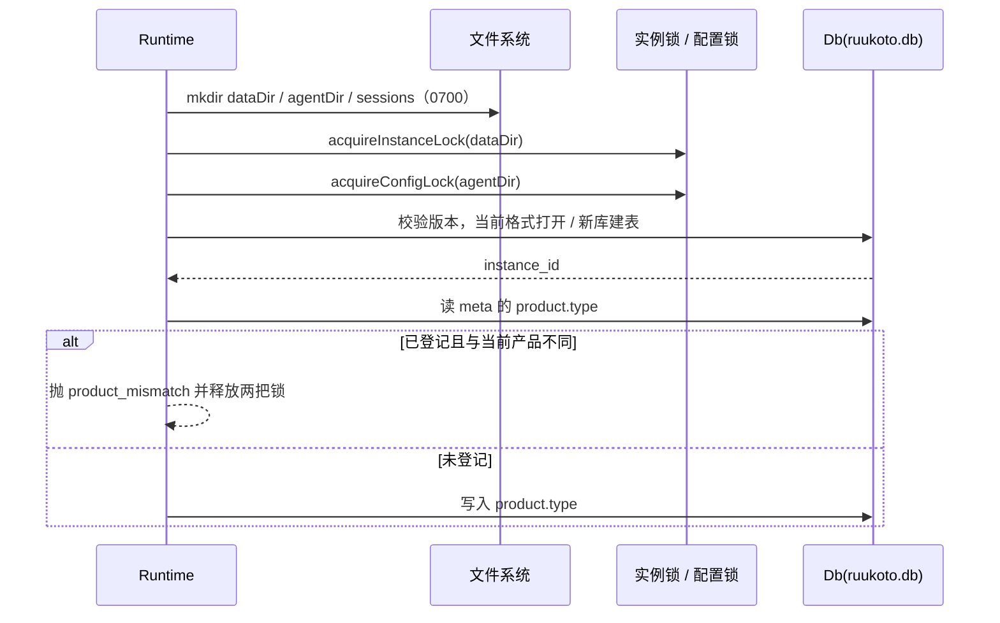
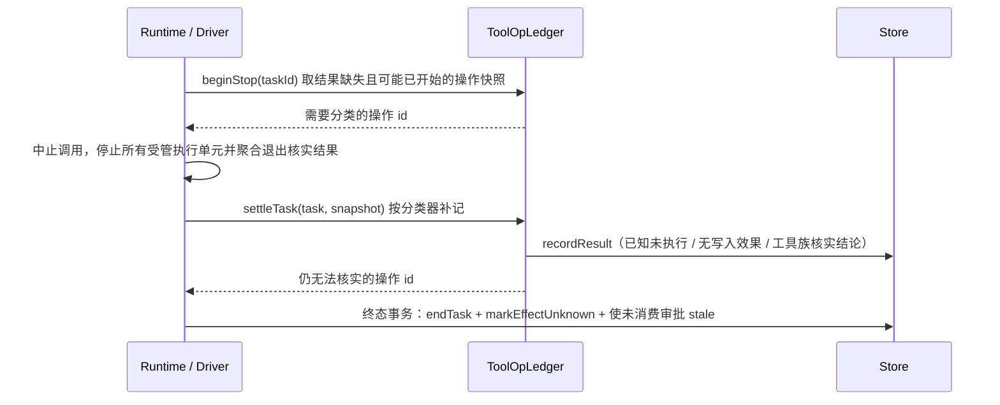

# 存储与身份

## 职责与边界

本篇的运行状态、历史或客户端协议适用于 Coding 与保留的旧格式实现；正式个人 Agent 使用[个人持久会话](personal-durable.md)，不接入旧 Runtime、Task Store 或控制协议。

`packages/core/src/` 是全部模块的最底层，定义数据的落盘形态与「这个会话是什么」的判定。它持有档案根与目录布局、SQLite 核心库（`ruukoto.db`）与 `agent-data/main.db` 的 schema 与版本校验、pi JSONL 会话文件、产物正文文件与入站图片暂存的读写边界、任务状态机及其字段、会话身份解析与执行画像的取数、目录与实例锁、以及产品归属登记。它不依赖其他模块，被全部模块依赖。

它负责：

- 决定数据目录里有什么：`dataDir`、`agentDir`、`control` 三个目录的默认位置、权限位与内容，以及 Coding 与保留旧格式 profile 的档案根。
- 建库与核实 schema：全新库在同一事务内建全部表与版本号；格式不等于当前版本的数据库在写入前拒绝，不回填任务或计划授权。
- 写任务状态：状态集合、`interrupt_reason`／`cancel_requested`／`effect_unknown` 三列，以及终态的条件更新原语。
- 判定会话身份：`Store.getSessionIdentity` 读取会话、角色、SubAgent 与调度运行绑定，纯函数 `classifySession` 给出对应身份；`executionProfile` 的输入由这里的身份、工作与任务行提供。
- 划清三种存储的职责：pi JSONL 是消息历史的唯一权威副本、SQLite 只存元数据与事件、产物正文在产物文件而 SQLite 只存其元数据。
- 实例锁与配置锁：以 `mkdir` 原子创建，用 `owner.json` 核实持锁进程身份。

它不负责：

- 旧实例导入的命令与操作步骤见 [usage](../usage.md)；导入的设计（源只读、离线执行、allow-list、回执与回退边界、执行归属交接）见 [runtime](runtime.md)；本篇只写数据布局与 `<dataDir>/migration/<导入ID>/target-before.db` 这个目录的存在与用途。
- 身份判定之后「谁允许做什么」的结论归 [runtime](runtime.md)：提交、改默认模式、切换模式、队列兜底各自怎么按身份拒绝或取消。本篇只写由哪些行、哪个函数判定。
- 工具可用性清单、审批闸门、工具操作账本与 MCP 见 [agent-tools](agent-tools.md)；执行边界内的目录身份核对见 [execution](execution.md)。
- 控制面 socket 的协议与拥有者认证见 [control](control.md)；调度与发送账本见 [scheduler](scheduler.md)；IM 平台连接见 [channels](channels.md)。

## 对外接口

| 调用方 | 入口 | 说明 |
|---|---|---|
| 全部模块 | `Db(dataDir)`（`packages/core/src/db.ts`） | 打开或创建 `ruukoto.db`；`SCHEMA_VERSION` 是当前 schema 版本；`getInstanceId()` 返回持久的数据实例标识 |
| 全部模块 | `Store`（`packages/core/src/store.ts`） | 表级 SQL 原语：任务、占用、确认请求、工具操作、产物、事件、授权、记忆与版本、历史索引、选择记录、压缩点、MCP、平台与调度表、SubAgent 与工作、导入回执与账本 |
| Runtime、Driver | `Store.getSessionIdentity(sessionId)` | 读取会话、角色、SubAgent 与独立调度运行绑定后调用 `classifySession`；会话不存在返回 `null` |
| Runtime、Driver | `Store.getSubAgentBySession(sessionId)` | 按独立子会话反查 `sub_agents` 绑定，是宿主识别动态身份的唯一依据 |
| Runtime | `packages/core/src/background-processes.ts` | 会话后台的登记、目录交接、单次启动认领、观测、停止核实、关闭屏障及每页最多20条、256 KiB的历史分页；写入由调用者持有同一 Store 事务 |
| Driver | `executionProfile({ identity, writeTarget, review, planMode })`（`packages/agent/src/tool-availability.ts`） | 由身份、任务所属工作是否有写入目标、是否宿主评审与任务钉定的 `planMode` 算出执行画像 |
| Driver、context-assembly | `ArtifactStore`（`packages/agent/src/artifacts.ts`） | `begin` / `append` / `complete` / `importImage` / `read` / `readImage` / `byteLength` |
| Runtime、channels | `InboundMediaStore`（`packages/channels/src/inbound-media.ts`） | `stage` / `promote` / 恢复与过期清理 |
| control、Runtime | `Db.tx` / `Store.withTx` | 单事务写入；`Db.tx` 不能嵌套 |
| Runtime | `acquireInstanceLock(dataDir)`、`acquireConfigLock(agentDir)`（`packages/core/src/instance-lock.ts`） | 获取 `<dataDir>/runtime.lock/` 与 `<agentDir>/config.lock/` |
| control | `packages/core/src/history.ts` 的 `readHistoryPage` / `readHistoryEntryText` / `readToolResult` | pi JSONL 的分页与分段只读读取；`history_index` 由 `packages/core/src/history-index.ts` 维护与检索 |
| control、Runtime、execution | `packages/core/src/dir-identity.ts` 的 `resolveDirIdentity` / `verifyDirIdentity` / `sameDirIdentity` | 目录身份解析、登记路径/inode 复核与物理别名判定 |
| Runtime、control | `PRODUCT_META_KEY` 与 `packages/core/src/product.ts` 的产品解析 | 产品归属的 meta 键与 `RUUKOTO_PRODUCT` 解析 |
| view、后台任务管理 | `ACTIVE_TASK_STATUSES` / `TERMINAL_TASK_STATUSES`（`packages/core/src/task-status.ts`） | 浏览器可用的活动与终态任务状态常量，`types.ts` 同时再导出 |

`TaskView.displayInput` 是任务详情可选的展示输入，由 runtime 从可核实的父级委派调用派生；不落入 Task 行，也不改写 JSONL 或模型输入。

`readToolResult` 保留逐字段预览，另可按指定结构字段返回 UTF-8 分页；精确偏移、空内容与缺字段的区别见[控制面](control.md#不变量与失败处理)。Edit／Write 的 patch 只取调用结果中已保存的补丁，Write 原文只取对应调用参数；不从普通结果文本或当前文件推导差异，也不把原文存在当作工具执行成功。旧记录缺少 patch 时返回 null，已记录的无变化补丁返回空字符串。

路径与配置键：

| 键 | 含义 |
|---|---|
| `RUUKOTO_PRODUCT` | 产品身份；缺省 `ruukoto`，另一个取值是 `ruukoto-code`；非法取值直接报错，不静默落到错误产品 |
| `RUUKOTO_DATA_DIR` / `RUUKOTO_AGENT_DIR` / `RUUKOTO_CONTROL_DIR` / `RUUKOTO_PENDING_DIR` | ruukoto 的四类路径覆盖；`ruukoto-code` 只读 `RUUKOTO_CODE_*_DIR` 同名变量，同机并存不串用 |
| `product.type` | 核心库 `meta` 表里登记的产品归属；跨产品复用同一数据目录被拒绝 |
| `schema_version` / `instance_id` | `meta` 表里的 schema 版本与数据实例标识 |

控制接口按 id、偏移与长度读取产物正文：`queryArtifact({ taskId, artifactId, offset?, length? })` 校验产物属于该任务，`offset` 下限 0，`length` 默认 256 KiB、上限 720 KiB（按线上帧约束：base64 膨胀 4/3 加 JSON 开销必须留在 `MAX_FRAME_BYTES` 即 1 MiB 内），返回 `base64` 编码的片段。模型侧读产物的工具是 `read_artifact`，参数 `artifact_id` / `offset` / `length`，单次上限 64 KiB，默认按 `utf8`、可显式选 `base64`。

## 数据与状态

`background_processes` 保存后台命令、原 Task/工具操作、完全访问来源与权限快照、目录身份、平台执行引用、参考快照及启动认领，状态为 starting/running/stop_requested/stopped/stop_unverified；退出观察与停止核实分开记录。每会话最多一个未核实停止的执行，输出计数单调增加且合计最多16 MiB，日志保存固定文件身份与 sha256，客户端视图不暴露内部证据。`occupancy` 每行只由 Task 或后台执行中的一个持有；交接用原行更新，在同一事务保存参考快照与当前 Task 的内部对话阶段，原 Task 终态只清除自己的占用。只有核实整个后台执行停止才能删除后台占用，后台状态及 `background_process.changed` 同事务提交。

`background_process_closures` 保存会话关闭请求的原键、输入事件水位及受影响的执行。关闭与全部停止意图同事务登记；水位以前已经接纳但尚未交接的请求不能启动，后续新拥有者请求可显式启动。同键重取原回执，不提高水位或停止后来新执行。启动认领在实际启动前提交，同一操作只认领一次，恢复只能核实原执行，不能重放命令。

`owner_questions` 保存普通开发会话的题目、原宿主操作、真实输入、权限快照与终态，`owner_question_receipts` 保存回答或取消的原键、参数摘要及唯一续接引用。选项保存原字符串或名字、可选说明与推荐标记，并记录是否多选；答案保存手写文字、单选索引或升序多选索引，Skip 保存不带选择字段的空字符串。一个会话最多一个 pending 批次，终态 answered/canceled/stale 保留原文；消费、答案、Task和事件由调用方同事务写入，core不写会话JSONL。

`sub_agents.definition` 保存完整定义快照：用途（用户角色或宿主固定评审）、名称、原文、规范字段、正文及内容摘要。Store 写入拒绝缺失或坏摘要；查询坏行保留身份并返回 `definition: null` 与 `definitionError`，执行必须经 `requireSubAgentDefinition` 拒绝继续。开发资料导入保留并校验快照，不从实例角色文件补回。工作流运行固定角色目录及诊断；等待参考快照保留父模型已使用的目录。

`tasks.read_scope.execution` 保存可信来源、角色摘要、有效模式、来源保护、实际工具、MCP 签名与内容摘要；paths、sourceRefs 和 readMemories 必须完整，缺失或损坏只允许查询，不能执行。普通子代理的记忆预览与正文读取 ID 同事务写入 readMemories 和 task.memory_accessed，后续发送/调用复核历史来源及记忆撤销，字段丢失不能解释成从未读取。开发资料导入校验来源任务/会话及角色绑定，保留内联记录，不授予目标实例来源权限。

历史页与单条读取在同一次 JSONL 解析内按宿主任务标记关联原 `taskId`；分支保留原任务。缺结束标记允许下一开始标记接替，无效 taskId 或结束不匹配报 `history_corrupt`。用途与关联诊断由 Runtime 查询可信绑定派生，core 不新增用途存储列。

工作流的不可变定义、名称历史/保存回执、运行、步骤、执行绑定、问题与控制回执由 `packages/core/src/workflow.ts` 持有，使用同一核心库和事件事务。定义与运行保存 `interfaceVersion`，新接口摘要包含版本；旧定义正文不改写，旧运行不能恢复为新接口。运行 payload 固定展示名称、显式简短说明和宿主创建时刻，启动摘要覆盖标题与说明；已有无标题记录在查询时按创建时刻回退，不改写持久事实。有界控制正文完整保存，步骤绑定既有 Task/Work/SubAgent，身份解析为 SubAgent 增加来源运行绑定；具体状态、预算、重放和停止核实见[工作流](workflows.md)。

`agent_waits` 保存父任务、SDK 调用、固定目标、截止时间、来源、参考快照、阶段与中断原因；`agent_reports` 分别保存消费证明、报告认领、资料依赖和最终回复/outbox 证明，状态及事件同事务提交。结果先进入 JSONL，再在模型实际接受后记消费；报告权整组转交保留旧消费、原后备任务与键，使用其他轮消费的报告还须当前完整输入凭据。持久认领事件保留任务的历史来源绑定，释放认领不解除资料依赖。重启只在本任务标记范围核实消费及最终回复，不宣称 JSONL 与 SQLite 原子。`AgentWaitView` 提供目标标签/状态、截止时间、阶段和中断原因，工作流标签使用固定名称或无标题时间回退；`task.resources_changed` 提交执行/对话阶段，供查询与事件重建。开发资料导入保留这些事实，结束旧等待并将 pending 报告记为 `undelivered`，不启动后备。

`Task.parentTaskId` 与 `sourcePermissionVersion` 保存宿主确定的触发任务及其权限版本，派生任务的 `accessMode` 在登记时固定。协作消息另存登记时模式和来源版本，延迟投递沿用这些字段。`tool_ops.authorization` 保存完全访问或单次批准的真实执行依据，授权和 `task.tool_authorized` 在执行事务内单次登记；完全访问不产生审批行。

独立调度会话由 `schedule_runs.session_id`、`root_task_id` 与计划的资料项目联合绑定，身份为 `scheduled`，不复制 main 角色行。根任务与全部派生任务通过父任务链归属于同一运行。

会话持久字段 `name` 与 `branch_source` 对旧会话均为 NULL。分支来源保存直接父会话、自动编号、实际末条 ID、消息数、尾部排除说明及宿主核实的历史任务、产物字节/状态和结果任务集合。来源字段只用于追溯和读取，不参与执行权限判定。

`branch_requests` 保存请求键、参数摘要、来源编号、固定目标会话、源文件身份/前缀摘要、目标准备文件摘要和压缩点内容；不保存消息正文。状态为 `prepared`、`published` 或 `failed`，未发布回执不进入会话列表。编号在事务内按直接来源分配，同键异参拒绝；自动编号也计入已导入分支的来源编号。

浏览器扩展不增加表或 schema 版本：`meta.browser_bindings_v1` 保存版本化绑定 JSON，状态与 `browser.binding_changed` 同事务提交；进程系统启动身份由共享 `process-identity.ts` 采集，实例锁与浏览器分别核实自身归属。`getTaskInputSeq` 从 `task.queued` 或 IM 的原始 `inbound.registered` 取接受顺序，人工暂停的后续消息判别不依赖时钟或延迟排队；绑定不保存 Cookie 或密码正文，profile 由 Chromium 管理。

### 档案根与目录布局

Coding 档案根为 `~/.ruukoto-code`，开发实例为 `~/.ruukoto-code-dev/<仓库>-<哈希>/`。旧 `~/.ruukoto` 与 `~/.ruukoto-dev/` 资料保留归档；新个人使用独立 durable 格式，不复用这些目录。以下布局以 Coding 档案为例：

```
<dataDir>/                     # 0700（RUUKOTO_CODE_DATA_DIR，默认 ~/.ruukoto-code/data）
├── ruukoto.db                 # node:sqlite 元数据（WAL，schema v49）
├── agent-data/main.db         # main 应用数据空间（独立库；实例 ID 登记在核心库 meta）
├── sessions/                  # pi JSONL 会话文件（消息历史唯一权威副本）
├── browser/                  # 0700；按实例与会话隔离 profile、保留截图
├── inbound-media/             # 0700；入站图片暂存（文件 0600），尚未成为任务产物
├── migration/<导入ID>/        # 跨实例导入记录（0700）
│                              #   target-before.db = 导入前目标库备份（整库恢复路径）
└── runtime.lock/              # 实例锁（mkdir 原子创建；owner.json 记录 pid 与进程启动身份）

<dataDir>/../qq-work/           # QQ 群会话专用空工作目录（每 账号_群 一个，0700）

<dataDir>/../control/          # 0770（RUUKOTO_CODE_CONTROL_DIR 可覆盖）
├── control.sock               # 控制面 Unix socket（0660）
└── owner.token                # 拥有者令牌（0600；部署时复制给拥有者 0400）

<dataDir>/artifacts/           # 0700；工具正文、不可变图片与用户附件（<artifactId>.bin）

<agentDir>/                    # 0700（RUUKOTO_CODE_AGENT_DIR，默认 ~/.ruukoto-code/agent）
├── models.json                # 模型配置（显式指定，不读 ~/.pi/agent）
├── auth.json                  # 模型凭据（同上；配置中心在线/离线维护，0600）
├── default-model.json         # 后台默认模型（0600；--model 启动参数优先）
├── credentials.json           # 服务凭据绑定（0600；审批注入用，值不展示）
├── skills/                    # 全局技能库（拥有者维护）
├── agents/                    # 子代理角色 Markdown（覆盖内置或新增）
└── config.lock/               # 配置独占锁（后台运行期间持有，语义同实例锁）

~/.ruukoto-code/                  # ruukoto-code 产品档案根（0700）：data/ agent/ control/ pending/

~/.ruukoto-dev/<仓库>-<哈希>/      # 旧个人开发归档（当前 dev 不使用）：
                                  #   data/ agent/ control/ pending/ logs/
~/.ruukoto-code-dev/<仓库>-<哈希>/ # ruukoto-code 开发 profile（npm run code，0700）：
                                  #   同上结构
```

`RUUKOTO_CODE_CONTROL_DIR` 覆盖时控制面目录可落在档案之外；默认下它是数据目录的兄弟目录。`control.sock` 的 `chmod` 在个别平台不支持，此时目录权限仍然生效。

### 三种存储的职责边界

| 存储 | 权威内容 | 写入者 | 备注 |
|---|---|---|---|
| pi JSONL（`sessions/`） | 消息历史，唯一权威副本，只追加 | 每会话一个 pi SDK 实例 | `SQLite` 的 `history_index` 只是可重建的派生索引；文件登记在 `sessions.session_file` |
| SQLite（`ruukoto.db`） | 元数据与事件 | `Store` 的 SQL 原语 | 不存消息历史正文，也不存产物正文 |
| 产物文件（`artifacts/<artifactId>.bin`） | 工具正文、不可变图片与用户附件 | `ArtifactStore` | SQLite 的 `artifacts` 只存归属、字节数、`status`、`mime_type` 与 `content_hash` |

三者没有跨文件事务，不得声称原子提交。会话文件与库记录的对应关系在启动恢复时修复：登记的 `session_file` 缺失而同 `pi_session_id` 的文件存在时改用最新一份并发 `session.history_unreadable`，孤立记录也发同一事件；损坏的 JSONL 不覆盖、不静默跳过。

### schema 版本与创建

`SCHEMA_VERSION` 是 `47`，写在 `meta` 表的 `schema_version` 键。

- 文件版本高于或低于程序版本：以 `schema_version_unsupported` 明确拒绝，不转换旧格式、不回填权限字段。保留原档案，由匹配代码查阅；当前代码使用独立新档案。
- 文件版本等于程序版本：沿用当前表定义，不自动补列或重建表。
- 全新库在 `BEGIN IMMEDIATE` 事务中创建当前表、字段与索引，并写入版本号；失败整体回滚。
- 首次打开后补写 `instance_id`（`ON CONFLICT DO NOTHING`），跨重启保留；换库即换标识。

当前 schema 里已登记的表：`meta`、`projects`、`sessions`、`branch_requests`、`compaction_requests`、`agent_waits`、`agent_reports`、`tasks`、`occupancy`、`confirmations`、`tool_ops`、`artifacts`、`events`、`data_grants`、`memories`、`memory_versions`、`history_index`、`history_index_state`、`selection_records`、`context_checkpoints`、`mcp_services`、`qq_config`、`qq_sessions`、`qq_inbox`、`qq_outbox`、`agent_roles`、`inbound_events`、`inbound_media_messages`、`inbound_media`、`chat_result_acceptances`、`schedules`、`schedule_runs`、`notification_ops`、`telegram_config`、`standing_permissions`、`sub_agents`、`work_delegations`、`instance_imports`、`instance_import_items`、`subagent_messages`、`workflow_definitions`、`workflow_definition_refs`、`workflow_runs`、`workflow_steps`、`workflow_executions`、`workflow_questions`、`workflow_controls`、`owner_questions`、`owner_question_receipts`。

关键表的要点：

`compaction_requests` 保存手动压缩请求键、会话、参数指纹与固定参数、模型、历史来源、预期旧点、统计、错误码及终态。状态为 `running`、`succeeded`、`noop`、`failed`、`cancelled`、`interrupted`，每会话至多一条在途请求。`context_checkpoints` 的自动来源是任务与调用序号，手动来源是 `manual_request_id`，此时任务和调用为空；来源可随分支或导入保留，操作回执只属于原实例，不要求导入目标存在原回执。

| 表 | 关键列 |
|---|---|
| `meta` | `key` / `value`；`schema_version`、`instance_id`、`product.type`、`app_data.main_instance_id`、`github_retirement_done`、`jev.project.<项目>` |
| `projects` | `id`、`name`、`create_request_id`、工作区根目录身份四列 `root_cwd` / `root_real` / `root_dev` / `root_ino`（四列同空即旧项目）、`instruction_files`、`web_search`、`settings_version`（并发保护） |
| `sessions` | `id`、`project_id`、`kind`（`dev` / `qq_group`）、`cwd` / `cwd_real` / `cwd_dev` / `cwd_ino`、`pi_session_id`、`session_file`、`confirm_tools`、`create_request_id`、`queue_state`（`active` / `paused`）与 `queue_pause_reason`、`workspace_project_id`（组织归属仅展示，资料身份仍是 `project_id`）、`model_selection` 与版本、`default_access_mode` 与版本（`confirm` / `full_access` / `auto-review` / `plan`） |
| `tasks` | `id`、`session_id`、`request_id`、`input`、`status`、`access_mode`、`plan_mode`、`permission_version`、`granted_paths`、`pending_access_mode`、`interrupt_reason`、`cancel_requested`、`effect_unknown`、`error_message`、`history_entry_ids`、`resumes_task_id`、`agent_id`、`parent_task_id`、`source_event_id`、`deadline`、`result_summary`、`result_ref`、SubAgent 关联四列 `work_id` / `sub_agent_id` / `read_scope` / `result_delivered_at`、`created_at` / `started_at` / `ended_at`；唯一键 `(session_id, request_id)` |
| `occupancy` | `cwd_real` 主键、`cwd_dev` / `cwd_ino`、`session_id`、`task_id`、`acquired_at`；一个任务可持有父目录及临时副本的多条占用，整任务释放按 `task_id`，已核实的临时副本可单独释放 |
| `confirmations` | `id`、`task_id`、`tool_op_id`、`tool_name`、`params`、结构化 `scope`、`cwd_dev` / `cwd_ino`、`permission_version`、`status`（`pending` / `approved` / `rejected` / `stale`）、`created_at` / `responded_at` / `consumed_at` |
| `tool_ops` | `id`、`task_id`、`tool_name`、`sdk_call_id`、`params`、`intent_recorded_at`、`authorization`、`result_summary`、`is_error`、`effect_unknown`、`recorded_result_at` |
| `artifacts` | `id`、`task_id`、`session_id`、`name`、`byte_count`、`status`（`partial` / `complete`）、`mime_type`（可空，`image/jpeg` / `image/png` / `image/webp`）、`content_hash`（可空）、`created_at` |
| `events` | 自增 `seq`、`task_id`、`session_id`、`body`、`created_at` |
| `inbound_events` | `source`、`external_id`（唯一即幂等键）、`body`、`artifact_refs`、`reply_target`、`event_kind`（`task` / `im_approval`）、`status`（`registered` / `queued` / `done` / `failed`） |
| `inbound_media_messages` | `source` + `external_id` 唯一、`media_count`、`status`（`staging` / `ready` / `bound` / `rejected` / `expired`）、`reason`、`event_id`、`task_id` |
| `inbound_media` | `message_id`、`media_index`、`declared_mime`、`mime_type`、`byte_count`、`content_hash`、`file_name`、`status`（`pending` / `downloading` / `ready` / `promoted` / `rejected` / `expired`）、`reason`、`event_id`、`task_id`、`artifact_id`；唯一键 `(source, external_id, media_index)` |
| `instance_imports` | `request_key` 唯一、来源实例与产品、来源 schema 版本、来源目录、计划摘要、目标备份路径与 sha256、事件区间、报告、`status`（`applied` / `reverted`）、回退时间 |
| `instance_import_items` | 主键 `(kind, item_id)`、`import_id`；`kind` 取值 `project` / `session` / `sub_agent` / `work_delegation` / `memory` / `grant` / `mcp` / `meta` / `file` / `agent_role` / `schedule` / `platform_config` / `standing_permission` / `credential` |
| `agent_roles` | `id`（`main` / `coding` / `chat`）、`project_id`、`session_id` 唯一、`work_dir`、`model_selection`、`tools` |
| `sub_agents` | `parent_session_id`、`session_id` 唯一、`work_dir`、`definition`、`active_work_id`、`current_task_id`、`state`（`running` / `idle` / `unverified`）、`closed_at` / `closed_by` |
| `work_delegations` | `parent_session_id`、`origin_task_id`、`sub_agent_id`、`request_key` + `params_digest`（唯一键 `(parent_session_id, request_key)`）、取消三列、`write_target`；Git 目标包含版本化工作区基线、来源/共享 Git/私有对象库身份、HEAD、索引摘要、原始树和内容摘要 |

产物表的演进要点：`artifacts` 新增可空的 `mime_type` 与 `content_hash`，旧产物保持空值；`inbound_media_messages` 与 `inbound_media` 分别保存图片消息信封、拒绝状态及按原顺序的图片下载和最终归属记录。暂存与拒绝账本不跨实例导入，已提升图片沿任务产物复制并保留 MIME 与哈希。`tasks` 的 `plan_mode` 默认 0；会话默认模式的 `CHECK` 接受 `plan`。原访问模式、会话设置、任务与索引保留；旧输入不回填计划状态，旧 `/plan` 文本与继续链均不决定执行模式。

普通工作副本准备的独立宿主 Task 在 `read_scope.workCopyHost` 保存父任务、工作、操作、来源身份、执行单元和停止核实；队列与模型补选排除该任务。基线引用与 SQLite 状态不能宣称跨文件原子；导入核实持久快照并保留原对象路径，不迁移或补造缺失基线。

### 任务状态机



在线终态只有 `completed` / `failed` / `canceled` / `interrupted`。终态只经 `Store.endTask` 的条件更新写入：只有当前状态仍在起点集合里才继续，重复调用只记一份事实。

中断原因、取消意图与外部效果是否确定分别记录在三列：`interrupt_reason` 存原因文本，`cancel_requested` 存取消意图，`effect_unknown` 存「效果无法核实」的任务级标记。已出现的原因标识包括 `backend_restart`、`backend_stop`、`cancel_requested`、`aborted`、`context_overflow`、`deadline_exceeded`、`mode_switch_unverified`、`mode_switch_failed:<原因>`、`history_unverified:<原因>`、`migration`，以及发送前最终检查的阻断原因（`context_budget_exceeded` 等前缀）。

### 中断与效果分类

停止、崩溃或重启时，结果缺失的工具操作按工具操作账本（`packages/agent/src/tool-op-ledger.ts`）的分类器分三类：

| 分类 | 判据 | 记录的结论 |
|---|---|---|
| 已知未执行 | 该操作有审批且全部未消费（`pending` / `stale` / `rejected`，或 `approved` 未消费） | 审批未消费即证明没执行；记明确结果，不再执行 |
| 无写入效果 | 操作按族清单归类为 `no_effect`（只读工具、`GET` / `HEAD`、`request_file_access` 的读取等） | 「未完成：只读操作……中止，无写入效果」 |
| 效果未知 | 其余已开始、效果无法从已提交记录核实的操作 | `effect_unknown`，发 `task.tool_effect_unknown` 并置任务级标记，不重放 |

工具族能按宿主操作 ID 核实账本时以核实结果为准（`committed` / `not_committed`），无法核实时落入 `effect_unknown`。获批后复核或消费失败的批准标 `stale`，不能再用，操作同样按已知未执行记录。效果以停止瞬间为准：中止期间才落下的结果不改结论。

### 会话身份判定

身份只由宿主绑定确定，`packages/core/src/session-identity.ts` 一次判定，任务、工具参数与模型结果不能改变它。读取与分类分开：`Store.getSessionIdentity(sessionId)` 读出会话行、`getAgentRoleBySession` 的角色行与 `getSubAgentBySession` 的 SubAgent 行三行，交给纯函数 `classifySession(session, role, agent)`；分类器不依赖 store。

| 判定顺序 | 条件 | 身份 | 附带信息 |
|---|---|---|---|
| 1 | `sub_agents` 行存在 | SubAgent 会话 | 携带 `agent` 行；会话类别也是 `dev` |
| 2 | `sessions.kind === "qq_group"` 或 `agent_roles.id === "chat"` | 已退役归档 | 原因 `core_group_chat_retired:核心群聊已退役（正式外挂后续交付）` |
| 3 | `agent_roles.id === "coding"` | 已退役归档 | 原因 `coding_role_retired:固定 coding 角色已退役（委派改用通用 SubAgent）` |
| 4 | `agent_roles.id === "main"` | main 会话 | 携带 `role` 行 |
| 5 | 其余 | 普通开发会话 | — |

SubAgent 行优先于角色与类别，所以子会话不会被误判成 main 或归档。退役原因的前缀即持久化原因标识：入站门卫弃、遗留排队任务取消、启动收尾与提交拒绝共用同一文本。

**存储不收缩。** `tasks.agent_id`、`agent_roles.id`、`inbound_events.target_role` 的 `CHECK` 仍含 `coding` / `chat`，`sessions.kind` 仍含 `qq_group`——旧行就是这些取值，收缩约束等于改写历史。`AgentRoleId` 与各 `CHECK` 的旧取值保留，新增的身份与委派任务只以 main 或 SubAgent 登记。群项目的资料边界（main／coding 角色项目不能借授权读原始群项目）照旧。

`executionProfile` 的取数来源：

| 输入 | 来源 |
|---|---|
| `identity` | `Store.getSessionIdentity(sessionId)` |
| `writeTarget` | `task.workId` 非空且 `Store.getWorkDelegation(task.workId).writeTarget` 非空 |
| `review` | 身份是 SubAgent 且该任务带宿主评审的 MCP 计划 |
| `planMode` | `tasks.plan_mode`（提交时钉定） |

画像由此产出会话类别（`toolClass`，决定工具类别表与系统提示键）、SubAgent 工具集（只读 / 写入 / 宿主评审）、是否规划 MCP、是否资料受限与计划资格，以及 `toolSignature`。已退役归档会话求画像时明确报错「已退役的只读归档不运行任务」。

### 思考事件

`task.thinking` 用 thinkingId 固定阶段，新事件的 text 是 offset 指定的 UTF-8 增量，每块最多 8 KiB，完整内容不截断；旧无 offset 事件仍表示快照。阶段结束允许空增量，后台异常终态复制最后一块收束，消费方按偏移幂等处理。

### 目录身份

目录身份记录 `realpath`、`dev` 与 `ino`。`sameDirIdentity` 在 `cwdReal` 相同或 `dev` / `ino` 相同时判为同一目录，覆盖符号链接与挂载别名。`verifyDirIdentity` 与同步变体只核对登记的真实路径和 inode，设备号变化不使目录失效；成功返回本次身份供普通任务占用和启动使用，不改写登记值。目录消失、非目录或路径/inode 不一致抛 `DirIdentityError`。

### 入站图片暂存

`<dataDir>/inbound-media/` 以 0700 创建、不接受符号链接，文件名固定为 `med_<hex>.bin`、权限 0600，写临时文件后 `rename` 落位。上限与时限：每条消息最多 4 张、每张最多 8 MiB、最多下载 3 次、每次最多 15 秒、暂存未绑定任务的记录 24 小时后清理（后台启动及之后每小时检查一次）。拒绝原因取固定错误码集合（`too_many_images`、`image_too_large`、`mime_unsupported`、`mime_mismatch`、`download_unavailable`、`download_failed`、`download_interrupted`、`media_corrupt`、`orphan_expired`、`image_input_unsupported`），平台错误正文不会成为拒绝说明。暂存文件在提升为任务产物后沿 `artifacts` 保留。

### 实例锁与配置锁

两种锁共用同一套 `mkdir` 锁语义（锁目录存在即视为持有中），锁目录里放 `owner.json`，记录 `pid`、`command`、`startedAt` 与 `processIdentity`：

| 锁 | 路径 | 范围 |
|---|---|---|
| 实例锁 | `<dataDir>/runtime.lock/` | 同一数据目录只允许一个后台 |
| 配置锁 | `<agentDir>/config.lock/` | 同一配置目录只允许一个在线后台或离线配置写入方；覆盖不同 `dataDir` 指向同一 `agentDir` 的情况 |

遇到已有锁时不删除：读 `owner.json` 核实记录的进程启动身份——进程存活且是本后台则拒绝启动（已确认的活后台竞争使用专用退出码 `INSTANCE_LOCK_EXIT_CODE` 即 42），进程已死或 PID 被无关进程回收则视为遗留锁可接管，`owner.json` 缺失或损坏则无活跃实例证据可接管，无法核实进程身份则保留锁并要求人工处理。

## 主要流程

历史快照打开源文件并固定长度，严格解析完整 UTF-8 JSONL 行及条目链；部分尾行排除。工具调用按宿主任务与 assistant 批次配对，活动未闭合批次回退，终态任务的旧孤儿保留。读取期间正常追加不改变快照；源文件身份、前缀或工具边界无法核实时拒绝。core 只读历史，独立文件准备由 agent 承担。

### 启动：目录、锁、产品归属与 schema



全新库在同一事务里建表并写版本号；旧版本和较新版本均以 `schema_version_unsupported` 拒绝启动，不做字段转换或授权回填。产品归属核对在库打开之后、模型配置装配之前，不匹配即关库并释放两把锁，不做任何数据改动。`instance_id` 在库打开时补写，客户端待确认请求绑定该标识，换库后不会向空后台重发。

### 任务终态与停止路径



`endTask` 在单个事务内做条件更新，随后清除待生效模式、使未消费审批失效、写入对应 `task.*` 事件。调用方核实全部执行单元退出后才按任务 ID 释放占用；未核实时传入 `keepOccupancy` 与 `occupancyIssueReason`，同一事务保留占用并写 `task.tool_process_unreaped`。原因是 `tool_process_unreaped` 或模式切换的 `mode_switch_unverified`，已知任务结果可以与未核实占用同时存在。识别不了效果的操作在同一个终态事务里标 `effect_unknown`，并发出 `task.tool_effect_unknown`；已知结果不会因退出未核实改成效果未知。已消费的服务审批范围在标记效果未知时使同目标的长期授权失效。

### 后台崩溃恢复

恢复是一个逻辑事务，任务中断、确认失效、占用事实、队列暂停与恢复事件要么全部提交、要么整体回滚：

1. `ToolOpLedger.settleAll()` 覆盖全部任务（含终态）里结果缺失的操作：无写入效果与审批未消费记已知结论；工具族先按宿主操作 ID 核实；其余标 `effect_unknown`。
2. 原 `running` / `awaiting_confirmation` 任务 → `interrupted`（原因 `backend_restart`），保留占用。
3. 遗留 Task 占用逐条发 `occupancy.stale`，对应会话置 `paused`（原因 `occupancy_unverified`）；会话后台按原平台身份另行停止和核实，核实失败保留独立占用。
4. 有排队任务的会话置 `paused`（原因 `backend_restart`），由拥有者 `resume-queue` 显式恢复。
5. 修复会话与 JSONL 的对应关系：登记的 `session_file` 缺失而同 `pi_session_id` 的文件存在时采用最新一份并发 `session.history_unreadable`；找不到时同样发事件说明。
6. 最后发 `backend.recovered`，带上被中断的任务与会话清单。

恢复不重放任何模型调用或工具操作；效果未知的操作只标记，由拥有者核实。

### 正文产物的捕获与读取

1. 工具在工作进程里产出数据块，`ArtifactStore.begin` 先在 `artifacts` 登记 `partial` 行，正文文件随首个数据块创建。
2. `append` 先落盘再累加字节数；上游据此生成限长模型视图。先落盘再生成视图，避免先在工具里丢弃内容再声称全量留存。
3. 结果回收后 `complete` 定稿；中断或写失败保持 `partial` 并保留已捕获部分与失败原因，不继续丢弃输出后报告完整成功。
4. 读取按 `offset` / `length` 打开文件后定位读取，不把整个大文件加载进内存再切片；跨后台重启可按 id 查询。
5. 图片产物走 `importImage`：先用实际文件签名核对 MIME，再核对字节数与 sha256，临时文件加 `linkSync` 落位（已存在同内容文件则复用，内容不同则报冲突），随后在同一事务里登记元数据；读取时每次核实归属、MIME、大小与哈希。图片产物大小上限 8 MiB，且不可修改。用户附件沿用不可变产物存储；附件元数据与 `task.attachments` 来源事件同任务事务登记，正文仍在产物文件，JSONL 只保存稳定引用。

### 旧实例导入留下的数据痕迹

应用导入时先对目标库 `VACUUM INTO` 备份到 `<dataDir>/migration/<导入ID>/target-before.db`（回执记录其 sha256），这是导入前目标库的核对备份；整库恢复保留为手工路径。回执写 `instance_imports`，逐项归属写 `instance_import_items`，外来的会话 JSONL 落在 `sessions/`、产物正文落在 `artifacts/<id>.bin`、应用数据覆盖 `agent-data/main.db`。导入写入的产品归属与目标备份不随回退移除，回退回到「已登记该产品的空实例」。命令、操作步骤与回退边界见 [usage](../usage.md) 与 [runtime](runtime.md)。

## 不变量与失败处理

手动压缩成功通过条件更新核实请求仍在途及原点未变，切换点、保存唯一终态与事件同事务完成；取消或其他终态先成立则返回原结果。失败和中断不替换原有效点，已无效旧点明确作废。历史读取始终只读；部分尾记录或无法核实的来源明确失败，不声称 JSONL 与 SQLite 存在事务。

**存储职责与原子性。**

- pi JSONL 是消息历史的唯一权威副本；SQLite 只存元数据与事件；产物正文在产物文件、SQLite 只存其元数据。三者之间没有跨文件事务，不声称原子提交。
- `history_index` 是可重建的派生数据；它处理到文件的哪个字节记在 `history_index_state`。文件尾部未换行的行视为正在写入的部分记录，不伪装成完整消息；完整行损坏即报 `history_corrupt`，不静默跳过。超大单条消息按字节分段读取，偏移对齐 UTF-8 字符边界。
- 数据实例标识（`instance_id`）跨重启保留，换库即换标识；`app_data.main_instance_id` 与 `main.db` 的实例标识不符时能力停止、保留未知效果、不覆盖既有绑定；`main.db` 已登记但文件丢失时同样停止能力，不自动创建空库。

**schema 与版本。**

- `SCHEMA_VERSION` 单调递增；版本不等于当前版本即明确拒绝，不降级、不转换旧任务或计划、不截断数据。
- 新库建表与版本号在一个事务内完成，任一步失败整体回滚。独立实例导入继续开放，但源与目标均须使用当前存储格式。

**状态与终态。**

- 终态只经 `endTask` 的条件更新写入，只有起点集合包含当前状态才继续；重复终态不产生第二份事实。
- 占用通常在任务运行期持有；所有终态路径只有核实执行单元退出才按任务 ID 释放。停止未核实时终态仍保留占用，并显式记 `task.tool_process_unreaped`，由拥有者核实后恢复。
- 后台执行交接后独立于原 Task；任务终态、等待让出与人工恢复队列不能释放后台占用。关闭回执、参考快照或索引反链损坏时报具名错误，保留记录与占用，不重新读取工作目录补造来源。
- 中断原因、取消意图与效果确定性是三个独立事实，任何一个都不能替代另一个。
- 效果未知的操作不自动重发；效果以停止瞬间为准，中止期间才落下的结果不改结论。审批未消费与只读操作中止都不算效果未知。
- 审批的 `consumed_at` 即执行开始；获批后的复核失败或消费失败使该批准标 `stale`，不能再用，操作按已知未执行记录。

**目录与锁。**

- 登记目录按真实路径与 inode 复核，不按设备号变化判失效；物理别名仍按 dev/ino 判定，不按同名合并目录。
- 锁用 `mkdir` 原子创建；无法核实持锁进程身份时保留锁并要求人工处理，不做静默删除。实例锁与配置锁的持有者身份判据相同。
- 同一数据目录已归属另一产品时以 `product_mismatch` 明确拒绝，并释放已取得的锁；不跨产品串用配置、数据与控制面。
- 数据目录、`agentDir`、`sessions/`、`artifacts/`、`inbound-media/`、`migration/<导入ID>/` 均按 0700 创建，锁与凭据按更严的权限落盘；`inbound-media/` 拒绝符号链接。

**产物与暂存。**

- 产物正文不可读时抛 `artifact_unavailable`，不伪装成空内容。
- 磁盘写入失败抛 `ArtifactWriteError` 并保留已捕获部分；调用方据此停止执行。
- 产物访问按任务归属核实：默认只允许同任务，跨任务需要有效范围或拥有者授权；图片产物读取每次重新核实归属、MIME、大小与哈希。
- 入站图片的声明 MIME 不作为内容证据，以实际文件签名判定；声明与签名不一致、GIF / SVG、大小或数量超限都永久拒绝。暂存账本只落固定错误码。
- 本地存储故障保留 `staging` 状态，不伪装成平台拒绝。

工作流来源固定实际能力、资料授权 ID、配置摘要和工作区身份；步骤保存冻结补丁产物与独立验证记录，详情见[工作流](workflows.md)。资料读取可携带宿主固定的授权 ID 集合，与当前未撤销授权求交；新增授权不扩大旧运行。

## 设计依据

- [Coding 会话后台持有独立目录占用](../../.agents/notes/implemented/feature/2026-10-21-coding-background-processes.md)

- [Coding 持久问题与可信续接](../../.agents/notes/implemented/feature/2026-10-21-coding-owner-questions.md)

- [完整思考与文件预览](../../.agents/notes/implemented/feature/2026-10-18-complete-reasoning-and-preview.md)

- [登记目录不按设备号变化失效](../../.agents/notes/implemented/bug-fix/2026-10-18-directory-device-number.md)

- [共享角色与工作流接口版本](../../.agents/notes/implemented/architecture/2026-10-15-workflow-role-interface.md)

- [当前工作区快照与子增量](../../.agents/notes/implemented/architecture/2026-10-15-current-workspace-snapshots.md)

- [子代理角色持久快照](../../.agents/notes/implemented/architecture/2026-10-14-subagent-role-snapshots.md)：完整内容随身份保存，损坏可查且拒绝执行。

- [等待让出与唯一报告归属](../../.agents/notes/implemented/architecture/2026-10-14-agent-wait-and-report-ownership.md)

- [内部回报的可信展示分类](../../.agents/notes/implemented/feature/2026-10-14-internal-report-visibility.md)

- [工作流真实步骤与冻结成果](../../.agents/notes/implemented/architecture/2026-10-13-workflow-step-capabilities.md)

- [工作流持久状态与执行绑定](../../.agents/notes/implemented/architecture/2026-10-13-workflow-runtime-and-store.md)：固定输入、状态/事件事务及运行恢复。

- [完全访问使用启动账户且不请求审批](../../.agents/notes/implemented/feature/2026-10-12-full-access-current-account.md)
- [调度计划只触发独立的通用任务](../../.agents/notes/implemented/feature/2026-10-12-generic-scheduled-tasks.md)

- [手动上下文压缩由会话操作提交滚动摘要](../../.agents/notes/implemented/feature/2026-10-11-manual-context-compaction.md)

- [执行单元的停止未核实结果保留到任务收尾](../../.agents/notes/implemented/bug-fix/2026-10-11-preserve-unverified-worker-stop.md)

- [独立历史快照与限定来源](../../.agents/notes/implemented/feature/2026-10-11-branch-session-snapshot.md)

- [任务由后台进程持有，终端只负责交互](../../.agents/notes/implemented/architecture/2026-09-19-detach-terminal-from-task-runtime.md)：任务独立于交互入口、实例锁的核实判据、后台重启恢复与不重放原则的来源。
- [完整保留会话历史，单独组装模型上下文](../../.agents/notes/implemented/architecture/2026-09-19-preserve-session-history.md)：解释为什么 pi JSONL 是唯一权威副本、历史索引只是派生数据，以及历史完整性与模型上下文的边界。
- [旧工作区迁移只改变组织归属，保留资料与配置身份](../../.agents/notes/implemented/architecture/2026-10-03-legacy-workspace-org-attribution.md)：解释 `sessions.workspace_project_id` 为什么只是展示归属而资料身份仍是 `project_id`，以及保留原 ID 与字节可核对的理由。
- [目标侧离线导入旧实例开发资料](../../.agents/notes/implemented/architecture/2026-10-04-legacy-instance-import.md)：解释目标库 `VACUUM INTO` 备份到 `migration/<导入ID>/target-before.db` 的用途、回执与条目账本的形状，以及整库恢复为什么留作手工路径。
- [向全新个人实例导入资料并交接平台与调度归属](../../.agents/notes/implemented/architecture/2026-10-05-personal-instance-import.md)：解释应用数据文件的文件级迁移、绑定 meta 随迁与凭据合并的边界，以及导入写入的产品归属为什么不随回退移除。

- [普通与工作流的可信来源能力](../../.agents/notes/implemented/architecture/2026-10-15-subagent-source-capabilities.md)。

Store.createSession 可接受宿主核实的初始 defaultAccessMode 与 modelSelection，与会话及 session.created 同事务写入；未提供模式仍为 confirm。创建幂等重放只返回首次成果，不重设当前设置，无数据库 schema 变化。
