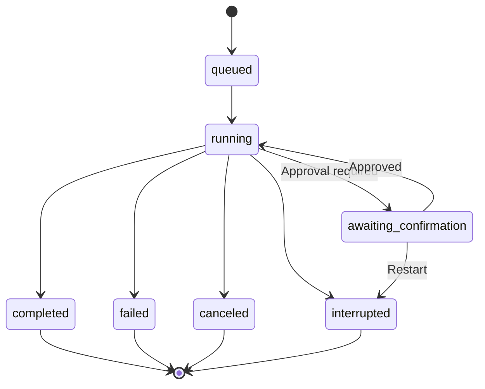
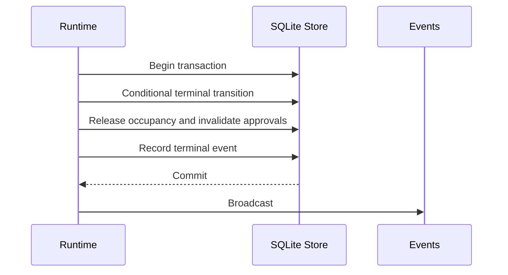

# Storage and Identity

## Responsibilities and Boundaries

`packages/core/src/` defines data layout, SQLite schema, task states and conversation identity. It depends on no other workspace package. These structures describe the Coding/shared runtime; [Personal durable](personal-durable.md) uses its own persistence.

Core owns profile-directory conventions, `SCHEMA_VERSION` and compatibility checks, conditional task transitions, identity classification, instance/configuration locks and read-only history parsing. [Runtime](runtime.md) owns scheduling; [agent tools](agent-tools.md) owns approvals and tool orchestration; [execution](execution.md) owns sandboxes and processes.

## Public Interfaces

| Caller | Entry | Contract |
| --- | --- | --- |
| All modules | `Db(dataDir)` / `Db.tx` | Open or initialize SQLite, validate schema compatibility and provide transactions |
| All modules | `Store` | SQL operations for tasks, work, approvals, artifacts and events |
| Runtime/Driver | `Store.getSessionIdentity(sessionId)` | Classify stored identity; return `null` when absent |
| Runtime/Driver | `Store.getSubAgentBySession(sessionId)` | Find the SubAgent bound to its independent conversation |
| Runtime | `acquireInstanceLock(dataDir)` | Acquire `<dataDir>/runtime.lock/`, checking owner process identity |
| Runtime/configuration | `acquireConfigLock(agentDir)` | Acquire `<agentDir>/config.lock/` for one configuration writer |
| Control/view | `readHistoryPage` / `readToolResult` | Read JSONL history, long text slices and patch details without modifying history; default pages exclude recalled contributions |
| Runtime/Agent | `effectiveProjection` / `materializeEffectiveHistory` | Apply appended `context_edit` omissions; invalid references produce `history_corrupt`; branch/side-chat copies contain only effective entries |
| Execution/runtime | `resolveDirIdentity` / `verifyDirIdentity` | Resolve and verify physical directories and aliases |
| State consumers | `ACTIVE_TASK_STATUSES` / `TERMINAL_TASK_STATUSES` | Shared status sets |

## Data and State



| Authority | Location | Ownership |
| --- | --- | --- |
| SQLite | `<dataDir>/ruukoto.db` | Tasks, metadata, work, backgrounds, approvals and events; state and its event commit together |
| Conversation JSONL | `<agentDir>/sessions/<id>.jsonl` | Complete message history and model-interaction records; core reads, the history owner appends; outside SQLite transactions |
| Artifact files | `<agentDir>/artifacts/` | Oversized tool output, patches, images and media; SQLite indexes size, SHA256 and metadata |

The main entities are `tasks`, `work_delegations`, `sub_agents`, `background_processes`, `owner_questions` and `tool_ops`. Task rows carry request identity, access/plan mode, parent and interruption reason. Work and SubAgent rows bind the delegated goal, role, conversation and work copy. Background rows retain command, directory identity, byte counts and verified-exit state. Questions retain options, answers and receipt state; tool operations retain immutable parameters and approval facts.

`task_guidance` maps each source Task to its target, acceptance order, phase and injected entry. `tasks.queue_order` and `sessions.queue_revision` persist order and optimistic concurrency. `side_chats` gives each Coding parent one persistent binding: preparation already claims it, and recovery publishes from the original receipt (`prepared/published/failed`). Ordinary HTTP MCP operations record operation/result facts; Cua additionally records supervised execution and recovery observations. Only actual Cua execution participates in computer-stop verification.

`message_recalls` fixes recall input/execution identity, history fingerprints, original text and attachments, stop/sealed-source sets, phase, edit window and failure reason. `(session_id, request_id)` is unique, with at most one unresolved recall per conversation. The current schema version is `57`.

```text
~/.ruukoto-code/
├── data/                  # SQLite and runtime.lock/
├── agent/                 # Configuration and history
│   ├── sessions/
│   ├── artifacts/
│   └── config.lock/
└── control/
    ├── control.sock
    └── spawn.log
```

## Main Flows

Terminal finalization conditionally transitions an eligible task, releases its occupancy, invalidates unconsumed approvals and records the terminal event in one transaction. Only after commit does runtime broadcast the result.



Identity resolution reads the conversation and its SubAgent/schedule bindings, classifies it as `dev`, `main`, `subagent`, `scheduled`, `side` or `retired`, then combines identity with the task's target and policy to obtain its execution profile.

## Invariants and Failure Handling

- Terminal tasks never become active again. A conditional transition prevents competing finalizers from claiming the same change.
- State and event updates share one SQLite transaction; JSONL is not atomically committed with SQLite.
- Restart recovery interrupts unfinished tasks and reconciles execution occupancy; unverified execution must not be treated as safely stopped.
- One backend owns a profile. Lock conflicts reject startup; process identity must be checked rather than trusting a PID alone.
- Schema versions increase monotonically. The current core rejects any different stored schema version, older or newer, without backfilling execution authority.

## Design Rationale

- [Preserve session history](../../.agents/notes/implemented/architecture/2026-09-19-preserve-session-history.md)
- [Detach terminal from task runtime](../../.agents/notes/implemented/architecture/2026-09-19-detach-terminal-from-task-runtime.md)
- [Work delegation subagent task](../../.agents/notes/implemented/architecture/2026-10-03-work-delegation-subagent-task.md)
- [Split agent and human docs](../../.agents/notes/implemented/process/2026-10-09-split-agent-and-human-docs.md)
- [Mcp host responsibilities](../../.agents/notes/implemented/simplification/2026-10-26-mcp-host-responsibilities.md)
