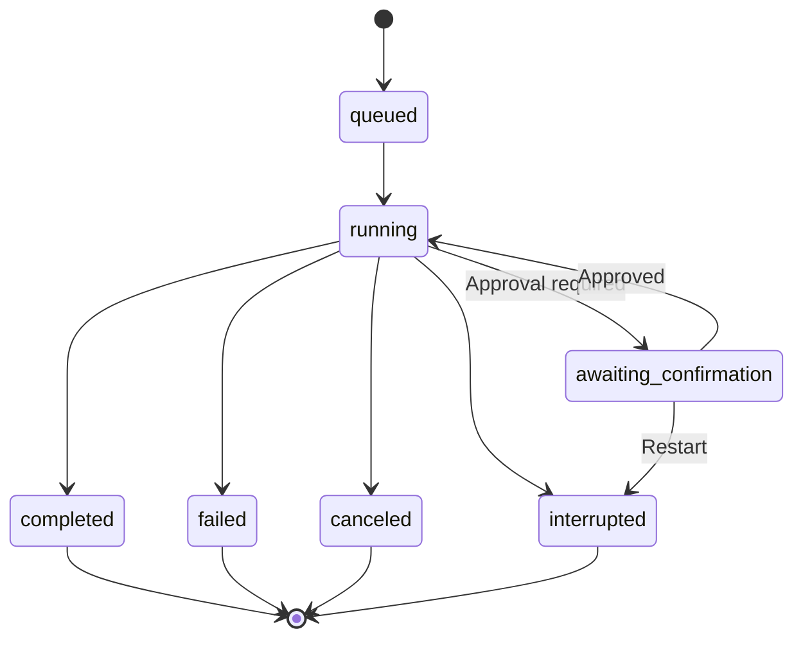
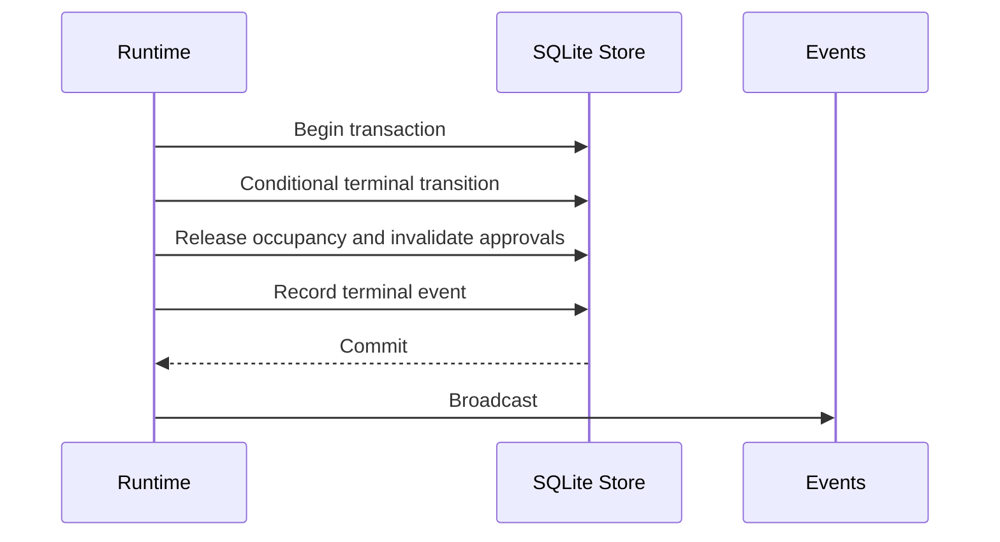

# Storage and Identity

## Responsibilities and Boundaries

`packages/core/src/` defines profile activation, data layout, SQLite schema, task states and conversation identity. It depends on no other workspace package.

Core owns profile-directory conventions, `SCHEMA_VERSION` and compatibility checks, conditional task transitions, identity classification, instance/configuration locks and read-only history parsing. [Runtime](runtime.md) owns scheduling; [agent tools](agent-tools.md) owns approvals and tool orchestration; [execution](execution.md) owns sandboxes and processes.

## Public Interfaces

| Caller | Entry | Contract |
| --- | --- | --- |
| Stateful entries | `selectProfile` / `bootstrapProfile` | Select the raw tuple without writes, then prepare and activate one fresh instance |
| Discovery and clients | `readProfile` / `verifyProfile` | Read-only activation discovery; verify required layout, role and instance bindings |
| Process launchers | `profileChildEnv` | Forward the complete canonical raw tuple, never resolved role paths |
| Storage owners | `Db` / `Db.tx` | Open the activated database, validate schema compatibility and provide transactions |
| All modules | `Store` | SQL operations for tasks, work, approvals, artifacts and events |
| Runtime/Driver | `Store.getSessionIdentity(sessionId)` | Classify stored identity; return `null` when absent |
| Runtime/Driver | `Store.getSubAgentBySession(sessionId)` | Find the SubAgent bound to its independent conversation |
| Runtime | `acquireInstanceLock(dataDir)` | Acquire `<dataDir>/runtime.lock/`, checking owner process identity |
| Runtime/configuration | `acquireConfigLock(agentDir)` | Acquire `<agentDir>/config.lock/` for one configuration writer |
| Control/view | `readHistoryPage` / `readToolResult` | Read JSONL history, long text slices and patch details without modifying history; default pages exclude recalled contributions |
| Runtime/Agent | `effectiveProjection` / `materializeEffectiveHistory` | Apply appended `context_edit` omissions; invalid references produce `history_corrupt`; branch/side-chat copies contain only effective entries |
| Execution/runtime | `resolveDirIdentity` / `verifyDirIdentity` | Resolve and verify physical directories and aliases |
| State consumers | `ACTIVE_TASK_STATUSES` / `TERMINAL_TASK_STATUSES` | Shared status sets |

## Data and State



| Authority | Location | Ownership |
| --- | --- | --- |
| SQLite | `<dataDir>/ruukoto.db` | Tasks, metadata, work, backgrounds, approvals and events; state and its event commit together |
| Conversation JSONL | `<dataDir>/sessions/<id>.jsonl` | Complete message history and model-interaction records; core reads, the history owner appends; outside SQLite transactions |
| Artifact files | `<dataDir>/artifacts/` | Oversized tool output, patches, images and media; SQLite indexes size, SHA256 and metadata |

The main entities are `tasks`, `work_delegations`, `sub_agents`, `background_processes`, `owner_questions` and `tool_ops`. Task rows carry request identity, access/plan mode, parent and interruption reason. Work and SubAgent rows bind the delegated goal, role, conversation and work copy. Background rows retain command, directory identity, byte counts and verified-exit state. Questions retain original task/host-operation identity, options, answers and receipts. Accepted answers reuse their event sequence as admission order without creating tasks; tool operations retain immutable parameters and approval facts.

`task_guidance` maps each source Task to its target, acceptance order, phase and injected entry. `tasks.queue_order` and `sessions.queue_revision` persist order and optimistic concurrency. The user-queue projection excludes pending guidance and trusted internal-report tasks; execution candidates are selected separately. `agent_reports` retains each source, claim, parked fallback, actual consumption and final proof. `side_chats` gives each Coding parent one persistent binding: preparation already claims it, and recovery publishes from the original receipt (`prepared/published/failed`). Ordinary HTTP MCP operations record operation/result facts; Cua additionally records supervised execution and recovery observations. Only actual Cua execution participates in computer-stop verification.

`message_recalls` fixes queued/historical purpose, input/execution identity, history fingerprints, original text and attachments, stop/sealed-source sets, phase, edit window and failure reason. `(session_id, request_id)` is unique, with at most one unresolved recall per conversation. Current schema 59 belongs to layout `ruukoto-single-v1`; predecessors are inspected for admission only, never imported.

Managed Coding chats use ordinary projects/workspaces and sessions. Host metadata records the managed flag and first-send creation receipt, including fixed project ID, request fingerprint, model/mode, canonical root and preparation identities. These additive records use the existing schema. Each independently started chat has its own data scope; branches retain that same workspace. No history, artifacts, instructions or credentials move into the work directory.

```text
~/.ruukoto/single-v1/
├── profile.json            # Authoritative activation marker
├── data/                   # Database and runtime state
├── agent/                  # New configuration and config.lock/
├── control/                # Persistent owner.token, not the socket
├── pending/{tui,desktop}/  # Instance-bound client request journals
├── workspace/              # Retained managed chat roots
├── agent-work/             # Retained SubAgent work copies
├── logs/                   # backend.log, spawn.log, dev.log
├── tui-command-history.json
└── reload-state.json
```

Independent non-default role overrides use fresh qualified sibling namespaces. Core owns all derived paths and desktop draft keys; [profile selection](../usage.md#6-fresh-profiles-and-old-data) gives the full mapping. The socket uses pinned canonical `/tmp/ruukoto-<uid>/<address>/control.sock`, independent of persistent path length. Its private directories bind the full selection/layout/instance digest behind the 32-character address; mismatches reject, not rehash or delete.

## Main Flows

Terminal finalization conditionally transitions an eligible task, releases its occupancy, invalidates unconsumed approvals and records the terminal event in one transaction. Only after commit does runtime broadcast the result.



Conversation identity combines ordinary development, SubAgent or side-chat binding with the task’s target and access policy. Scheduled runs retain host-managed source authority.

Bootstrap publishes an exclusive preparation reserving one instance ID before role initialization. Each role’s recorded staging/final identity must match before installation or recovery. After all roles are durable and consistent, `profile.json` activates the set. A valid interruption resumes the same ID; unreferenced staging debris is not adopted. Model readiness follows activation, so offline configuration can initialize an empty instance without credentials.

Compatible transient predecessor exclusion covers coherent copied SQLite/WAL inspection through activation. Minimal version/resource recognition rejects live or unresolved execution without loading old runtime code, signaling resources or replaying work. Profile identity errors are terminal, including in offline configuration.

## Invariants and Failure Handling

- Terminal tasks never become active again. A conditional transition prevents competing finalizers from claiming the same change.
- State and event updates share one SQLite transaction; JSONL is not atomically committed with SQLite.
- Restart recovery interrupts unfinished tasks and reconciles execution occupancy; unverified execution must not be treated as safely stopped.
- One backend owns a profile. Lock conflicts reject startup; process identity must be checked rather than trusting a PID alone.
- Schema versions increase monotonically. Required role, parent, layout and instance bindings are verified before current writers/clients proceed; corrupt active roles are errors, never automatic resets.

## Design Rationale

- [Single product and fresh identity](../../.agents/notes/implemented/architecture/2026-11-10-single-product.md)
- [Fresh-profile identity](../../.agents/notes/implemented/architecture/2026-11-10-single-product-profile.md): resolver, admission and activation ownership.
- [Atomic lock publication](../../.agents/notes/implemented/bug-fix/2026-11-10-atomic-lock-publication.md): ownership before visibility and conservative stale recovery.

- [Managed Coding workspaces](../../.agents/notes/implemented/feature/2026-11-07-managed-coding-workspaces.md)
- [Preserve session history](../../.agents/notes/implemented/architecture/2026-09-19-preserve-session-history.md)
- [Detach terminal from task runtime](../../.agents/notes/implemented/architecture/2026-09-19-detach-terminal-from-task-runtime.md)
- [Work delegation subagent task](../../.agents/notes/implemented/architecture/2026-10-03-work-delegation-subagent-task.md)
- [Split agent and human docs](../../.agents/notes/implemented/process/2026-10-09-split-agent-and-human-docs.md)
- [Mcp host responsibilities](../../.agents/notes/implemented/simplification/2026-10-26-mcp-host-responsibilities.md)
- [Coding user queue](../../.agents/notes/implemented/feature/2026-10-30-coding-user-queue.md)
- [Same-task owner questions](../../.agents/notes/implemented/feature/2026-10-30-coding-owner-question-wait.md)
