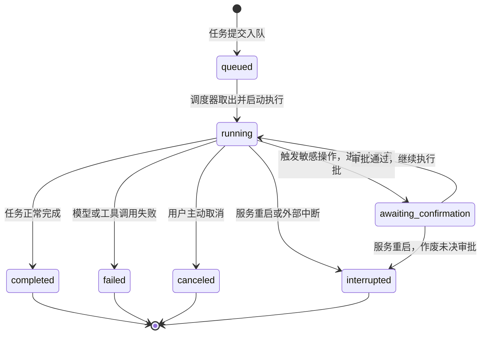
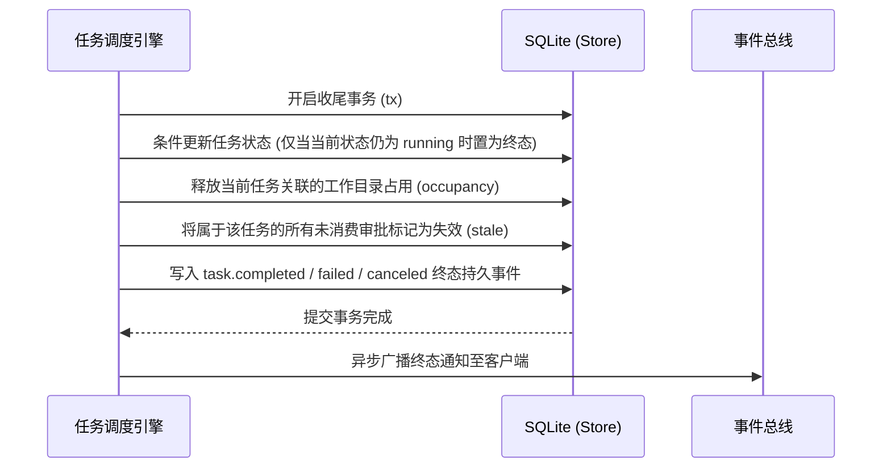

# 存储与身份

## 职责与边界

`packages/core/src/` 是系统最底层的基础库，定义底层数据的落盘布局、SQLite 数据库模式（Schema）、任务状态机与会话身份判定规则。它不依赖其他任何 workspace 包，被系统全部上层模块依赖。

> 注：本篇的存储结构与客户端协议适用于 Coding Agent 底座；正式个人 Agent 采用原生的持久化体系，见[个人持久会话](personal-durable.md)。

### 核心职责
- **数据目录与文件布局**：统一规范数据目录（`dataDir`）、配置目录（`agentDir`）与控制目录（`controlDir`）的默认位置、访问权限与内部子结构。
- **数据库 Schema 与版本校验**：管理 SQLite 核心库（`ruukoto.db`）的表结构、索引与迁移版本号（`SCHEMA_VERSION`），拒绝与代码版本不符的数据库写入。
- **任务状态机管理**：定义任务全生命周期状态流转规则与终态收尾的原子条件更新。
- **会话身份与执行画像判定**：纯函数判定会话所属的角色分类（普通开发会话、main 会话、SubAgent 子会话等），为上层执行提供基准事实。
- **实例锁与文件锁**：基于原子目录创建（`mkdir`）实现进程级实例互斥锁与配置互斥锁。

### 边界与非职责
- 任务的具体调度策略与出入队算法归 [runtime](runtime.md)。
- 工具的调用门拦截、审批闸门与操作账本归 [agent-tools](agent-tools.md)。
- 沙箱环境创建与命令实际执行归 [execution](execution.md)。

## 对外接口

`core` 模块导出的核心入口与方法如下：

| 调用方 | 核心接口 / 入口 | 作用与关键契约 |
|---|---|---|
| 全部模块 | `Db(dataDir)` | 打开或初始化 SQLite 数据库；校验 `SCHEMA_VERSION`，提供事务原语 `Db.tx` |
| 全部模块 | `Store` | 核心数据库操作门面：提供任务、工作委托、审批、产物、事件等实体的高层 SQL 原语 |
| Runtime / Driver | `Store.getSessionIdentity(sessionId)` | 读取会话元数据并调用 `classifySession` 判定会话分类；不存在返回 `null` |
| Runtime / Driver | `Store.getSubAgentBySession(sessionId)` | 根据独立子会话反查绑定的 `sub_agents` 记录，用于识别动态代理身份 |
| Runtime | `acquireInstanceLock(dataDir)` | 获取实例排他锁（`<dataDir>/runtime.lock/`），通过 `owner.json` 校验持锁进程身份 |
| Runtime | `acquireConfigLock(agentDir)` | 获取配置排他锁（`<agentDir>/config.lock/`），保障离线/在线配置单写者 |
| control / View | `readHistoryPage` / `readToolResult` | 分页只读解析会话消息 JSONL 与工具结果详情，支持长文本分段与补丁差异展示 |
| execution / Runtime | `resolveDirIdentity` / `verifyDirIdentity` | 目录与文件系统 Inode 身份解析，识别物理路径与别名绑定 |
| 全部模块 | `ACTIVE_TASK_STATUSES` / `TERMINAL_TASK_STATUSES` | 导出任务活动态与终态常量集合，供状态机与前端视图判定 |

## 数据与状态

### 任务状态机

任务（Task）的生命周期状态严格遵循单向终态收敛：



### 三大存储载体与分工

系统严格划分不同数据的权威存储载体，避免双写不一致：

| 存储载体 | 存放路径 / 介质 | 存储内容 | 权威性与访问规则 |
|---|---|---|---|
| **SQLite 核心库** | `<dataDir>/ruukoto.db` | 任务元数据、状态、工作委托、后台进程、审批记录、事件日志 | 状态与元数据的唯一权威；所有状态变更与事件日志在单事务中提交 |
| **会话 JSONL** | `<agentDir>/sessions/<id>.jsonl` | 完整对话历史、Prompt 组装记录、流式模型消息 | 消息历史与模型交互的唯一权威副本；纯追加只读解析，不参与 SQLite 事务 |
| **产物与文件存储** | `<agentDir>/artifacts/` | 工具执行产生的超长文本、Diff 补丁、图片与多媒体制品 | 超长数据转存文件，SQLite 仅保留其 SHA256 哈希、字节大小与元数据索引 |

### 核心数据实体模型

- **`tasks`**：记录任务状态、所属会话、请求幂等键、安全模式（`accessMode`）、计划模式（`planMode`）、父任务 ID 及中断原因。
- **`work_delegations` & `sub_agents`**：记录主会话委派给 SubAgent 的工作目标、子会话 ID、指定角色、独立 worktree 与最终执行结果。
- **`background_processes`**：记录普通会话拉起的常驻后台进程、启动命令、目录身份、输出字节统计与退出核验状态。
- **`owner_questions`**：记录模型向人类发起的交互式提问、选项清单、答案内容与回执状态。
- **`tool_ops` & 审批表**：记录所有外部工具调用的不可变参数快照、审批授权记录与执行审计。
- **`task_guidance`**：以源 Task ID 保存引导路由（目标 Task、接纳次序、阶段与接入 entry）；`tasks.queue_order` 与 `sessions.queue_revision` 保存排队顺序与乐观并发修订。
- **`side_chats`**：Coding 侧聊的父会话唯一持久绑定（父会话 ID、侧聊会话 ID、请求键、准备回执 payload、`prepared/published/failed` 状态）；准备阶段即占用绑定，恢复凭原回执发布。
- **`tool_ops.mcp`**：普通 HTTP 保存操作与结果事实；Cua 另保存受监督执行身份及恢复观察。SQLite schema 保持 `55`；仅真实 Cua 执行参与电脑停止核实。

### 目录布局标准

以 Coding Agent 为例，各核心目录层次如下：

```
~/.ruukoto-code/
├── data/                  # dataDir: 核心数据库与运行锁
│   ├── ruukoto.db         # 主数据库（SQLite）
│   └── runtime.lock/      # 运行时排他锁
├── agent/                 # agentDir: 会话历史与配置产物
│   ├── sessions/          # 会话消息 JSONL 文件
│   ├── artifacts/         # 超长工具输出与生成的代码制品
│   └── config.lock/       # 配置写入排他锁
└── control/               # controlDir: 控制面通信
    ├── control.sock       # 控制面 Unix Domain Socket
    └── spawn.log          # 后台进程输出日志
```

## 主要流程

### 1. 任务终态原子收尾流程

任务流转至终态时，Runtime 必须通过条件更新确保原子收尾，避免并发修改冲突：



### 2. 会话身份解析流程

系统在处理任何外部输入前，通过纯函数一次性解析会话身份：
1. 从 `sessions` 表读取会话记录，并关联查询 `sub_agents` 与定时调度绑定；
2. 依据是否绑定主会话、是否为 SubAgent、是否为调度来源，判定出规范身份枚举（`dev`、`main`、`subagent`、`scheduled`、`side`、`retired`）；
3. 结合任务的工作目标与安全模式，生成当前任务全局唯一的执行画像（`executionProfile`）。

## 不变量与失败处理

- **状态机终态单向不可逆**：一旦任务进入 `completed`、`failed`、`canceled` 或 `interrupted` 终态，任何操作均不得将其重新激活或改写。
- **状态与事件事务原子性**：任务状态变更必须与对应事件（如 `task.started`、`task.completed`）在同一个 SQLite 事务中落盘，禁止先改状态后写事件。
- **进程重启安全收敛**：后台服务异常中断或被 SIGKILL 终止后，下次启动时扫描所有仍处于 `running` 或 `awaiting_confirmation` 的任务，全部安全置为 `interrupted`，释放遗留目录占用，防止状态悬空。
- **单写者实例锁隔离**：同一数据目录同一时间只允许一个后台服务进程持有锁。竞争失败的进程必须立即报错退出，绝不在无锁状态下并发读写数据库。

## 设计依据

- [会话历史与模型上下文](../../.agents/notes/implemented/architecture/2026-09-19-preserve-session-history.md)：历史与上下文的分工，决定了 core 与 agent-context 的边界。
- [后台任务与终端](../../.agents/notes/implemented/architecture/2026-09-19-detach-terminal-from-task-runtime.md)：后台与客户端分离、事件流恢复与请求幂等的基础决定。
- [工作委托、SubAgent 与任务](../../.agents/notes/implemented/architecture/2026-10-03-work-delegation-subagent-task.md)：委派三层数据模型与一层派生的来源。
- [人类文档与决策记录](../../.agents/notes/implemented/process/2026-10-09-split-agent-and-human-docs.md)：模块文档的读者分层与约定。
- [MCP 宿主职责收缩](../../.agents/notes/implemented/simplification/2026-10-26-mcp-host-responsibilities.md)：普通操作与真实电脑执行分开记录。
