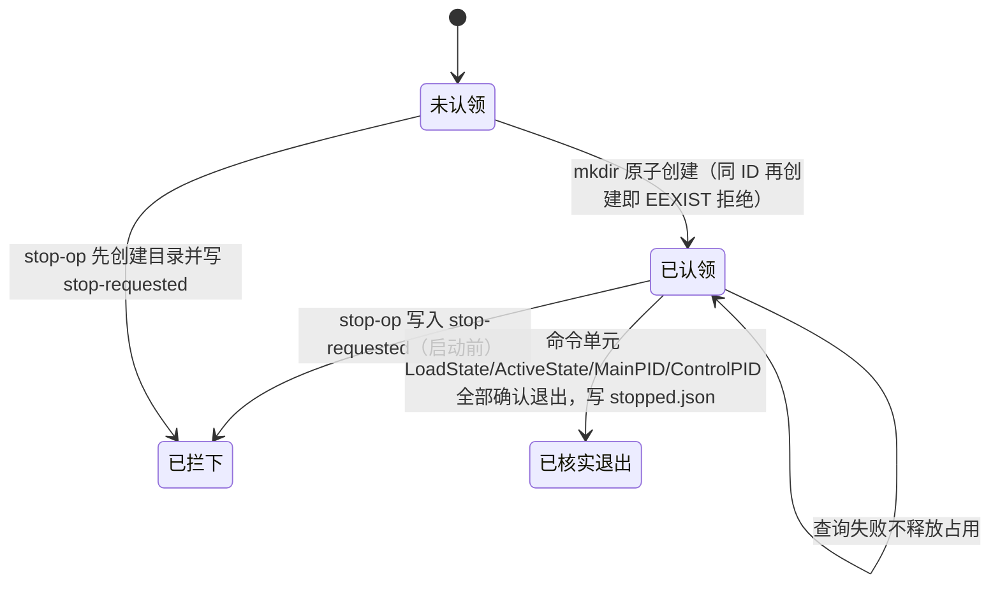
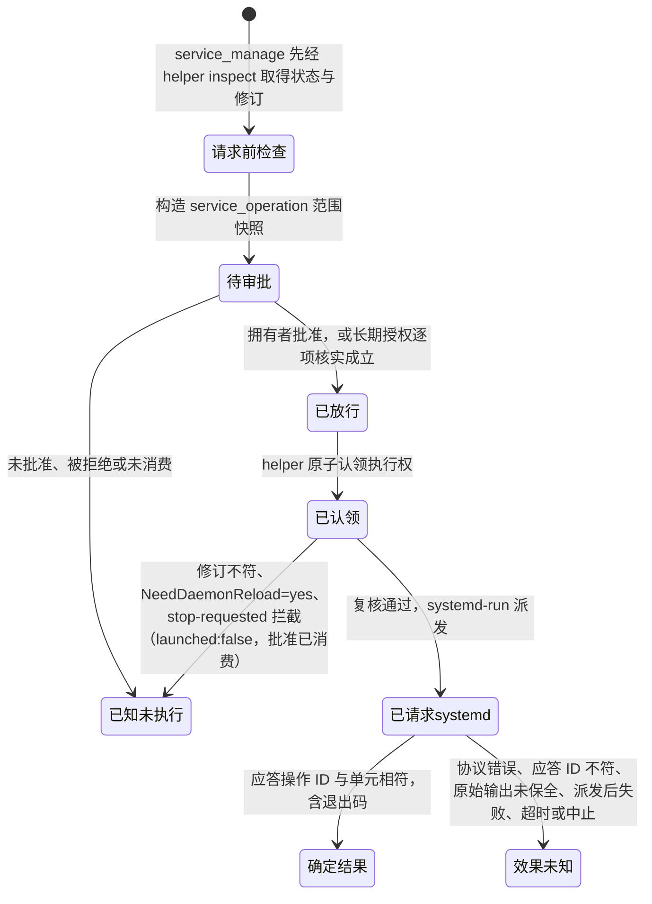
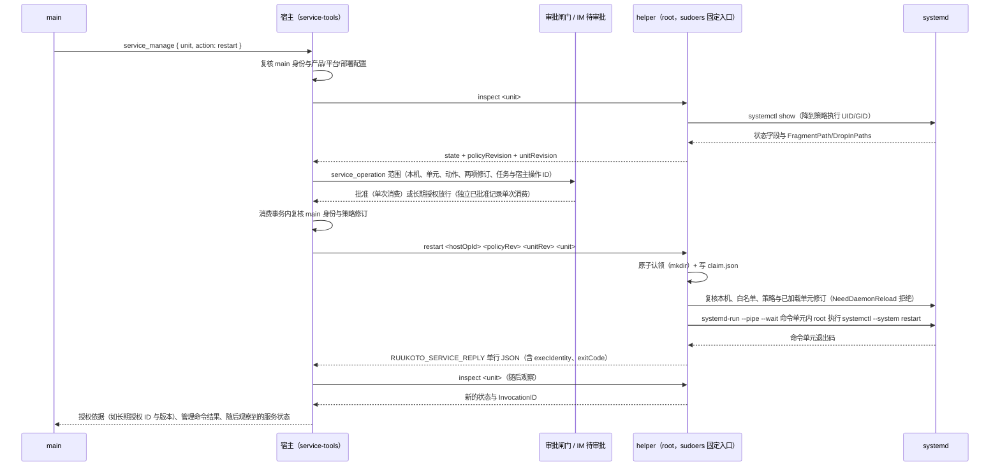

# 部署与服务管理

## 职责与边界

本篇负责 `ruukoto` 在目标 Linux 服务器上的部署形态：三个系统身份的分工、`ruukoto-backend.service` 单元、受保护的提权入口、固定工具工作进程镜像的构建，以及服务器服务管理的 helper、策略文件与执行侧行为。它同时说明两个产品各自的安装与升级方式。

**三个系统身份**把「谁持有什么」固定下来，控制面身份与执行权限由此分离：

| 身份 | 运行什么 | 持有 | 不能做什么 |
|---|---|---|---|
| 拥有者 | 可信 CLI/TUI | 数据目录 socket 通道、`owner.token` 的 0400 副本 | 不改写后台数据与授权状态 |
| 后台 `ruukoto-backend` | 控制面、编排器、`ruukoto-backend.service` | 数据目录、agent 目录、模型凭据与 `credentials.json`、令牌原件、docker 组（容器管理）、受保护的提权启动入口 | 不以执行账户身份运行任务工作进程 |
| 执行账户 `ruukoto-exec` | 完全访问模式的任务工作进程 | 自己的工作目录与工作区 ACL 权限 | 不属于拥有者或后台的组，读不到两者的认证材料，没有新增的 sudo/Polkit 权限，不能修改服务代码、配置、单元或容器管理接口 |

同一 UID 部署不满足控制面分离：socket 的文件权限区分不了拥有者终端与完全访问命令。

**systemd 单元与提权入口**。`ruukoto-backend.service` 以后台身份运行控制面，`KillMode=control-group`、`TimeoutStopSec=30`、`Restart=on-failure`、`RestartSec=3`，其 `[Service]` 直接给出数据目录、agent 目录、执行后端与执行入口等环境。root 拥有的固定 argv 包装脚本经 `/etc/sudoers.d/ruukoto` 只放行给后台账户：执行工作进程的启停两个入口，加服务管理 helper 一个。执行账户不能调用它们，也不能修改其配置。项目命令从不以 root 运行，容器管理权限只留给可信后台。

**固定工具镜像**由可信身份在部署时构建（`deploy/worker-image/build.sh`，`npm run build:worker-image`），产物是 `ruukoto-worker:<pi 版本>` 与 `ruukoto-worker:latest`。镜像版本随 pi 发布版固定，工具链是 node 24 + bash + coreutils + git，工作进程由 `npm run build` 打成单文件 `worker/worker.mjs`。后台只运行镜像，不构建它。

**服务器服务管理**让 main 检查部署白名单内的服务状态，并经拥有者逐次审批执行管理动作（首版仅 `restart`）。宿主工具在 `src/agent/service-tools.ts`；审批、通知与批准消费复用 IM 审批通道，不另建控制面。装配边界：`service_inspect` / `service_manage` 仅 main 获得，且要求产品 `ruukoto` + Linux + 显式部署配置齐备；普通开发会话、SubAgent 与 `ruukoto-code` 都不获得该能力，main 不因此获得 `bash`。模型只提供白名单服务名与固定动作，主机身份、`taskId`、`hostOpId`、执行身份与策略由宿主注入。

不负责的部分点名归属：安装、配置与故障排查的操作步骤归 [deploy/systemd/README.md](../../deploy/systemd/README.md) 与 [usage](../usage.md)，本篇只写设计并链过去；工具工作进程、容器参数、受管执行单元与回收核实归 [execution](execution.md)；长期授权（`standing_permissions`）的创建、范围、行级版本与失效语义归 [agent-tools](agent-tools.md)，本篇只写消费它的 helper、策略与执行侧；IM 命令的文本解析与回执归 [channels](channels.md)。

## 对外接口

部署材料：

| 材料 | 作用 |
|---|---|
| `deploy/systemd/README.md` | 安装步骤与目标机验证记录（操作步骤的唯一落点） |
| `deploy/systemd/ruukoto-backend.service` | 后台单元；环境与重启策略在此 |
| `deploy/systemd/ruukoto-exec-launch.sh`、`ruukoto-exec-stop.sh` | 完全访问执行入口的受保护包装（root 0700，固定参数） |
| `deploy/systemd/sudoers.d.ruukoto` | 只放行后台账户调用上述三个固定路径；`env_keep` 传递 `RUUKOTO_EXEC_UID` / `RUUKOTO_EXEC_GID` |
| `deploy/systemd/ruukoto-service.mjs` | 服务管理 helper（root 0700，无第三方依赖，不接受环境变量配置） |
| `deploy/systemd/ruukoto-service-test.service`、`ruukoto-service-test.sh` | 可控测试服务：以执行账户运行、`Restart=no`、无网络、无业务凭据、最小攻击面；每次启动记 `InvocationID` 与计数，仅作辅助观察 |
| `deploy/worker-image/build.sh`、`Dockerfile` | 固定工具镜像的构建 |

配置键：`RUUKOTO_DATA_DIR`、`RUUKOTO_AGENT_DIR`、`RUUKOTO_EXECUTION_BACKEND`、`RUUKOTO_EXEC_LAUNCH_SCRIPT`、`RUUKOTO_EXEC_STOP_SCRIPT`、`RUUKOTO_EXEC_UID`、`RUUKOTO_EXEC_GID`、`RUUKOTO_CONTAINER_UID`、`RUUKOTO_CONTAINER_GID`、`RUUKOTO_WORKER_IMAGE`、`RUUKOTO_WORKER_IMAGE_TAG`、`RUUKOTO_WORKER_PATH`、`RUUKOTO_EXEC_SUDO`、`RUUKOTO_SERVICE_HELPER`、`RUUKOTO_SERVICE_POLICY`。`RUUKOTO_SERVICE_HELPER` 与 `RUUKOTO_SERVICE_POLICY` 经后台单元 drop-in 注入，**只设一个拒绝启动**，不静默降级为无能力。

**工具接口**（模型可见，仅 main）：

| 工具 | 参数 | 语义 |
|---|---|---|
| `service_inspect` | `unit`（白名单内的精确 `.service` 名） | 只读状态查询，无写入效果 |
| `service_manage` | `unit`、`action`（联合类型，首版只取 `restart`） | 任何访问模式都逐次审批；批准只对该次操作与目标有效 |

**helper 协议**：固定三个动词，绝对路径结构化 argv，清空环境，无 shell 字符串、无自由参数。

| 动词 | argv | 行为 |
|---|---|---|
| `inspect` | `inspect <unit>` | 白名单内服务的固定状态字段与两项修订指纹；`systemctl show` 显式降到策略执行 UID/GID，应答含实际执行身份 uid/gid |
| `restart` | `restart <hostOpId> <policyRev> <unitRev> <unit>` | 原子认领 → 复核修订与已加载配置 → `systemd-run --pipe --wait` 的短命命令单元内以 root 执行固定 `systemctl --system restart` |
| `stop-op` | `stop-op <hostOpId>` | 只停由同一 `hostOpId` 派生的命令单元，核实整个单元退出后才报告 `exited:true` |

应答是 stderr 上唯一一条 `RUUKOTO_SERVICE_REPLY ` 前缀的单行 JSON（`v: 1`），stdout 与 stderr 其余内容都是原始 systemctl 输出证据；不使用 fd3，因为 sudo 默认关闭 fd ≥ 3。`restart` 路径的 `systemd-run --pipe` 会把命令单元的 stderr 混入，机器调用方按前缀行提取。成功应答的字段：`inspect` 返回 `machineId`、`policyRevision`、`unitRevision`、`unit`、`state`、`execIdentity`、`observedAt`；`restart` 返回 `machineId`、`hostOpId`、`opUnit`、`launched`、`execIdentity`、`exitCode`、`observedAt`；`stop-op` 返回 `machineId`、`hostOpId`、`opUnit`、`exited`、`detail`。失败应答含 `ok:false`、`launched`、`reasonCode` 与 `error`。

调用侧固定入口：生产经 `/usr/bin/sudo -n <helper> …`（`RUUKOTO_EXEC_SUDO` 决定 sudo 路径），受控替身以当前 node 直接执行脚本；两条路径都是固定 argv、`PATH` 最小化、进程组可整组回收。

## 数据与状态

**身份与目录权限**：

| 路径 | 属主与权限 | 内容 |
|---|---|---|
| `/var/lib/ruukoto/data`、`/var/lib/ruukoto/agent`、`/var/lib/ruukoto/agent-work` | `ruukoto-backend`，0700 | 元数据库、会话资料、角色工作目录（缺失时后台启动失败） |
| `/var/lib/ruukoto/control` | `ruukoto-backend`，0770；socket 0660 | 控制面 socket 与 `owner.token`（后台生成，32 字节随机数 hex，至少 32 字符） |
| `/home/ruukoto-exec` | `ruukoto-exec`，0700 | 执行账户 HOME（`systemd-run` 按 passwd 设置，npm/pip/git 需要可写） |
| `/opt/ruukoto` | root，后台与执行账户只读 | 代码、依赖与打包产物 `worker/worker.mjs` |
| `/usr/local/libexec/ruukoto/{ruukoto-exec-launch,ruukoto-exec-stop,ruukoto-service}` | root，0700 | 三个受保护入口 |
| `/etc/sudoers.d/ruukoto` | root，0440 | 只放行后台账户调用上述三个路径 |
| `/etc/ruukoto/services.json` | root，0644 | 服务管理策略 |
| `/var/lib/ruukoto/service-ops` | root，0700 | 宿主操作标记目录 |
| 拥有者令牌副本 `~/.ruukoto-owner.token` | 拥有者，0400 | 控制面认证材料 |

执行账户进入工作区靠按工作区配置的 ACL：拥有者主目录给后台与执行账户 `--x` 穿越权限，工作区再给 `u:ruukoto-exec:rwX` 与默认 ACL；没配 ACL 的工作区在完全访问下工具调用 `EACCES`。

**策略文件** `/etc/ruukoto/services.json` 固定本机身份、执行 UID/GID、精确单元与允许动作：

| 字段 | 含义 |
|---|---|
| `machineId` | 必须等于 `/etc/machine-id`，否则拒绝 |
| `execUid`、`execGid` | 正整数；检查动作降到该身份运行 |
| `services` | 单元名 → `{ actions: [...] }`；默认只列可控测试服务 |

单元名必须是精确规范的 `.service` 名：拒绝别名、模板实例（含 `@`）、路径、空白、通配符、选项注入与额外参数。固定拒绝清单覆盖后台、Docker 与容器运行时、执行工作进程、本 helper 操作单元以及 dbus 等基础设施目标，防止策略误配。策略由拥有者在可信部署流程修改，模型不能增删目标。

**修订指纹**两项，都是 sha256：

- `policyRevision` = 策略文件原始字节的 sha256；
- `unitRevision` = 对单元定义来源（`FragmentPath` 与 `DropInPaths` 逐文件 sha256，按路径排序）加 `NeedDaemonReload` 状态计算的 sha256。

活动状态、PID 与 `InvocationID` 是观察值，不进入修订，正常状态变化不让审批失效。`NeedDaemonReload=yes` 表示已加载配置与磁盘不一致，拒绝请求 systemd。

**操作标记**位于 `/var/lib/ruukoto/service-ops/<hostOpId>/`，`hostOpId` 形态是 `op_` 加 24 位小写十六进制：

`claim.json` 记录单元与两项期望修订，标记持久保留，不随瞬态单元回收而删除；它只证明执行权已认领，不是服务已重启的证据。

**派生命令单元** `ruukoto-service-op-<hostOpId>.service`：`KillMode=control-group`，`RuntimeMaxSec=120`，单元内以 root 执行固定的 `systemctl --system restart`。停止协议只接受由同一操作 ID 派生的单元，不能指定任意目标。

**宿主侧操作状态**（消费与 systemd 之间没有跨系统事务）：

**审批范围**是判别联合 `ApprovalScope` 的 `service_operation` 成员，固定：`machineId`、规范单元、动作 `restart`、`policyRevision`、`unitRevision`、`taskId`、`toolOpId`。执行参数取自审批前构造、与审批记录同源的不可变快照，模型不能提交批准 ID 后替换参数。

**结果产物**：helper 的 stdout/stderr 原始字节先入 `ArtifactStore`，模型只收 4 KiB 上限的有界视图；产物引用接到 `task.tool_result` 事件，正常回收记 complete，中断或捕获失败保持 partial。

## 主要流程

**部署**（步骤见 [deploy/systemd/README.md](../../deploy/systemd/README.md)）：建三个身份与目录 → 把检出同步到 `/opt/ruukoto`（root 拥有，后台与执行账户只读）并安装依赖、构建 `worker.mjs` → 放入模型配置与凭据（缺失时后台以 `no_model` 启动失败）→ 由可信身份构建工具镜像并把后台加入 docker 组 → 安装两个执行入口包装与 sudoers 片段 → 用单元环境或 drop-in 指到受保护包装（不设置则完全访问不可用，提交返回 `execution_unavailable`）→ 安装并启用 `ruukoto-backend.service` → 生成并复制拥有者令牌、按需配置工作区 ACL。

**服务状态检查**：main 调用 `service_inspect` → 宿主每次重新核实任务、会话与 main 角色绑定 → helper 校验自身、策略、标记目录及其每一级父目录都是 root 拥有且组/他人不可写，策略 `machineId` 与本机一致 → 白名单与精确单元名校验 → `systemctl show` 显式降到策略执行 UID/GID 并清空环境 → 返回固定状态字段与两项修订。别名（`show` 返回的 `Id` 不等于请求名）明确拒绝。

**管理动作**（首版 `restart`）：

**执行与回收**。每个宿主操作派生一个短命命令单元，`RuntimeMaxSec=120` 给命令单元有界运行时间；宿主在异步启动前把该单元登记进受管执行单元表（`kind: systemd_unit`），停止路径据此调用 `stop-op`。停止协议先阻断后续启动（认领或 `stop-requested`），再停派生命令单元；只有查询确认整个单元退出才报告 `exited:true`，权限错误、bus 不可达与查询失败都不当作已退出，占用保留。已经提交 PID 1 的重启作业不撤回，取消不自动停止目标服务作为回滚。

**结果与恢复**。正常重启分述两件事：「管理命令结果」（`systemctl restart` 的退出码）与「随后观察到的服务状态」（`InvocationID` 对照：变化即确实经过新的启动周期）。退出码 0 表示 systemd 接受并完成重启动作，不等同于服务 active，更不等同于业务健康；`InvocationID` 未变化时提示核实。操作后状态查询失败保留已知命令结果并说明无法核实，不伪装成功。非零退出可能含部分效果（例如已停止但未能启动），如实报告退出码与输出，不描述为零执行。

消费后的结果分类只认可信结论：

| 情形 | 结论 |
|---|---|
| 未消费的中断或重启、请求前的确定拒绝（`launched:false`）、`service_inspect` 的状态查询 | 已知未执行 |
| 确定的管理命令结果（含非零退出） | 如实记录 |
| 协议错误、应答 ID 不符、原始输出未保全、派发后失败、超时、中止 | 效果未知，不自动重发 |

效果未知另使同一目标的有效长期授权失效（授权语义见 [agent-tools](agent-tools.md)）。账本规则：`service_inspect` 记 `no_effect`、`service_manage` 记 `approval`。

**两个产品的安装与升级**。`ruukoto-backend.service` 只承载个人 Agent `ruukoto`。Coding Agent `ruukoto-code` 装在开发机器上：同一仓库检出加 `bin/ruukoto-code.mjs` 入口（`npm link` 或直接把 bin 目录加入 PATH），默认档案根 `~/.ruukoto-code`；首次打开 TUI 即按需拉起本机后台，无需预置服务单元。两端各自的安装与升级（替换检出后按产品 `stop` / `server` 重启）互不要求对方同时升级或停止；按需拉起的后台在升级替换检出后同样经 `ruukoto-code stop` 停下，下次打开 TUI 自动以新代码拉起。

## 不变量与失败处理

**装配与权限不变量**：

- 服务管理能力在产品 `ruukoto`、Linux 与显式部署配置三者齐备时才装配；只设 `RUUKOTO_SERVICE_HELPER` 与 `RUUKOTO_SERVICE_POLICY` 之一即拒绝启动。宿主可为受控测试显式放宽平台判定，生产不依赖它。
- main 不因服务管理获得 `bash`；执行账户不获得新增 sudo/Polkit 权限，也不获得策略外部署材料的访问权；容器不开放 systemd bus、Docker socket 或控制面。
- 模型、任务参数与其他会话不能指定可执行文件、配置路径、执行身份或 systemd 参数；`hostOpId` 与 `taskId` 一律来自宿主记录。
- 每次 helper 调用都验证 helper 自身、策略文件、操作标记目录及其每一级父目录：真实文件或目录、非符号链接、属主 root、组/他人不可写。策略路径与 helper 固定路径不一致时明确失败。
- 策略 `machineId` 必须匹配本机；白名单只认精确 `.service` 名；固定拒绝清单（后台、Docker 与容器运行时、`ruukoto-exec-*`、`ruukoto-service-op-*`、`systemd-*`、dbus）先于白名单生效。
- 同一 `hostOpId` 只能认领一次执行权，标记持久保留，跨进程与瞬态单元回收后仍拒绝再次启动。
- helper 必须以 root 运行（仅后台账户经 sudoers 调用），且只接受三个动词与固定数量的参数。

**审批不变量**：

- `service_manage` 在任何访问模式（含 `full_access`）逐次审批：root 分支是后台经 sudoers 的提权能力，不属于执行账户已有权限，因此完全访问不跳过它；自动审查对服务范围也转人工。
- 审批固定本机、规范单元、动作、策略与单元修订以及任务与宿主操作 ID；活动状态、PID 与 `InvocationID` 不进修订。
- 批准单次消费；消费事务内复核 main 身份与策略修订，helper 在请求 systemd 前再次核实全部修订。修订或入口固定身份变化即失效。
- 已消费但 helper 证明尚未请求 systemd 的动作记为已知未执行，重新操作需要新审批。
- 长期授权命中不改变上述消费路径：宿主逐项核实候选并重建完整范围，创建独立的已批准记录并单次消费，授权本身不被消费；范围外与核实失配的候选回落逐次人工审批，观察到失配的旧授权同事务明确失效。

**失败分类与语义**：

| 失败 | 处理 |
|---|---|
| 缺 Linux、systemd、helper 或 sudo 权限 | 明确失败，不降级到后台自由执行 |
| helper 拒绝（策略不可读或非法、本机不符、单元非法或被固定拒绝、目标不在白名单、动作不允许、操作 ID 非法、修订形态非法、已认领、认领失败、启动前收到停止标记、修订不符、别名、`NeedDaemonReload=yes`、systemd 不可用或查询失败、单元定义来源不可读） | 应答 `ok:false` 且 `launched:false`，宿主记已知未执行（批准已消费，重新操作需要新审批） |
| `systemd-run` spawn 只有可证明命令根本未启动（`ENOENT`、`EACCES`、`ENOTDIR`） | 报未派发，宿主记已知未执行 |
| 启动后的错误（缓冲超限等）或被信号杀死 | 报「可能已派发」`ok:false, launched:true`，不猜退出码；宿主记效果未知、不自动重发，同目标长期授权失效 |
| 宿主侧无结构化应答、应答不是合法 JSON、协议版本不符、应答与请求不符、原始输出保存失败 | 一律不当成功：协议错误或输出未保全按效果未知记录 |
| 调用超时（`inspect` 默认 20 秒、`restart` 默认 150 秒、`stop-op` 默认 15 秒）或任务中止 | 整组 `SIGKILL` 回收 helper 进程组并结束调用；已消费的 `restart` 记效果未知，不自动重发 |
| 停止核实失败 | 保留目录占用并报告，重复停止不当作已回收；helper 内 8 秒、每 200 ms 轮询仍未确认退出时如实报 `exited:false` |
| 非零命令退出 | 如实记录退出码，可能含部分效果，不描述为零执行 |
| 操作后状态查询失败 | 保留已知命令结果，说明无法核实 |
| 非 Linux 平台上的完全访问 | 没有已验证的执行账户入口，提交与切换模式时以 `execution_unavailable` 拒绝，任务不创建 |

后台单元以 `KillMode=control-group` 终止子进程树，`TimeoutStopSec=30` 给受管停止有界时间；崩溃重启不重放效果未知的操作，异常中断保留中断任务的占用。

## 设计依据

- [工具执行放进边界内的工作进程，受限任务按任务建容器，完全访问用专用执行账户](../../.agents/notes/implemented/architecture/2026-09-20-tool-worker-per-task-container.md)：解释三个系统身份为什么分开、完全访问为什么用专用执行账户、固定镜像为何由可信身份构建、缺失配置为何明确失败而不降级。
- [服务管理经过 root 拥有的固定 helper](../../.agents/notes/implemented/architecture/2026-10-03-service-management-helper.md)：解释白名单、固定协议、修订绑定、单次认领与效果未知不重放的取舍，以及这个 root 分支为什么在完全访问下仍逐次审批。
- [访问模式由技术边界实施，完全访问须拥有者显式选择](../../.agents/notes/implemented/feature/2026-09-19-explicit-access-modes.md)：解释控制面拥有者认证与执行账户分离，为什么同一 UID 部署不满足边界，以及哪些授权独立于任务执行权限。
