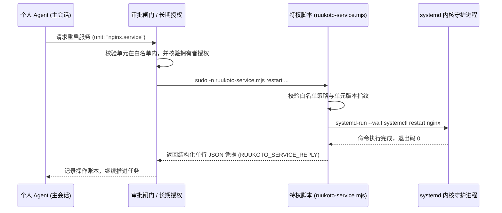

# 部署与服务管理

## 职责与边界

`deploy` 模块（对应 `deploy/` 目录）负责系统的生产环境服务管理、systemd 单元配置、宿主原生沙箱前置依赖与安全的操作系统提权管理。

### 核心职责
- **生产 systemd 单元管理**：提供用于生产服务器常驻运行的 systemd 模板（`ruukoto-backend.service` 与 `ruukoto-remote.service`），支持优雅终止与自动故障恢复。
- **运行身份与常驻环境配置**：支持以普通无特权用户运行后台服务，通过 Linux `loginctl enable-linger` 保持后台常驻，并接入 systemd user manager。
- **受控特权 Helper（`ruukoto-service.mjs`）**：在受限模式下，通过固化的 `sudoers` 精准放行白名单系统服务重启（如 Nginx、数据库），禁止模型执行任意 sudo 命令。
- **平台沙箱前置依赖验证**：管理 Linux `bubblewrap`（bwrap）前置规则与 macOS 原生监督器（`native-macos-supervisor`）的权限与编译产物。

### 边界与非职责
- 业务代码逻辑与持久化存储归 [core](core.md) 与 [personal-durable](personal-durable.md)。
- 实际操作步骤与命令统一在 [deploy/systemd/README.md](../../deploy/systemd/README.md) 中维护。
- 工具执行边界与容器进程回收归 [execution](execution.md)。

## 对外接口

### 1. 核心部署资产与配置

| 资产路径 | 职责与作用 | 权限与访问约束 |
|---|---|---|
| `deploy/systemd/ruukoto-backend.service` | 个人 Agent 核心后台服务的 systemd 模板 | 以无特权普通用户运行，集成 cgroup v2 资源监控 |
| `deploy/systemd/ruukoto-remote.service` | Tailscale 远程接入适配服务 | 代理 HTTPS/WSS 流量至本地私有 Unix Socket |
| `deploy/systemd/sudoers.d.ruukoto` | Sudoers 精准授权白名单配置 | 仅允许无密码执行固定的 `ruukoto-service.mjs` helper 脚本 |
| `deploy/systemd/ruukoto-service.mjs` | 系统服务管理独立可执行脚本 | Root 属主（`0700`），无第三方依赖，仅接受结构化固定动词 |
| `deploy/native/` | Linux 原生沙箱配置脚本 | 校验并配置 `bubblewrap` 与非特权用户命名空间（userns） |

### 2. 受控特权 Helper 动词协议

特权 Helper 绝不接受任意 Shell 字符串，必须使用严格固化的参数：

| 动词命令 | 参数格式 | 行为与安全约束 |
|---|---|---|
| `inspect` | `inspect <unit>` | 查询白名单 systemd 服务的当前运行状态与配置指纹（只读无副作用） |
| `restart` | `restart <hostOpId> <policyRev> <unitRev> <unit>` | 在独立的短命命令单元（`systemd-run`）中重启指定白名单服务 |
| `stop-op` | `stop-op <hostOpId>` | 主动停止并清理指定操作派生的在途命令单元 |

## 数据与状态

### 生产部署分层拓扑

```
┌────────────────────────────────────────────────────────┐
│ 宿主操作系统 (Linux Kernel / cgroup v2)                  │
├────────────────────────────────────────────────────────┤
│ systemd System Manager (PID 1)                         │
│ └── ruukoto-backend.service (普通运行账户, linger 开启)     │
│     ├── Node.js 后台进程 (ruukoto serve)                │
│     └── 外部沙箱 (bubblewrap 受限进程树)                │
├────────────────────────────────────────────────────────┤
│ sudoers 授权边界 (sudoers.d/ruukoto)                   │
│ └── 仅限执行: /usr/local/bin/ruukoto-service.mjs       │
│     └── 受控操作: systemctl restart <白名单单元>        │
└────────────────────────────────────────────────────────┘
```

## 主要流程

### 受控系统服务重启流程



1. **白名单准入**：模型只能指定白名单中预设的精确服务名（如 `test.service`），禁止传入通配符或任意脚本路径。
2. **免密提权与环境剥离**：通过 `sudo -n` 调用 Helper，强制清空外部环境变量，防止通过 `LD_PRELOAD` 或 `PATH` 进行提权劫持。
3. **结构化单行应答**：Helper 执行完成后在 stderr 输出唯一带有前缀的单行 JSON 结果，供宿主提取验证并计入不可变账本。

## 不变量与失败处理

- **最小权限原则**：主服务进程绝对以无特权普通用户身份常驻，严禁以 root 身份直接启动 `ruukoto` 或 `ruukoto-code`。
- **拒绝自由 Shell 命令拼接**：Helper 脚本的入参必须全部为绝对路径与严格校验的结构化枚举，绝不通过 `eval` 或 `sh -c` 拼接命令。
- **服务停止优雅超时**：systemd 服务单元设置 `TimeoutStopSec=30`，超时后记录未核实退出状态，保护数据库文件不被 SIGKILL 意外损坏。

## 设计依据

- [后台任务与终端](../../.agents/notes/implemented/architecture/2026-09-19-detach-terminal-from-task-runtime.md)
- [Coding Agent 的原生受限执行](../../.agents/notes/implemented/architecture/2026-10-10-native-execution-sandbox.md)
