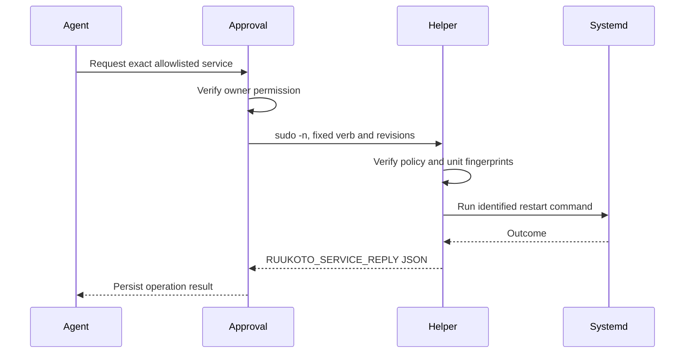

# Deployment and Service Management

## Responsibilities and Boundaries

`deploy/` contains systemd units, native sandbox prerequisites and narrowly scoped privilege helpers. Backends run as ordinary accounts; Linux linger/user-manager setup supports persistent operation. Optional service management allows fixed allowlisted systemd actions without giving the model arbitrary sudo.

Operational steps belong to [the systemd guide](../../deploy/systemd/README.md). [Core](core.md)/[Personal durable](personal-durable.md) own stored state, and [execution](execution.md) owns live process boundaries.

## Public Interfaces

| Asset | Purpose |
| --- | --- |
| `deploy/systemd/ruukoto-backend.service` | Personal backend unit template |
| `deploy/systemd/ruukoto-remote.service` | Private remote endpoint behind Tailscale Serve |
| `deploy/systemd/sudoers.d.ruukoto` | Fixed helper authorization, not arbitrary sudo |
| `deploy/systemd/ruukoto-service.mjs` | Root-owned helper accepting structured verbs |
| `deploy/native/` | bubblewrap, user namespace and scope prerequisites |

| Helper verb | Arguments | Contract |
| --- | --- | --- |
| `inspect` | `<unit>` | Read allowlisted service state and configuration fingerprint |
| `restart` | `<hostOpId> <policyRev> <unitRev> <unit>` | Restart through an identified transient systemd command unit |
| `stop-op` | `<hostOpId>` | Stop/verify the operation's command unit |

## Data and State

```text
Linux / cgroup v2
├── Personal backend service (ordinary account)
│   ├── Node durable backend
│   └── Native command execution scopes
└── Fixed sudoers authorization
    └── Root-owned service helper
        └── Allowlisted systemd service operation
```

The backend's profile and the privileged helper's policy/operation records have separate ownership. Installation must preserve that distinction; a task-owned path must not become root-executed configuration.

## Main Flows



The helper validates exact names, policy revisions and unit identity, sanitizes its execution environment and uses structured arguments rather than shell concatenation. It emits one bounded prefixed JSON response on stderr for the host to validate and record.

## Invariants and Failure Handling

- Product backends run under ordinary accounts, not root.
- Privilege is limited to the installed helper and its root-owned allowlist; no `eval` or arbitrary `sh -c` is accepted.
- Stopping a command unit is separate from knowing whether the target service changed. Lost replies preserve effect uncertainty.
- Deployment stopping and restart behavior must follow the actual unit template and verified execution state; a timeout alone is not proof of clean shutdown.

## Design Rationale

- [Detach terminal from task runtime](../../.agents/notes/implemented/architecture/2026-09-19-detach-terminal-from-task-runtime.md)
- [Native execution sandbox](../../.agents/notes/implemented/architecture/2026-10-10-native-execution-sandbox.md)
