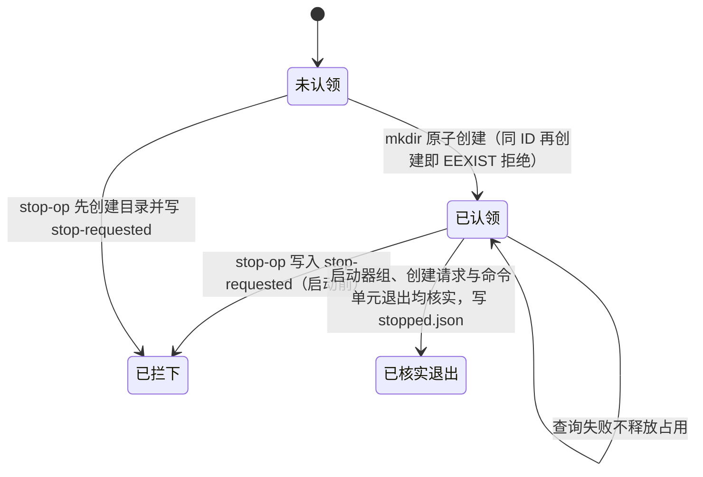
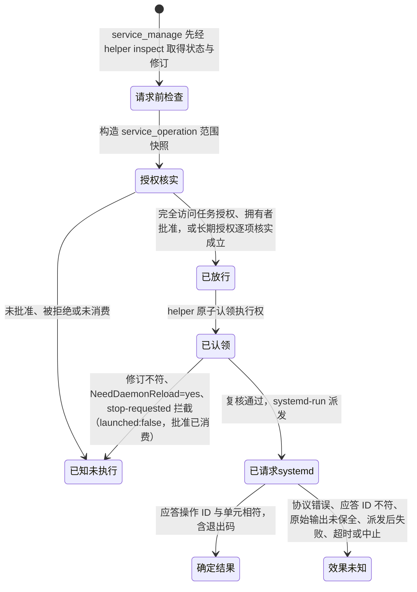
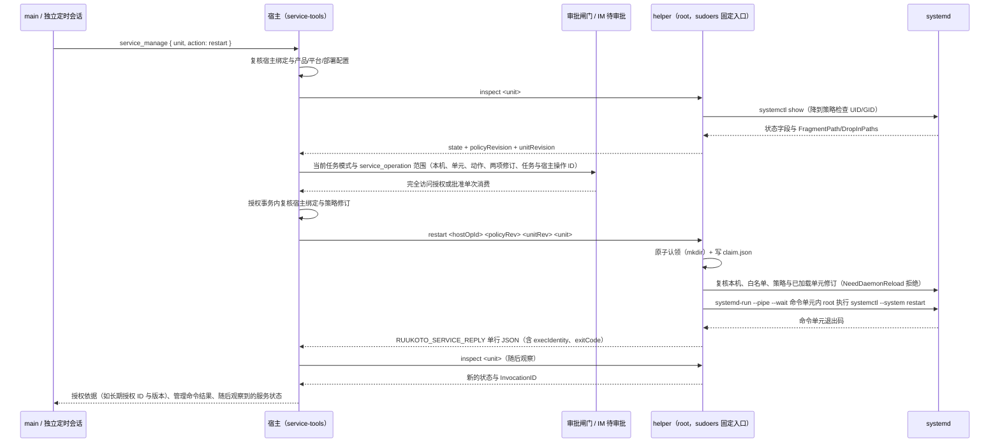

# 部署与服务管理

## 职责与边界

本篇负责两个产品的部署：`ruukoto-code` 的原生沙箱、宿主工具链与按需后台前置；`ruukoto` 的当前账户后台单元、常驻 user manager 与可选服务管理 helper。两端独立安装、停止与升级。

后台、CLI/TUI 与完全访问 worker 使用实际启动账户。控制面仍验证拥有者令牌；同账户完全访问能够读取该账户有权限的后台数据、凭据与令牌。账户原有文件权限继续有效，不要求另建后台与执行账户或配置工作区 ACL。

**systemd 单元与提权入口**。`ruukoto-backend.service` 模板在安装时将 `@RUN_USER@` / `@RUN_GROUP@` / `@RUN_UID@` / `@NODE_BIN@` 替换为实际账户、UID 与 Node 绝对路径，`KillMode=control-group`、`TimeoutStopSec=30`、`Restart=on-failure`、`RestartSec=3`。完全访问不需要特权执行入口；可选服务管理只放行 root 拥有的固定 helper，sudoers 对同一实际账户授权。

**宿主工具链与常驻账户**。受限任务使用宿主 Node、Bash、coreutils、Git 及任务所需工具；工作进程由 `npm run build` 打成 `worker/worker.mjs`，SDK 与其运行依赖随 workspace 安装。个人服务器为运行账户显式启用 linger；backend 系统单元依赖该账户 user manager，并固定 runtime dir 与 user bus 环境。原生 scope 使用 `Delegate=yes` 与可写 `cgroup.kill`；backend 的 `KillMode` 不替代 scope 停止核实。

**服务器服务管理**让 main 与独立定时会话检查部署白名单内的服务状态，完全访问免操作审批，其他模式逐次批准执行管理动作（首版仅 `restart`），main 可命中经核实的长期授权，定时会话不继承长期授权。宿主工具在 `apps/ruukoto/src/service-tools.ts`；审批、通知与批准消费复用 IM 审批通道，不另建控制面。装配要求产品 `ruukoto` + Linux + 显式部署配置齐备；普通开发会话、SubAgent 与 `ruukoto-code` 都不获得该能力，个人业务工具集不因此获得 `bash`。模型只提供白名单服务名与固定动作，主机身份、`taskId`、`hostOpId`、执行身份与策略由宿主注入。

不负责的部分点名归属：安装、配置与故障排查的操作步骤归 [deploy/systemd/README.md](../../deploy/systemd/README.md) 与 [usage](../usage.md)，本篇只写设计并链过去；工具工作进程、原生策略、受管执行单元与回收核实归 [execution](execution.md)；长期授权（`standing_permissions`）的创建、范围、行级版本与失效语义归 [agent-tools](agent-tools.md)，本篇只写消费它的 helper、策略与执行侧；IM 命令的文本解析与回执归 [channels](channels.md)。

**两个产品的原生前置**。正式入口默认且只接受 `native`，显式 container/local 参数或环境覆盖被拒并提示迁移；原生执行使用宿主 Node、Git、Python 与编译器，`npm run build` 构建 worker，并在 macOS 用系统 clang 构建 `worker/native-macos-supervisor`。只读提供 SDK 和必要运行依赖，每单元独立 HOME/TMPDIR，不需要工具镜像。macOS 需要可用的 `sandbox-exec` 与 libproc 身份/原子信号能力；Linux 需要正式 `/usr/bin/bwrap`、允许 userns 的系统策略、cgroup v2 和可委派的 user scope。安装与检查步骤见 [deploy/native/README.md](../../deploy/native/README.md)，启动器不安装依赖、不调整系统策略。

## 对外接口

部署材料：

| 材料 | 作用 |
|---|---|
| `deploy/native/README.md`、`ruukoto-bwrap` | Linux 原生 namespace、AppArmor 与 user scope 前置的安装、核实和移除 |
| `scripts/build-native.mjs`、`worker/native-macos-supervisor` | macOS 宿主监督器的条件构建与运行产物；其他平台不编译该辅助程序 |
| `deploy/systemd/README.md` | 安装步骤（操作步骤的唯一落点） |
| `deploy/systemd/ruukoto-backend.service` | 后台单元；环境与重启策略在此 |
| `deploy/systemd/sudoers.d.ruukoto` | 安装时替换启动账户，仅放行固定服务 helper |
| `deploy/systemd/ruukoto-service.mjs` | 服务管理 helper（root 0700，无第三方依赖，不接受环境变量配置） |
| `deploy/systemd/ruukoto-service-test.service`、`ruukoto-service-test.sh` | 可控测试服务：以实际启动账户运行、`Restart=no`、无网络、无业务凭据、最小攻击面；每次启动记 `InvocationID` 与计数，仅作辅助观察 |

配置键：`RUUKOTO_DATA_DIR`、`RUUKOTO_AGENT_DIR`、`RUUKOTO_EXECUTION_BACKEND`、`XDG_RUNTIME_DIR`、`DBUS_SESSION_BUS_ADDRESS`、`RUUKOTO_SERVICE_SUDO`、`RUUKOTO_SERVICE_HELPER`、`RUUKOTO_SERVICE_POLICY`。`RUUKOTO_SERVICE_HELPER` 与 `RUUKOTO_SERVICE_POLICY` 经后台单元 drop-in 注入，只设一个拒绝启动，不静默降级为无能力。

**工具接口**（模型可见，main 与独立定时会话）：

| 工具 | 参数 | 语义 |
|---|---|---|
| `service_inspect` | `unit`（白名单内的精确 `.service` 名） | 只读状态查询，无写入效果 |
| `service_manage` | `unit`、`action`（联合类型，首版只取 `restart`） | 完全访问免操作审批；其他模式按单次批准或长期授权放行 |

**helper 协议**：固定动词，绝对路径结构化 argv，清空环境，无 shell 字符串、无自由参数。

| 动词 | argv | 行为 |
|---|---|---|
| `inspect` | `inspect <unit>` | 白名单内服务的固定状态字段与两项修订指纹；`systemctl show` 显式降到策略检查 UID/GID，应答含实际执行身份 uid/gid |
| `inspect-op` | `inspect-op <inspectionId> <machineId> <unit>` | 先认领稳定检查身份，再执行同组只读 show；同 ID 永不重启 |
| `stop-inspect` | `stop-inspect <inspectionId> <machineId>` | 先阻止迟到启动，再观察原启动器与进程组；不向持久 PID/PGID 发送停止信号 |
| `restart` | `restart <hostOpId> <policyRev> <unitRev> <unit>` | 原子认领 → 复核修订与已加载配置 → `systemd-run --pipe --wait` 的短命命令单元内以 root 执行固定 `systemctl --system restart` |
| `stop-op` | `stop-op <hostOpId>` | 只停由同一 `hostOpId` 派生的命令单元，启动器进程组和整个单元均退出才报告 `exited:true` |

应答是 stderr 上唯一一条 `RUUKOTO_SERVICE_REPLY ` 前缀的单行 JSON（`v: 1`），stdout 与 stderr 其余内容都是原始 systemctl 输出证据；不使用 fd3，因为 sudo 默认关闭 fd ≥ 3。`restart` 路径的 `systemd-run --pipe` 会把命令单元的 stderr 混入，机器调用方按前缀行提取。成功应答的字段：`inspect` 返回 `machineId`、`policyRevision`、`unitRevision`、`unit`、`state`、`execIdentity`、`observedAt`；`restart` 返回 `machineId`、`hostOpId`、`opUnit`、`launched`、`execIdentity`、`exitCode`、`observedAt`；`stop-op` 返回 `machineId`、`hostOpId`、`opUnit`、`launcherExited`、`exited`、`detail`。失败应答含 `ok:false`、`launched`、`reasonCode` 与 `error`。

`inspect-op` 的应答在 inspect 字段外含原 `inspectionId`，动词为 `inspect-op`；`stop-inspect` 返回 `machineId`、`inspectionId`、`exited` 与未核实原因 `detail`。这两个动词均先核对期望机器。消费者必须在首次 spawn 前持久化机器与检查归属，并逐项核对应答；现有产品工具仍调用原 inspect，尚不消费检查身份协议。

调用侧固定入口：生产经 `/usr/bin/sudo -n <helper> …`（`RUUKOTO_SERVICE_SUDO` 决定 sudo 路径），受控替身以当前 node 直接执行脚本；两条路径都是固定 argv、`PATH` 最小化、进程组可整组回收。

## 数据与状态

**目录权限**：`/var/lib/ruukoto/{data,agent,agent-work,control}` 由实际启动账户拥有并以 0700 创建，socket 仍以拥有者令牌认证；`/opt/ruukoto` 是 root 拥有的代码与依赖。可选 helper、策略、操作目录及其每一级父目录由 root 拥有且组/他人不可写。完全访问能读取启动账户自己的状态与凭据，路径权限不构成同账户隔离。

**策略文件** `/etc/ruukoto/services.json` 固定本机身份、检查 UID/GID、精确单元与允许动作：

| 字段 | 含义 |
|---|---|
| `machineId` | 必须等于 `/etc/machine-id`，否则拒绝 |
| `inspectUid`、`inspectGid` | 正整数；检查动作降到实际启动账户运行 |
| `services` | 单元名 → `{ actions: [...] }`；默认只列可控测试服务 |

单元名必须是精确规范的 `.service` 名：拒绝别名、模板实例（含 `@`）、路径、空白、通配符、选项注入与额外参数。固定拒绝清单覆盖后台、Docker 与容器运行时、执行工作进程、本 helper 操作单元以及 dbus 等基础设施目标，防止策略误配。策略由拥有者在可信部署流程修改，模型不能增删目标。

**修订指纹**两项，都是 sha256：

- `policyRevision` = 策略文件原始字节的 sha256；
- `unitRevision` = 对单元定义来源（`FragmentPath` 与 `DropInPaths` 逐文件 sha256，按路径排序）加 `NeedDaemonReload` 状态计算的 sha256。

活动状态、PID 与 `InvocationID` 是观察值，不进入修订，正常状态变化不让审批失效。`NeedDaemonReload=yes` 表示已加载配置与磁盘不一致，拒绝请求 systemd。

**操作标记**位于 `/var/lib/ruukoto/service-ops/<hostOpId>/`，`hostOpId` 形态是 `op_` 加 24 位小写十六进制：

`claim.json` v2 记录单元、两项期望修订与启动器 PID、Linux starttime、进程组和 boot ID；标记持久保留，只证明执行权已认领。`systemd-run --wait` 退出 0 后保存绑定原身份的 `launcher-completed.json`；停止查询实际观察到原命令单元为 loaded 时保存 `unit-observed.json`。这些证明让后续 not-found 可判为退出；缺少证明时，即使启动器组已消失，也不能排除尚未处理的 D-Bus 创建请求。旧、缺失或损坏的认领不提供停止证明，保留占用。

固定检查使用独立 `inspect_` 加 24 位小写十六进制 ID，位于同一受保护根下；`claim.json` v1 绑定检查 ID、机器、单元及启动器身份，与 restart 的 v2 分开解释。stop-inspect 写入 `stop-requested`；只有完整的停止先手认领、完整原身份跨 boot，或原 helper 身份已结束且整个原组不存在，才返回 `exited:true`。坏记录、观察失败、仍活的同组后代或组号复用均保留未核实。这只证明固定同组 show 的退出，不用于任意命令或主动脱组后代。

调用侧为检查创建独立组，允许 sudo 监护与 helper 同组；helper 不必是组首领，同组的其他成员会保守延后停止核实。

**派生命令单元** `ruukoto-service-op-<hostOpId>.service`：`KillMode=control-group`，`RuntimeMaxSec=120`，单元内以 root 执行固定的 `systemctl --system restart`。停止协议只接受由同一操作 ID 派生的单元，不能指定任意目标。

**宿主侧操作状态**（消费与 systemd 之间没有跨系统事务）：

**审批范围**是判别联合 `ApprovalScope` 的 `service_operation` 成员，固定：`machineId`、规范单元、动作 `restart`、`policyRevision`、`unitRevision`、`taskId`、`toolOpId`。执行参数取自审批前构造、与审批记录同源的不可变快照，模型不能提交批准 ID 后替换参数。

**结果产物**：helper 的 stdout/stderr 原始字节先入 `ArtifactStore`，模型只收 4 KiB 上限的有界视图；产物引用接到 `task.tool_result` 事件，正常回收记 complete，中断或捕获失败保持 partial。

## 主要流程

**部署**（步骤见 [deploy/systemd/README.md](../../deploy/systemd/README.md)）：创建当前账户的数据目录 → 安装代码、依赖与构建产物 → 放入模型配置与凭据 → 安装原生前置与宿主工具并为运行账户启用 linger → 在单元模板中替换实际账户并启用后台。完全访问不依赖原生沙箱、专用账户、执行启停包装或服务 helper。

**服务状态检查**：main 或独立定时会话调用 `service_inspect` → 宿主每次重新核实任务、会话、项目与个人助手宿主绑定 → helper 校验自身、策略、标记目录及其每一级父目录都是 root 拥有且组/他人不可写，策略 `machineId` 与本机一致 → 白名单与精确单元名校验 → `systemctl show` 显式降到策略检查 UID/GID 并清空环境 → 返回固定状态字段与两项修订。别名（`show` 返回的 `Id` 不等于请求名）明确拒绝。

**管理动作**（首版 `restart`）：

**执行与回收**。每个宿主操作派生一个短命命令单元，`RuntimeMaxSec=120` 给命令单元有界运行时间；宿主在异步启动前把该单元登记进受管执行单元表（`kind: systemd_unit`），停止路径据此调用 `stop-op`。停止协议先写标记、观察并停命令单元，再核实启动器身份退出、进程组消失及整个单元退出；单元已回收时还需上述创建请求证明。先手 stop-op 自己原子认领或已跨系统重启时可排除旧派发。全部成立才报告 `launcherExited:true, exited:true`；否则保留占用。权限错误、bus 不可达与查询失败不当作已退出。已经提交 PID 1 的服务重启作业不撤回，取消不自动停止目标服务作为回滚。

**结果与恢复**。正常重启分述两件事：「管理命令结果」（`systemctl restart` 的退出码）与「随后观察到的服务状态」（`InvocationID` 对照：变化即确实经过新的启动周期）。退出码 0 表示 systemd 接受并完成重启动作，不等同于服务 active，更不等同于业务健康；`InvocationID` 未变化时提示核实。操作后状态查询失败保留已知命令结果并说明无法核实，不伪装成功。非零退出可能含部分效果（例如已停止但未能启动），如实报告退出码与输出，不描述为零执行。

消费后的结果分类只认可信结论：

| 情形 | 结论 |
|---|---|
| 未消费的中断或重启、请求前的确定拒绝（`launched:false`）、`service_inspect` 的状态查询 | 已知未执行 |
| 确定的管理命令结果（含非零退出） | 如实记录 |
| 协议错误、应答 ID 不符、原始输出未保全、派发后失败、超时、中止 | 效果未知，不自动重发 |

效果未知另使同一目标的有效长期授权失效（授权语义见 [agent-tools](agent-tools.md)）。账本规则：`service_inspect` 记 `no_effect`；`service_manage` 保存实际任务、人工或长期授权来源。

**两个产品的安装与升级**。`ruukoto-backend.service` 只承载个人 Agent。Coding Agent 在开发机检出仓库、安装依赖并构建，使用 `apps/ruukoto-code/bin/ruukoto-code.mjs`（`npm link` 或把 bin 加入 PATH），档案为 `~/.ruukoto-code`；首次打开 TUI 按需拉起后台，无需预置服务单元。原生的主任务、SubAgent、worktree 创建与汇总共用已核实的边界，宿主不直接运行仓库 Git。升级先停旧后台及执行单元，再替换检出、重建并移除旧 container/local 参数与环境覆盖，重开入口；保留会话、工作副本、产物、审批与异常占用，不在线替换活动任务环境。两个产品不要求同时升级或停止，个人产品的正式受限入口同样只接受 native。

## 不变量与失败处理

**装配与权限不变量**：

- 服务管理能力在产品 `ruukoto`、Linux 与显式部署配置三者齐备时才装配；只设 `RUUKOTO_SERVICE_HELPER` 与 `RUUKOTO_SERVICE_POLICY` 之一即拒绝启动。宿主可为受控测试显式放宽平台判定，生产不依赖它。
- main 与独立定时会话不因服务管理获得 `bash`；服务 helper 的 OS 授权由拥有者独立配置；受限原生 worker 不开放 systemd bus 或控制面。
- 模型、任务参数与其他会话不能指定可执行文件、配置路径、执行身份或 systemd 参数；`hostOpId` 与 `taskId` 一律来自宿主记录。
- 每次 helper 调用都验证 helper 自身、策略文件、操作标记目录及其每一级父目录：真实文件或目录、非符号链接、属主 root、组/他人不可写。策略路径与 helper 固定路径不一致时明确失败。
- 策略 `machineId` 必须匹配本机；白名单只认精确 `.service` 名；固定拒绝清单（后台、Docker 与容器运行时、`ruukoto-exec-*`、`ruukoto-service-op-*`、`systemd-*`、dbus）先于白名单生效。
- 同一 `hostOpId` 只能认领一次执行权，标记持久保留，跨进程与瞬态单元回收后仍拒绝再次启动。
- helper 必须以 root 运行（仅实际启动账户经 sudoers 调用），且只接受固定动词与对应数量的参数。

**审批不变量**：

- `service_manage` 在完全访问下免操作审批，但仍复核活动任务、权限版本、目标、部署修订与 OS 授权；其他模式沿用单次批准或长期授权，自动审查对服务范围转人工。
- 审批固定本机、规范单元、动作、策略与单元修订以及任务与宿主操作 ID；活动状态、PID 与 `InvocationID` 不进修订。
- 批准单次消费；授权事务内复核个人助手宿主绑定与策略修订，helper 在请求 systemd 前再次核实全部修订。修订或入口固定身份变化即失效。
- 已消费但 helper 证明尚未请求 systemd 的动作记为已知未执行，重新操作重新核实授权。
- 长期授权命中不改变上述消费路径：宿主逐项核实候选并重建完整范围，创建独立的已批准记录并单次消费，授权本身不被消费；范围外与核实失配的候选回落逐次人工审批，观察到失配的旧授权同事务明确失效。

**失败分类与语义**：

| 失败 | 处理 |
|---|---|
| 原生二进制、AppArmor/user scope、libproc 能力或策略不可用 | `execution_unavailable` 携带缺二进制、缺策略、策略拒绝或 worker 失败原因，不回退到容器、local 或后台自由执行 |
| 原生停止无法核实 | 保留执行身份、目录占用和每单元临时资料；已有结果保留，效果未知不重放，拥有者核实后恢复 |
| 缺 Linux、systemd、helper 或 sudo 权限 | 明确失败，不降级到后台自由执行 |
| helper 拒绝（策略不可读或非法、本机不符、单元非法或被固定拒绝、目标不在白名单、动作不允许、操作 ID 非法、修订形态非法、已认领、认领失败、启动前收到停止标记、修订不符、别名、`NeedDaemonReload=yes`、systemd 不可用或查询失败、单元定义来源不可读） | 应答 `ok:false` 且 `launched:false`，宿主记已知未执行；批准路径已消费批准，重新操作重新核实授权 |
| `systemd-run` spawn 只有可证明命令根本未启动（`ENOENT`、`EACCES`、`ENOTDIR`） | 报未派发，宿主记已知未执行 |
| 启动后的错误（缓冲超限等）或被信号杀死 | 报「可能已派发」`ok:false, launched:true`，不猜退出码；宿主记效果未知、不自动重发，同目标长期授权失效 |
| 宿主侧无结构化应答、应答不是合法 JSON、协议版本不符、应答与请求不符、原始输出保存失败 | 一律不当成功：协议错误或输出未保全按效果未知记录 |
| 调用超时（`inspect` 默认 20 秒、`restart` 默认 150 秒、`stop-op` 默认 15 秒）或任务中止 | 整组 `SIGKILL` 后等待调用进程与 stdio 关闭，再返回首次失败及有界输出；调用关闭不代替操作单元停止证明，已消费的 `restart` 记效果未知、不自动重发 |
| 停止核实失败 | 保留目录占用并报告，重复停止不当作已回收；helper 内 8 秒、每 200 ms 轮询仍未确认退出时如实报 `exited:false` |
| 非零命令退出 | 如实记录退出码，可能含部分效果，不描述为零执行 |
| 操作后状态查询失败 | 保留已知命令结果，说明无法核实 |

后台单元以 `KillMode=control-group` 终止子进程树，`TimeoutStopSec=30` 给受管停止有界时间；崩溃重启不重放效果未知的操作，异常中断保留中断任务的占用。

## 设计依据

- [个人 Agent 复用原生受限执行并退役 Docker worker](../../.agents/notes/implemented/architecture/2026-10-12-personal-native-sandbox.md)：系统服务与常驻 user manager、宿主工具、升级核实及临时空间选择。

- [完全访问使用启动账户且不请求审批](../../.agents/notes/implemented/feature/2026-10-12-full-access-current-account.md)：当前账户、服务 OS 授权与无操作审批。

- [Coding Agent 的原生执行沙箱](../../.agents/notes/implemented/architecture/2026-10-10-native-execution-sandbox.md)：宿主工具链、平台前置、默认选择与 macOS 残留的取舍。

- [工具工作进程与受限任务容器](../../.agents/notes/implemented/architecture/2026-09-20-tool-worker-per-task-container.md)：解释共享协议与缺隔离能力时明确失败的原始决定；两个产品的受限后端由原生决定持有。
- [服务管理经过 root 拥有的固定 helper](../../.agents/notes/implemented/architecture/2026-10-03-service-management-helper.md)：解释白名单、固定协议、修订绑定、单次认领与效果未知不重放的取舍，以及服务 OS 授权与实际任务模式的分工。
- [固定服务检查以受保护认领核实原执行退出](../../.agents/notes/implemented/architecture/2026-10-17-service-inspection-identity.md)：检查身份、机器绑定与只观察原组的范围。
- [访问模式由技术边界实施，完全访问须拥有者显式选择](../../.agents/notes/implemented/feature/2026-09-19-explicit-access-modes.md)：解释拥有者显式选择访问模式与控制面认证。
