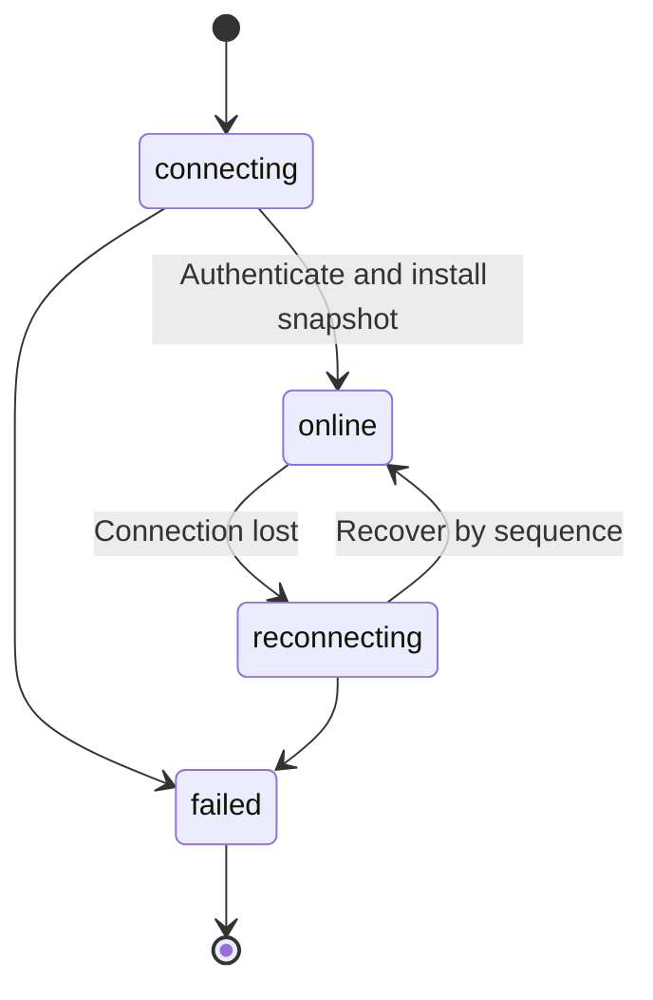
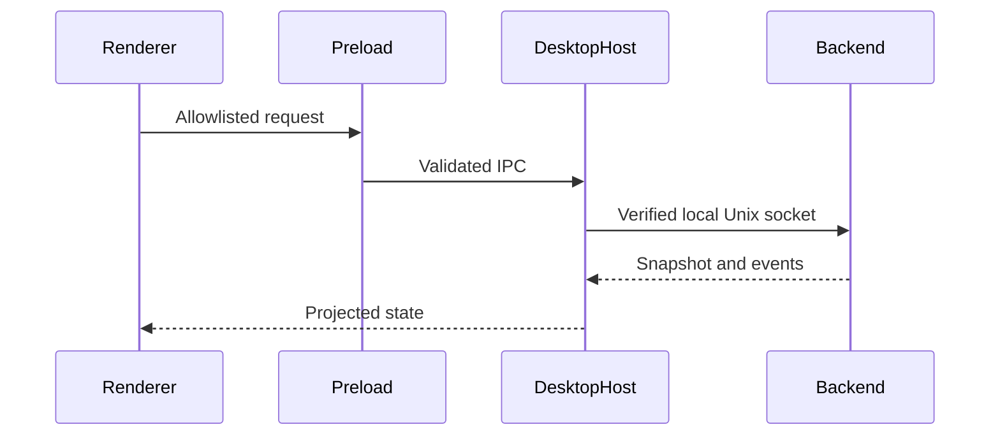

# Desktop Client

## Responsibilities and Boundaries

`apps/desktop/` provides Electron and MyGo clients for the local Ruukoto backend. They expose workspaces, conversation tabs, diffs, SubAgents, settings, schedules and a terminal; MyGo additionally owns the native Agent browser.

The Node `DesktopHost` owns backend credentials and activated `ProfilePaths`. An allowlisted preload/IPC bridge exposes specific operations to React rendering, not arbitrary OS access. Shared projection belongs to [view](view.md) and execution to [runtime](runtime.md).

## Public Interfaces

| Host | Role |
| --- | --- |
| Electron + Chromium | Windows, notifications and Dock badge, mediated OS integration |
| Experimental MyGo, Go + WKWebView | Native web rendering with stdio to the same Node host; also supports the Coding native browser panel |

MyGo has one native browser WebView per main conversation. Go's `browser.Manager` owns lifecycle, placement, navigation generations and input gating. Private stdio frames carry Go→Node `browser_event` facts and control→Go `kind:"request"`/`kind:"response"` commands. Node uploads screenshots/snapshots through `desktop_browser_chunk` in ≤256 KiB pieces; the backend assembles by `command_id` and SHA256. The control connection fixes task provenance. Electron does not provide this channel.

Idle native pages accept owner input directly. Actual Agent browser use claims only that conversation's page until the task ends; ordinary task activity and status reads do not lock it. The toolbar's takeover icon is enabled while the Agent holds the page and becomes a return icon after explicit takeover. Completion, failure, cancellation or control disconnection releases the native input cover. Explicit return records a fresh page observation before Agent continuation.

The native page leaves the sidebar resize handle outside its bounds. Resizing keeps the page visible; settings dialogs and other covering overlays hide it until dismissed.

| UI entry | Behavior |
| --- | --- |
| New chat | Compose without selecting a directory; first send creates a persistent managed workspace, or uses the explicitly selected workspace |
| Spotlight, `⌘K` / search icon | Search this instance's workspace conversation titles and message bodies; highlight and navigate |
| Workspace sidebar | Add directories, select conversations, access mode and model; amber markers identify pending approvals or owner questions; the toggle stays beside the traffic lights and the five navigation actions transition into the collapsed rail |
| Timeline | Stream input, thinking, tools and question cards; completed Agent messages offer copy/branch; branches restore source-task traces; the server-selected latest recallable owner message offers recall and restores text/attachments to this client's draft |
| Scheduled | Lists Active/Archived plans as cards with title, Instructions summary, repeat rule and next-trigger progress; details separate overview and run records; create/edit uses one centered form with shared workspace, permission and model controls plus a supported-level Effort slider, and successful saves return to details without a success notice |
| Composer | Grows to at most one third of window height; steering targets the running task's next boundary; post-interrupt input is an ordinary new task; with an empty draft, the send button resumes a nonempty paused queue; text or attachments submit ordinary queued input without resuming |
| Context indicator | A numberless ring with circular hover feedback; clicking opens usage/category details and reads the latest recorded context |
| Queue above composer | Shares the composer surface; drag or use arrow keys to reorder, turn input into guidance, retrieve any eligible unstarted message and announce position |
| Inspector sidebar | Starts collapsed; opens from its toggle or content actions for diffs, SubAgent progress, Git graph, read-only files and background logs |
| Terminal drawer | xterm.js terminal in the selected workspace |
| Skills settings | Read-only paged catalog and diagnostics from the backend account’s `$HOME/.agents/skills/` |
| MCP settings | Instance services and local effect classes |
| Computer settings | Select fixed computer program/Linux sandbox, pause, verify stop and accept a fresh recovery image |
| Appearance settings | System/Light/Dark selection, persisted per host in `desktop-preferences.json`; the native window material and the page's `prefers-color-scheme` follow the selection |

### Code Slash Commands

Type `/` at the start of the conversation or New chat input to search applicable commands. Arrow keys move the selection; Enter, Tab or a pointer selection completes it without executing. Submit the completed input to run it. Escape dismisses the menu, and Shift+Enter inserts a newline. Unregistered slash-leading text, including filesystem paths, remains ordinary message input.

| Command | Behavior |
| --- | --- |
| `/skill [name] [arguments]` | Discover a skill or prepare its explicit input; submission normalizes to `/skill:name` while preserving arguments and attachments |
| `/skills` | Open the Code skill library |
| `/model` | Open model and effort selection for this conversation or local New chat draft |
| `/mode` | Open access-mode selection for this conversation or local New chat draft |
| `/new` | Open New chat; workspace selection follows the existing first-send creation flow |
| `/branch [name]` | Branch the current conversation's persisted history using existing source and eligibility rules |
| `/compact [guidance]` | Start manual compaction for an eligible idle ordinary conversation |
| `/help` | Show commands and arguments |

Application commands use existing UI actions without an Agent task or owner-history message. They retain attachments in their draft. New chat selector changes create no session. Invalid or unavailable commands retain input and explain the next action; the menu filters actions by draft, conversation and connection state. Disconnected conversations retain the composer and local help; backend actions require reconnection. Skill invocations remain normal task input with backend validation and queueing.

## Data and State

State binds to the activated layout and instance, not merely a control-directory string. Drafts use `ProfilePaths.desktopDraftKey`; native request journals use `ProfilePaths.desktopPendingDir`. Queued retrieval saves its original request key before sending and restores text/attachments from its receipt independently of historical edit pause. Current submission journals require the original model selection; malformed records remain visible and never become editable new input. Predecessor journals are not read, and there is no missing-model restoration path.

New chat starts with No workspace selected and accepts text or attachments. Before first send it creates no persistent workspace/session. Managed chats share the No workspace sidebar group while search, reopening, file inspection, Git, terminals and archive resolve each chat's actual registered workspace. The folder action reveals its real root. Branches reuse that root and files while history continues independently.

Once first send begins, a private native journal retains original creation/submission keys, attachment snapshots and uploaded references. Creation, upload or submission retry reuses the same workspace/session. Resume first message restores an unfinished input after navigation or application restart, requiring explicit send. Verified nonacceptance permits correcting the submission to the visible composer settings; an unknown submission keeps its original parameters until verified. Closing or archiving preserves files and history.

Manual compaction saves its original request identity in the native journal before sending. Reconnect, lost-response recovery and application reopening query that operation in its original data instance. The result panel shows running, succeeded, no-op, failed, canceled or interrupted outcomes, with available before/after estimates and Stop while running. Switching conversations or closing the client does not cancel it. Unsent input stays visible while compaction occupies the conversation, and backend admission rules still apply. Original history is unchanged; the Context indicator continues to describe the most recent actual model request.

Coding question cards stay at their original `ask_user` operation, including repeated batches in one task. Answers return receipts for that task; closing a card window does not cancel it. The activity indicator shows pending-answer waiting. Interruption persists an owner pause; resume retains each queued task's recorded model and confirms retained stopping separately when required.

## Main Flows

Startup selects and bootstraps the same core profile as CLI/TUI, then discovers the expected local backend and starts it on demand when absent. Child handoff forwards the complete raw tuple. In-process callers use `ProfilePaths.socketPath`, never a derived control socket. Managed development connects only to the launcher-owned backend.

Conversation switching loads bounded history. Approval cards expose immutable operation details before a decision. Settings retains local model, Skills, MCP, Computer, Web Search, appearance and archive pages with original-instance/request ownership, revision checks and lost-response recovery. No PA target, pairing, remote credentials or PA settings remain.

Computer recovery verifies original execution stopped, obtains a fresh observation and enables acceptance only after the complete current image is displayed. A replacement or failed image clears eligibility; accepting an observation does not make the original unknown operation successful.

## Invariants and Failure Handling

- Rendering has no arbitrary filesystem/process access; the host/preload mediates operations.
- Closing/crashing a client does not cancel backend work or question waits. Backend restart interrupts the task and makes unanswered questions stale.
- Both hosts retain signed startup, instance locking and renderer/host isolation; removing remote credentials does not weaken native security.
- Lost write responses are resolved from original records, not automatic resubmission. Incomplete or failed fresh-image display cannot authorize recovery.
- MyGo private request/response and `browser_event` frames remain host-only transport; sidecar startup does not depend on retired credential initialization.

## Design Rationale

- [Desktop slash commands](../../.agents/notes/implemented/feature/2026-11-08-desktop-slash-commands.md): explicit command routing, local draft actions and original-key compaction recovery.

- [Idle desktop browser input](../../.agents/notes/implemented/simplification/2026-11-07-idle-desktop-browser.md): task claims, direct owner browsing and icon-only takeover.

- [Desktop visual alignment](../../.agents/notes/implemented/feature/2026-11-07-desktop-visual-alignment.md): shared controls, connection-state presentation and the single Scheduled form.

- [Managed Coding workspaces](../../.agents/notes/implemented/feature/2026-11-07-managed-coding-workspaces.md)
- [Desktop client](../../.agents/notes/proposed/architecture/2026-10-15-desktop-client.md)
- [Shared history recovery](../../.agents/notes/implemented/architecture/2026-10-23-shared-history-recovery.md)
- [Desktop message actions](../../.agents/notes/implemented/feature/2026-10-28-desktop-message-actions.md)
- [Desktop Scheduled interface](../../.agents/notes/implemented/feature/2026-11-01-desktop-scheduled-interface.md)
- [Desktop spotlight search](../../.agents/notes/implemented/feature/2026-10-21-desktop-spotlight-search.md)
- [Home skills discovery](../../.agents/notes/implemented/simplification/2026-10-28-home-skills-discovery.md)
- [Mcp host responsibilities](../../.agents/notes/implemented/simplification/2026-10-26-mcp-host-responsibilities.md)
- [Coding user queue](../../.agents/notes/implemented/feature/2026-10-30-coding-user-queue.md)
- [Same-task owner questions](../../.agents/notes/implemented/feature/2026-10-30-coding-owner-question-wait.md)
