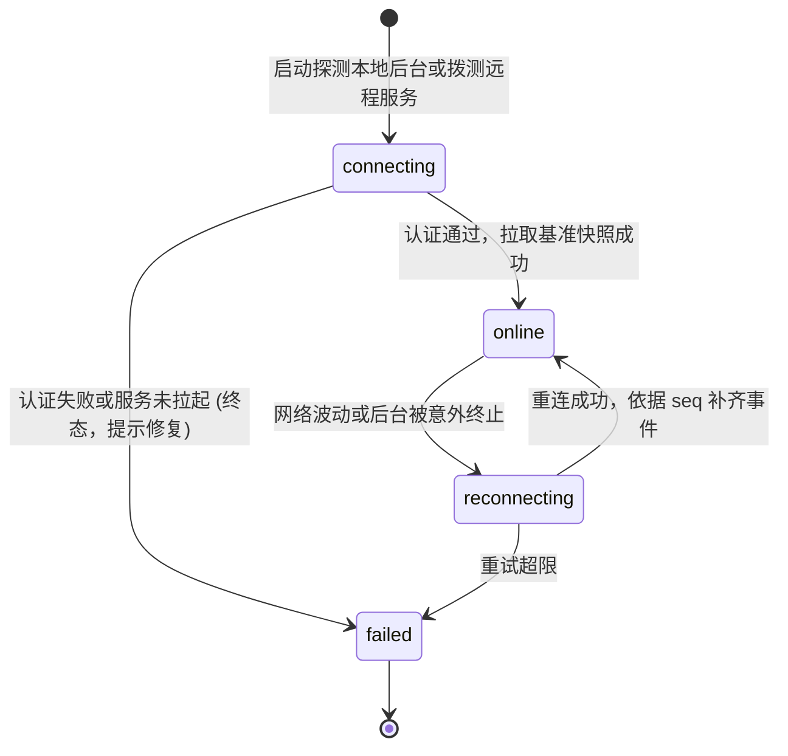
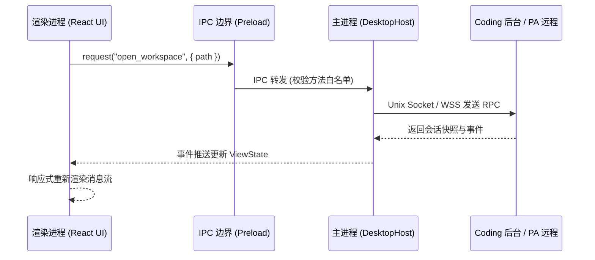
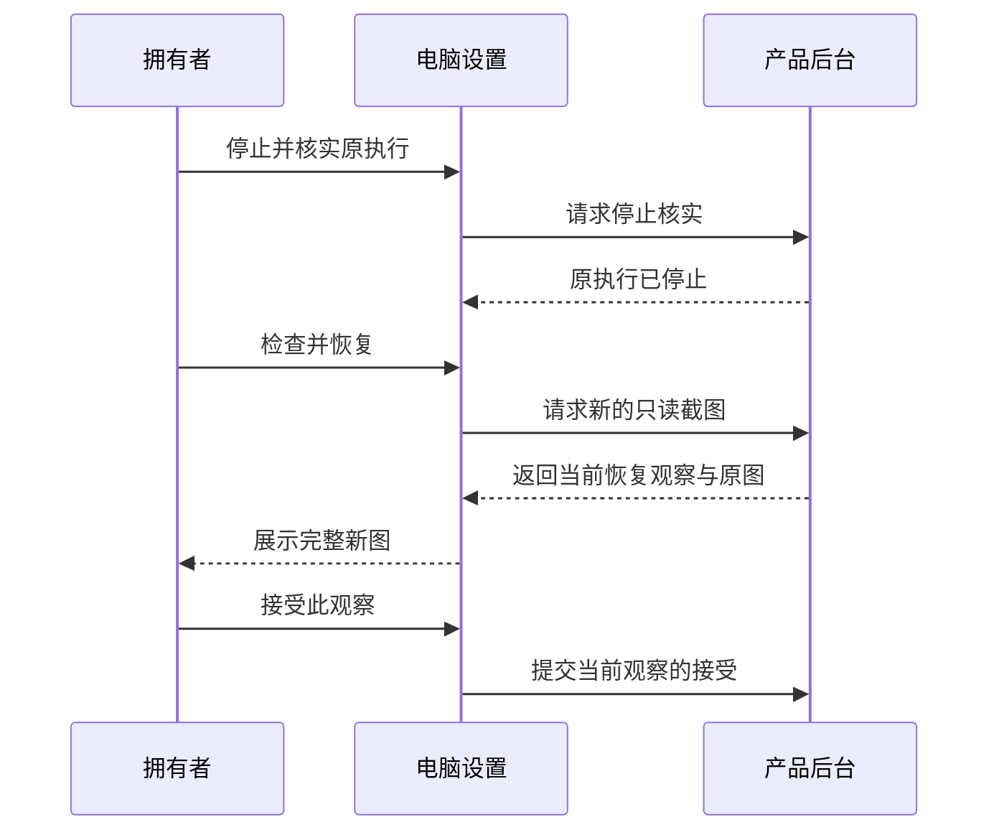

# 桌面客户端

## 职责与边界

`desktop` 模块（对应 `apps/desktop/`）是专为桌面环境（主要支持 macOS）打造的图形化 GUI 客户端。它支持双模式切换：本地工程编码（Coding 目标）与远程个人助理（Personal 目标）。

### 核心职责
- **双产品目标支持**：
  - **Coding 目标**：通过本地 Unix Domain Socket 接入 `ruukoto-code`，提供多工作区管理、会话标签页、代码 Diff 查看、SubAgent 监控与集成终端。
  - **Personal 目标**：通过安全的 Tailscale HTTPS/WSS 接入远程 `ruukoto` 个人 Agent，管理长效主会话、日常问答与后台工作。
- **安全 IPC 桥接**：主进程（Node `DesktopHost`）持有控制面凭据，通过严格的白名单 IPC（Preload）向渲染进程暴露受限操作，渲染层无直接底层访问权限。
- **现代前端视图与动效**：基于 React、Tailwind CSS、Radix UI 与 Lucide 图标库构建现代化深浅色三栏工作区。
- **Spotlight 全局快搜（⌘K）**：提供类似 macOS 原生体验的工作区会话与历史消息全文秒级即时检索。

### 边界与非职责
- 视图的纯内存状态投影与事件合并归 [view](view.md)。
- 后台核心任务调度归 [runtime](runtime.md)。
- 个人端的业务数据持久化归 [personal-durable](personal-durable.md)。

## 对外接口

### 1. 宿主与外壳架构

桌面客户端支持两种外壳运行时，底层复用同一套 Node 业务桥接层：

| 外壳运行时 | 技术栈 | 职责与特点 |
|---|---|---|
| **Electron 外壳** (主流) | Electron + Chromium | 提供完整的本地窗口管理、系统级通知、Dock 角标与操作系统钥匙串（Keychain）安全加密 |
| **MyGo 实验外壳** | Go + WKWebView | 轻量化探索架构，利用原生 WKWebView 渲染界面，通过标准输入输出管道与 Node 宿主通信 |

### 2. 渲染层核心交互与功能

| 功能模块 | 快捷键 / 入口 | 核心功能与交互 |
|---|---|---|
| **Spotlight 全局检索** | `⌘K` 或顶栏搜索图标 | 瞬时搜索当前实例下所有工作区会话标题与消息正文，高亮匹配词并一键定位跳转 |
| **工作区与会话树** | 左侧边栏 | 支持添加工作区目录、新建分支会话、切换安全模式与配置模型参数 |
| **时间线与对话区** | 中间主画布 | 流式呈现用户输入、模型思考过程（Thinking）、代码生成与结构化提问卡片 |
| **辅助检查抽屉** | 右侧边栏 | Tab 切换：查看代码 Diff 补丁、SubAgent 执行进展、Git Graph、只读文件树与后台服务日志 |
| **集成终端** | 底部抽屉 | 内嵌基于 xterm.js 的真实终端模拟器，直接在工作区目录执行日常编译命令 |
| **Skills** | 设置 → Code/PA → Skills | 只读查看所属后台账户 `$HOME/.agents/skills/` 的技能列表、分页与诊断 |
| **MCP 设置** | 设置 → Code/PA → MCP | Coding 管理实例服务；Personal 管理远端档案的普通服务、工具效果与原调用 |
| **电脑设置** | 设置 → Code/PA → 电脑 | 选择固定电脑程序或 Linux 沙箱，暂停操作、核实停止并接受恢复新图 |

## 数据与状态

### 1. 客户端连接状态机

### 2. 本地与远程状态隔离

- **Coding 状态**：严格绑定本地 `<controlDir>`，消费 `@ruukoto/view` 的 `ViewState` 内存投影，草稿与未提交输入在客户端安全暂存。
- **Personal 状态**：严格绑定远程 Tailscale HTTPS Origin，基于 WSS 实时消费原生帧，配对凭据存入 macOS Keychain 加密保护。

### 3. MCP 配置与原调用

设置草稿与原调用分别读取。Personal 的普通工具由拥有者逐服务选择“不允许、只读、写入、副作用不明”，效果类别与远端工具定义分别保存；新允许工具及迁入的旧普通工具默认副作用不明。旧配置先通过“更新 MCP 配置”迁入 v4，原服务、凭据引用与历史保留，原电脑恢复仍可管理。

| 管理对象 | 页面行为 |
|---|---|
| 私有凭据文件 | 普通编辑保留原绑定；选择“重新绑定凭据”后，与设置保存一同提交新绑定 |
| 普通未知调用 | “调用”区读取原参数与结果；可由拥有者选择“结束此工作，保留结果未知” |
| 电脑恢复观察 | 接受资格属于当前完整展示的新截图；重新观察或取图失败时清除原来的接受资格 |

## 主要流程

### 客户端接入与会话交互流程

1. **环境自检与按需拉起**：客户端启动时探测后台，若未启动则由主进程安全拉起 `ruukoto-code server`，免去手动开终端操作。
2. **多会话无缝切换**：左侧栏点击会话时秒级切换激活视图，历史消息异步分段拉取，保证流畅不掉帧。
3. **一键审批响应**：工具调用触发审批时，时间线即时弹出审批卡片，拥有者可查看参数 Diff 并一键批准或拒绝。

### MCP 原调用收尾与电脑恢复

Personal 的 MCP 页从“调用”区刷新列表并查看原调用，人工结束需要明确确认。客户端把收尾交给原工作，结果仍保留未知；本地执行停止与最终报告由[个人持久会话](personal-durable.md)处理。收尾应答丢失时，刷新先核实同一个原调用，再由拥有者决定下一步。

电脑页的恢复分为三个步骤：

停止核实后直接“检查并恢复”，公开的独立开始恢复动作已退役；已开始恢复的旧记录也可继续取得新图。Personal 停止整个 Linux 沙箱前会确认未保存状态的损失。

## 不变量与失败处理

- **渲染进程零特权**：Preload 严格限制暴露的 Node API，渲染进程无法直接执行操作系统任意命令或读写任意物理文件。
- **凭据硬件级加密**：所有配对令牌与 API Key 通过操作系统的安全加密存储（macOS Keychain / safeStorage）落盘，严禁明文写入配置文件。
- **后台与界面解耦**：桌面窗口关闭或前端崩溃绝不导致后台正在执行的代码任务被意外终止，重开桌面后自动恢复进度。
- **原调用保持原事实**：人工结束普通 MCP 工作保留未知结果；它与电脑停止核实、新图接受分别管理。
- **写入丢答先核实**：配置保存与原调用收尾分别查询原记录，不自动重发；电脑新图未完整显示时不能接受恢复。

## 设计依据

- [桌面客户端作为又一个控制面客户端](../../.agents/notes/proposed/architecture/2026-10-15-desktop-client.md)
- [双端共用会话历史恢复](../../.agents/notes/implemented/architecture/2026-10-23-shared-history-recovery.md)
- [应用内 Spotlight 与历史定位](../../.agents/notes/implemented/feature/2026-10-21-desktop-spotlight-search.md)
- [个人 Tailscale HTTPS 与 WebSocket](../../.agents/notes/implemented/architecture/2026-10-24-personal-tailscale-https.md)
- [技能统一从宿主 HOME 发现](../../.agents/notes/implemented/simplification/2026-10-28-home-skills-discovery.md)：两端只读 Skills 与旧维护回执核实。
- [MCP 宿主职责收缩](../../.agents/notes/implemented/simplification/2026-10-26-mcp-host-responsibilities.md)：效果与凭据由拥有者设置，普通未知人工收尾，电脑恢复合并为取图与接受。
