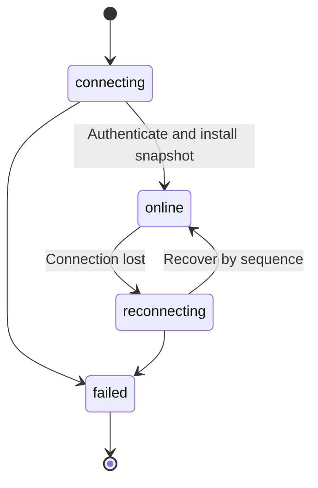
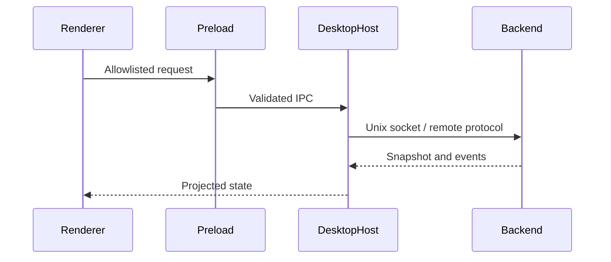
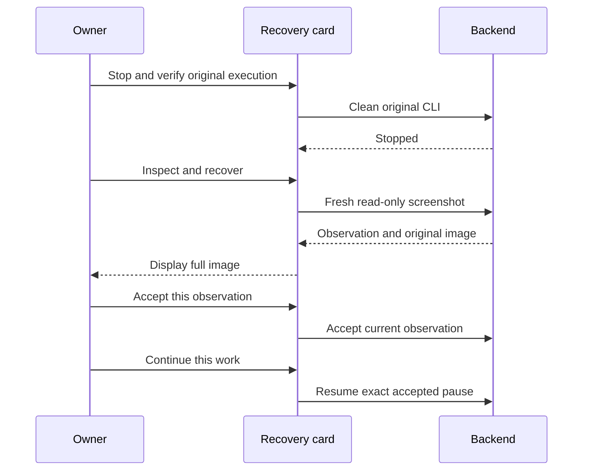

# Desktop Client

## Responsibilities and Boundaries

`apps/desktop/` provides graphical clients, primarily on macOS, for two **product targets**: local Coding and remote Personal. Coding connects to its Unix socket and exposes workspaces, conversation tabs, diffs, SubAgents and a terminal. Personal connects over Tailscale HTTPS/WSS to main conversation and background work.

The Node `DesktopHost` owns backend credentials. An allowlisted preload/IPC bridge exposes specific operations to React rendering, not arbitrary OS access. Shared projection belongs to [view](view.md), Coding execution to [runtime](runtime.md), and Personal persistence to [durable](personal-durable.md).

## Public Interfaces

| Host | Role |
| --- | --- |
| Electron + Chromium | Windows, Coding notifications and Dock badge, OS-protected credential storage |
| Experimental MyGo, Go + WKWebView | Native web rendering with stdio to the same Node host; also supports the Coding native browser panel |

MyGo has one native browser WebView per main conversation. Go's `browser.Manager` owns lifecycle, placement, navigation generations and input gating. Private stdio frames carry Go→Node `browser_event` facts and control→Go `kind:"request"`/`kind:"response"` commands. Node uploads screenshots/snapshots through `desktop_browser_chunk` in ≤256 KiB pieces; the backend assembles by `command_id` and SHA256. The control connection fixes task provenance. Electron does not provide this channel.

Idle native pages accept owner input directly. Actual Agent browser use claims only that conversation's page until the task ends; ordinary task activity and status reads do not lock it. The toolbar's takeover icon is enabled while the Agent holds the page and becomes a return icon after explicit takeover. Completion, failure, cancellation or control disconnection releases the native input cover. Explicit return records a fresh page observation before Agent continuation.

| UI entry | Behavior |
| --- | --- |
| New chat | Compose without selecting a directory; first send creates a persistent managed workspace, or uses the explicitly selected workspace |
| Spotlight, `⌘K` / search icon | Search this instance's workspace conversation titles and message bodies; highlight and navigate |
| Workspace sidebar | Add directories, select conversations, access mode and model; amber markers identify pending approvals or owner questions; the toggle stays beside the traffic lights and the five navigation actions transition into the collapsed rail |
| Timeline | Stream input, thinking, tools and question cards; completed Agent messages offer copy/branch; branches restore source-task traces; the server-selected latest recallable owner message offers recall and restores text/attachments to this client's draft |
| PA conversation | Canonical connections show an owner bubble immediately on Send, with a loading icon to its left until acceptance; completed Agent messages use the same house bubbles, with one timestamp per role group and inline operation decisions, recovery and owner questions |
| PA work and decisions | Commit events update child progress, canonical decisions across enabled families, independent work questions, superseded cards, whole-assignment cancellation and validated publication; partial prose, traces and OS notifications stay hidden |
| PA composer | Starts as a one-line pill, expands for wrapped text or attachments and grows to at most one third of window height; supports up to four files/images, attachments-only input and removal before submission |
| Scheduled | Lists Active/Archived plans as cards with title, Instructions summary, repeat rule and next-trigger progress; details separate overview and run records; create/edit uses one centered form with shared workspace, permission and model controls plus a supported-level Effort slider, and successful saves return to details without a success notice |
| Composer | Grows to at most one third of window height; steering targets the running task's next boundary; post-interrupt input is an ordinary new task; with an empty draft, the send button resumes a nonempty paused queue; text or attachments submit ordinary queued input without resuming |
| Context indicator | A numberless ring with circular hover feedback; clicking opens usage/category details and reads the latest recorded context |
| Queue above composer | Shares the composer surface; drag or use arrow keys to reorder, turn input into guidance, retrieve any eligible unstarted message and announce position |
| Inspector sidebar | Starts collapsed; opens from its toggle or content actions for diffs, SubAgent progress, Git graph, read-only files and background logs |
| Terminal drawer | xterm.js terminal in the selected workspace |
| Code/PA Skills settings | Read-only paged catalog and diagnostics from that backend account's `$HOME/.agents/skills/` |
| Code/PA MCP settings | Coding instance services; Personal remote services, effect classes and original calls |
| Computer settings | Select fixed computer program/Linux sandbox, pause, verify stop and accept a fresh recovery image |

### Code Slash Commands

Type `/` at the start of the conversation or New chat input to search applicable commands. Arrow keys move the selection; Enter, Tab or a pointer selection completes it without executing. Submit the completed input to run it. Escape dismisses the menu, and Shift+Enter inserts a newline. Unregistered slash-leading text, including filesystem paths, remains ordinary message input.

| Command | Behavior |
| --- | --- |
| `/skill [name] [arguments]` | Discover a skill or prepare its explicit input; submission normalizes to `/skill:name` while preserving arguments and attachments |
| `/skills` | Open the Code skill library |
| `/model` | Open model and effort selection for this conversation or local New chat draft |
| `/mode` | Open access-mode selection for this conversation or local New chat draft |
| `/new` | Open New chat; workspace selection follows the existing first-send creation flow |
| `/branch [name]` | Branch the current conversation's persisted history using existing source and eligibility rules |
| `/compact [guidance]` | Start manual compaction for an eligible idle ordinary conversation |
| `/help` | Show commands and arguments |

Application commands use existing UI actions without an Agent task or owner-history message. They retain attachments in their draft. New chat selector changes create no session. Registered invalid or unavailable commands retain input and explain the next action; the menu filters actions by the draft, conversation and connection state. An open Code conversation keeps its composer and unsent input visible while disconnected; local help remains available, and backend actions require reconnection. Skill invocations remain normal task input with backend validation and queueing. Personal uses its own composer.

## Data and State

Coding state binds to local `controlDir` and `ViewState`; drafts stay client-side. Queued retrieval saves its original request key before sending and restores text/attachments from that receipt independently of historical edit pause. It preserves the remaining queue and current execution. Original pending continue/old-answer requests remain inspectable under their original instance without conversion or replay.

New chat starts with No workspace selected and accepts text or attachments. Before first send it creates no persistent workspace/session. Managed chats share the No workspace sidebar group while search, reopening, file inspection, Git, terminals and archive resolve each chat's actual registered workspace. The folder action reveals its real root. Branches reuse that root and files while history continues independently.

Once first send begins, a private native journal retains original creation/submission keys, attachment snapshots and uploaded references. Creation, upload or submission retry reuses the same workspace/session. Resume first message restores an unfinished input after navigation or application restart, requiring explicit send. Verified nonacceptance permits correcting the submission to the visible composer settings; an unknown submission keeps its original parameters until verified. Closing or archiving preserves files and history.

Manual compaction saves its original request identity in the native journal before sending. Reconnect, lost-response recovery and application reopening query that operation in its original data instance. The result panel shows running, succeeded, no-op, failed, canceled or interrupted outcomes, with available before/after estimates and Stop while running. Switching conversations or closing the client does not cancel it. Unsent input stays visible while compaction occupies the conversation, and backend admission rules still apply. Original history is unchanged; the Context indicator continues to describe the most recent actual model request.

Coding question cards stay at their original `ask_user` operation, including repeated batches in one task. Answers return receipts for that task; closing a card window does not cancel it. The activity indicator shows pending-answer waiting. Interruption persists an owner pause; resume confirms retained stopping separately when required.

Personal state binds to the remote HTTPS origin and WSS protocol, with pairing credentials protected by OS storage. Its cards retain the original family, operation, admission and displayed occurrence; backend records determine current state and allowed choices.

Personal owner display commits with native input admission and associates one request/submission with eventual history. Identical text under different requests remains separate. On canonical connections, Send shows a local bubble before waiting for the native host; its loading icon disappears on an accepted receipt or canonical history. The sending client retains complete text under either receipt/event ordering; paired clients read the same canonical body. Only new visible sends and completed live arrivals receive a bubble animation; history, reconnect and reopening do not replay it. Routine processing, queuing and admission text is absent from the composer and owner bubbles. Older backends without canonical projections display server history alone because their raw entries cannot reliably replace a local bubble. Reconnect inspects cached inputs and decisions outside the newest page. Completed-only Assistant rendering excludes internal report inputs and unpublished drafts.

Personal attachment drafts retain selected references, selection failure and draft identity. A failed selected member blocks the complete input across reload until attachment preparation succeeds through the composer’s Plus action. The composer omits the separate failure notice and retry/discard buttons; editing text or removing chips does not clear the failure. A proven attachment rejection before admission releases its pending submission for correction while retaining the failed draft. A lost response or request-association conflict preserves the original request and references for inspection; restoring it never invents another request key. Timeline attachments project the admitted name, type, size and hash without server paths. Telegram timeline, live events and complete-content pages show the original caption with attachment metadata.

Settings drafts and original MCP calls are separate reads. Personal ordinary tools have owner-selected disallowed/read/write/unknown-effect states; new allowed tools and migrated ordinary tools default to unknown. The explicit v4 migration preserves service and credential references plus history; original computer recovery remains available.

| Managed object | Behavior |
| --- | --- |
| Private credential file | Ordinary editing retains binding; explicit rebind is submitted with the settings save |
| Unknown ordinary call | Original timeline card and Calls section expose original parameters/result and explicit work finalization retaining uncertainty |
| Computer observation | Acceptance belongs only to the currently fully displayed fresh image; another observation or failed image load clears eligibility |

## Main Flows

Startup discovers the local Coding backend and starts it on demand when absent. Conversation switching loads history in bounded segments. Approval cards expose operation details before approve/reject.

### PA Work and Decisions

The native attachment picker snapshots ordinary files before upload, verifies complete bytes and the original file identity, and accepts at most four files/images of 8 MiB each. The host uploads 64 KiB chunks through the original authenticated profile. The renderer receives only immutable metadata references; it does not supply local paths or file bytes. Attachment-bearing input uses a dedicated route so an older backend rejects it. Main delegates processing through the attachment's recorded work scope, and final results use the existing preview/save path.

Main delegates assignments and stays available for queries, amended requirements and whole-assignment cancellation. Decisions or recovery choices for ordinary tools, app-data, MCP/Cua, service restarts and inspections, commands, browsers and managed processes arrive through the authenticated event stream, including before main finishes its prose. Every redisplay retains the same decision. Amendments leave the old card visible with its original approval and a changed-requirements/not-executed reason; the same SubAgent prepares the current exact operation.

Before approval, the desktop reads all immutable parameter pages and the full prepared target. The host journals each native choice's exact card, payload and request ID before dispatch. After a lost response, it inspects the original canonical receipt; a missing, admitted or unverified receipt keeps that card locked through reconnect and application restart. Reopening does not resend the choice. Work progress separates accepted, actually model-read and answered instructions; stopping, publication and delivery retain their own states. The composer stays usable during waits.

Published final-file cards offer native preview and save in Electron and MyGo. The host reads authenticated 128 KiB chunks, verifies immutable metadata, exact length and final SHA-256, and holds at most 8 MiB. Partial or oversized output stays visible with complete delivery unavailable. Renderer requests contain the original origin/profile/publication/output identity, never bytes or filesystem paths. Native save selection waits for the owner's choice, then checks authentication again before an atomic local write; Quick Look uses private temporary files with viewer cleanup on replacement, connection change and exit. Transfer failure never starts another business operation.

Work questions appear inline while their original work waits. Each question batch keeps its own selection, navigation and free-text draft. A single-question single choice submits directly; multi-select waits for Done; a multiple-question batch ends with review. Free text belongs to the exact question, and canonical cancellation or version changes prevent old drafts from submitting. An unresolved answer locks only that question. IM-origin questions remain answerable through their original verified entry, with native inspection and cancellation available.

Recovery cards distinguish original receipts, current observations and immutable owner applied/not-applied claims. A claim needs no freeform evidence and does not establish stopping or delivery. Fixed checks and cleanup use the recorded target or execution; available choices come from the original family's current records. [Durable recovery](personal-durable.md#native-recovery-choices) owns the family-specific effect and resource rules.

One delegation item groups its visible member labels, progress and inspection actions with whole-assignment cancellation. It uses the original request as a fallback when members are outside the loaded page, and independently paged members still appear when their delegation is outside that page. Presence shows main processing, pending decisions or active work before report preparation; a report waiting for active members does not claim to be preparing the result. Cancellation with unverified stopping remains visible even without loaded members.

### Settings and Connection

Settings uses a viewport-bounded 1120 by 760 dialog with independent navigation/content scrolling. Navigation separates Desktop entries from Code and PA model, Skills and MCP pages. Local computer management sits under Desktop; PA retains its remote computer entry. Provider/service rows expand with keyboard or pointer input. Pages read on opening without persistent refresh buttons; failures and unresolved outcomes expose their specific retry or verification action. Web Search shows credential availability without returning existing secrets.

The PA page separates the server address, pairing and maintenance. Its Mac–Tailscale–server diagram shows connected only when transport and backend are online and the live identity matches the saved server and profile. Pairing alone is not connection success; unsaved address edits leave the diagram associated with the saved target. Default permissions and original-pairing recovery remain on the same page.

### PA Configuration Saves

Model, MCP and computer edits save directly. Reading current configuration retains drafts; save uses the current connection and latest revision, so another entry's simultaneous edits to the same object may be overwritten. Leaving settings is allowed while the result is unknown: the desktop retains the original submission and queries save/apply outcomes when reopened. Verification, withdrawal and recovery actions appear for exceptions or unapplied changes rather than every save.

Personal model settings offer compatible installed provider/model presets while preserving the custom editor. Selection edits the draft and retains existing save/application receipts. Connection settings show shared desktop/local/Telegram and independent QQ default permissions, explain granted-scope execution, and confirm full access. Permission reads and writes bind the original connection; a save or lost response is followed by inspection, with controls locked if current values cannot be verified.

### MCP Call Finalization and Computer Recovery

Personal's original timeline card and Calls section expose explicit work finalization for an unknown ordinary MCP call. The result stays unknown; durable owns local stopping and final reporting. After a lost timeline action response, the native host checks the original choice's receipt. The timeline refreshes that original card or question before enabling further choices, including cached records outside the newest page; a failed read keeps the choice locked. Calls refreshes the original operation before further management.

The native computer recovery card verifies original CLI stopping, obtains a fresh scene, accepts that exact scene and resumes the corresponding pause:

Acceptance requires every current image to be complete, hash verified and successfully displayed. A new observation invalidates the old images and their load callbacks. Timeline image reads use the bound profile's current MCP revision for every page; the original operation and observation still identify the image. Timeline and computer settings share image verification; Calls and computer settings remain available for management. There is no separate public begin-recovery action, and old recovery-started records can still obtain a new image. Cleaning the original CLI keeps the Linux sandbox running. Stopping the recorded whole sandbox is a separate confirmed choice identifying loss of memory and unsaved application state.

## Invariants and Failure Handling

- Rendering has no arbitrary filesystem/process access; the host/preload mediates operations.
- Pairing secrets use OS-protected storage rather than plaintext client configuration.
- Closing/crashing the desktop does not cancel backend work or question waits. Coding backend restart interrupts its task and makes unanswered questions stale; Personal reopens safe original waits after canonical verification.
- Manual MCP finalization preserves original uncertainty and is distinct from computer-stop verification/image acceptance.
- Lost write responses are resolved from original records, not automatic resubmission. Incomplete or failed fresh-image display cannot authorize recovery.
- Personal decisions share canonical operation identity across cards and paired devices. Pending response-loss records block connection switching and survive restart; late results cannot clear another profile's record.

## Design Rationale

- [Desktop slash commands](../../.agents/notes/implemented/feature/2026-11-08-desktop-slash-commands.md): explicit command routing, local draft actions and original-key compaction recovery.

- [Idle desktop browser input](../../.agents/notes/implemented/simplification/2026-11-07-idle-desktop-browser.md): task claims, direct owner browsing and icon-only takeover.

- [Personal send feedback](../../.agents/notes/implemented/simplification/2026-11-07-personal-send-feedback.md): immediate owner bubbles and loading feedback without routine status prose.

- [Desktop visual alignment](../../.agents/notes/implemented/feature/2026-11-07-desktop-visual-alignment.md): shared controls, connection-state presentation and the single Scheduled form.

- [Managed Coding workspaces](../../.agents/notes/implemented/feature/2026-11-07-managed-coding-workspaces.md)
- [Desktop client](../../.agents/notes/proposed/architecture/2026-10-15-desktop-client.md)
- [Shared history recovery](../../.agents/notes/implemented/architecture/2026-10-23-shared-history-recovery.md)
- [Desktop message actions](../../.agents/notes/implemented/feature/2026-10-28-desktop-message-actions.md)
- [Desktop Personal message bubbles](../../.agents/notes/implemented/feature/2026-11-01-desktop-personal-message-bubbles.md)
- [Personal desktop file loop](../../.agents/notes/implemented/feature/2026-11-04-personal-desktop-file-loop.md)
- [Personal desktop canonical choices](../../.agents/notes/implemented/feature/2026-11-05-personal-desktop-decisions.md)
- [Personal work questions](../../.agents/notes/implemented/feature/2026-11-05-personal-work-questions.md)
- [Personal native recovery facts](../../.agents/notes/implemented/architecture/2026-11-05-personal-desktop-recovery.md)
- [Personal final-file delivery](../../.agents/notes/implemented/architecture/2026-11-05-personal-final-outputs.md)
- [Personal inbound attachment submission](../../.agents/notes/implemented/architecture/2026-11-07-personal-inbound-attachments.md)
- [Personal setup presets and defaults](../../.agents/notes/implemented/feature/2026-11-05-personal-setup-presets.md)
- [Desktop Scheduled interface](../../.agents/notes/implemented/feature/2026-11-01-desktop-scheduled-interface.md)
- [Desktop spotlight search](../../.agents/notes/implemented/feature/2026-10-21-desktop-spotlight-search.md)
- [Personal tailscale https](../../.agents/notes/implemented/architecture/2026-10-24-personal-tailscale-https.md)
- [Home skills discovery](../../.agents/notes/implemented/simplification/2026-10-28-home-skills-discovery.md)
- [Mcp host responsibilities](../../.agents/notes/implemented/simplification/2026-10-26-mcp-host-responsibilities.md)
- [Desktop personal direct save](../../.agents/notes/implemented/simplification/2026-10-28-desktop-personal-direct-save.md)
- [Coding user queue](../../.agents/notes/implemented/feature/2026-10-30-coding-user-queue.md)
- [Same-task owner questions](../../.agents/notes/implemented/feature/2026-10-30-coding-owner-question-wait.md)
