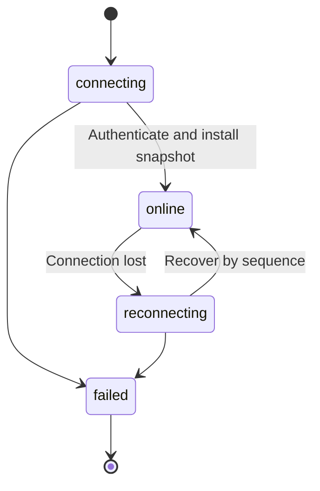
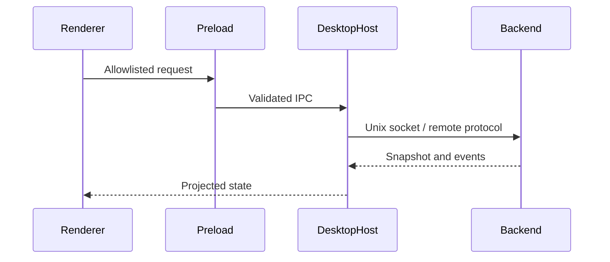
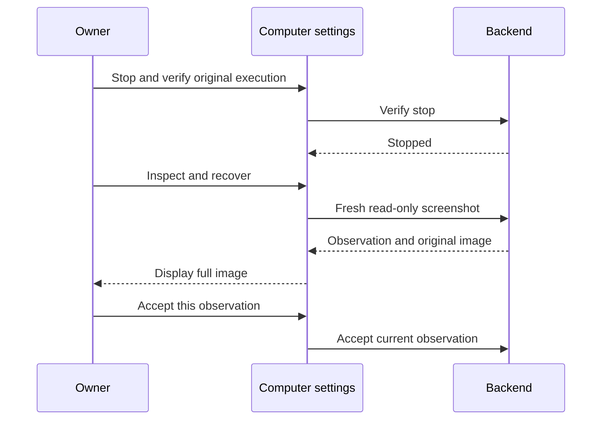

# Desktop Client

## Responsibilities and Boundaries

`apps/desktop/` provides graphical clients, primarily on macOS, for two **product targets**: local Coding and remote Personal. Coding connects to its Unix socket and exposes workspaces, conversation tabs, diffs, SubAgents and a terminal. Personal connects over Tailscale HTTPS/WSS to main conversation and background work.

The Node `DesktopHost` owns backend credentials. An allowlisted preload/IPC bridge exposes specific operations to React rendering, not arbitrary OS access. Shared projection belongs to [view](view.md), Coding execution to [runtime](runtime.md), and Personal persistence to [durable](personal-durable.md).

## Public Interfaces

| Host | Role |
| --- | --- |
| Electron + Chromium | Windows, notifications, Dock badge and OS-protected credential storage |
| Experimental MyGo, Go + WKWebView | Native web rendering with stdio to the same Node host; also supports the Coding native browser panel |

MyGo has one native browser WebView per main conversation. Go's `browser.Manager` owns lifecycle, placement, navigation generations and input gating. Private stdio frames carry Go→Node `browser_event` facts and control→Go `kind:"request"`/`kind:"response"` commands. Node uploads screenshots/snapshots through `desktop_browser_chunk` in ≤256 KiB pieces; the backend assembles by `command_id` and SHA256. The control connection fixes task provenance. Electron does not provide this channel.

| UI entry | Behavior |
| --- | --- |
| Spotlight, `⌘K` / search icon | Search this instance's workspace conversation titles and message bodies; highlight and navigate |
| Workspace sidebar | Add directories, select conversations, access mode and model |
| Timeline | Stream input, thinking, tools and question cards; completed Agent messages offer copy/branch; branches restore source-task traces |
| Composer | Grows to at most one third of window height; steering targets the running task's next boundary |
| Queue above composer | Move input up/down with mouse or keyboard, turn it into guidance and announce position |
| Inspector sidebar | Diffs, SubAgent progress, Git graph, read-only files and background logs |
| Terminal drawer | xterm.js terminal in the selected workspace |
| Code/PA Skills settings | Read-only paged catalog and diagnostics from that backend account's `$HOME/.agents/skills/` |
| Code/PA MCP settings | Coding instance services; Personal remote services, effect classes and original calls |
| Computer settings | Select fixed computer program/Linux sandbox, pause, verify stop and accept a fresh recovery image |

## Data and State

Coding state binds to local `controlDir` and `ViewState`; drafts stay client-side. Personal state binds to the remote HTTPS origin and WSS protocol, with pairing credentials protected by OS storage.

Settings drafts and original MCP calls are separate reads. Personal ordinary tools have owner-selected disallowed/read/write/unknown-effect states; new allowed tools and migrated ordinary tools default to unknown. The explicit v4 migration preserves service and credential references plus history; original computer recovery remains available.

| Managed object | Behavior |
| --- | --- |
| Private credential file | Ordinary editing retains binding; explicit rebind is submitted with the settings save |
| Unknown ordinary call | Calls section shows original parameters/result and offers explicit work finalization retaining uncertainty |
| Computer observation | Acceptance belongs only to the currently fully displayed fresh image; another observation or failed image load clears eligibility |

## Main Flows

Startup discovers the local Coding backend and starts it on demand when absent. Conversation switching loads history in bounded segments. Approval cards expose operation details before approve/reject.

### PA Configuration Saves

Model, MCP and computer edits save directly. Refresh retains drafts; save uses the current connection and latest revision, so another entry's simultaneous edits to the same object may be overwritten. Leaving settings is allowed while the result is unknown: the desktop retains the original submission and queries save/apply outcomes when reopened. Verification, withdrawal and recovery actions appear for exceptions or unapplied changes rather than every save.

### MCP Call Finalization and Computer Recovery

Personal's Calls section refreshes original calls and requires confirmation to end work. The result stays unknown; durable owns local stopping and final reporting. If the response is lost, refresh verifies the same call before the owner chooses what to do next.

Computer recovery follows three steps:

There is no separate public begin-recovery action. Old recovery-started records can still obtain a new image. Before stopping the entire Personal Linux sandbox, the UI confirms potential loss of unsaved state.

## Invariants and Failure Handling

- Rendering has no arbitrary filesystem/process access; the host/preload mediates operations.
- Pairing secrets use OS-protected storage rather than plaintext client configuration.
- Closing/crashing the desktop does not cancel backend Coding work; reopening recovers progress.
- Manual MCP finalization preserves original uncertainty and is distinct from computer-stop verification/image acceptance.
- Lost write responses are resolved from original records, not automatic resubmission. Incomplete or failed fresh-image display cannot authorize recovery.

## Design Rationale

- [Desktop client](../../.agents/notes/proposed/architecture/2026-10-15-desktop-client.md)
- [Shared history recovery](../../.agents/notes/implemented/architecture/2026-10-23-shared-history-recovery.md)
- [Desktop message actions](../../.agents/notes/implemented/feature/2026-10-28-desktop-message-actions.md)
- [Desktop spotlight search](../../.agents/notes/implemented/feature/2026-10-21-desktop-spotlight-search.md)
- [Personal tailscale https](../../.agents/notes/implemented/architecture/2026-10-24-personal-tailscale-https.md)
- [Home skills discovery](../../.agents/notes/implemented/simplification/2026-10-28-home-skills-discovery.md)
- [Mcp host responsibilities](../../.agents/notes/implemented/simplification/2026-10-26-mcp-host-responsibilities.md)
- [Desktop personal direct save](../../.agents/notes/implemented/simplification/2026-10-28-desktop-personal-direct-save.md)
