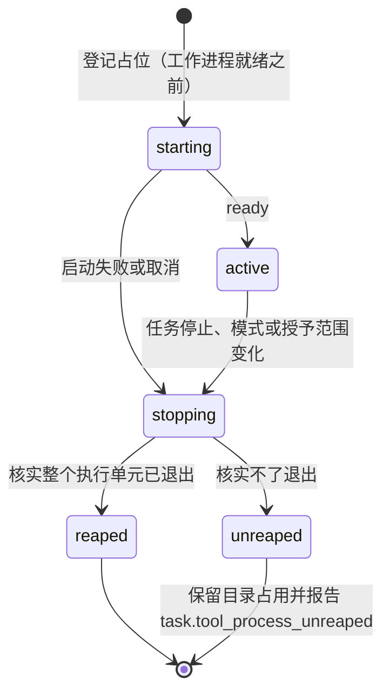
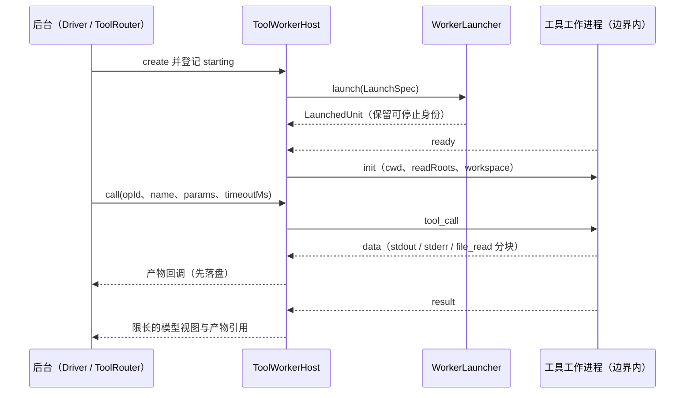
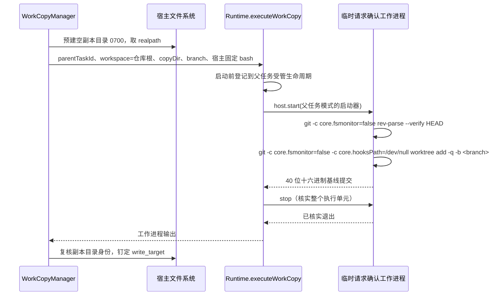

# 执行边界与工具工作进程

## 职责与边界

本篇负责把编码工具 `read` / `edit` / `write` / `bash` 的完整执行放进独立工具工作进程，再按后端与访问模式提供执行边界。两个产品的受限任务均经 `native` 使用 macOS Seatbelt 或 Linux bubblewrap；普通完全访问使用启动后台的当前账户，不施加任务沙箱；工作流编码验证始终收窄到原生沙箱的独立副本。它同时负责进程间协议、沿发起任务模式执行的 worktree 创建与汇总、目录身份复核、防旁路与整个执行单元的停止核实。

不负责的部分点名归属：工具的类别清单、可用性判定与执行画像归 [agent-tools](agent-tools.md)；审批闸门、是否需要审批与 auto-review 策略同样归 [agent-tools](agent-tools.md)，本篇只写越界操作在**执行侧**怎样落地——越界的外部文件读写与单次 HTTP 请求由后台的受信执行器完成，不进工作进程，参数不可替换、批准单次消费，闸门与策略见 [agent-tools](agent-tools.md)。委派语义（`mode`、`target`、写入目标钉定、目录占用键与串行规则）归 [runtime](runtime.md)；任务的访问模式、权限版本与提交幂等也归 [runtime](runtime.md)，本篇只承担它们在执行侧的后果：同一任务内按任务 ID、访问模式与授予路径复用工作进程，模式或授予范围变化时先停旧执行单元、核实已退出，再建立新环境。

`local` 后端以当前账户 spawn 一个独立进程组，没有隔离，供完全访问与库层离线测试使用；正式受限入口拒绝 local，不得据此宣称受限边界已经生效。

受限 JavaScript 的固定编排入口使用独立 Node 进程内的 QuickJS/WASM，只提供四类宿主回调。该库层入口不导入 runtime，不持久化运行；`script-worker/validate.ts` 使用同一 async 函数包装和 QuickJS compileOnly 做有界语法校验，不执行步骤。产品启动归 Runtime 与共享宿主工具；脚本的隔离与来源步骤采用何种工具访问模式分别确定。

浏览器是共享宿主工具，首版只在完全访问使用后台账户，不进入编码 worker 或受限沙箱。`packages/agent/src/browser-manager.ts` 直接启动并登记自有 Chrome 的 PID、进程组与系统启动身份，固定官方 CLI 只连接该 CDP；附接的 Chrome 不归宿主回收。关闭自有 Chrome 使用 CDP 退出并核实整个进程组与 profile 关联进程已退出；PID 身份不符或启动窗口不明时保留不可用。动作传输用官方 stdin batch 的单个参数数组，避免网页输入被解释为全局管理参数；配置/version sidecar 不符时拒绝 CLI 自动换代。详情见[宿主工具](agent-tools.md)与[运行时](runtime.md)。

## 对外接口

| 调用方 | 入口 | 说明 |
|---|---|---|
| Runtime | `createLauncherFor(config, mode)`、`Runtime.launcherFor(mode)` | `native` 的受限任务进入原生边界，`full_access` 共用当前账户启动器；`local` 只供库层开发与验证 |
| 后台（Driver、ToolRouter、委派流程） | `ToolWorkerHost.create(launcher, spec)`、`host.start()` | 先创建并登记宿主记录，再启动并等 `ready`；30 秒未就绪抛 `worker_timeout`，启动失败保留原原因与停止结论 |
| 后台 | `ToolWorkerHost.call({ opId, sdkCallId, name, params, timeoutMs })` | 发出一次工具调用；`opId` 是宿主分配的操作 ID、协议关联键，`sdkCallId` 只供上游工具内部使用、不作身份；超时抛 `tool_timeout` 并发出 `abort` |
| 后台 | `ToolWorkerHost.abort(opId)`、`ToolWorkerHost.stop()` | 中止单次调用；停止时发 `shutdown` 并停掉整个执行单元 |
| Runtime 的 worktree 创建与改动汇总 | `Runtime.executeWorkCopy({ parentTaskId, workspace, copyDir, branch, command, extraGrants })` | 归属活动 Driver 任务或运行派生的宿主操作任务，用临时工作进程按其固定模式执行宿主 bash；`bash` 超时 120 秒、宿主调用超时 150 秒 |
| `WorkCopyManager` | `prepareWriteTarget(...)`、`assertCopy(...)` | 判定修改目标是 Git worktree 还是直接写入根，逐项复核目录身份与 `.git` 指向；失效抛 `worktree_gone` |
| 已批准越界操作 | `packages/agent/src/execution/approved-ops.ts` | 后台受信执行器完成，不进工作进程；执行参数取自审批保存的不可变请求 |
| 受管执行单元登记表 | `packages/agent/src/managed-processes.ts` 的 `register` / `list` / `clear` | 每会话一份，登记可回收的执行单元身份 |
| 宿主编排调用方 | `WorkflowScriptHost`（`packages/agent/src/script-worker/host.ts`） | 先登记 `entry()` 启动占位，再 `run(script, input, invoke, options)`；`onIdentity` 在启动完成后交给宿主持久化实际身份；`identity()`、`output`、`stopFailure` 与重复 `stop()` 保留退出事实 |

正式入口仅接受 `RUUKOTO_EXECUTION_BACKEND=native` 或不设覆盖；旧 local/container 覆盖被拒。运行入口与部署步骤见 [usage](../usage.md)。

进程间是一条有界消息协议（`packages/agent/src/tool-worker/protocol.ts`）：stdio 上换行分帧的 JSON。

| 方向 | 消息 | 载荷 |
|---|---|---|
| 后台 → 工作进程 | `init` | `cwd`、`label`、可选 `readRoots`（宿主 realpath，可选 dev/ino）、可选 `workspace`（path/dev/ino） |
| | `tool_call` | `opId`、`sdkCallId`、`name`、`params`、可选 `timeoutMs` |
| | `abort` | `opId` |
| | `shutdown` | — |
| 工作进程 → 后台 | `ready` | `pid` |
| | `stopped` | `reaped`（已登记命令进程组的停止结论） |
| | `data` | `opId`、`stream`（`stdout` / `stderr` / `file_read`）、`chunk`（base64） |
| | `result` | `opId`、`ok`、`content`、可选 `details`、`isError`、`errorMessage` |
| | `fatal` | `message` |

`read` 按文件签名识别 JPEG、PNG、WebP，类型探测与上游读取复用同一次打开得到的原始字节；只读范围核实和符号链接限制同样适用于图片。原始字节只捕获一次，模型图像沿用 pi 的自动缩放，最大尺寸为 2000 × 2000。处理后的整个 JSON 结果帧超过 4 MiB 时，当前操作返回明确工具错误，已捕获原文仍可定稿与查询，后续工具可继续；不是对原始图片大小施加 4 MiB 上限。覆盖见 `test/07-read-images.test.ts`。

错误码：`execution_unavailable`（缺少受限后端、策略或宿主运行依赖）、`invalid_state`（启动器与模式不匹配）、`worker_timeout`（工作进程未就绪）、`tool_timeout`（调用超时）、`worktree_failed`（副本创建失败）、`worktree_gone`（副本目录被替换、删除或 `.git` 指向变化）。原生不可用另带 `binary_missing`、`policy_missing`、`sandbox_rejected` 或 `worker_failed` 原因；按进入受限 Node 的启动标记区分策略拒绝与 worker 失败，不解析 stderr 文案。

## 数据与状态

脚本入口只持有当前执行的内存状态。脚本与 JSON 参数经专用 stdio 协议发送，脚本原语为 `agent(key, params)`、`ask(key, params)`、`integrate(key, params)`、`progress(key, params)`，均返回解释器内 Promise。宿主回调收到递增请求 ID、类别、稳定键和 JSON 参数，并负责业务校验、持久化及名下实际步骤；本入口不把脚本返回视为整项工作的成功。`onActivity` 在发送 start/reply 前同步通知活动，只有最新序号的 idle 才通知空闲，供运行协调器核实人工停计。宿主步骤结果应返回具名 JSON；只有 `ScriptCallError` 表示可交脚本处理的拒绝，授权、协议与其他宿主错误终止执行。

启动工作进程的 `LaunchSpec`：

| 字段 | 含义 |
|---|---|
| `taskId` | 启动身份，用于关联任务及执行单元标签；普通 worker 用任务 ID，worktree 临时 worker 加独立后缀，生命周期仍归属实际父任务 |
| `mode` | 原生启动器接受受限访问策略 `confirm` / `auto-review`；计划模式使用后一策略；当前账户启动器接受 `full_access` |
| `workspace` | 授权工作区（realpath），也是工具执行目录 |
| `grantedPaths` | 拥有者为任务显式授予的工作区外路径，每项带 `path` / `access` / `purpose`，只读范围由平台策略或只读挂载实施；native 宿主在 launch 前保存每项 dev/ino，供每调用前复核 |
| `readRoots` | 宿主钉定的额外只读根（SubAgent 限定的资料范围、worktree 的共享 Git 目录），可带 dev/ino 供 `init` 复核；只读材料分析即使没有额外路径也显式下发空列表，由 worker 钉定其工作目录 |
| `workspaceIdentity` | 宿主钉定的工作区目录身份（dev/ino），供 `init` 复核 cwd |
| `env` | 宿主注入的环境聚合包，只在 worktree 副本创建与挂载副本的任务里出现（`GIT_CONFIG_COUNT` / `GIT_CONFIG_KEY_0` / `GIT_CONFIG_VALUE_0=safe.directory=*`）；其余任务恒为空，且不进工作进程复用键 |

受管执行单元登记表记录三种身份：`process_group`（local 进程组或 macOS 原生监督器，原生停止由监督器核实全部已归属后代）、`systemd_unit`（Linux 原生 user scope 或服务 helper 命令单元）、`starting`（ready 前的占位，同样参与停止）。原生执行每单元持有独立 HOME 与 TMPDIR，临时资料仅在停止已核实时删除；未核实时与目录占用一起保留。

local 的原进程组停止在 TERM/KILL 阶段预算内持续核实，短暂查询失败不会提前结束等待；查询超时与轮询休眠按剩余预算收紧，每阶段至少核实一次，预算耗尽后不再重查。成功查询确认无可执行成员或原组不存在才算已退出；仍无法核实时保留占用，不把查询错误当作退出证据。

写入目标落库在 `work_delegations.write_target`（可空）：

| 目标 | 字段 |
|---|---|
| Git 目标（`kind: "worktree"`） | `repoRoot`、`commonGitDir`、`gitdir`、`path`、`dev`、`ino`、`branch`、`baseCommit` |
| 非 Git 目标（`kind: "direct"`） | `path`、`dev`、`ino` |
| 只读分析工作 | `write_target` 为空，不能升级为写入；继续委派（`work_id`）沿用原目标，复用（`sub_agent_id`）承接新工作时另建副本 |

副本落盘位置与生命周期：每项工作一个宿主生成的 worktree，位于 `<dataDir>/../agent-work/worktrees/<workId>`（在保护根与父工作区之外），分支 `ruukoto/work-<workId>`，`gitdir` 为 `<commonGitDir>/worktrees/<workId>`，副本根与副本目录以 0700 创建；副本、分支与失败现场一律保留，不提供任何删除副本的入口。共享 Git 目录必须位于父工作区内，否则拒绝修改委派。

## 主要流程

### 固定脚本执行

入口只启动构建后的 `worker/workflow-script.mjs`，WASM 从同目录读取；启动 argv 不含脚本文本，环境只有固定 LANG。解释器不暴露 Node、文件、网络、凭据、时钟、随机数、模块或定时器；宿主输入与结果按 JSON 值交付，转换同样受执行时限约束。每批 64 个微任务让出事件循环，宿主等待不耗脚本执行预算；完成帧、通道排空、正常退出和原进程组停止核实都成立才返回成功。取消先阻止回调和迟到消息，并通知回调的 AbortSignal，再回收进程；调用方仍须停止已登记的实际步骤。

### 一次工具调用

主 Agent 等待时先结束其他工具调用，核实受管执行停止后才让出目录；停止失败保留占用及未核实事实。内部对话阶段不启动工具 worker 或 MCP，也不现场读取工作目录；恢复业务工具前重新取得占用并复核身份、原权限版本、资料来源和目录 dev/ino，竞争失败继续处理对话与等待。

### 原生受限执行

两个产品的正式入口默认 `native`，`--execution` 与 `RUUKOTO_EXECUTION_BACKEND` 只接受 native；显式 container/local 被拒并提示迁移，库层仍可注入 local。原生 worker 使用实际宿主 UID/GID、补充组与 ACL，通过宿主 Node 和构建出的 `worker/worker.mjs` 运行；只读提供 SDK 依赖、选定工具安装版本与实际动态库，不开放整个 HOME、工具资料父目录、源码根、后台数据或控制面。原生工作区必须有钉定 dev/ino，授予与只读根使用真实路径，重叠只读祖先与读写子授权被拒。保护范围和已批准操作共用物理 dev/ino 祖先判定，不因 `/System/Volumes/Data` 等别名放开同一保护目录。

原生启动和 worker init 复核工作区与带身份的只读根；宿主在 launch 前另为全部 grantedPaths 保存 dev/ino，每次 `ToolWorkerHost.call` 合并这三类身份重新核实。调用前发现工作区、只读根或任一读写/只读授予被替换或无法读取，先请求停止旧单元，再拒绝发送命令，未核实停止仍保留占用。白名单环境使用每单元 HOME/TMPDIR，不继承凭据、代理、SSH agent、控制面或 systemd bus 变量；只额外接受宿主固定 Git 配置。汇总补丁写在独立临时目录内，资料仅在已核实停止后删除。

启动与每调用前还遍历显式授权文件树，按目录 dev/ino 去重，文件条目按父目录 dev/ino 加真实 basename 只计一次；显式文件名须精确匹配 readdir，Data 路径、APFS 大小写或 Unicode 别名不能充当另一个授权条目。nlink 大于 1 的文件全部目录条目须在同等级授权内；范围外名字、同一对象的只读/读写冲突或复核变化明确拒绝，同权限范围内的硬链接可用。遍历不跟随符号链接、不扫描保护目录或真实凭据树，成本随授权树条目数增加。Seatbelt 和只读 bind 的路径规则不能单独保证预存硬链接别名只读，因此该入口检查同时用于两平台。

| 平台 | 边界与前置 | 停止核实 |
|---|---|---|
| macOS | `sandbox-exec` 的 deny-default Seatbelt 策略；仅授权根可写、必要运行依赖只读，文件规则使用真实路径，网络与外部 IPC 默认拒绝；`npm run build:native` 用系统 clang 构建宿主监督器 | 启动前保存同 UID 身份基线，任务存活期累计后代；libproc 同次读取出生时间、uniqueid 与 pidversion，信号由 audit token 在内核原子核实身份后发送 |
| Linux | `/usr/bin/bwrap`、AppArmor userns 配置、cgroup v2 与可委派的 user systemd scope；完整 namespace、只读基础根和受限挂载；seccomp 拒绝 socket/connect/发送与 io_uring，包含 abstract Unix socket | PID namespace 拆除回收后代，user scope 的 `cgroup.kill` 提供第二道回收；成功查询单元退出与 cgroup 无成员才返回 true |

macOS 监督器关闭自己的状态和控制 FD 后才 exec worker，可信 Node 在独立临时目录写启动标记，再加载 SDK。身份查询无结果最多同 PID 重核三次，只有明确退出或完整合法身份可以接受；持续失败与损坏字段保留未知。观察中断、身份不可用或信号失败保持未核实；停止后留 100ms 收敛窗口，以连续完整采样核实最终残留。当前父 uniqueid 会随收养改变；仅当前父为 PID 1 不足以判外部进程，原父 pidversion 也须匹配启动前 PID 1 身份。PID 1 用可跨 UID 的 libproc flavor 17 核实，失败或 root 初始版本不大于 PID 1 版本时禁用排除。未知新寿命按单调分配的 uniqueid 判出生顺序；看到新寿命或已知成员的无符号 pidversion 低于 root 初始版本，标回卷并保留占用，其他未知同 UID 孤儿也不发送信号且返回 false。pidversion 为可回卷的 32 位序列，轮询也不是不可逃逸的内核成员集合，未核实后代仍可能继续写工作区，因此保留占用并等待拥有者核实。Linux 的安装与核实入口见 [原生部署前置](../../deploy/native/README.md)。

### Linux 常驻前提与临时资料

个人后台由系统级 service 以实际账户运行。安装时为该账户启用 linger，确保 user manager 在开机后与退出登录后持续运行；系统服务固定正确的 `XDG_RUNTIME_DIR` 与 `DBUS_SESSION_BUS_ADDRESS`，并在 user manager 就绪后启动。user bus 只供可信 launcher 管理 scope，不传入受限 worker。bubblewrap/AppArmor、cgroup v2、scope 委派与 `cgroup.kill` 都必须可用；安装与核实步骤见 [systemd 部署](../../deploy/systemd/README.md)。后台单元的 `KillMode` 不证明独立 user scope 已退出。

每个原生单元的 HOME/TMPDIR 使用宿主临时磁盘，没有单任务容量上限，也不设置 CPU、内存、PID 或工作区容量配额。核实整个执行单元停止后才删除临时资料；无法核实时保留现场与目录占用。

完全访问任务不进受限沙箱，由后台直接以当前账户启动。用户环境与宿主固定 Git 环境合并后剔除内部 Ruukoto 变量，不增加代理、SSH agent 或执行入口配置。ready 前中断同样由 `starting` 占位覆盖。

### worktree 副本的受限创建

创建命令由宿主写定，逐项：

1. 仓库根从修改目标向上做纯文件系统查找（不运行 git、不越出父工作区）；共享 Git 目录必须位于父工作区内，否则拒绝。
2. 宿主在 worker 启动前预建空副本目录（0700），目录非空即视为失败残留，不自动认领或覆盖。
3. 创建命令、挂载与 `write_target.path` 一律用 `copyDirReal = fs.realpathSync(copyDir)`，以抹平 macOS TMPDIR 的 `/var → /private/var` 符号链接。
4. 工作进程按父任务模式执行宿主固定的 bash：`git -c core.fsmonitor=false rev-parse --verify HEAD` 取基线，`git -c core.fsmonitor=false -c core.hooksPath=/dev/null worktree add -q -b <branch> <copyDirReal> "$base"` 建副本；基线按 40 位十六进制从输出提取，提不到即 `worktree_failed`。父任务已有父工作区占用，临时执行另取副本占用；并发 Git 元数据操作由 git 自身的锁处理。
5. 受限工作进程的挂载：workspace 为仓库根，副本目录读写挂载；父仓库本身是 worktree 时，共享 Git 目录另作一次读写授予，否则 `extraGrants` 为空。
6. 副本目录身份（dev/ino）与 `path` 写进 `write_target`；子任务的 `LaunchSpec` 把工作区指向副本、共享 Git 目录作 `readRoots` 只读挂载。

### 受管执行单元的停止与回收

1. 停止入口核实已归属的执行单元：原生单元按平台协议核实；Linux user scope 必须确认 cgroup 无可执行成员。当前账户的 worker 在 Shell 主进程结束和 shutdown 时停止各已登记的命令进程组，再发送 `stopped` 应答；宿主同时核实 worker 原进程组。完全访问必须两项结论都为 true；无应答、查询失败或残留均保留占用，主 PID 消失不足以结束核实。
2. 同一执行记录的并发、重复停止共享一次停止结果。未创建单元的启动失败无需回收；已创建后返回 false 或抛错均保留未核实结论与身份，不因通信句柄关闭、启动 Promise 拒绝或登记清理改成成功。
3. 任务的自然完成、失败、取消与模式切换均等待受管单元的停止核实；单个停止失败不跳过其他单元。只有核实退出才释放目录占用，核实不了时保留占用并报告 `task.tool_process_unreaped`；模式切换记为 `mode_switch_unverified`。
4. 队列启动前复核写入目标的目录身份，被替换或消失即失败、不自动重建；占用键与串行规则见 [runtime](runtime.md)。

### 已批准越界操作的执行

越界的外部文件读写与单次 HTTP 请求由后台的受信执行器完成，不进工作进程。文件操作逐段 `lstat`、拒绝符号链接组件，最终以 `O_NOFOLLOW` 打开；打开后 `fstat` 的 dev/ino 必须与批准时的对象身份一致，写入前校验原文的 sha256 指纹，变化即失败并要求重新申请；后台数据、服务凭据与控制面目录始终排除。HTTP 请求不自动跟随重定向，也不重试；连接固定到批准时解析出的地址，凭据只在目标主机与预配置的绑定一致时注入；批准一个 HTTP 请求不会给脚本开放网络。

## 不变量与失败处理

### 受限脚本

`SCRIPT_LIMITS` 固定脚本 128 KiB、每帧 1 MiB、排队输出 4 MiB、未决请求 32 个、进度 256 次及 256 KiB、QuickJS 堆 32 MiB、栈 256 KiB；WASM 线性内存最多 64 MiB，Node V8 old space 64 MiB。这些分别约束解释器和载荷，不能合称进程 RSS 上限。父进程计入每次发送至相应 idle 的累计墙钟时间，默认 10 秒，宿主只能收窄；WASM 初始化另限 10 秒。无宿主请求的悬空 Promise、漏 await 的调用、越限和损坏帧均失败，不能静默等待或返回成功。

父进程计时独立于解释器，中断回调不是长内建操作的及时中止保证。异常中断后由进程退出回收整个 WASM，正常路径释放 Promise、上下文与运行时；停止核实 false 或抛错保留身份、结果、失败原因，调用方不得释放相关占用或重放步骤。该固定 worker 没有派生外部进程的接口；如需增加这种能力，必须重新核实整个执行单元的回收范围。

### 工具工作进程

- 工作进程只执行 `read`、`edit`、`write`、`bash`，白名单之外的名字一律拒绝；不加载任何项目自动发现的可执行扩展或可执行文件。
- 工作进程协议不提供审批与模式切换；参数经结构化消息传递，从不拼进启动器的 shell 命令。完全访问能访问同账户的后台数据、凭据与令牌，控制面认证不构成对该进程的文件隔离。
- 完全访问继承后台的用户环境，包括 PATH、HOME、代理、SSH agent 与工具凭据，并合并宿主固定 Git 环境；内部 `RUUKOTO_OWNER_TOKEN` / `RUUKOTO_OWNER_TOKEN_FILE` / `RUUKOTO_CONTROL_DIR` / `RUUKOTO_CODE_CONTROL_DIR` 被清除，其余用户工具环境保留，环境值不进入诊断。受限原生使用白名单环境；库层 local 的受限模拟只保留五项基本环境。
- 宿主工具一律声明 `executionMode: "sequential"`：工作进程按「工具名 → 当前调用」关联原始输出流，同一轮并发的同名调用会串流。
- 正文捕获在工作进程侧完成：经 `BashOperations.onData` 与文件 Operations 包装器，在上游工具截断之前把原始输出与文件正文流回后台；后台先存为任务产物，再生成限长的模型视图，并在工具结果里附产物引用。中断或写失败保留已捕获部分并标 partial。
- 协议有界：单帧上限 `MAX_FRAME_BYTES` 为 4 MiB，正文数据按 `DATA_CHUNK_BYTES` 为 512 KiB 分块并以 base64 传输，写入侧有背压。
- 工作进程启动超时 30 秒（`worker_timeout`）；`ready` 或初始化发送失败时先停止再抛原错误，停止未核实保留到任务收尾。启动中取消阻止迟到的工作进程服务；单次调用超时（`tool_timeout`）由工作进程中止执行。

### 执行边界

- 受限执行单元按任务建立，不复用给后续任务；任务内按 ID、模式与授予范围复用，变化时先核实旧单元已停止再重建。进程组 TERM/KILL 失败仍在原预算内核实退出，持续权限或查询失败保留占用。
- 单次批准不改变沙箱权限：批准的结构化操作不变成后续 Shell 可复用的文件或网络授权。
- 工作区与授予一律使用宿主真实路径；模型看到的 cwd、拥有者给出的绝对路径与 `request_file_access` 的宿主路径保持一致。
- 原生 worker 不继承宿主凭据、SSH agent、代理或控制面；项目内自带的秘密属于已授权内容，沙箱不会识别或隐藏它们。
- 原生受限任务不获得宿主 root 权限。缺少受限后端、策略或运行依赖时以 `execution_unavailable` 明确失败，不静默改用当前账户无沙箱执行。
- 完全访问免操作审批，使用后台启动账户已有的文件、网络与工具权限，不额外授予 root 或其他账户身份，也不需要执行启停配置或工作区 ACL。
- 完全访问停止覆盖原 worker 组及 worker 已登记的命令组；强制崩溃未取得命令组停止应答即记未核实。主动脱离已登记组、另行提权的进程与外部服务不承诺随任务停止；取消与模式切换不撤销已发生的外部效果。
- macOS 原生累计身份有轮询窗口，最终未知后代须保留占用；`local` 后端没有任务沙箱，不据此宣称受限隔离已生效。

### Git 与副本

- 创建与汇总的临时工作进程启动前登记到实际父任务，并由父任务临时占用副本目录，参与取消、后台停止和模式变化。核实停止成功后只释放该副本占用，允许子任务执行；停止未核实时抛 `worker_stop_unverified`，保留父目录与副本占用、成果和已知 Git 结果，阻止其他会话或子任务并发写入，不能自动重放 Git。副本创建尚未登记工作行时，仍可按父任务的执行记录定位现场。
- 宿主不直接执行 git。仓库 hooks 与 config 可被任务写入，后台直接运行 git 会让植入的 fsmonitor 或 filter 越过执行边界。
- 创建命令显式关掉这些执行入口：hooks 用 `core.hooksPath=/dev/null` 跳过，`core.fsmonitor` 显式关闭。
- 基线为委派时仓库 HEAD 指向的提交，父工作区未提交的改动不进副本；子任务不 `git add`、不 `git commit`、不推送，改动留在工作树由主 Agent 汇总。任务首行写明工作目录、分支、基线与「不要 git add/commit，改动留在工作树由主 Agent 汇总」。
- 共享 Git 目录对子任务只读：可 `status` / `diff` / `log`，不能 `add` / `commit`、不能写 refs、hooks 或 config。共享目录可写时子任务能改 hooks 或 `core.fsmonitor`，之后会在拥有者自己的 git 中执行。完全访问不施加这项 OS 只读隔离，宿主仍传递共享 Git 范围与目录身份。
- 工作副本相关 worker 合并宿主固定的 `GIT_CONFIG_COUNT` / `GIT_CONFIG_KEY_0` / `GIT_CONFIG_VALUE_0=safe.directory=*`；其余任务不传这组环境。
- 修改子任务沿本次发起任务模式，完全访问共用当前账户、受限模式使用产品后端；工具仅有 `read` / `edit` / `write` / `bash` / `read_artifact`，不能通过工具参数增加授权或委派下级；受限模式默认无网络。复用从只读切换到修改时重建 SDK 会话。
- `init` 下发并核实 `readRoots` 与工作区 dev/ino；macOS 与 Linux 均保留真实数值身份。
- 写预检以实际宿主账户的 `accessSync` 核实，包括补充组与 ACL。
- 副本防旁路：覆盖 `agent-work/worktrees` 或其下位置的读写授予被拒（`validateGrantedPaths`；只读授予仍允许）。副本只能经委派范围访问。
- worktree 被删除、目录被替换或 `.git` 指向变化后继续委派明确失败（`worktree_gone`），不自动重建、不凭旧记录套用。
- 创建失败保留现场，错误信息含副本路径与分支；任务取消或退出不删除副本、分支与写入根的改动。

### 已批准操作的消费与失败定性

- 执行参数完全取自审批保存的不可变请求，工作进程或模型不能提交批准 ID 后自行替换参数；批准由 SQLite 条件更新单次消费，`consumed_at` 即执行开始。
- 消费后的失败定性：GET / HEAD 失败一律是已知错误；其他方法以请求交给操作系统发出为界，之前失败（连接被拒、TLS、凭据）是已知错误，之后失败（等响应超时、连接重置、任务停止中止）标 `effect_unknown`，不自动重发。
- 任务停止即中止在途请求，不等超时。

[工作流编码验证](workflows.md)始终用原生沙箱，只写按冻结基线/补丁建立的独立验证副本；来源完全访问也在验证阶段收窄，附加路径转只读，宿主文件写入口关闭。原生环境不可用明确失败，不回退到 local。工作流宿主操作的副本占用保持到全部套用与组合检查收尾，实际身份更新原 starting 句柄，取消后的身份仍保存。

## 设计依据

- [等待让出与唯一报告归属](../../.agents/notes/implemented/architecture/2026-10-14-agent-wait-and-report-ownership.md)

- [会话浏览器的归属与不重放](../../.agents/notes/implemented/feature/2026-10-14-agent-browser.md)

- [工作流真实步骤与冻结成果](../../.agents/notes/implemented/architecture/2026-10-13-workflow-step-capabilities.md)

- [具名宿主执行](../../.agents/notes/implemented/architecture/2026-10-13-workflow-runtime-and-store.md)：短期任务持有 worker、账本与目录占用，停止未核实保留。

- [QuickJS/WASM 脚本隔离](../../.agents/notes/implemented/architecture/2026-10-13-workflow-script-isolation.md)：固定入口、资源保证、回收及四格实验依据。

- [内置 read 从同一受限读取恢复图片结果](../../.agents/notes/implemented/bug-fix/2026-10-12-read-images.md)：图片类型探测、原始捕获与超限失败的接法。
- [个人 Agent 复用原生受限执行并退役 Docker worker](../../.agents/notes/implemented/architecture/2026-10-12-personal-native-sandbox.md)：统一正式入口、常驻服务器前置、宿主身份及无临时空间配额的取舍。

- [完全访问使用启动账户且不请求审批](../../.agents/notes/implemented/feature/2026-10-12-full-access-current-account.md)：用户环境、无沙箱执行与停止核实的范围。

- [Coding Agent 使用原生执行沙箱](../../.agents/notes/implemented/architecture/2026-10-10-native-execution-sandbox.md)：两平台边界、部署前置与 macOS 未核实残留的保留规则。

- [执行单元的停止未核实结果保留到任务收尾](../../.agents/notes/implemented/bug-fix/2026-10-11-preserve-unverified-worker-stop.md)

- [工具工作进程与受限任务容器](../../.agents/notes/implemented/architecture/2026-09-20-tool-worker-per-task-container.md)：解释共享工作进程、有界消息协议与停止核实的原始决定；受限后端选择由原生决定接管。
- [SubAgent 修改委派每项工作使用独立 worktree](../../.agents/notes/implemented/architecture/2026-10-04-subagent-worktrees.md)：解释副本位置与分支、宿主永不执行 git、预建空副本目录、共享 Git 目录只读、`safe.directory` 注入与目录身份只按路径钉定的理由。
- [访问模式由技术边界实施，完全访问须拥有者显式选择](../../.agents/notes/implemented/feature/2026-09-19-explicit-access-modes.md)：解释权限为什么是技术约束、缺少隔离机制时明确失败而不降级，以及控制面身份校验。
- [退役专用 GitHub 模块，GitHub 作为普通 MCP 工具](../../.agents/notes/implemented/simplification/2026-09-23-retire-github-module.md)：解释为什么没有 GitHub 专用的执行路径——它与其他 MCP 服务共用本篇的边界、审批与结果保存流程。
