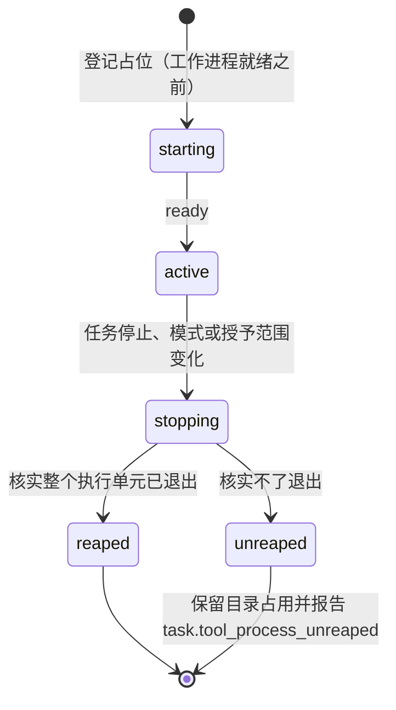
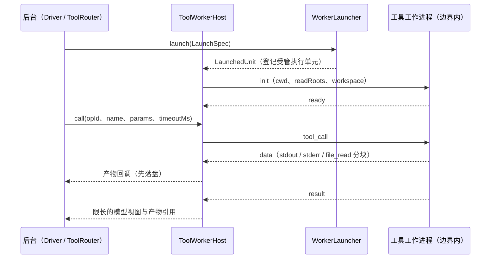
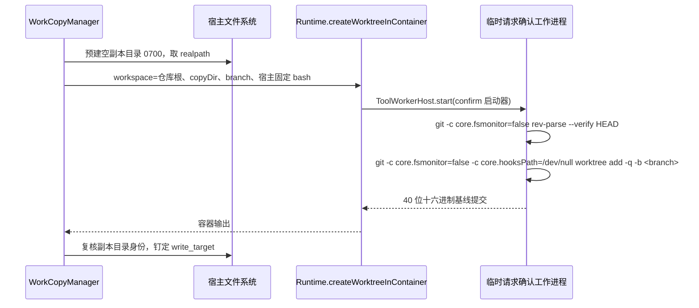

# 执行边界与工具工作进程

## 职责与边界

本篇负责把编码工具 `read` / `edit` / `write` / `bash` 的完整执行（含上游工具内部的路径解析与自由 Shell 子进程）放进独立的工具工作进程，并把这个进程放进与访问模式匹配的执行边界：请求确认模式与自动审查模式使用按任务建立的 Linux 容器，完全访问模式使用专用执行账户、由 systemd 启动。它同时负责工具工作进程之间的进程间协议、worktree 副本的容器内创建与挂载、容器内外目录身份（dev/ino）的一致性、副本写入的防旁路，以及受管执行单元的登记与回收核实。

不负责的部分点名归属：工具的类别清单、可用性判定与执行画像归 [agent-tools](agent-tools.md)；审批闸门、是否需要审批与 auto-review 策略同样归 [agent-tools](agent-tools.md)，本篇只写越界操作在**执行侧**怎样落地——越界的外部文件读写与单次 HTTP 请求由后台的受信执行器完成，不进工作进程，参数不可替换、批准单次消费，闸门与策略见 [agent-tools](agent-tools.md)。委派语义（`mode`、`target`、写入目标钉定、目录占用键与串行规则）归 [runtime](runtime.md)；任务的访问模式、权限版本与提交幂等也归 [runtime](runtime.md)，本篇只承担它们在执行侧的后果：同一任务内按任务 ID、访问模式与授予路径复用工作进程，模式或授予范围变化时先停旧执行单元、核实已退出，再建立新环境。

`local` 后端以当前账户 spawn 一个独立进程组，没有隔离，只用于开发与验证；它生效时启动打印无隔离警告，不得据此宣称受限边界已经生效。

## 对外接口

| 调用方 | 入口 | 说明 |
|---|---|---|
| Runtime | `createLauncherFor(config, mode)`、`Runtime.launcherFor(mode)` | 按后端配置与访问模式选启动器：`container` 后端下 `full_access` 走 systemd 启动器，`confirm` 与 `auto-review` 走容器启动器；`local` 走后端自身 |
| 后台（Driver、ToolRouter、委派流程） | `ToolWorkerHost.start(launcher, spec)` | 启动工作进程并等 `ready`；30 秒未就绪抛 `worker_timeout`，失败时先回收执行单元再抛错 |
| 后台 | `ToolWorkerHost.call({ opId, sdkCallId, name, params, timeoutMs })` | 发出一次工具调用；`opId` 是宿主分配的操作 ID、协议关联键，`sdkCallId` 只供上游工具内部使用、不作身份；超时抛 `tool_timeout` 并发出 `abort` |
| 后台 | `ToolWorkerHost.abort(opId)`、`ToolWorkerHost.stop()` | 中止单次调用；停止时发 `shutdown` 并停掉整个执行单元 |
| Runtime 的 worktree 创建与改动汇总 | `Runtime.createWorktreeInContainer({ workspace, copyDir, branch, command, extraGrants })` | 用临时的请求确认工作进程执行宿主固定的 bash，创建时 `bash` 超时 120 秒、宿主调用超时 150 秒 |
| `WorkCopyManager` | `prepareWriteTarget(...)`、`assertCopy(...)` | 判定修改目标是 Git worktree 还是直接写入根，逐项复核目录身份与 `.git` 指向；失效抛 `worktree_gone` |
| 已批准越界操作 | `packages/agent/src/execution/approved-ops.ts` | 后台受信执行器完成，不进工作进程；执行参数取自审批保存的不可变请求 |
| 受管执行单元登记表 | `packages/agent/src/managed-processes.ts` 的 `register` / `list` / `clear` | 每会话一份，登记可回收的执行单元身份 |
| 部署入口 | `deploy/systemd/ruukoto-exec-launch.sh`、`deploy/systemd/ruukoto-exec-stop.sh` | root 拥有、只放行固定参数的 sudo 包装入口；`RUUKOTO_EXEC_LAUNCH_SCRIPT` 与 `RUUKOTO_EXEC_STOP_SCRIPT` 两个都设置才算配置了该入口 |

相关的配置键：`RUUKOTO_EXECUTION_BACKEND`、`RUUKOTO_WORKER_IMAGE`、`RUUKOTO_CONTAINER_UID` / `RUUKOTO_CONTAINER_GID`、`RUUKOTO_DOCKER_PATH`、`RUUKOTO_EXEC_UID` / `RUUKOTO_EXEC_GID`、`RUUKOTO_WORKER_PATH`、`RUUKOTO_EXEC_SUDO`、`RUUKOTO_EXEC_LAUNCH_SCRIPT`、`RUUKOTO_EXEC_STOP_SCRIPT`。运行入口、部署步骤与镜像构建见 [usage](../usage.md)。

进程间是一条有界消息协议（`packages/agent/src/tool-worker/protocol.ts`）：stdio 上换行分帧的 JSON。

| 方向 | 消息 | 载荷 |
|---|---|---|
| 后台 → 工作进程 | `init` | `cwd`、`label`、可选 `readRoots`（宿主 realpath，可选 dev/ino）、可选 `workspace`（path/dev/ino） |
| | `tool_call` | `opId`、`sdkCallId`、`name`、`params`、可选 `timeoutMs` |
| | `abort` | `opId` |
| | `shutdown` | — |
| 工作进程 → 后台 | `ready` | `pid` |
| | `data` | `opId`、`stream`（`stdout` / `stderr` / `file_read`）、`chunk`（base64） |
| | `result` | `opId`、`ok`、`content`、可选 `details`、`isError`、`errorMessage` |
| | `fatal` | `message` |

错误码：`execution_unavailable`（缺少后端、镜像、CLI 或身份配置）、`invalid_state`（启动器与模式不匹配）、`worker_timeout`（工作进程未就绪）、`tool_timeout`（调用超时）、`worktree_failed`（副本创建失败）、`worktree_gone`（副本目录被替换、删除或 `.git` 指向变化）。

## 数据与状态

启动工作进程的 `LaunchSpec`：

| 字段 | 含义 |
|---|---|
| `taskId` | 任务 ID，也是容器名与 systemd 单元名的来源 |
| `mode` | 任务的访问模式；容器启动器只接受 `confirm` 与 `auto-review`，systemd 启动器只接受 `full_access` |
| `workspace` | 授权工作区（realpath）；同时是容器工作目录 |
| `grantedPaths` | 拥有者为该任务显式授予的工作区外路径，每项带 `path` / `access` / `purpose`，只读授予加 `:ro` |
| `readRoots` | 宿主钉定的额外只读根（SubAgent 限定的资料范围、worktree 的共享 Git 目录），可带 dev/ino 供 `init` 复核 |
| `workspaceIdentity` | 宿主钉定的工作区目录身份（dev/ino），供 `init` 复核 cwd |
| `env` | 宿主注入的环境聚合包，只在 worktree 副本创建与挂载副本的任务里出现（`GIT_CONFIG_COUNT` / `GIT_CONFIG_KEY_0` / `GIT_CONFIG_VALUE_0=safe.directory=*`）；其余任务恒为空，且不进工作进程复用键 |

受管执行单元登记表记录四种可回收身份：`process_group`（本地工作进程，pgid 等于主 pid）、`container`（任务容器，按容器名停止）、`systemd_unit`（完全访问的执行账户单元）、`starting`（工作进程就绪之前的占位，让启动窗口同样在停止路径的覆盖内）。

写入目标落库在 `work_delegations.write_target`（可空）：

| 目标 | 字段 |
|---|---|
| Git 目标（`kind: "worktree"`） | `repoRoot`、`commonGitDir`、`gitdir`、`path`、`dev`、`ino`、`branch`、`baseCommit` |
| 非 Git 目标（`kind: "direct"`） | `path`、`dev`、`ino` |
| 只读分析工作 | `write_target` 为空，不能升级为写入；继续委派（`work_id`）沿用原目标，复用（`sub_agent_id`）承接新工作时另建副本 |

副本落盘位置与生命周期：每项工作一个宿主生成的 worktree，位于 `<dataDir>/../agent-work/worktrees/<workId>`（在保护根与父工作区之外），分支 `ruukoto/work-<workId>`，`gitdir` 为 `<commonGitDir>/worktrees/<workId>`，副本根与副本目录以 0700 创建；副本、分支与失败现场一律保留，不提供任何删除副本的入口。共享 Git 目录必须位于父工作区内，否则拒绝修改委派。

## 主要流程

### 一次工具调用

容器按任务建立，参数固定：

| 参数 | 值 |
|---|---|
| 镜像 | 固定 `ruukoto-worker`（`RUUKOTO_WORKER_IMAGE`，缺省 `ruukoto-worker:latest`），由可信身份按 `deploy/worker-image/` 构建，不内置特权入口 |
| 用户 | `--user <uid>:<gid>`，缺省 1000:1000，非 root |
| 能力 | `--cap-drop ALL`、`--security-opt no-new-privileges` |
| 根文件系统 | `--read-only`，另有单独可写的 `--tmpfs /tmp:rw,nosuid,size=64m` |
| 网络 | `--network none`，默认无网络 |
| 挂载 | 工作区 `-v 
:
` 并作为工作目录；任务级授予路径 `-v 
:
`，只读授予加 `:ro`；宿主钉定的只读根 `-v 
:
:ro` |
| 环境 | `PATH=/usr/local/bin:/usr/bin:/bin`；worktree 创建与挂载副本时另注入 `safe.directory` 聚合包 |
| 容器名 | `ruukoto-task-<taskId>-<后台 pid 的 36 进制>`，启动前先清理同名遗留 |
| 进程入口 | 镜像内固定路径 `/opt/ruukoto/worker/worker.mjs` |

完全访问任务不进容器，由 systemd 以固定执行 UID 启动：`systemd-run --pipe --wait --uid --gid --unit ruukoto-exec-<taskId> --property KillMode=control-group`；生产经 root 拥有、只放行固定参数的 sudo 包装入口启动与停止。工作进程就绪之前的中断同样经由 `starting` 占位回收执行单元。

### worktree 副本的容器内创建

创建命令由宿主写定，逐项：

1. 仓库根从修改目标向上做纯文件系统查找（不运行 git、不越出父工作区）；共享 Git 目录必须位于父工作区内，否则拒绝。
2. 宿主在容器启动前预建空副本目录（0700）。挂载源不存在时 Docker 会以 root 自动创建、容器内 uid 写 `.git` 被拒，所以副本目录必须先在宿主侧存在；目录非空即视为失败残留，不自动认领或覆盖。
3. 创建命令、挂载与 `write_target.path` 一律用 `copyDirReal = fs.realpathSync(copyDir)`，以抹平 macOS TMPDIR 的 `/var → /private/var` 符号链接。
4. 容器内执行宿主固定的 bash：`git -c core.fsmonitor=false rev-parse --verify HEAD` 取基线，`git -c core.fsmonitor=false -c core.hooksPath=/dev/null worktree add -q -b <branch> <copyDirReal> "$base"` 建副本；基线提交按 40 位十六进制从容器输出提取，提不到即 `worktree_failed`。这一步不取父会话的目录占用（父任务正持有占用，取则自锁），并发由 git 自身的锁处理。
5. 模板请求确认工作进程的挂载：workspace 为仓库根，副本目录读写挂载；父仓库本身是 worktree 时，共享 Git 目录另作一次读写授予，否则 `extraGrants` 为空。
6. 副本目录身份（dev/ino）与 `path` 写进 `write_target`；子任务的 `LaunchSpec` 把工作区指向副本、共享 Git 目录作 `readRoots` 只读挂载。

### 受管执行单元的停止与回收

1. 停止入口停掉整个执行单元：容器是 `docker kill` 加 `docker rm -f`，再以 `docker inspect` 失败（容器已不存在）作为核实；systemd 单元由包装脚本自己完成 stop 与 `is-active` 判定（退出码 0 = 已不在活动），直连路径以 `systemctl is-active` 不是 `active` 为核实；本地进程组先 `SIGTERM`、等待、再 `SIGKILL`。
2. 只有核实到整个单元（含子进程与 cgroup）已退出，才释放目录占用。
3. 核实不了退出时保留目录占用并报告 `task.tool_process_unreaped`；模式切换的同一情形记为 `mode_switch_unverified`。
4. 队列启动前复核写入目标的目录身份，被替换或消失即失败、不自动重建；占用键与串行规则见 [runtime](runtime.md)。

### 已批准越界操作的执行

越界的外部文件读写与单次 HTTP 请求由后台的受信执行器完成，不进工作进程。文件操作逐段 `lstat`、拒绝符号链接组件，最终以 `O_NOFOLLOW` 打开；打开后 `fstat` 的 dev/ino 必须与批准时的对象身份一致，写入前校验原文的 sha256 指纹，变化即失败并要求重新申请；后台数据、服务凭据与控制面目录始终排除。HTTP 请求不自动跟随重定向，也不重试；连接固定到批准时解析出的地址，凭据只在目标主机与预配置的绑定一致时注入；批准一个 HTTP 请求不会给脚本开放网络。

## 不变量与失败处理

### 工具工作进程

- 工作进程只执行 `read`、`edit`、`write`、`bash`，白名单之外的名字一律拒绝；不加载任何项目自动发现的可执行扩展或可执行文件。
- 工作进程拿不到审批、模式切换或控制面凭据；参数经结构化消息传递，从不拼进启动器的 shell 命令。
- 工作进程的环境是最小环境：只保留 `PATH`、`HOME`、`LANG`、`LC_ALL`、`TMPDIR`，不传凭据、SSH agent、代理配置与 `RUUKOTO_*` 控制面变量。
- 宿主工具一律声明 `executionMode: "sequential"`：工作进程按「工具名 → 当前调用」关联原始输出流，同一轮并发的同名调用会串流。
- 正文捕获在工作进程侧完成：经 `BashOperations.onData` 与文件 Operations 包装器，在上游工具截断之前把原始输出与文件正文流回后台；后台先存为任务产物，再生成限长的模型视图，并在工具结果里附产物引用。中断或写失败保留已捕获部分并标 partial。
- 协议有界：单帧上限 `MAX_FRAME_BYTES` 为 4 MiB，正文数据按 `DATA_CHUNK_BYTES` 为 512 KiB 分块并以 base64 传输，写入侧有背压。
- 工作进程启动超时 30 秒（`worker_timeout`）；`ready` 失败时先回收执行单元再抛错，不留孤儿容器或进程组；单次调用超时（`tool_timeout`）由工作进程中止执行。

### 执行边界

- 容器按任务建立，结束后回收，从不复用给后续任务；同一任务内按任务 ID、访问模式与授予路径复用工作进程，模式或授予范围变化时先停止并核实旧单元已退出，再建立新环境。
- 单次批准不改变容器权限：审批换来的额外能力不变成后续命令可复用的挂载，也不沉淀进常驻环境。
- 挂载一律按宿主原路径；系统提示里的 cwd、拥有者给出的绝对路径与 `request_file_access` 的宿主路径在容器内外一致；挂载点以外的父目录在容器内为空。
- 容器不传宿主凭据、SSH agent、代理配置、控制 socket 或容器管理 socket；项目内自带的秘密属于已挂载内容，容器不会识别或隐藏它们。工作区须位于容器运行时的文件共享范围内。
- 项目命令从不以 root 运行，也不存在通用的特权启动接口；容器管理权限只留给可信后台。执行账户不能调用受保护的提权入口，也不能修改它的配置；直连 `systemd-run` 只能由代码传入配置启用，不能经环境变量打开。
- 完全访问不逐次确认，但执行账户与拥有者、后台都不同，不属于两者的组；它提供的是该账户已有的系统权限，不承诺读取拥有者账户的全部文件，也不提供账户内部的文件隔离。执行账户进入工作区靠按工作区配置的 ACL，没配 ACL 的工作区在完全访问下工具调用得到 EACCES。
- 缺少执行后端或身份配置时明确失败，错误码 `execution_unavailable`，不回退到后台账户执行，也不改用其他执行方式。完全访问的执行入口在提交与切换模式时检查，缺失即拒绝、任务不创建；macOS 上的完全访问需要本机独立账户加 sudo 固定参数包装，属于拥有者的部署前置，没有入口时同样以 `execution_unavailable` 拒绝。容器运行时是否可用要到启动工作进程时才知道：docker 不可用时任务仍可入队，首个工具调用以 `execution_unavailable` 拒绝，命令不执行。
- 启动器与模式必须匹配：容器启动器只用于 `confirm` 与 `auto-review`，systemd 启动器只用于 `full_access`，不匹配抛 `invalid_state`。
- 停止以整个执行单元为单位并核实退出：只杀 Docker CLI，或等 Shell 主 PID 消失，都不足以证明子进程已退出。核实不了时保留目录占用并报告 `task.tool_process_unreaped`；后台崩溃后不假定容器随父进程销毁，重启恢复保留中断任务的占用。
- 镜像在构建时打包工作进程代码，改动 `packages/agent/src/tool-worker/` 后必须重建镜像。
- 已知上限：挂载别名造成的祖先关系识别不出；`local` 后端没有隔离。

### Git 与副本

- 宿主永不执行 git。仓库的 hooks 与 config 可能被父任务的容器写入，宿主以后台账户运行 git 就会执行其中植入的 fsmonitor 或 filter，以后台账户身份越过执行边界。
- 创建命令显式关掉这些执行入口：hooks 用 `core.hooksPath=/dev/null` 跳过，`core.fsmonitor` 显式关闭。
- 基线为委派时仓库 HEAD 指向的提交，父工作区未提交的改动不进副本；子任务不 `git add`、不 `git commit`、不推送，改动留在工作树由主 Agent 汇总。任务首行写明工作目录、分支、基线与「不要 git add/commit，改动留在工作树由主 Agent 汇总」。
- 共享 Git 目录对子任务只读：可 `status` / `diff` / `log`，不能 `add` / `commit`、不能写 refs、hooks 或 config。共享目录可写时子任务能改 hooks 或 `core.fsmonitor`，之后会在拥有者自己的 git 中执行。
- 容器环境注入 `GIT_CONFIG_COUNT` / `GIT_CONFIG_KEY_0` / `GIT_CONFIG_VALUE_0=safe.directory=*`，绕过容器 uid 与仓库 owner 不一致时的 dubious ownership 检查；这组环境只出现在副本创建与挂载副本的任务里，其余任务容器环境不变。
- 修改委派的子任务固定 `confirm`、在容器中运行，不继承父任务的完全访问；它的工具只有 `read` / `edit` / `write` / `bash` / `read_artifact`，没有 `request_file_access`、`http_request` 与 MCP，不能委派下级。工具集进了 SDK 会话签名，同一个 SubAgent 从只读工作复用到修改工作时重建会话。
- worker `init` 的数值目录身份（`readRoots` 的 dev/ino 与 `workspaceIdentity`）只在 Linux 下发：原生 bind mount 按宿主原样呈现目录身份；macOS Docker Desktop 经 VM 重新编号 inode，容器侧 dev/ino 与宿主恒不一致，darwin 不下发数值身份，`init` 只按路径钉定，目录身份复核由宿主队列回路在任务启动前按 `taskWorkspaceFor` 承担。
- 写预检按实际执行身份核实写位：Linux 容器按执行 uid 的 POSIX 权限位；macOS 上 Docker Desktop 的 VM 以宿主身份执行容器内文件访问，darwin 按后台账户核实。
- 副本防旁路：覆盖 `agent-work/worktrees` 或其下位置的读写授予被拒（`validateGrantedPaths`；只读授予仍允许）。副本只能经委派范围访问。
- worktree 被删除、目录被替换或 `.git` 指向变化后继续委派明确失败（`worktree_gone`），不自动重建、不凭旧记录套用。
- 创建失败保留现场，错误信息含副本路径与分支；任务取消或退出不删除副本、分支与写入根的改动。

### 已批准操作的消费与失败定性

- 执行参数完全取自审批保存的不可变请求，工作进程或模型不能提交批准 ID 后自行替换参数；批准由 SQLite 条件更新单次消费，`consumed_at` 即执行开始。
- 消费后的失败定性：GET / HEAD 失败一律是已知错误；其他方法以请求交给操作系统发出为界，之前失败（连接被拒、TLS、凭据）是已知错误，之后失败（等响应超时、连接重置、任务停止中止）标 `effect_unknown`，不自动重发。
- 任务停止即中止在途请求，不等超时。

## 设计依据

- [工具执行放进边界内的工作进程，受限任务按任务建容器，完全访问用专用执行账户](../../.agents/notes/implemented/architecture/2026-09-20-tool-worker-per-task-container.md)：解释工作进程与有界消息协议、容器参数、`local` 后端无隔离、受管单元停止核实的取舍，以及完全访问为什么使用专用执行账户。
- [SubAgent 修改委派每项工作使用独立 worktree](../../.agents/notes/implemented/architecture/2026-10-04-subagent-worktrees.md)：解释副本位置与分支、宿主永不执行 git、预建空副本目录、共享 Git 目录只读、`safe.directory` 注入与目录身份只按路径钉定的理由。
- [访问模式由技术边界实施，完全访问须拥有者显式选择](../../.agents/notes/implemented/feature/2026-09-19-explicit-access-modes.md)：解释权限为什么是技术约束、缺少隔离机制时明确失败而不降级，以及控制面身份与执行账户分离。
- [退役专用 GitHub 模块，GitHub 作为普通 MCP 工具](../../.agents/notes/implemented/simplification/2026-09-23-retire-github-module.md)：解释为什么没有 GitHub 专用的执行路径——它与其他 MCP 服务共用本篇的边界、审批与结果保存流程。
