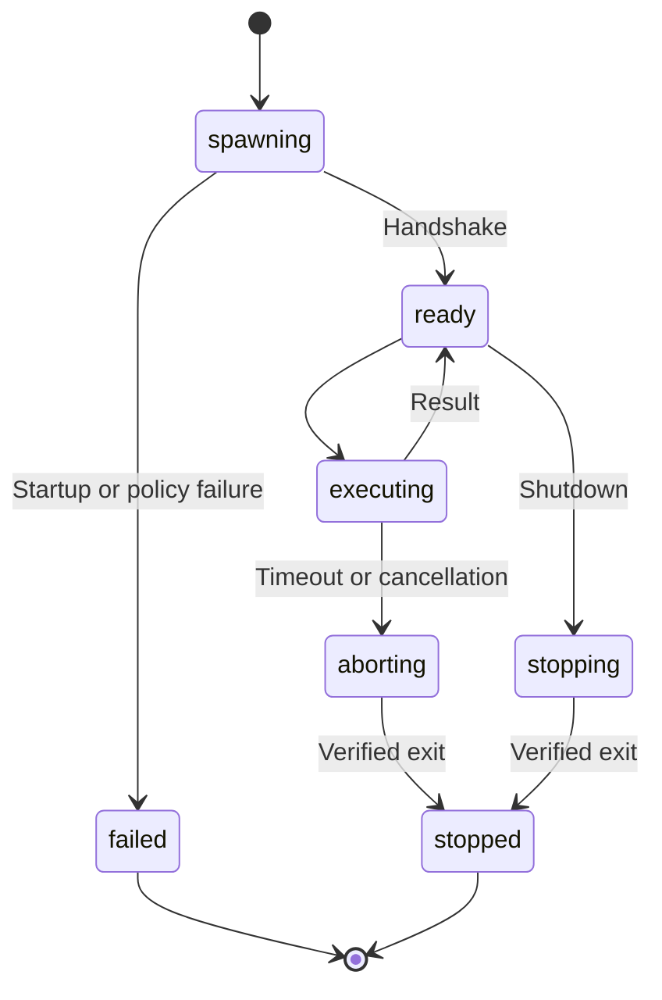
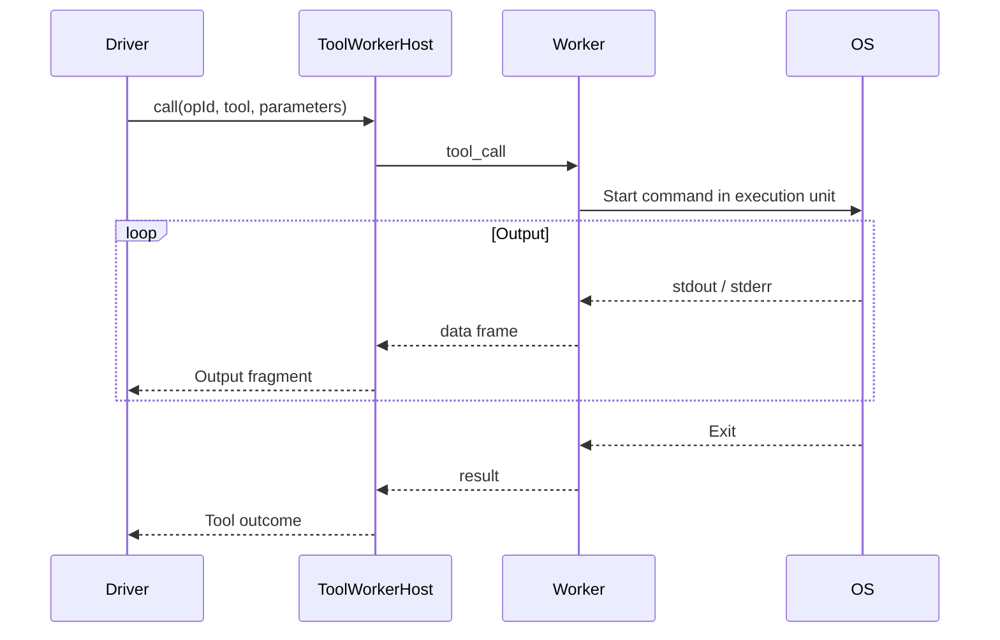

# Execution and Tool Workers

## Responsibilities and Boundaries

The execution subsystem supplies tool workers and OS isolation for file operations, shell commands and search. Restricted macOS execution uses Seatbelt; Linux uses bubblewrap and cgroups. Stdio carries framed JSON requests and results. Cancellation and finalization verify the execution unit and descendants have exited before releasing occupancy.

Work-copy preparation validates real directory identity and Git metadata for isolated changes. [Agent tools](agent-tools.md) owns availability/approval; [runtime](runtime.md) owns task/delegation orchestration; [core](core.md) owns stored state.

## Public Interfaces

| Entry | Caller | Contract |
| --- | --- | --- |
| `createLauncherFor(config, mode)` | Runtime | Choose restricted native or full-access execution |
| `ToolWorkerHost.create(launcher, spec)` | Driver/router | Start the worker and await its `ready` handshake |
| `ToolWorkerHost.call(params)` | Driver/router | Execute a tool with optional `timeoutMs` |
| `ToolWorkerHost.abort(opId)` | Interruption | Abort an in-flight operation |
| `ToolWorkerHost.stop()` | Finalization | Request shutdown and verify termination |
| `Runtime.executeWorkCopy(spec)` | Delegation/workflow integration | Run a command in the work copy under the specified mode |
| `WorkCopyManager.assertCopy` | Integration | Verify directory identity and `.git` binding |

### Tool Worker Protocol

| Direction | Frame | Main fields |
| --- | --- | --- |
| Host → worker | `init` | `cwd`, `readRoots`, `workspace` |
| Host → worker | `tool_call` | `opId`, `name`, `params`, `timeoutMs` |
| Host → worker | `abort` | `opId` |
| Host → worker | `shutdown` | No operation payload |
| Worker → host | `ready` | `pid` |
| Worker → host | `data` | `opId`, `stream`, base64 `chunk` |
| Worker → host | `result` | `opId`, `ok`, `content`, `isError` |

## Data and State

| Mode | Filesystem | Network |
| --- | --- | --- |
| `native` | Workspace and explicit grants; pinned skills read-only; protected paths excluded | External network disabled |
| `full_access` | Starting account's existing OS permissions, without a task sandbox | Account's network access |

## Main Flows

Before first use, the worker aligns identity, working directory and mounts. Output is streamed in slices. A timeout requests abort and escalates termination when needed; completion is not treated as proof that detached descendants are gone.

## Invariants and Failure Handling

- Release occupancy only after the execution unit and its descendants are verified stopped. Unknown stopping retains occupancy and recovery evidence.
- Directory identity checks use device/inode facts and validated aliases, not a path string alone.
- Missing native prerequisites produce `execution_unavailable`; restricted execution never silently becomes unsandboxed.

## Design Rationale

- [Tool worker per task container](../../.agents/notes/implemented/architecture/2026-09-20-tool-worker-per-task-container.md)
- [Native execution sandbox](../../.agents/notes/implemented/architecture/2026-10-10-native-execution-sandbox.md)
