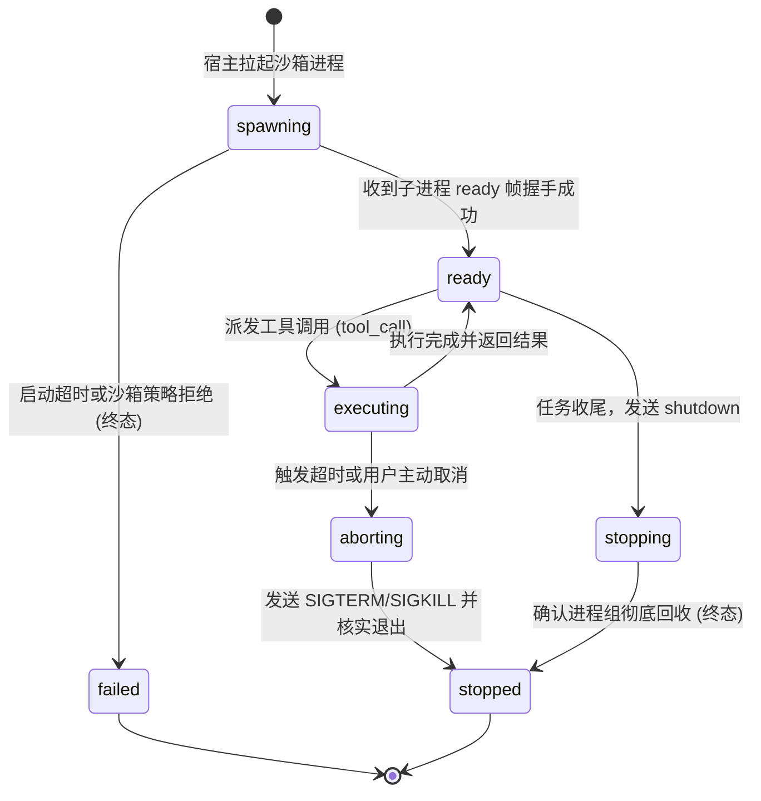
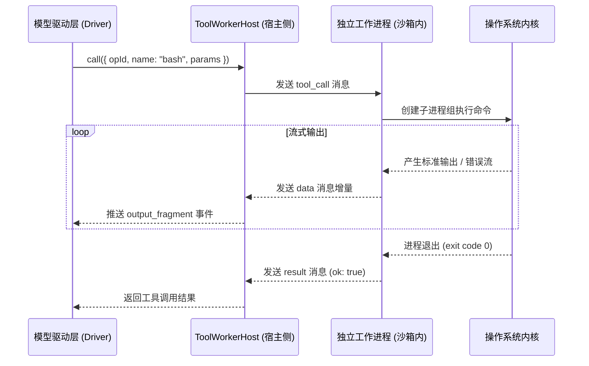

# 执行边界与工具工作进程

## 职责与边界

`execution` 模块负责为代码读写（`read` / `write` / `edit`）、终端命令执行（`bash`）与文件检索提供物理隔离的工具工作进程（Tool Worker）及原生操作系统沙箱环境。

### 核心职责
- **原生沙箱隔离（Native Sandbox）**：在受限模式下，macOS 采用 Seatbelt 策略，Linux 采用 `bubblewrap`（bwrap）与 cgroup 隔离，确保模型无法逃逸到未授权的宿主目录。
- **跨进程通信与协议分帧**：基于 stdio 上的行分隔 JSON 协议，与受限的工作进程进行低开销、全双工的 RPC 通信。
- **进程树监控与停止核实**：在命令取消、超时或任务结束时，主动清理子进程组（Process Group），严格核实全部派生进程退出后才释放资源。
- **Git Worktree 隔离环境**：为修改类任务准备独立的工作树副本，校验目录 Inode 真实身份，防止软链接攻击。

### 边界与非职责
- 工具的白名单准入规则与审批判定归 [agent-tools](agent-tools.md)。
- 任务的排队与 SubAgent 依赖关系归 [runtime](runtime.md)。
- 存储层的数据落盘归 [core](core.md)。

## 对外接口

| 核心接口 / 类 | 调用方 | 职责与关键行为 |
|---|---|---|
| `createLauncherFor(config, mode)` | Runtime | 根据当前安全模式（受限 native 或完全访问 full_access）创建对应的沙箱启动器 |
| `ToolWorkerHost.create(launcher, spec)` | Driver / ToolRouter | 创建并拉起独立的工作进程宿主，等待子进程返回 `ready` 握手信号 |
| `ToolWorkerHost.call(params)` | Driver / 路由层 | 向工作进程下发一次具体的工具调用（支持设置执行超时 `timeoutMs`） |
| `ToolWorkerHost.abort(opId)` | Runtime 中断流程 | 立即中止指定操作编号（`opId`）的在途命令 |
| `ToolWorkerHost.stop()` | 任务收尾流程 | 发送 `shutdown` 指令并确保子进程组完全终止与回收 |
| `Runtime.executeWorkCopy(spec)` | 委派 / 工作流合入 | 在独立副本目录中按指定安全模式执行特定的 Bash 命令 |
| `WorkCopyManager.assertCopy(dir)` | 变更合入流程 | 严格校验工作副本的目录身份、Inode 与 `.git` 指向有效性 |

### 工具工作进程协议

宿主进程与工作子进程通过 stdio 交换结构化 JSON 消息：

| 消息流向 | 消息类型 (`type`) | 关键载荷字段 | 说明 |
|---|---|---|---|
| 宿主 → 工作进程 | `init` | `cwd`, `readRoots`, `workspace` | 初始化工作进程环境与只读/读写挂载点 |
| 宿主 → 工作进程 | `tool_call` | `opId`, `name`, `params`, `timeoutMs` | 请求执行具体工具（如 `bash`、`edit`） |
| 宿主 → 工作进程 | `abort` | `opId` | 强行终止特定操作 |
| 宿主 → 工作进程 | `shutdown` | — | 退出工作进程 |
| 工作进程 → 宿主 | `ready` | `pid` | 工作进程完成初始化并就绪 |
| 工作进程 → 宿主 | `data` | `opId`, `stream`, `chunk` (base64) | 实时流式回传 stdout、stderr 或文件分块 |
| 工作进程 → 宿主 | `result` | `opId`, `ok`, `content`, `isError` | 工具执行最终结果 |

## 数据与状态

### 1. 执行单元生命周期状态机

### 2. 执行后端模式对比

| 模式 | 沙箱机制 | 文件系统访问边界 | 网络访问能力 | 适用场景 |
|---|---|---|---|---|
| **`native`**（默认受限模式） | macOS Seatbelt / Linux bubblewrap | 仅允许读写当前工作区与显式授权的目录；任务钉版的技能目录以只读根并入；保护系统敏感路径 | 完全禁用外部网络访问 | 日常代码编辑、审查、测试运行 |
| **`full_access`**（完全访问模式） | 继承宿主运行账户环境 | 可访问当前用户拥有读写权限的所有路径 | 允许访问外部网络 | 外部依赖安装、需要联网的构建工具 |

## 主要流程

### 工具调用在沙箱内的执行流程

1. **就绪与校验**：工作进程在初次使用前启动并完成身份对齐，校验当前工作目录与挂载参数。
2. **命令执行与流式传输**：工具在独立的进程组内运行，stdout/stderr 实时流式切片送回宿主。
3. **超时与强制中断**：若调用超过 `timeoutMs`，宿主发送 `abort` 并在超时后向整个进程组发送 SIGKILL，确保无残留僵尸进程。

## 不变量与失败处理

- **进程组彻底清理（Reaping）**：工具调用终止或任务结束时，系统必须核验该执行单元及其派生的所有孙进程已彻底退出，未确认退出前绝不解除工作目录占用。
- **文件路径 Inode 强复核**：在执行任何写入操作前，系统比对路径的 `(dev, ino)` 设备与索引节点号，拒绝符号链接伪造与别名穿透。
- **沙箱策略不可逆降级**：若系统缺少沙箱前提（如缺少 `bubblewrap`），直接抛出 `execution_unavailable` 报错，绝不隐式降级到无沙箱环境执行。

## 设计依据

- [工具工作进程与受限容器](../../.agents/notes/implemented/architecture/2026-09-20-tool-worker-per-task-container.md)
- [Coding Agent 的原生受限执行](../../.agents/notes/implemented/architecture/2026-10-10-native-execution-sandbox.md)
