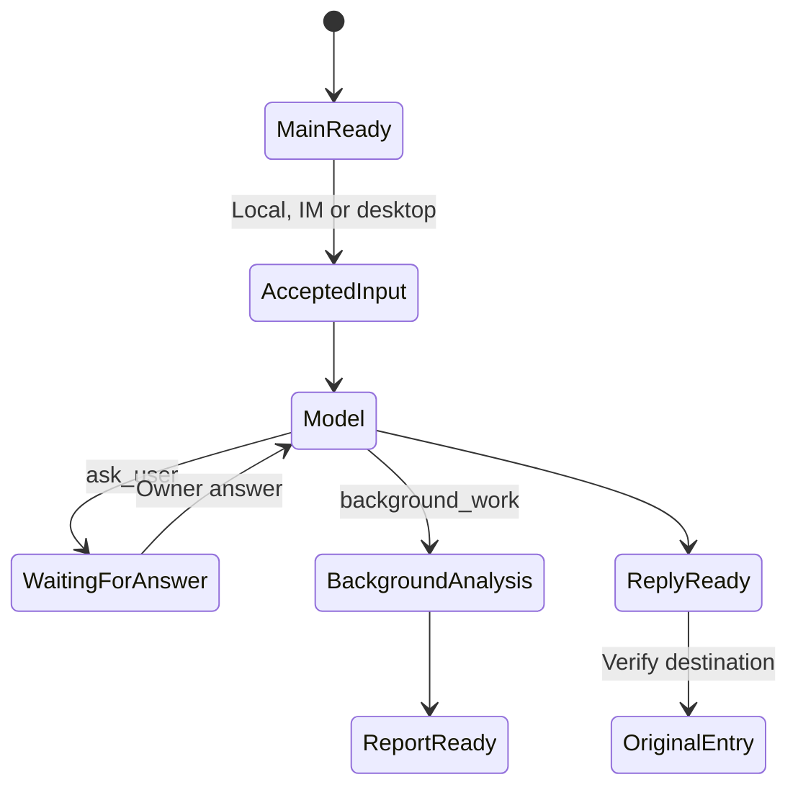
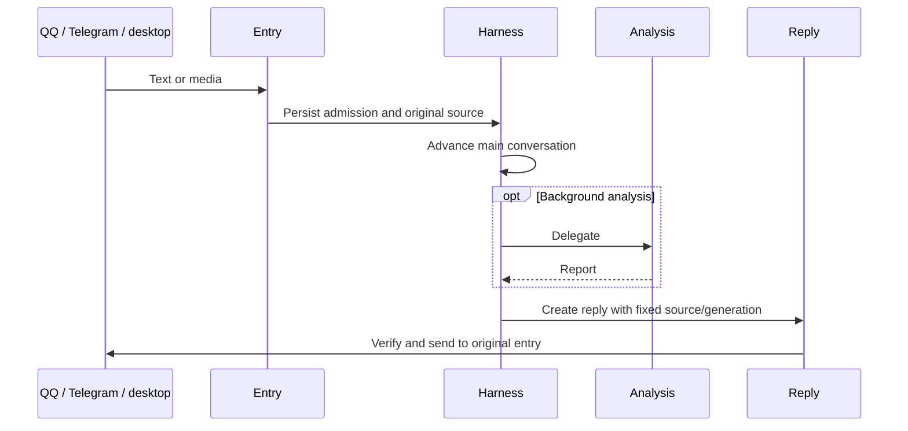

# Personal Durable Conversations

## Responsibilities and Boundaries

`apps/ruukoto/src/personal-*.ts` owns the Personal product's Pi 1.3.0 durable runtime: one main conversation, persistent analysis, schedules, memory and local/IM/remote entry points. It provides command workers, browser tools, application-data access, approvals and structured owner questions. File preparation, revalidation and execution run in one fixed worker per job, outside the host event loop and Session transactions. A stuck job leaves unrelated file operations available while capacity remains.

Waiting business tools run only inside SubAgents: main model requests never offer them and their main-conversation execution is refused before any effect, so waiting operations never hold the main generation. Each owner input may commit at most four persisted tool-call batches; a noncompliant overrun stops the input through a durable cutoff that cancels exactly the work it admitted, appends a public marker with the cancellation registration, and notifies the original local or IM entry factually — cancellation registered is never reported as physically stopped — while a compliant model simply answers in prose once the offer is empty. While a cutoff's cancellation registration is unfinished, new main submissions are admitted durably as queued — accepted immediately, never self-placed — and the coordinator places the queue itself once registration completes; queued inputs are parked so that foreign writes such as background compaction summaries can never advance them ahead of a pending registration, and a run that ends without a boundary likewise leaves the queue to the coordinator, which applies the same final boundary its callers would have.

[Deployment](deploy.md) owns systemd configuration; [runtime](runtime.md) describes the separate Coding engine; [execution](execution.md) describes shared native primitives.

## Public Interfaces

| Command | Purpose |
| --- | --- |
| `ruukoto` / `npm start` | Guided models, backend, recent conversations, permissions and pending questions |
| `ruukoto serve` | Foreground durable backend; `--directory` fixes the profile |
| `ruukoto settings` | JSON model/MCP management and read-only fixed-root skill queries, online or offline |
| `ruukoto maintenance` | Verify and explicitly control the production service |
| `ruukoto remote` | Pair/revoke remote devices; host HTTPS/WSS with `remote serve` |

| Tool family | Main tools and responsibility |
| --- | --- |
| Analysis/delegation | `background_work`: persistent children, further instructions, progress and full reports |
| Questions | `ask_user`: one to three structured questions and continuation after answers |
| Scheduling | `schedule_create`, `schedule_query`, `schedule_cancel`: timed work in independent conversations |
| Memory/history | `memory`, `history_search`, `history_read`: versioned facts and history lookup |
| Files/network | `read_file`, `write_file`, `web_search`, `http_request`, `list_files`, `search_files`, `read_artifact`: child-side access within granted scope, with approvals where required |
| Browser | `browser`: browser operation and screenshots |
| Application data | `app_data_*`: dedicated business database access |
| MCP | `mcp_tools`, `mcp_call`, `read_mcp_result`: eligible discovery, calls and original results; Pi handles transport/paging |

## Data and State

| Data | Authority |
| --- | --- |
| Conversations, children and analysis reports | Durable SQLite under the profile, default `~/.ruukoto-durable/` |
| Questions/answers/receipts | `ruukoto.questions` |
| Memory and skills | `ruukoto.memories`, `ruukoto.skills` and entries: revisions, revocation, source/body snapshots and invocation evidence |
| Schedules | `ruukoto.schedules`: rules, runs, execution snapshots and delivery credentials |
| Business data | `agent-data/main.db` |
| MCP | `mcp.json` configuration v4 and durable operation entries |
| File I/O | Versioned job admissions and lifecycle entries: original tool/work/source, host identity, immutable input, deadline, settlement and stopping evidence |

MCP v4 separates locally configured tool effects from remote definitions. The owner explicitly migrates configuration through management before new ordinary-service work is admitted. Save/apply receipts make migration recoverable. Existing credential references and their byte-digest semantics remain; explicit credential rebinding switches to the actual-token digest. Migration invalidates old unstarted approvals, preserves old unknown calls and keeps original computer stopping/recovery manageable.

Before each model request, skills refresh from the backend account's `$HOME/.agents/skills/` and save a full snapshot. The initial model view contains names/descriptions; `skill` loads bodies or references, and main supports `/skill:name arguments`. A child uses `run_command` to execute a script by its skill-directory path under the original work permissions. Restricted commands mount eligible directories from the original request snapshot read-only; binding evidence is recorded with command admission and intent. Source is not read by default. Current discovery is separate from old library configuration/managed state; schedules with incompatible old sources stop explicitly and require cancellation/recreation.

## Main Flows

Platform message identity deduplicates admission. Auto-review handles eligible read-only operations; sensitive actions follow the original platform's approval flow. Replies retain the original platform, account, owner and generation.

### File Operation Lifecycle

Preparation returns immutable file identity and content evidence, without holding a worker through an approval wait. Successful pre-review revalidation leaves pending owner approval intact across restart; execution still requires fresh post-approval revalidation. After approval and revalidation, the host reserves execute capacity before the short authorization/claim/start commit. The fixed worker then checks the original file again and executes once; artifacts and observations retain the original operation identity.

Capacity is four reserved, starting, live or stop-unverified workers per profile. An unused reservation releases locally; a started worker releases capacity only on its exact exit. Job deadlines are 120 seconds and termination grace is 5 seconds. A deadline or a terminate request ends the caller's wait, not proof of worker exit. Four OS-stuck workers leave file operations unavailable until actual exits, verified original-host termination or storage repair.

Capacity denial before approval consumption is terminal and known not executed. The original approval remains history, but neither a freed slot nor same-key replay can execute it later. A new operation requires fresh preparation and whatever approval its normal policy requires. A lost dispatched write retains unknown effects and its directory claim; even worker exit does not release that claim until the effect is independently resolved. Interrupted preparation and reads have no write effect, but still require actual stopping evidence before their work is released.

Shutdown establishes the file-admission fence even before the first job, collects stopping and queued evidence while Session storage remains available, then closes storage and releases the profile lock. An unverified grace timeout leaves the Session, control entry and lock available for inspection and another stop request. Unexpected storage failure retains exact in-memory receipts for same-process recovery and keeps exclusion over live workers. Completed legacy file history remains verifiable; unfinished legacy operations must be handled with the original version before activation.

### Finalizing an Unknown MCP Call

When a sent write/unknown-effect call loses its reply, its source stops automatic business calls. An interrupted authorized read is a read failure instead. The owner can choose to end that work while keeping the result unknown. The work-ending path stops local execution; after member tasks and real resources are verified terminal/stopped, a final unknown-result report goes through the original-entry sending ledger.

Manual finalization adds facts; it never removes the original source's automatic-execution prohibition. New independent owner input may use the same service: its URL is not a business-resource lock. Old SSE reinspection tasks retire without networking after restart; recovery and queries read original records.

## Invariants and Failure Handling

- One instance owns one exclusive durable Harness; local, IM and desktop entries share its conversation facts.
- IM approvals/questions require the bound owner in the original platform/private chat. An answer is not a tool approval.
- Restart recovery reconciles pending work without repeating completed facts or replaying unknown external effects.
- Accepted follow-up instructions keep the original work's SubAgent and stable native keys: the same task steers each accepted note into that conversation in admission order, supervises every submission through completion, cancellation or failure, and reports each note's real state instead of replaying it under a new key.
- Sending retains destination and outcome identity across connection failures. An inconclusive sent operation is not automatically retried as if unsent.

## Design Rationale

- [Personal product entry](../../.agents/notes/implemented/simplification/2026-10-18-personal-product-entry.md)
- [Personal tailscale https](../../.agents/notes/implemented/architecture/2026-10-24-personal-tailscale-https.md)
- [Personal token atomic publish](../../.agents/notes/implemented/bug-fix/2026-10-24-personal-token-atomic-publish.md)
- [Detach terminal from task runtime](../../.agents/notes/implemented/architecture/2026-09-19-detach-terminal-from-task-runtime.md)
- [Mcp host responsibilities](../../.agents/notes/implemented/simplification/2026-10-26-mcp-host-responsibilities.md)
- [Home skills discovery](../../.agents/notes/implemented/simplification/2026-10-28-home-skills-discovery.md)
- [Personal file operations worker](../../.agents/notes/implemented/architecture/2026-11-02-personal-file-io-worker.md)
- [Per-job bounded file-I/O workers](../../.agents/notes/implemented/architecture/2026-11-03-personal-file-io-jobs.md)
- [Personal main handoff yield](../../.agents/notes/implemented/architecture/2026-11-02-personal-main-handoff.md)
- [Personal bounded main coordination](../../.agents/notes/implemented/architecture/2026-11-03-personal-coordination-cutoff.md)
- [Personal same-SubAgent work-note supervision](../../.agents/notes/implemented/architecture/2026-11-02-personal-work-note-supervision.md)
