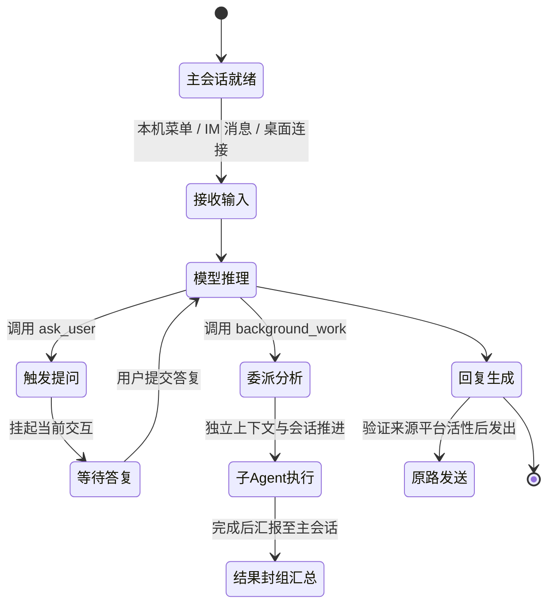
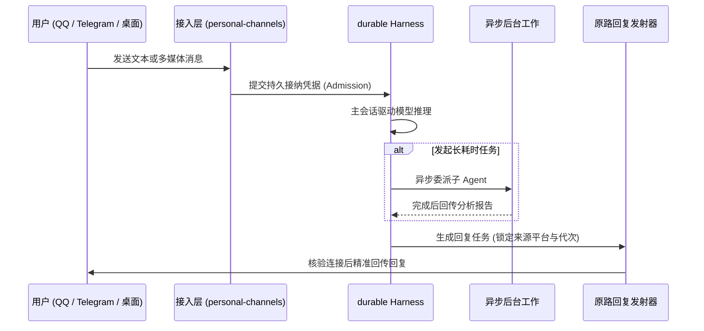

# 个人持久会话与入口管理

## 职责与边界

`personal-durable`（对应 `apps/ruukoto/src/personal-*.ts`）是个人 Agent 的核心运行与持久化中枢。它基于 Pi 1.3.0 durable 架构，统一管理个人主会话、后台长效分析、定时任务调度、长期记忆与外部多平台接入。

### 核心职责
- **统一会话模型**：持有个人 Agent 的唯一主会话，承载来自本机终端、QQ、Telegram 与远程桌面的交互请求。
- **长效后台工作**：提供长期子 Agent 委派、异步分析委托（`background_work`）与独立定时任务（`personal-scheduler`）。
- **外部通道与远程接入**：管理 Telegram Bot 与 QQ（OneBot）私聊适配器，提供 Tailscale HTTPS/WSS 安全远程连接。
- **安全工具链与命令沙箱**：提供专属命令 Worker（`personal-command-worker`）、浏览器自动化工具及应用数据（`app_data_*`）的受限访问与审批。
- **人机交互式提问（`ask_user`）**：支持模型向拥有者发起单选、多选或自由文本的结构化问答交互。

### 边界与非职责
- 系统部署与 systemd 单元配置归 [deploy](deploy.md)。
- Coding 端的代码工程与多任务排队归 [runtime](runtime.md)。
- 底层共享的原生命令沙箱原语归 [execution](execution.md)。

## 对外接口

模块对外暴露的 CLI 命令、交互路由与主要模型工具如下：

### 1. 命令行管理入口

| 入口 | 作用与交互方式 | 核心行为说明 |
|---|---|---|
| `ruukoto` / `npm start` | 交互式终端向导 | 引导用户配置模型、启停后台、查看最近会话、管理授权与回答待决问题 |
| `ruukoto serve` | 前台常驻后台服务 | 托管个人 durable 运行引擎，支持通过 `--directory` 指定独立存储目录 |
| `ruukoto settings` | JSON 运维配置接口 | 读写模型与 MCP 配置，只读查询固定目录技能，支持在线与离线模式 |
| `ruukoto maintenance` | 系统级服务管理 | 针对生产环境验证并显式启停 systemd 服务单元 |
| `ruukoto remote` | 远程配对向导 | 管理 Tailscale HTTPS/WSS 访问凭据，支持设备配对与凭据吊销 |

### 2. 个人核心模型工具集

| 工具族 | 工具列表 | 核心职责 |
|---|---|---|
| **后台分析与委派** | `background_work` | 创建长效子 Agent、追加分析说明、查询进度、拉取完整分析报告 |
| **交互提问** | `ask_user` | 向拥有者登记 1~3 道结构化题目，挂起当前轮次等待用户回答 |
| **定时调度** | `schedule_create` / `query` / `cancel` | 创建时间触发计划，沿独立会话执行并汇总结果 |
| **长期记忆** | `memory` / `history_search` / `read` | 个人知识与偏好的检索、按版本修订与显式撤销 |
| **安全文件与网络** | `read_file` / `write_file` / `web_search` / `http_request` | 在授权范围内读写文件与检索网络，越界操作触发人工审批 |
| **浏览器自动化** | `personal-browser` | 在独立沙箱中驱动可视化/无头浏览器完成网页操作与截图 |
| **应用数据存储** | `app_data_*` | 访问专属于个人 Agent 的结构化业务数据库（`agent-data/main.db`） |
| **MCP** | `mcp_tools` / `mcp_call` / `read_mcp_result` | 发现获准工具、发起调用与只读查询原结果；传输与分页使用 Pi MCP |

## 数据与状态

个人 Agent 的全部持久事实由档案根目录（默认 `~/.ruukoto-durable/`）下的 durable SQLite 统一持有：

### 核心持久数据分类

| 数据类别 | 持久化载体 | 包含内容与管理机制 |
|---|---|---|
| **核心会话与工作** | `durable SQLite` | 主会话记录、长效子 Agent、异步分析任务状态与完整报告 |
| **提问与回执** | `ruukoto.questions` | 交互式提问内容、选项清单、用户提交答案及原路回执 |
| **长期记忆与技能** | `ruukoto.memories` / `ruukoto.skills` 与 entries | 记忆修订与撤销、技能来源和正文快照、加载与显式调用证据 |
| **定时计划与运行** | `ruukoto.schedules` | 定时触发规则、历史运行记录、执行快照与投递凭据 |
| **应用业务数据** | `agent-data/main.db` | 个人业务数据库，支持关系模型与事务一致性审计 |
| **MCP 配置与操作** | `mcp.json` / durable entries | 配置 v4 分开保存工具效果与定义；新操作保存身份、批准、开始事实、规范结果与产物，旧记录只读保留 |

MCP 配置先经拥有者管理入口显式迁入 v4，再接纳普通服务的新业务。迁入沿保存／生效回执恢复，保留旧凭据引用及其字节摘要语义；重新绑定凭据才改用实际 token 摘要。旧未开始批准在迁入时失效，旧未知调用保持原事实，原电脑停止与恢复可继续管理。

个人技能从后台账户的 `$HOME/.agents/skills/` 发现，每次模型请求前刷新并保存完整快照，模型只先取得名称与描述。`skill` 按需返回正文或引用文本，主会话支持 `/skill:名称 参数`。技能目录中的脚本经子 Agent `run_command` 按其目录路径执行，沿用原工作权限；受限命令把原模型请求所选快照中可用的技能目录以只读挂载并入执行，绑定证据与命令接纳、执行意图同录，源码默认不读取。当前发现与旧技能库配置、托管状态分开；旧来源不同的定时计划明确停止并要求取消重建。

## 主要流程

### 1. 外部消息接入与回复流程

1. **消息接收与幂等接纳**：外部平台消息到达后，系统按平台消息唯一标识登记接纳事实，重复消息直接定位原记录。
2. **执行与安全审批**：在默认的“自动审查”模式下，只读操作自动放行，敏感写操作挂起并向原平台发送审批菜单。
3. **原路安全回传**：回复生成后严格沿原接入平台与账号代次发回，绝不串号或误发。

### 2. 普通 MCP 未知调用收尾

普通写入或副作用不明工具已发送后丢答，原来源停止自动业务调用；已授权只读工具中断记读取失败。拥有者可从原调用管理选择“结束此工作，保留结果未知”，沿工作结束路径停止本地执行。工作成员终态与真实资源停止确认后，最终未知报告经原入口发送账本送达。

人工收尾追加事实并永久保留原来源的自动执行禁令。新的独立拥有者输入可以处理同一服务；服务 URL 不承担业务资源锁。跨重启原 SSE 重核任务只做无网络退役，恢复与查询读取原记录。

## 不变量与失败处理

- **主会话单例与排他性**：一个个人 Agent 实例只持有一个核心 durable Harness，所有入口（IM、本机向导、桌面）共享该会话事实。
- **审批与问答的原路闭环**：在 QQ 或 Telegram 发起的审批与提问，必须在原平台对应私聊中由授权拥有者确认，防止越权代答。
- **进程重启状态自愈**：后台异常重启后，未决的后台任务与子 Agent 状态自动核查恢复，已完成的事实绝不重复执行。
- **网络故障重试与防重复**：外部 IM 通道发生网络异常时，消息保持在发件队列中等待恢复，核验成功后才标记送达，避免重复轰炸。

## 设计依据

- [个人正式入口使用唯一 durable 装配](../../.agents/notes/implemented/simplification/2026-10-18-personal-product-entry.md)
- [个人 Tailscale HTTPS 与 WebSocket](../../.agents/notes/implemented/architecture/2026-10-24-personal-tailscale-https.md)
- [个人认证令牌完整写入后发布](../../.agents/notes/implemented/bug-fix/2026-10-24-personal-token-atomic-publish.md)
- [后台任务与终端](../../.agents/notes/implemented/architecture/2026-09-19-detach-terminal-from-task-runtime.md)
- [MCP 宿主职责收缩](../../.agents/notes/implemented/simplification/2026-10-26-mcp-host-responsibilities.md)：配置迁入、来源级未知收尾与 Pi MCP 薄适配。
- [技能统一从宿主 HOME 发现](../../.agents/notes/implemented/simplification/2026-10-28-home-skills-discovery.md)：固定来源与旧快照、配置回执的保留范围。
