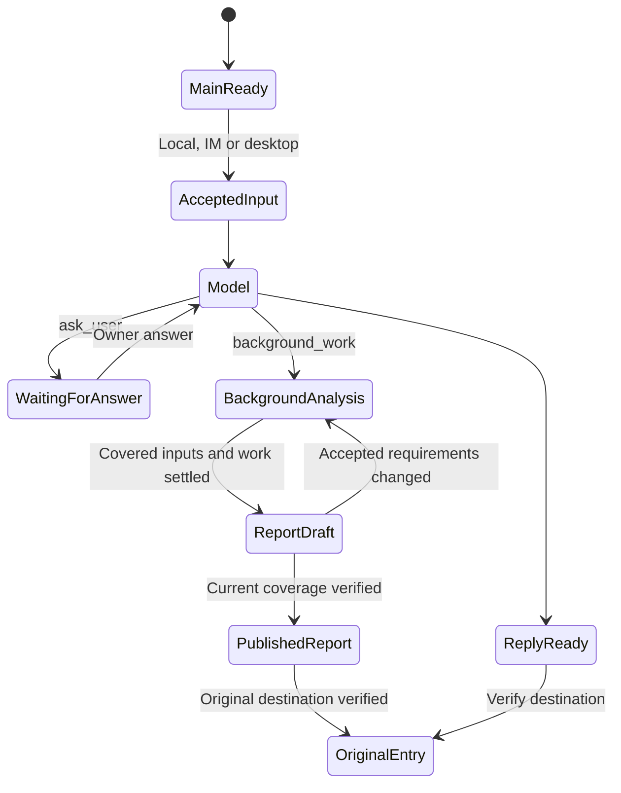
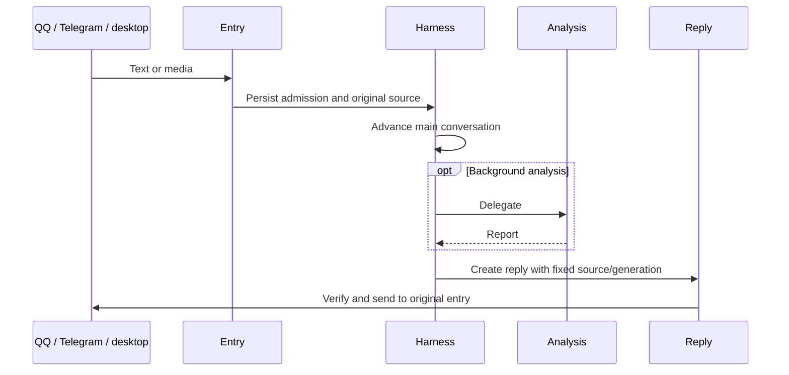

# Personal Durable Conversations

## Responsibilities and Boundaries

`apps/ruukoto/src/personal-*.ts` owns the Personal product's Pi 1.3.0 durable runtime: one main conversation, persistent analysis, schedules, memory and local/IM/remote entry points. It provides command workers, browser tools, application-data access, approvals and structured owner questions. File and application SQLite operations run in fixed workers outside the host event loop and Session transactions. A stuck file job leaves unrelated file operations available while capacity remains.

Main delegates waiting business calls to SubAgents: its requests omit ordinary tools, app-data, MCP calls, service inspection/restart, commands, browser operations and process startup. Independent scheduled conversations retain their original captured scope. Main execution safeguards return handled errors before effects. Each owner input may commit at most four persisted tool-call batches; a noncompliant overrun stops the input through a durable cutoff that cancels exactly the work it admitted, appends a public marker with the cancellation registration, and notifies the original local or IM entry factually — cancellation registered is never reported as physically stopped — while a compliant model simply answers in prose once the offer is empty. While a cutoff's cancellation registration is unfinished, new main submissions are admitted durably as queued — accepted immediately, never self-placed — and the coordinator places the queue itself once registration completes; queued inputs are parked so that foreign writes such as background compaction summaries can never advance them ahead of a pending registration, and a run that ends without a boundary likewise leaves the queue to the coordinator, which applies the same final boundary its callers would have.

[Deployment](deploy.md) owns systemd configuration; [runtime](runtime.md) describes the separate Coding engine; [execution](execution.md) describes shared native primitives.

## Public Interfaces

| Command | Purpose |
| --- | --- |
| `ruukoto` / `npm start` | Guided models, backend, recent conversations, permissions and pending questions |
| `ruukoto serve` | Foreground durable backend; `--directory` fixes the profile |
| `ruukoto settings` | JSON model/MCP management and read-only fixed-root skill queries, online or offline |
| `ruukoto maintenance` | Verify and explicitly control the production service |
| `ruukoto remote` | Pair/revoke remote devices; host HTTPS/WSS with `remote serve` |

| Tool family | Tools and responsibility |
| --- | --- |
| Analysis/delegation | `background_work`: persistent children, amendments, bounded operation/decision queries, redisplay and published reports |
| Questions | `ask_user`: one to three structured questions and continuation after answers |
| Scheduling | `schedule_create`, `schedule_query`, `schedule_cancel`: independent timed work, with separate occurrence and future-plan cancellation |
| Memory/history | `memory`, `history_search`, `history_read`: versioned facts and history lookup |
| Files/network | `read_file`, `write_file`, `web_search`, `http_request`, `list_files`, `search_files`, `read_artifact`: child-side access within granted scope, with approvals where required |
| Browser/computer | `browser` and configured Cua tools: host-qualified child work, serial resource ownership, fresh takeover observations |
| Application data | `app_data_*`: explicitly delegated business database access; fixed SQLite worker jobs |
| Persistent processes | `process_start`, `process_status`, `process_output`, `process_stop`: work-owned startup and independent lifetime across replies |
| MCP | `mcp_tools`, `mcp_call`, `read_mcp_result`: eligible discovery, calls and original results; Pi handles transport/paging |

## Data and State

| Data | Authority |
| --- | --- |
| Conversations, children and analysis reports | Durable SQLite under the profile, default `~/.ruukoto-durable/` |
| Questions/answers/receipts | `ruukoto.questions` |
| Memory and skills | `ruukoto.memories`, `ruukoto.skills` and entries: revisions, revocation, source/body snapshots and invocation evidence |
| Schedules | `ruukoto.schedules`: rules, runs, execution snapshots and delivery credentials |
| Business data | `agent-data/main.db` |
| MCP | `mcp.json` configuration v4 and durable operation entries |
| File I/O | Versioned job admissions and lifecycle entries: original tool/work/source, host identity, immutable input, deadline, settlement and stopping evidence |
| Work and report selections | Actual model-request evidence: received instructions, native inputs and report source/coverage |
| Interactive resources | Host work qualification, FIFO claims, acquisition and release entries with original stop evidence |
| Published reports | Immutable publication references to original answers; drafts remain inspectable in conversation history |
| Native owner display | Data-only admission entry and reciprocal request/submission/history association; native model history remains unchanged |

MCP v4 separates locally configured tool effects from remote definitions. The owner explicitly migrates configuration through management before new ordinary-service work is admitted. Save/apply receipts make migration recoverable. Existing credential references and their byte-digest semantics remain; explicit credential rebinding switches to the actual-token digest. Migration invalidates old unstarted approvals, preserves old unknown calls and keeps original computer stopping/recovery manageable.

Before each model request, skills refresh from the backend account's `$HOME/.agents/skills/` and save a full snapshot. The initial model view contains names/descriptions; `skill` loads bodies or references, and main supports `/skill:name arguments`. A child uses `run_command` to execute a script by its skill-directory path under the original work permissions. Restricted commands mount eligible directories from the original request snapshot read-only; binding evidence is recorded with command admission and intent. Source is not read by default. Current discovery is separate from old library configuration/managed state; schedules with incompatible old sources stop explicitly and require cancellation/recreation.

## Main Flows

Platform message identity deduplicates admission. Auto-review handles eligible read-only operations; sensitive actions follow the original platform's approval flow. Replies retain the original platform, account, owner and generation.

### Amendments and Final Reports

Main handles a progress question through canonical work and operation queries. Work results include current MCP, app-data, browser, process and resource state alongside command, service and ordinary-tool facts. A requested redisplay identifies the same original decision and grants no approval. An append records changed or additional requirements for the same work and SubAgent. Every accepted append makes its older unstarted operations known not executed across enabled families, including approved but unconsumed actions, while preserving their requests and decisions. The child reads the saved update at a model boundary and prepares a new exact action. Admission and consumption check what that actual request received and the current live input membership, including delayed old responses and note-only runs. Misclassifying a progress question as append has the same conservative invalidation cost; a started effect cannot be undone by an amendment.

Work result queries expose at most eight facts per family. `factsOffset` and `nextFactsOffset` page those facts independently of the answer's `offset` and `nextOffset`; summaries and delegation progress include the first fact page. When facts are paged, `factCounts` gives each family's total, pending and unknown counts across all records. A missing operation on one page does not establish that work has no pending decisions or unknown effects. Process facts show brief status; process management retains the original command and output details.

Delegated requirements preserve the owner's exact target, literal content and restrictions without adding verification effects. Progress and redisplay answers use concise natural language; internal identifiers, fields, tool names and versions are reserved for requested technical evidence. These instructions guide the model; actual model-request captures and scenario interaction provide separate evidence of its behavior.

A completed, stopped file-write receipt confirms the requested full UTF-8 content was written and synchronized during that execution. Its result asks the model to report the completed write, without requiring an extra read. This does not establish later filesystem contents; failed or unknown writes retain their original recovery requirements.

The WorkTask supervises every accepted note until it is answered or accounted for by failure/cancellation. Native input failure stops new dispatch; original keys reconnect after restart without replaying the instruction. Every contributing owner input must remain active, including an appended source whose coordination failed before cancellation registration. Reopen verifies each immutable note admission against its work and ordered note projection rather than silently dropping missing records.

Grouped work automatically registers host reporting intent and remains open to additions. Reports wait for main's contributing arrangements, accepted work and necessary effect/stopping checks. An owner input accepted before native placement delays publication until it is classified. Each summary pins its covered sources, notes, answers and operation facts, and the host checks coverage again before publishing. Changed requirements supersede an unpublished draft; an unchanged query lets the existing summary continue. Main stays available while the report task waits.

Only the validated publication appears as a normal desktop final answer. Internal report inputs, tool traffic, partial streaming and the raw draft stay out of that projection; history can still inspect them. Publication references the original complete answer without duplicating a model message, and the history API pages its full body. Later accepted requirements preserve published history and register a successor. If the original work already completed safely, model-facing append creates a linked new work in the same idle SubAgent under the original delegation authority; failed, canceled or unknown work cannot automatically continue.

### Desktop Observation

The authenticated snapshot/event stream projects ordinary-operation card occurrences, canonical work and delegation state, actual model-read evidence and explicit publication. Public commit notifications wake bounded updates independently of main's model events. Original admission and redisplay anchors determine card placement; each operation's current decision updates every occurrence. List pages contain at most eight items, and exact parameter/target bodies use immutable pages. Subscription sequence detects transport gaps, while commit revisions discard older canonical state within the same backend run.

Native owner text receives a data-only display entry in its admission transaction, including when queued. Reciprocal indices associate the original request and native submission with eventual user history. Projection validates body and identity, hides the associated raw row once covered by the display cut, and preserves entryless withdrawal as unanswered. Custom report/question/IM inputs retain their existing projection. Contradictory referenced records fail explicitly instead of moving or omitting another owner's message.

### File Operation Lifecycle

Preparation returns immutable file identity and content evidence, without holding a worker through an approval wait. Successful pre-review revalidation leaves pending owner approval intact across restart; execution still requires fresh post-approval revalidation. After approval and revalidation, the host reserves execute capacity before the short authorization/claim/start commit. The fixed worker then checks the original file again and executes once; artifacts and observations retain the original operation identity.

Capacity is four reserved, starting, live or stop-unverified workers per profile. An unused reservation releases locally; a started worker releases capacity only on its exact exit. Job deadlines are 120 seconds and termination grace is 5 seconds. A deadline or a terminate request ends the caller's wait, not proof of worker exit. Four OS-stuck workers leave file operations unavailable until actual exits, verified original-host termination or storage repair.

Stopping is unresolved from job admission, including before its worker starts. Revocation or changed requirements can terminalize an unstarted operation as known not executed while revalidation still stops independently; original decisions and later exact stop evidence remain visible.

Capacity denial before approval consumption is terminal and known not executed. The original approval remains history, but neither a freed slot nor same-key replay can execute it later. A new operation requires fresh preparation and whatever approval its normal policy requires. A lost dispatched write retains unknown effects and its directory claim; even worker exit does not release that claim until the effect is independently resolved. Interrupted preparation and reads have no write effect, but still require actual stopping evidence before their work is released.

Shutdown establishes the file-admission fence even before the first job, collects stopping and queued evidence while Session storage remains available, then closes storage and releases the profile lock. An unverified grace timeout leaves the Session, control entry and lock available for inspection and another stop request. Unexpected storage failure retains exact in-memory receipts for same-process recovery and keeps exclusion over live workers. Completed legacy file history remains verifiable; unfinished legacy operations must be handled with the original version before activation.

### Finalizing an Unknown MCP Call

When a sent write/unknown-effect call loses its reply, its source stops automatic business calls. An interrupted authorized read is a read failure instead. The owner can choose to end that work while keeping the result unknown. The work-ending path stops local execution; after member tasks and real resources are verified terminal/stopped, a final unknown-result report goes through the original-entry sending ledger.

Manual finalization adds facts; it never removes the original source's automatic-execution prohibition. New independent owner input may use the same service: its URL is not a business-resource lock. Old SSE reinspection tasks retire without networking after restart; recovery and queries read original records.

### Interactive Ownership and Persistent Processes

Original full-access work receives a host-recorded controlled identity for configured browser, computer and process capabilities. One assignment holds a managed browser or Cua sandbox resource; later assignments persist in FIFO order with their original permissions. Normal completion and cancellation close the original browser or CLI and wait for exact stopping and required effect evidence. Resource release and WorkTask completion commit together after checking notes accepted during cleanup, so an active amended work keeps its original claim. Unknown stopping keeps the work and resource owned while main answers other inputs.

Browser takeover requires an original-entry continuation choice and a new snapshot before later actions. Browser connection management targets the current child owner and binds stopping and its evidence to the captured original execution; a historical operation cannot stop or mark a reused child's later browser stopped. Cua requires a new screenshot and acceptance of that exact observation, including when a paused in-flight call later succeeds. Old choices and observations cannot resume a later pause. A later connection-stop failure can be rechecked while preserving the accepted takeover. Automatic CLI cleanup preserves the Linux sandbox; stopping the whole sandbox remains an explicit owner action because unsaved state may be lost. The existing Cua connection handles one configured target at a time and refuses another while occupied or stopping. A successor for the same resource waits for cleanup or recovery to finish and rechecks its original instructions before connecting. Reopen verifies all resource participants and release evidence against immutable history.

Processes survive ordinary child replies under their original assignment and directory claims. Canceling that assignment stops only its owned managed executions, even after the WorkTask has completed. Reused SubAgents cannot manage another work's processes. Historical processes retain their original provenance; directory conflicts and unknown stopping still prevent unsafe writes.

### Application Data and Schedule Cancellation

App-data work requires explicit delegation eligibility. Fixed worker jobs open only the bound application database, perform preparation/query/write/receipt inspection, and exit before results are used. Each handle waits at most one second for a SQLite lock, including concurrent WAL recovery at opening; an expired opening wait reports busy rather than a missing or corrupt database. Inspection/query/receipt jobs request termination after two seconds, initialization/writes after ten seconds. Aborts, deadlines and profile close join the original worker; an active native SQLite call can delay exit while main remains available. A host crash ends all writer threads. Started writes recover from original audit receipts without replay. Approval records no database wait inside the Session transaction, and the application write transaction rechecks the approved revision. Receipt recheck is an independent host task.

Canceling one scheduled occurrence records its original owner authority, cancels its derived work and leaves future triggers intact. Canceling the plan also stops future triggers. A later plan cancellation preserves an earlier run cancellation entry. Unknown effects and unverified resources keep the original run occupied until their existing verification paths settle.

## Invariants and Failure Handling

- One instance owns one exclusive durable Harness; local, IM and desktop entries share its conversation facts.
- IM approvals/questions require the bound owner in the original platform/private chat. An answer is not a tool approval.
- Restart recovery reconciles pending work without repeating completed facts or replaying unknown external effects.
- Accepted follow-up instructions keep the original work's SubAgent and stable native keys: the same task steers each accepted note into that conversation in admission order, supervises every submission through completion, cancellation or failure, and reports each note's real state instead of replaying it under a new key.
- A local empty model answer without persisted handoff facts reports an error while retaining the original native history.
- Unstarted operations across enabled families require the instructions actually present in their recorded model request; a later append cannot leave an older action executable.
- Report publication and external send claims verify their covered requirements independently. Published history stays immutable, and an already-started send keeps its original outcome identity across successor reports.
- Desktop approval remains the original native/IM operation decision. Display, redisplay and client reconnection grant no authority; native cannot approve an IM-origin item.
- Sending retains destination and outcome identity across connection failures. An inconclusive sent operation is not automatically retried as if unsent.

## Design Rationale

- [Personal product entry](../../.agents/notes/implemented/simplification/2026-10-18-personal-product-entry.md)
- [Personal tailscale https](../../.agents/notes/implemented/architecture/2026-10-24-personal-tailscale-https.md)
- [Personal token atomic publish](../../.agents/notes/implemented/bug-fix/2026-10-24-personal-token-atomic-publish.md)
- [Detach terminal from task runtime](../../.agents/notes/implemented/architecture/2026-09-19-detach-terminal-from-task-runtime.md)
- [Mcp host responsibilities](../../.agents/notes/implemented/simplification/2026-10-26-mcp-host-responsibilities.md)
- [Home skills discovery](../../.agents/notes/implemented/simplification/2026-10-28-home-skills-discovery.md)
- [Personal file operations worker](../../.agents/notes/implemented/architecture/2026-11-02-personal-file-io-worker.md)
- [Per-job bounded file-I/O workers](../../.agents/notes/implemented/architecture/2026-11-03-personal-file-io-jobs.md)
- [Personal main handoff yield](../../.agents/notes/implemented/architecture/2026-11-02-personal-main-handoff.md)
- [Personal bounded main coordination](../../.agents/notes/implemented/architecture/2026-11-03-personal-coordination-cutoff.md)
- [Personal same-SubAgent work-note supervision](../../.agents/notes/implemented/architecture/2026-11-02-personal-work-note-supervision.md)
- [Personal work amendments and canonical decision queries](../../.agents/notes/implemented/architecture/2026-11-04-personal-work-amendments.md)
- [Personal foundation integration and failure evidence](../../.agents/notes/implemented/bug-fix/2026-11-04-personal-foundation-integration.md)
- [Personal validated report publication](../../.agents/notes/implemented/architecture/2026-11-04-personal-report-publication.md)
- [Personal desktop file loop](../../.agents/notes/implemented/feature/2026-11-04-personal-desktop-file-loop.md)
- [Personal execution across waiting capabilities](../../.agents/notes/implemented/architecture/2026-11-04-personal-m2-execution.md)
