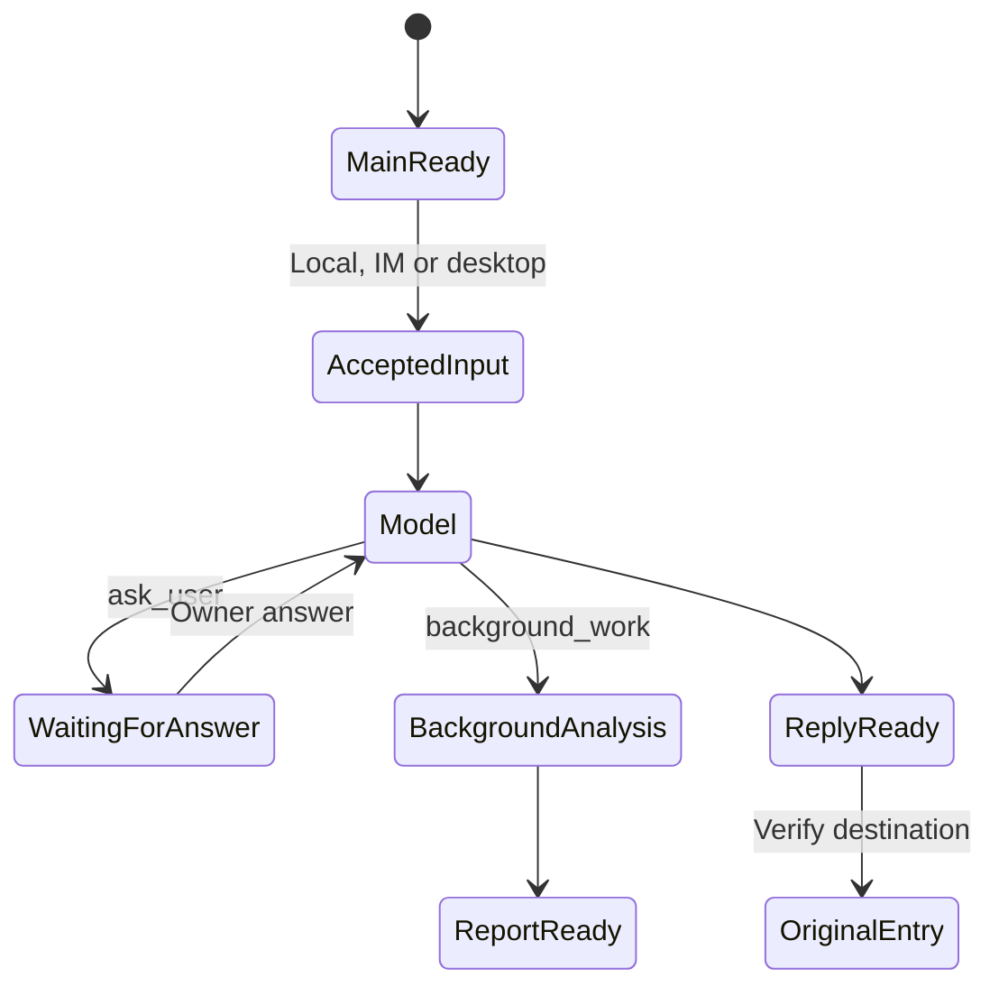
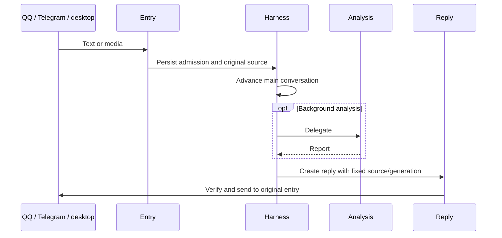

# Personal Durable Conversations

## Responsibilities and Boundaries

`apps/ruukoto/src/personal-*.ts` owns the Personal product's Pi 1.3.0 durable runtime: one main conversation, persistent analysis, schedules, memory and local/IM/remote entry points. It provides command workers, browser tools, application-data access, approvals and structured owner questions.

[Deployment](deploy.md) owns systemd configuration; [runtime](runtime.md) describes the separate Coding engine; [execution](execution.md) describes shared native primitives.

## Public Interfaces

| Command | Purpose |
| --- | --- |
| `ruukoto` / `npm start` | Guided models, backend, recent conversations, permissions and pending questions |
| `ruukoto serve` | Foreground durable backend; `--directory` fixes the profile |
| `ruukoto settings` | JSON model/MCP management and read-only fixed-root skill queries, online or offline |
| `ruukoto maintenance` | Verify and explicitly control the production service |
| `ruukoto remote` | Pair/revoke remote devices; host HTTPS/WSS with `remote serve` |

| Tool family | Main tools and responsibility |
| --- | --- |
| Analysis/delegation | `background_work`: persistent children, further instructions, progress and full reports |
| Questions | `ask_user`: one to three structured questions and continuation after answers |
| Scheduling | `schedule_create`, `schedule_query`, `schedule_cancel`: timed work in independent conversations |
| Memory/history | `memory`, `history_search`, `history_read`: versioned facts and history lookup |
| Files/network | `read_file`, `write_file`, `web_search`, `http_request`: access within granted scope, with approvals where required |
| Browser | `browser`: browser operation and screenshots |
| Application data | `app_data_*`: dedicated business database access |
| MCP | `mcp_tools`, `mcp_call`, `read_mcp_result`: eligible discovery, calls and original results; Pi handles transport/paging |

## Data and State

| Data | Authority |
| --- | --- |
| Conversations, children and analysis reports | Durable SQLite under the profile, default `~/.ruukoto-durable/` |
| Questions/answers/receipts | `ruukoto.questions` |
| Memory and skills | `ruukoto.memories`, `ruukoto.skills` and entries: revisions, revocation, source/body snapshots and invocation evidence |
| Schedules | `ruukoto.schedules`: rules, runs, execution snapshots and delivery credentials |
| Business data | `agent-data/main.db` |
| MCP | `mcp.json` configuration v4 and durable operation entries |

MCP v4 separates locally configured tool effects from remote definitions. The owner explicitly migrates configuration through management before new ordinary-service work is admitted. Save/apply receipts make migration recoverable. Existing credential references and their byte-digest semantics remain; explicit credential rebinding switches to the actual-token digest. Migration invalidates old unstarted approvals, preserves old unknown calls and keeps original computer stopping/recovery manageable.

Before each model request, skills refresh from the backend account's `$HOME/.agents/skills/` and save a full snapshot. The initial model view contains names/descriptions; `skill` loads bodies or references, and main supports `/skill:name arguments`. A child uses `run_command` to execute a script by its skill-directory path under the original work permissions. Restricted commands mount eligible directories from the original request snapshot read-only; binding evidence is recorded with command admission and intent. Source is not read by default. Current discovery is separate from old library configuration/managed state; schedules with incompatible old sources stop explicitly and require cancellation/recreation.

## Main Flows

Platform message identity deduplicates admission. Auto-review handles eligible read-only operations; sensitive actions follow the original platform's approval flow. Replies retain the original platform, account, owner and generation.

### Finalizing an Unknown MCP Call

When a sent write/unknown-effect call loses its reply, its source stops automatic business calls. An interrupted authorized read is a read failure instead. The owner can choose to end that work while keeping the result unknown. The work-ending path stops local execution; after member tasks and real resources are verified terminal/stopped, a final unknown-result report goes through the original-entry sending ledger.

Manual finalization adds facts; it never removes the original source's automatic-execution prohibition. New independent owner input may use the same service: its URL is not a business-resource lock. Old SSE reinspection tasks retire without networking after restart; recovery and queries read original records.

## Invariants and Failure Handling

- One instance owns one exclusive durable Harness; local, IM and desktop entries share its conversation facts.
- IM approvals/questions require the bound owner in the original platform/private chat. An answer is not a tool approval.
- Restart recovery reconciles pending work without repeating completed facts or replaying unknown external effects.
- Sending retains destination and outcome identity across connection failures. An inconclusive sent operation is not automatically retried as if unsent.

## Design Rationale

- [Personal product entry](../../.agents/notes/implemented/simplification/2026-10-18-personal-product-entry.md)
- [Personal tailscale https](../../.agents/notes/implemented/architecture/2026-10-24-personal-tailscale-https.md)
- [Personal token atomic publish](../../.agents/notes/implemented/bug-fix/2026-10-24-personal-token-atomic-publish.md)
- [Detach terminal from task runtime](../../.agents/notes/implemented/architecture/2026-09-19-detach-terminal-from-task-runtime.md)
- [Mcp host responsibilities](../../.agents/notes/implemented/simplification/2026-10-26-mcp-host-responsibilities.md)
- [Home skills discovery](../../.agents/notes/implemented/simplification/2026-10-28-home-skills-discovery.md)
