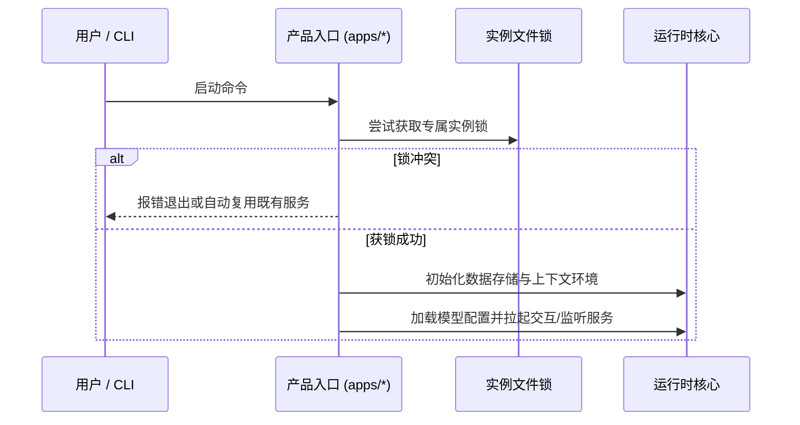

# 产品装配

## 职责与边界

`products` 模块（对应 `apps/ruukoto` 与 `apps/ruukoto-code`）负责将底层各共享包组装为两个定位明确的最终产品，并提供对应的命令行可执行文件（bin）、引导交互与前后台生命周期接线。

### 核心职责
- **`apps/ruukoto`**：个人 Agent 产品。装配 durable 原生持久层、引导式 CLI、QQ/Telegram 双通道及 PA 桌面远程协议。
- **`apps/ruukoto-code`**：Coding Agent 产品。装配基于 `packages/runtime` 的多任务调度器、终端 TUI、Web 控制台与工作区工程能力。
- **产品隔离**：两个产品在运行时完全独立，互不依赖，拥有各自独立的运行档案、实例锁与协议栈。

### 边界与非职责
- 个人端的会话推进、后台工作与记忆机制归 [personal-durable](personal-durable.md)。
- Coding 端的任务调度与 SubAgent 编排归 [runtime](runtime.md)。
- 跨平台的终端渲染与 CLI 命令分发归 [tui](tui.md)。

## 对外接口

两个产品分别提供独立的 CLI 二进制入口与核心交互命令：

| 产品 | 命令入口 | 核心作用与行为 |
|---|---|---|
| `ruukoto` | `ruukoto` / `npm start` | 无参打开个人交互引导菜单（支持聊天、状态查询、通道配对与能力配置） |
| `ruukoto` | `ruukoto serve` | 前台托管常驻后台服务（支持 `--directory` 指定独立档案路径） |
| `ruukoto` | `ruukoto settings` | 供外部客户端调用的结构化 JSON 配置接口，支持模型、Skills 与 MCP 管理 |
| `ruukoto` | `ruukoto remote` | 本机配对管理向导；`remote serve` 托管 Tailscale HTTPS/WSS 远程接入 |
| `ruukoto-code` | `ruukoto-code [路径]` | 打开指定工作区会话并启动 TUI，服务未运行时自动按需拉起后台 |
| `ruukoto-code` | `ruukoto-code server` | 前台启动 Coding 后台服务 |
| `ruukoto-code` | `ruukoto-code config` | 打开模型离线配置终端界面 |
| `ruukoto-code` | `ruukoto-code stop` | 优雅停止运行中的 Coding 后台服务 |

### 产品能力矩阵对比

| 能力维度 | `ruukoto`（个人 Agent） | `ruukoto-code`（Coding Agent） |
|---|---|---|
| **会话与状态模型** | Pi durable 1.3.0 原生记录与状态管理 | 共享 Runtime 编排，基于 SQLite 元数据 + JSONL 消息历史 |
| **主要交互终端** | QQ / Telegram 私聊、引导式菜单、PA 桌面 | 全屏终端 TUI、Web 控制台、Coding 桌面客户端 |
| **后台执行体系** | 长期子 Agent、异步分析委托、原生定时计划 | 串行任务队列、通用 SubAgent、Git Worktree 隔离与工作流 |
| **执行沙箱模式** | 宿主安全命令 Worker（支持有限与完全访问） | 原生系统沙箱（macOS Seatbelt / Linux bubblewrap） |
| **开发工作区模式** | 不提供项目级代码编辑与 Git 自动评审 | 支持任意本地工程目录与代码工作区 |

## 数据与状态

每个产品在宿主上持有严格隔离的数据与控制档案，互不干扰：

- **个人 Agent 档案根**：默认位于 `~/.ruukoto-durable/`（可通过环境变量 `RUUKOTO_PERSONAL_DIR` 覆盖），内部管理专属的 durable 数据库、凭据映射与认证 Socket。
- **Coding Agent 档案根**：默认位于 `~/.ruukoto-code/`（可通过 `RUUKOTO_CODE_DATA_DIR` 等变量覆盖），核心库 `meta.product.type` 显式标识为 `ruukoto-code`，并持有独立的实例锁与任务数据库。
- **互斥保证**：系统拒绝跨产品复用数据目录，防止底层存储布局混淆。

## 主要流程

### 1. 服务启动与初始化

- **个人 Agent**：使用当前配置的模型初始化唯一的 durable Harness；日常后台与菜单交互解耦，菜单退出不会中断后台任务。
- **Coding Agent**：按能力声明配置原生沙箱并装配 Runtime 与控制面 Socket；终端 TUI 启动时自动探测后台，支持按需拉起后台。

### 2. 构建与分发流程

根构建流程（`npm run build`）统一完成多包制品的编译与输出：
1. 编译生成跨产品共享的工具 Worker（`worker/worker.mjs`）与个人命令 Worker（`worker/personal-command-worker.mjs`）；
2. 编译 macOS 原生监督器与工作流驱动脚本；
3. 构建 `apps/ruukoto` 与 `apps/ruukoto-code` 的 npm 包，保留对同仓共享包的完整依赖链。

## 不变量与失败处理

- **装配纯粹性**：正式个人 Agent 仅装配自身持久体系，绝不反向加载旧 Runtime、Task Store 或控制协议；Coding 仅装配工程底座与开发能力。
- **档案互斥与版本一致**：严格禁止跨产品复用数据目录。底层 Schema 版本与当前代码版本不一致时拒绝启动，杜绝隐式损坏历史数据。
- **失败优雅降级**：模型配置缺失或网络故障时，服务仍可进入离线配置模式；外部客户端断开连接时，后台进行中的任务持续推进而不被级联取消。

## 设计依据

- [Coding 调度的固定配置与独立会话](../../.agents/notes/implemented/feature/2026-10-25-code-scheduled.md)
- [个人 Tailscale HTTPS 与 WebSocket](../../.agents/notes/implemented/architecture/2026-10-24-personal-tailscale-https.md)
- [Code MCP 按实例配置与旧格式退出](../../.agents/notes/implemented/simplification/2026-10-24-code-instance-mcp.md)
- [个人认证令牌完整写入后发布](../../.agents/notes/implemented/bug-fix/2026-10-24-personal-token-atomic-publish.md)
- [个人正式入口使用唯一 durable 装配](../../.agents/notes/implemented/simplification/2026-10-18-personal-product-entry.md)
- [两个 Agent 产品](../../.agents/notes/implemented/architecture/2026-10-02-two-agent-products.md)
- [同仓 workspaces 分包](../../.agents/notes/implemented/architecture/2026-10-11-in-repo-workspace-packages.md)
