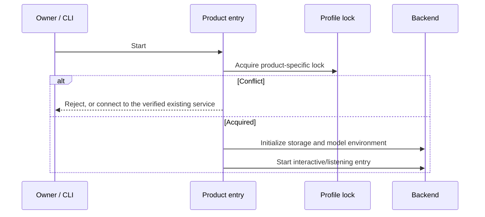

# Product Composition

## Responsibilities and Boundaries

`apps/ruukoto` and `apps/ruukoto-code` assemble the two products and own their executable entry points, guided setup and lifecycle wiring. Personal assembles durable, QQ/Telegram and PA remote access. Coding assembles the shared runtime, TUI and engineering workspace capabilities. They have independent profiles, locks and protocols and do not depend on each other.

Conversation progression and memory belong to [Personal durable](personal-durable.md); Coding scheduling and delegation belong to [runtime](runtime.md); shared terminal rendering and command dispatch belong to [TUI](tui.md).

## Public Interfaces

| Product | Command | Purpose |
| --- | --- | --- |
| Personal | `ruukoto` / `npm start` | Guided menu for chat, status, pairing and capabilities |
| Personal | `ruukoto serve` | Foreground backend; `--directory` chooses a profile |
| Personal | `ruukoto settings` | Structured JSON management for models, skills and MCP |
| Personal | `ruukoto remote` | Local pairing wizard; `remote serve` hosts Tailscale HTTPS/WSS |
| Coding | `ruukoto-code [path]` | Workspace conversation and TUI; start the backend on demand |
| Coding | `ruukoto-code server` | Foreground backend |
| Coding | `ruukoto-code config` | Configuration UI, including offline model setup |
| Coding | `ruukoto-code stop` | Graceful backend stop |

| Capability | Personal | Coding |
| --- | --- | --- |
| Persistence | Pi durable 1.3.0 records | SQLite metadata plus JSONL history |
| MCP | Thin Pi adapter retaining durable tool identity | Official MCP/tool_search with host approvals and artifacts |
| Clients | QQ/Telegram private chat, menu, PA desktop | TUI, control clients and Coding desktop |
| Background work | Persistent child Agents, analysis, native schedules | Queued tasks, SubAgents, worktrees and workflows |
| Commands | Personal command worker, restricted/full access | macOS Seatbelt or Linux bubblewrap, plus full access |
| Workspaces | No engineering workspace/Git-review product | Local code workspaces and engineering tools |

## Data and State

Personal defaults to `~/.ruukoto-durable/`, overridden by `RUUKOTO_PERSONAL_DIR`, and holds durable data, credential mappings and its authenticated socket. Coding defaults to `~/.ruukoto-code/`, with directory overrides such as `RUUKOTO_CODE_DATA_DIR`; `meta.product.type` identifies `ruukoto-code` in its database. Cross-product profile reuse is rejected.

## Main Flows

Personal initializes the one durable Harness from configured models. Its daily menu is separate from the backend: closing the menu does not cancel backend work. Coding assembles runtime, native execution and control socket; the TUI discovers or starts its backend.

Root `npm run build` builds native supervisors, shared and Personal workers, workflow script/WASM, then the two product packages with their complete shared-package dependencies. It does not package the Electron application.

## Invariants and Failure Handling

- The production Personal entry does not load the legacy shared Runtime, task Store or control protocol as its persistence authority.
- Profiles remain product-specific. Unsupported schema versions fail before use; newer databases are not silently rewritten.
- Missing model configuration can be addressed through offline setup. A disconnected client does not cancel accepted backend work.

## Design Rationale

- [Code scheduled](../../.agents/notes/implemented/feature/2026-10-25-code-scheduled.md)
- [Personal tailscale https](../../.agents/notes/implemented/architecture/2026-10-24-personal-tailscale-https.md)
- [Code instance mcp](../../.agents/notes/implemented/simplification/2026-10-24-code-instance-mcp.md)
- [Personal token atomic publish](../../.agents/notes/implemented/bug-fix/2026-10-24-personal-token-atomic-publish.md)
- [Personal product entry](../../.agents/notes/implemented/simplification/2026-10-18-personal-product-entry.md)
- [Two agent products](../../.agents/notes/implemented/architecture/2026-10-02-two-agent-products.md)
- [In repo workspace packages](../../.agents/notes/implemented/architecture/2026-10-11-in-repo-workspace-packages.md)
- [Mcp host responsibilities](../../.agents/notes/implemented/simplification/2026-10-26-mcp-host-responsibilities.md)
