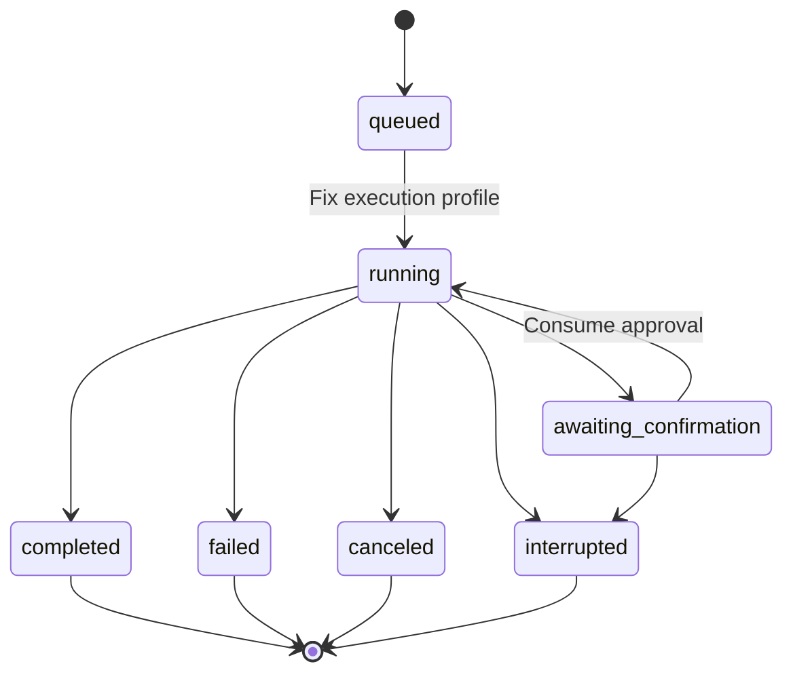
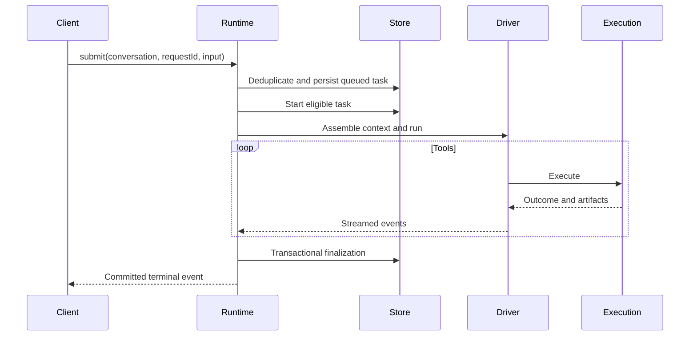

# Task Runtime

## Responsibilities and Boundaries

`packages/runtime/src/` coordinates the Coding backend: task lifecycle, per-conversation queues, model driving, SubAgents, backgrounds and restart recovery. Production Personal uses [its durable runtime](personal-durable.md) instead.

Queue order is persistent (`queue_order`/`queue_revision`). Ordinary owner inputs may be reordered or explicitly converted to guidance for the running task. `task_guidance` routes it to the next safe boundary; if that boundary is missed, the input returns to the queue head. Execution profiles fix identity, write target and access policy at task start.

Runtime owns one-level SubAgent delegation, independent work copies, parent delivery and explicit integration. It also supervises conversation backgrounds and their occupancy. Ordinary Coding side chat has dedicated `open/find/submit_side_chat` entries, no tools or directory occupancy, and at most one unfinished task; it can run alongside its parent.

[Execution](execution.md) owns tool processes; [context](agent-context.md) owns model input; [control](control.md) owns authenticated transport; [channels](channels.md) owns shared IM adapters.

## Public Interfaces

| Entry | Caller | Contract |
| --- | --- | --- |
| `submit` | Clients | Verify `(sessionId, requestId)` and queue a persisted task |
| `cancel` / `interrupt` | Owner/system | Request execution stop and converge task state; preserve unresolved stop facts |
| `switch_mode` | Owner | Change access mode at an eligible safe boundary |
| `resume_queue` | Owner | Explicitly resume a paused/recovered queue |
| `task_queue` / `queue_reorder` / `steer_task` | Owner | Read order/revision/eligibility, reorder ordinary input, or route it as guidance |
| `work_*` / `subagent_close` | Control | Inspect work, cancel delegation or close an idle child |
| `subagent_delegate` | Main Agent | Assign goal, role and target to a child |
| `subagent_result` | Main Agent | Read child result, artifacts and work messages |
| `subagent_integrate` | Main Agent | Explicitly integrate validated child changes |
| `subagent_cancel` / `subagent_close` | Main Agent | Cancel work / close an idle SubAgent |

Conversation identity determines entry eligibility: ordinary development conversations accept owner input and can delegate; legacy/shared `main` accepts channel input; SubAgent conversations accept assigned work and cannot delegate further; scheduled identities carry fixed sources. Side conversations and retired conversations have their own restricted entry rules, rather than being ordinary development conversations.

## Data and State

`work_delegations` represents the goal and source of a multi-task assignment. `sub_agents` represents the child's persistent identity, conversation and work copy. `tasks` represents individual executions, linked through `parentTaskId`. Completion of one task does not close its SubAgent or finish every possible future assignment.

Directory occupancy excludes competing writers. Task finalization releases it only after required execution-stop verification. Persistent backgrounds retain their occupancy until verified exit.

## Main Flows

Delegation prepares an isolated context/work copy, then registers work, child identity and task facts transactionally. Filesystem work is not part of SQLite atomicity. The child executes independently; completion registers a parent wakeup. The main Agent reviews results and explicitly integrates changes.

Required role/workflow/delegation MCP tools are verified after official registration and before the model starts. Task source eligibility remains pinned; revocation can narrow it, while discovery or SDK restoration cannot enlarge it.

### Coding Scheduled Execution

Due schedules activate independent development conversations from fixed engineering configuration. Their history and results remain available after task finalization; the personal notification outbox is not the Coding conversation's persistence authority.

## Invariants and Failure Handling

- Identical `(sessionId, requestId)` replay returns the original task; changed parameters produce `request_conflict`.
- One execution entity owns a write target at a time; competitors wait or fail.
- Task state, approval invalidation, occupancy changes and corresponding events finalize in one transaction, subject to verified stopping.
- After backend restart, unfinished shared-runtime work becomes `interrupted` with `backend_restart`; pending approvals become stale and ordinary queues pause for explicit owner resumption.
- Side-chat queued tasks also become interrupted, but its queue does not pause or replay input; new submissions are validated normally.
- MCP business-effect uncertainty is separate from resource stopping. An unknown write stops automatic business execution and preserves its ledger; SubAgent reuse still waits for local processes and actual shared resources to stop.

## Design Rationale

- [Detach terminal from task runtime](../../.agents/notes/implemented/architecture/2026-09-19-detach-terminal-from-task-runtime.md)
- [Work delegation subagent task](../../.agents/notes/implemented/architecture/2026-10-03-work-delegation-subagent-task.md)
- [Code scheduled](../../.agents/notes/implemented/feature/2026-10-25-code-scheduled.md)
- [Preserve session history](../../.agents/notes/implemented/architecture/2026-09-19-preserve-session-history.md)
- [Mcp host responsibilities](../../.agents/notes/implemented/simplification/2026-10-26-mcp-host-responsibilities.md)
