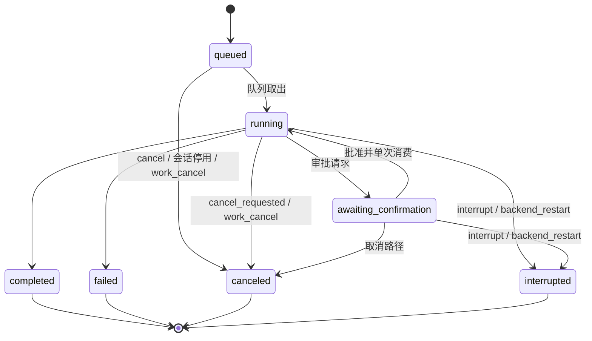
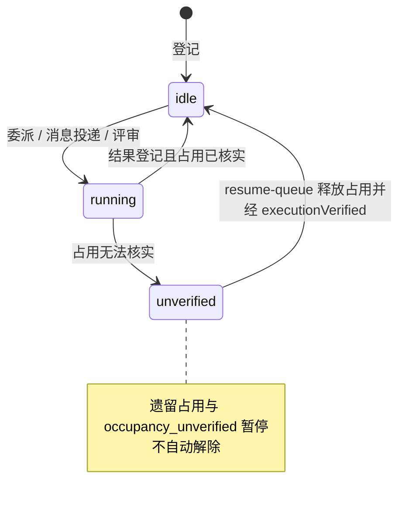
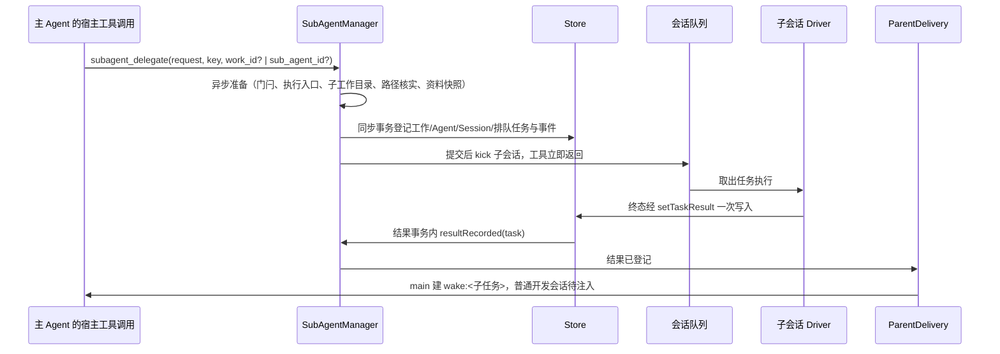

# 任务运行时

## 职责与边界

本篇的运行状态、历史或客户端协议适用于 Coding 与保留的旧格式实现；正式个人 Agent 使用[个人持久会话](personal-durable.md)，不接入旧 Runtime、Task Store 或控制协议。

任务运行时（`packages/runtime/src/`）是后台的编排中心：它拥有任务生命周期与队列、会话身份与执行画像、任务收尾、父级送达、SubAgent 生命周期与全部委派行为、后台崩溃恢复，以及旧实例导入的设计。单个后台进程持有调度、任务状态与事件，每个会话用独立的 pi SDK 实例驱动；交互终端（TUI、CLI、IM 入口、GitHub 事件来源）只提交与观察，断开或关闭不取消任务。

它负责：

- 把一次提交变成持久任务，按会话 FIFO 排队并串行执行，终态在一个事务内收尾。
- 按会话身份决定入口资格，按身份、写入目标与宿主评审算出一次任务的执行画像并钉到任务结束。
- 决定父级会收到什么、何时收到：SubAgent 结果与发给主 Agent 的工作内消息进入主 Agent 模型调用的时机。
- 全部 SubAgent 委派行为：登记、继续、复用、协作加入、工作内消息、整项取消、修改委派、改动汇总、结果与通知、宿主固定评审、重启恢复。
- 模型配置与模型栈由 `models.ts` 的 RuntimeModels 持有，任务、Driver、压缩和配置锁由 Runtime 持有。
- 后台异常重启后的恢复顺序与人工核实的出口。
- 旧实例导入的设计（源只读、离线、快照、allow-list、回执与回退边界、执行归属交接）。

它不负责：工具的实际执行与执行边界（原生沙箱、挂载、目录身份与 worker init）见 [execution](execution.md)；工具可用性清单、审批闸门、工具操作账本、产物与 MCP 见 [agent-tools](agent-tools.md)；模型上下文的组装、压缩、历史与记忆见 [agent-context](agent-context.md)；控制面 socket 与拥有者认证见 [control](control.md)；IM 平台连接、入站登记与 GitHub 事件来源见 [channels](channels.md)；调度计划与通知 outbox 的发送账本见 [scheduler](scheduler.md)；数据布局、schema 与会话身份的存储原语见 [core](core.md)；命令与配置的操作步骤见 [docs/usage.md](../usage.md)。

## 对外接口

`Runtime.models` 提供模型列表、配置视图、目录及凭据管理、默认/摘要选择和连接测试；控制面直接调用它，协议名不变。配置修订、引用核实、门闩和回滚由该模块集中处理，文件操作复用 agent/model-config。任务登记仍在 Runtime 或委派管理器的事务内完成，并同步执行模型解析返回的复核。

`searchHistory` 的 workspace_chats scope 与会话摘要共用 `Store.getSessionIdentity` 的普通开发身份资格，包含存档并保留原资料身份；内部报告分类沿用任务的持久关联，只排除内部用户输入，可展示的 Agent 总结仍可搜索。来源的待落盘／丢失判定同时检查索引登记和已提交条目引用。`readHistoryWindow` 分批准备单会话索引，再读取目标附近或前后连续窗口；旧 `readHistory` 与无 source 的单条补读继续兼容。

`listBackgroundProcesses`、`backgroundProcessOutput`、`stopBackgroundProcess` 与 `endSessionBackground` 管理本会话独立后台。启动由完全访问的真实普通开发工具来源接纳；状态与日志查询、可信停止按会话核实。原关闭请求保存接纳水位和固定目标集合，重复请求只核实原集合，不能据其 stopVerified 推断后来新执行也已停止。

`listOwnerQuestions` 提供待答及最近终态，`answerOwnerQuestion` 只接受可信普通开发入口的逐题回答或跳过，校验单选或多选索引与选项名正文一致；规范化输入包含完整选项元数据、多选标记与空答案。`cancelOwnerQuestion` 和 `findOwnerQuestionReceipt` 管理独立取消与原键回执。回答经宿主私有绑定进入 `submit`，普通聊天不消费问题；原入队事务同时保存答案、当前回答权限、唯一 Task及事件。原任务自然结束、会话存档或重启保留问题，显式取消原任务使未答问题 stale。

任务查询及应答从工作流专属送达或等待报告的持久补报及排队别名绑定派生输入用途；历史首屏、分页与单条读取先核实原任务属于当前会话或 `branchSource.taskIds`，再派生同一分类。缺任务、跨会话关联或已知内部任务条目缺标记时返回关联诊断并保留普通展示，不靠正文或请求键推断。

`readToolResult` 按原会话历史归属读取指定工具结果，支持旧预览或 core 的结构字段分页；参数与 UTF-8 游标见[控制面](control.md#不变量与失败处理)。不读取工作区当前文件或重算差异。

工作流定义库、模型发起与 CLI/TUI/IM 可信控制见[工作流](workflows.md)。启动同时固定定义名或临时标题、显式简短说明及宿主创建时间，不从参数推导摘要；查询投影直接取持久字段。当前列表先保留所有活动运行和最近十项终态再分页，历史列表包含全部运行。显式启动固定会话当前模型和模式，在单一事务创建/结束短期发起任务并登记运行和适用 IM 回执；模型启动沿活动任务。编译/模型预检后的事务重新核实来源、配置门闩与目录身份，已接受原键先返回固定运行。父级送达按固定代次将结果交给有效等待父轮，或登记唯一无工具汇总任务；dev 也进入实时结果登记和冷启动补记，main 沿原 IM 事件回复，定时来源只由调度整项回报。暂停及混有普通输入的队列遵循既有恢复规则。

`listWorkspaceFiles`／`readWorkspaceFile` 仅按已登记项目根提供只读分页，不经过模型或 Agent 工具。拥有者查询不采用 Agent 的保护根限制，也不遍历后台保护树；根目录身份、规范相对路径和每段父链读取前后核实，允许普通硬链接，拒绝符号链接、非普通文件与变化中的内容；目录异步枚举单层、内存保留下一页 201 个候选并最多返回 200，以目录优先及名称固定顺序续页；cursor／nextCursor 绑定工作区、相对路径、根／父链身份与目录修订，页间或读中变化拒绝，文件按 256 KiB 字节页返回 base64，version 绑定文件身份、大小及修改时间，跨页改变拒绝，无总文件长度上限；缺失与权限失败保留具名错误且不暴露宿主绝对路径。纯 Node 的前后身份核实不是原子 openat 沙箱。

`listSkills` 保留有效技能库的 TUI 查询；`listManagedSkills`、`getSkill`、`previewSkillImport`、`importSkill`、`setSkillEnabled` 与 `removeSkill` 将当前 Code 实例的技能查询和管理交给共享技能库。托管根位于自身 agentDir，外部来源只读；导入提交按原预览身份、源内容修订和管理修订核实，启停与逻辑移除只改清单。管理不创建任务、改变工具权限或改写既有技能正文；当前有效技能选择及旧引用的保持规则见[上下文与技能](agent-context.md)。

`branchSession` 由产品的 `branchSessions` 能力开放，核实普通开发身份、工作区映射及目录身份后固定来源历史和设置；`findBranchSession` 按持久请求键核实发布结果。创建不提交任务或调用模型。

`Runtime.start(config)` 要求 app 注入 `config.product`（`RuntimeProduct`）：身份用于数据目录登记，IM 与调度能力决定启停，产品工具族由 app 的工厂提供。共享运行时不按产品名装配。具体产品归属见[产品装配](products.md)。

**驱动本模块的入口。** 控制面（[control](control.md) 与 CLI/TUI）提供 `submit`、`continue`、`interrupt`、`cancel`、`resume_queue`、`switch_mode`、`set_session_mode`、`confirm`，以及工作维度的只读查询 `work_list` / `work_get` 与写操作 `work_cancel`、`subagent_close`（CLI 分别对应 `ruukoto-code work list` / `ruukoto-code work show` / `ruukoto-code work cancel` / `ruukoto-code work close`）。普通控制面的 `submit` / `continue` / `switch-mode` / 会话默认模式不能作用于子会话。channels 与 scheduler 经入站事件与唤醒任务驱动建任务；每个任务带 `source_event_id` 时出队走既有入站门。

**本模块提供给模型的宿主工具。** `subagent_delegate`（登记一次委派，分析或修改）、`subagent_result`（读取结果，省略 `work_id` 时列出本会话 SubAgent 总览，`part=messages` 查看工作内消息）、`subagent_cancel`（整项取消）、`subagent_close`（显式关闭）、`subagent_message`（工作内消息）、`subagent_integrate`（改动汇总）。这些工具属 `subagent` 类别，由 [agent-tools](agent-tools.md) 按执行画像装配；每次调用重新核实宿主任务、会话与身份绑定。

**本模块调用的部件。** Store 的 SQL 原语（任务、占用、工作、Agent、消息、导入回执与账本、事件）；Driver 与 agent-context 组装并流式调用模型；SubAgentManager 持有普通 SubAgent 状态与指针，WorkflowCoordinator 持有运行绑定步骤的状态与指针；ParentDelivery 决定结果与消息的送达；编排器负责入站派发、结果回传与角色队列恢复；调度器、IM 入口表（工作最终汇报经 `sendWorkReport` 回调交给拥有者 IM 入口）与执行后端的宿主入口。

**本模块发布与消费的事件。** `task.queued`、`task.started`、`task.completed`、`task.failed`、`task.canceled`、`task.interrupted`、`task.tool_process_unreaped`、`task.mode_switched`、`task.mode_switch_requested`、`task.mode_switch_failed`、`task.awaiting_confirmation`、`task.approval_consumed`、`session.queue_paused`、`occupancy.stale`、`work_delegation.created`、`work_delegation.canceled`、`work_delegation.integrated`、`subagent.closed`、`subagent_message.sent`、`subagent_message.dropped`、`subagent_task.*`、`child_task.*`、`session.history_unreadable`、`agent_wait.changed`、`agent_report.changed`、`task.resources_changed`、`*.reply_skipped`。

**会话身份与入口资格。** 身份由 `packages/core/src/session-identity.ts` 一次判定：`Store.getSessionIdentity` 读出会话、角色行与 SubAgent 行，纯函数 `classifySession` 分五种身份。Runtime 各入口按身份一行判定，错误码与文案留在各入口；每次调用的宿主身份重核（main 绑定、委派资格、群结果工具、IM 长期授权）用同一解析，但每次新鲜读取。

| 会话身份 | 判定依据 | 提交与模式入口 | 本模块的相关行为 |
| --- | --- | --- | --- |
| 普通开发会话 | 不绑定角色、拥有者直接对话的用户会话 | 接受提交；计划模式只限此身份 | 委派的合法父会话；结果与工作内消息经下一次任务开始注入 |
| main 会话 | 宿主为 main 绑定的会话 | 接受提交 | 委派的合法父会话；结果与消息经唤醒任务送达 |
| 独立调度会话 | 每次运行经 `schedule_runs.session_id` / `root_task_id` 绑定，资料项目来自计划 | 不接受用户提交、继续或改模式 | 保留个人业务工具与委派资格，全部派生任务属于本次运行 |
| SubAgent 会话 | `sub_agent` 行存在（SubAgent 行优先；会话类别也是 dev） | 提交、改默认模式与切换模式一律拒绝 | 只承接委派、消息投递与评审；不能委派下级 |
| 已退役归档会话 | QQ 群会话、chat/coding 角色会话（附退役原因） | 提交按原因拒绝；队列兜底按原因取消 | 只读归档，不运行任务；`resume-queue` 按身份取 Agent 行 |

委派登记核实普通开发、main 或独立调度来源，角色和目标不能提供来源身份。

**执行画像。** `tool-availability.ts` 的 `executionProfile` 按会话身份、持久来源、角色与宿主限制确定工具类别、MCP、资料范围、计划资格及 SDK 签名。普通与工作流共用来源计算；显式角色工具必须全部可用，步骤 `tools` 只能进一步收窄。宿主固定评审另限 `read` / `read_artifact` 与只读 MCP，禁消息。画像在任务开始固定，激活、发送前检查与调用门共用；工作区与占用由 `core/worktree.ts` 的 `taskWorkspaceFor` 解析。

Runtime 另持有跨任务的 `BrowserManager`，Coding 底座持有；Driver 的每任务 registry 不承担浏览器归属。正常任务结束保留浏览器，活动任务的取消、有效模式切换和后台停止先核实自有 Chrome、CLI daemon 与 dashboard 的停止；附接只停自己的连接进程。改变同会话另一排队任务的模式不关闭当前任务的浏览器。启动先恢复浏览器绑定、核实旧执行停止，再恢复任务，不重放旧动作；未核实状态仅影响浏览器能力。

拥有者打开工作区、新建会话、分支与组织迁移只核实目录身份及既有归属，不查询 Agent 保护根。登记不授予任务文件权限；受限任务在实际执行入口核对范围，完全访问使用后台账户已有权限。

## 数据与状态

浏览器绑定保存在核心库 `meta.browser_bindings_v1`，包含会话、代次、自有/附接、目标、进程启动身份、人工暂停、未知效果及失败码。更新与 `browser.binding_changed` 事件同事务；Chromium profile、图片文件与 SQLite 没有跨文件原子保证。关闭保留 profile 与图片，空闲退出以进程存活监督为依据，不发保活命令。安装、登录和恢复步骤见[操作手册](../usage.md#12-浏览器)。

[工作流](workflows.md)使用独立运行授权与队列，默认接真实步骤，测试可注入执行器；来源任务结束后仍可调度，步骤结果由协调器消费。普通出队与工作流启动共用来源名额，释放占用后唤醒两种队列。运行派生的宿主操作任务经 HostExecutionManager 执行，不建立模型会话；普通工作副本操作保留 Driver 路径。

**任务（`tasks`）。** 状态集合 `queued` / `running` / `awaiting_confirmation` / `completed` / `failed` / `canceled` / `interrupted`；在线终态只有后四种。字段：`access_mode`（`confirm` 默认 / `full_access` / `auto-review`）、`plan_mode`、`permission_version`、`granted_paths`、`pending_access_mode`、`interrupt_reason`、`cancel_requested`、`effect_unknown`、`error_message`、`history_entry_ids`、`resumes_task_id`、`agent_id`、`parent_task_id`、`source_permission_version`、`source_event_id`、`deadline`、`result_summary`、`result_ref`、`created_at` / `started_at` / `ended_at`；唯一键 `(session_id, request_id)`。

模式绑定任务：任务携带 `accessMode`（默认请求确认）、权限版本与授予路径；模式与范围进入提交幂等比较。切换只在无执行中工具的边界生效，递增权限版本并使等待中的审批失效。切换未核实记专用 `task.mode_switch_failed`。

委派的新建、继续、复用与协作加入均取本次发起任务，已有任务不会被后续会话默认或别的任务切换改写。消息在登记事务内保存发送任务、当时模式与权限版本，忙碌排队及重启后按该快照投递；结果唤醒以终态子任务为来源，沿其已保存模式与权限版本恢复。来源登记前的异步准备完成后再次核实活动状态和权限版本，变化则拒绝新增任务；已经登记的触发授权独立保留。

**目录占用（`occupancy`）。** 键为 `cwd_real`，附带 `cwd_dev` / `cwd_ino`、`session_id`、`acquired_at`，`task_id` 与 `process_id` 恰有一个持有者。普通占用键是任务的写入目标（`taskWorkspaceFor`），按 `taskId` 释放；后台占用仅在独立执行停止核实成功时释放，Task 终态和 resume_queue 不能清除。

`RuntimeBackgroundProcesses` 先登记 starting，再由 Driver 在串行工具边界停止临时 worker；交接事务保存参考快照、当前轮 conversation 阶段并无空窗转占用，随后一次认领与实际启动。当前轮和后续拥有者轮只观测后台，停止后通过 status 或进程 wait 重新取得目录才恢复业务工具；无 agent_wait 历史也能准入。子工作、其他会话和同会话业务写入均受独立占用约束；目录冲突明确要求先停止，不靠等待释放自己的后台。

**工作委托（`work_delegations`）。** `id`、所属父用户会话、发起任务、`sub_agent_id`、首次委派键 `request_key` 与参数摘要 `params_digest`（唯一键 `(parent_session_id, request_key)`）、取消三列 `canceled_at` / `canceled_by`（`owner` 或 `agent:<任务ID>`）/ `cancel_reason`、写入目标 `write_target`。工作状态由取消列与任务状态派生，不新建状态机。

**SubAgent（`sub_agents`）。** `id`、父用户会话、独立 Session、宿主生成的独立工作目录 `work_dir`、当前工作指针 `active_work_id`、当前任务指针 `current_task_id`、执行状态 `state`（`running` / `idle` / `unverified`）、关闭两列 `closed_at` / `closed_by`（`owner` 或 `agent:<任务ID>`）。

**工作内消息（`subagent_messages`）。** 工作、父会话、发送方（`from_sub_agent_id` 为空 = 主 Agent）、发起任务、登记时的 `access_mode` 与 `source_permission_version`、接收方、`request_key` 与 `params_digest`、正文 `body`、投递结果 `delivered_task_id` / `delivered_at` / `undelivered_reason`；幂等键为（工作, 发送方, 键）。

**写入目标（`work_delegations.write_target`）。** 直接写入记 `{kind:"direct", path, dev, ino}`；worktree 记 `{kind:"worktree", repoRoot, commonGitDir, gitdir, path, dev, ino, branch, baseCommit}`；为空表示无目标的独立执行工作；增加修改目标需新建工作。

**结果引用（`result_ref`）。** 明确 `workId` / `subAgentId` / `taskId` / 原直接父任务 / 所属父会话 / `outcome` / `artifactIds`。

**会话队列。** 每会话一个队列状态：`active`，或 `paused` 携带暂停原因 `backend_restart` 与 `occupancy_unverified`。

**实例导入（`instance_imports` / `instance_import_items`）。** 回执记 `request_key`、源实例与产品、源 schema 版本、源目录、计划摘要、目标备份路径与 sha256、事件区间、报告、状态 `applied` / `reverted` 与回退时间。条目账本主键 `(kind, item_id)`，类别覆盖 `project`、`session`、`sub_agent`、`work_delegation`、`memory`、`grant`、`meta`、`file`、`agent_role`、`schedule`、`platform_config`、`standing_permission`、`credential`。

**任务状态机。**

终态路径只经 `Store.endTask` 的条件更新，只有当前状态仍在起点集合时才继续；重复终态只记一份。

**SubAgent 状态机。** 关闭是独立维度（`closed_at` / `closed_by`），不进入 `state`；已关闭的 Agent 仍可查历史、产物与工作目录。

**请求键与幂等键。** 提交的幂等键是 `(session, request_id)`；首次委派以 `(父会话, key)` 唯一查工作，工作内以 `sdelegate:<workId>:<key>` 查任务；消息投递请求键 `smsg:<消息ID>`；唤醒键 `wake:<childId>`；入站重提键 `evt:<eventId>`；导入请求键由计划文件派生。

## 主要流程

会话分支经 `packages/runtime/src/branch-session.ts` 编排：固定快照与限定来源 → 事务保存准备回执 → agent 独占写入并刷盘、安装独立 JSONL → 同一数据库事务发布会话、独立压缩点、完成回执和创建事件 → 提交后应答及广播。文件与 SQLite 没有跨文件事务；启动恢复只使用原回执和已核实文件，无法核实则记录失败，不发布半成品。原任务、占用、审批、工作和通知继续归来源会话，新任务仍受共享目录占用约束。

连续分支只继承已有且仍可核实的来源集合。来源产物固定字节上限与状态，图片及跨项目资料每次读取重新校验；SubAgent 结果只允许固定的已完成任务和产物，不能扩展到后来执行或复用的结果。来源关系不进入委派、消息、关闭、取消和汇总的归属核实。

### 提交、排队与执行

手动压缩由 `compactSession` 接收、`getSessionCompaction` 查询、`interruptSessionCompaction` 取消，只开放产品声明了 `manualCompaction` 的普通开发会话。接收在首次异步等待前持久登记并占住会话，拒绝已有排队、运行、等待确认或正在启动的任务；提交与继续在最终入队事务内重检，队列启动同样参与占用判断。摘要不取得工作目录执行锁，不创建普通任务、Driver、工作委托或工具 worker。

每次接收固定会话模型与摘要配置，严格只读历史并保存文件身份、字节范围、指纹和预期旧点。后台独立执行摘要，成功在同一事务核实来源及旧点、替换压缩点、保存回执和完成事件；取消先提交则不发布新点，成功先提交则取消返回原成功。摘要 provider 纳入配置应用的使用中检查。模型等待结束后释放会话占用；停止先中止并等待摘要再关库，启动恢复把遗留在途记录定为中断，不重发。

1. 入口按会话身份放行或拒绝（SubAgent 拒绝、计划模式只限普通开发会话、归档按原因拒绝）。
2. 提交先按 `(session, request_id)` 幂等查重：同键同参重放返回原任务，同键异参报 `request_conflict`；重试先核实原请求，不换键重复提交。模式与范围参与幂等比较。
3. 登记 `queued` 任务并写 `task.queued` 事件；新消息持久化为任务后按会话 FIFO 调度，不使用易失的 SDK follow-up 队列。
4. 业务执行前核实登记真实路径与 inode，以本次设备号占用工作目录（realpath 与 dev/ino 识别，覆盖符号链接与挂载别名），目录已被占用则等待释放；有持久等待快照的主轮可先进入仅处理对话与后台记录的阶段。同目录判定按 dev/ino 相等、realpath 相等或按分隔符边界互为前缀（祖先/子孙）；同一会话一次只执行一个任务，不同会话在目录不冲突时并行。
5. 任务开始时钉定执行画像；业务工具签名变化时重建 SDK 会话，内部对话阶段在现有 Driver 中收窄工具，不新增历史写入者。
6. 等待审批时任务转 `awaiting_confirmation`，由审批闸门负责决定与单次消费（见 [agent-tools](agent-tools.md)）；模式切换只在无执行中工具的边界生效，递增权限版本并使等待中的审批失效。
7. 终态经任务收尾事务落定。

### 任务收尾

进程 wait 订阅提交后事件并查询本会话后台，不参与任务／工作流报告认领。主命令退出、尚未登记停止意图且未核实整组停止时立即返回 attention；已登记停止意图则继续等待停止证明；新拥有者输入提交后同时打断这种等待，后台继续持有目录。超时和取消清理等待订阅，不取消目标；旧 agent_wait 名称仍用于历史结果和账本恢复。

`wait` 固定同来源的一组任务或工作流，先订阅提交后事件再查询持久事实；停止核实后才让出目录，新可信拥有者输入成功提交会打断旧等待但不取消后台工作。结果与报告权分别登记：有效父轮接管后继续处理，固定组全部就绪及完整输入被接受后才最终汇报；介入问句保留消费并释放报告权。续接轮只等最后一项也须通过 `reportTargets` 接受全组再汇报，原消费不改。未完成报告沿持久原键补报；已经开始的汇总不再授予第二份报告权，同源多目标共用一份总结及适用外发。

运行中任务经 agent 的 `endTaskExecution`：先保存取消意图与首次中止快照，再由执行归属停止并核实；共享上下文贯穿队列、Driver 与嵌套工作流，停止后重读快照，在终态事务补已知结论，仅条件更新成功才标未知效果、清待生效模式、失效未消费审批及写终态事件。只有成功释放占用才唤醒队列；未中止的自然收尾不补工具结果。queued、重启恢复与零执行单元启动的即时任务仍直接用 `Store.endTask`。

停止 false、抛错或归属缺失保留占用并写 `task.tool_process_unreaped`。普通队列仅在 `getDriver` 尚未返回、任务尚未启动时可按已核实结束；取得 Driver 后的异常即使 worker 已停也保守保留，防止终态事务回滚丢失浏览器等停止失败事实。工作副本父任务停止失败的兜底沿用请求前捕获的快照，不再次停止或释放占用；兜底落盘再次失败则报告诊断、保留现场待恢复。自然完成的已知结果与退出未核实分别记录；已提交终态不被后续兜底覆盖。

### 通用定时执行

每次到期执行在独立会话中接受计划说明与显式资料，不复制主会话或前次运行历史。该会话以调度运行绑定取得个人业务工具与委派资格，资料项目、访问模式和回报目标均来自计划保存的记录。模型配置与执行入口准备后，来源复核、会话创建、首次任务、入站关联和运行绑定在同一事务提交；失败不会留下半条任务或会话。

委派、工作内消息与结果汇总沿 `parent_task_id` 的实际发起任务亲缘归入本次运行。首次任务或进度回合完成不会立即关闭：全部派生任务已到终态且结果已登记、待消息已送达或有明确未投递结果、每个未取消工作子任务的结果汇总已完成，以及全部停止占用已核实，才固定运行结果并交调度器向原目标登记一次最终回报。中间回答和单项工作结果不自动发到 IM；无目标保留运行记录。

取消计划先持久化取消事实，再对该运行全部排队任务定取消、活动任务记取消意图，停止全部工作与派生执行；运行通过工具取消自身时，宿主仅对已核实的发起任务异步停止，让工具先返回，其他任务仍等待停止核实；登记与队列开始都会重核取消及关闭状态，迟到消息或结果不能新增执行。成果、未知效果及未核实占用按原规则保留。重启后已开始执行的任务定中断，不重放；已登记未执行的首次任务、子任务与汇总保留原任务键、模式、目标和上下文归属，只有运行仍开放且没有未知效果或未核实占用才恢复队列。

### 委派登记与执行范围

主 Agent（拥有者的普通开发会话或 main）经 `subagent_delegate` 登记工作委托、创建动态 SubAgent 与独立子会话并派出一次通用执行任务或带目标的修改任务。

- **触发来源**：拥有者直接提交、已核实身份的 QQ／Telegram 私聊任务及宿主保存来源授权的工作唤醒可以委派；GitHub 等外部评审仍拒绝模型委派。
- **输入与固定参数**：模型提供 request/key、可选 role、work_id/sub_agent_id、target 及开发会话 read_paths 或个人会话 materials；工作与身份同时给出可协作加入。未给目标时在独立目录使用来源允许的 shell 与业务工具，资料可以省略；权限取来源与角色收紧结果；新任务保存来源任务与权限版本，不继承单次批准与长期授权；角色从目录选择，不提供模型自选执行账户、访问模式、父会话、任意 cwd 或自由工具列表。截止时间固定为父任务开始时刻 + 60 分钟；同一父用户会话最多 3 个活动（queued/running/awaiting_confirmation）执行任务。
- **幂等**：首次委派与复用委派以（父会话, `key`）唯一查工作（`sub_agent_id` 只在提供时纳入参数摘要，保持旧重放摘要不变）；工作内以 `sdelegate:<workId>:<key>` 查任务。参数摘要不包含本次调用的直接父任务 id 与模型选择——跨对话轮次重放核实同一逻辑委派，返回首次记录；同键异参明确冲突；查重先于限额与资料解析，同键同参的重放即使目标已关闭或忙碌也返回原记录。有目标时将 `target` 纳入摘要；旧 `mode` 字段在查重前明确拒绝，不新建执行。
- **登记事务**：先异步准备（模型门闩预检、发起任务模式的执行入口预检、宿主生成的独立工作目录 `<dataDir>/../agent-work/sub-agents/<agentId>`、路径核实与资料快照），再在一个同步事务内重核来源任务活动状态、模式和权限版本后登记工作/Agent/Session/排队任务与 `work_delegation.created` 事件，提交后才 kick 子会话；工具在子任务入队后立即返回，不等待子模型结束。准备或落库失败只清理本次产物：新建目录整删，沿用目录时只删本次写入的快照文件。
- **资料与读范围**：main 的 `materials`（1–8 个来源，复用来源解析器）解析为文本快照写入子工作目录 `materials-<workId>-<key>.txt`（按工作 + 执行键命名，复用承接新工作不覆写旧工作的快照），来源引用随任务保存，登记事务与每次向模型发送上下文前按该 Agent 全部历史任务来源引用与本次的并集重新 verify（任一撤销即拒绝登记或阻断发送 `task_sources_revoked`，快照正文不重新解析）；dev 在受限模式下的 `read_paths` 限父工作区内或父任务已授予范围（交集后的只读钉定，保存 realpath 与目录身份，经 LaunchSpec/init 传入 worker），模型参数不能替换；绝对系统路径、保护根、符号链接越界与目录身份变化明确拒绝。
- **上下文**：普通与工作流沿持久来源装配适用项目指令、技能目录及获准资料，角色正文和实际工具记录可重建；不复制父完整聊天或无条件注入个人记忆。产物按来源授权读取，`prompt-snapshot:*` 不作为交付资料。

### 继续、复用与关闭

- **继续**（`work_id`）：沿原工作追加任务；**复用**（`sub_agent_id`）：同一父会话内把相关的另一项工作交给同一个空闲 SubAgent，登记一条新 `work_delegations` 行指向既有 Agent（同一子会话，保留上下文），任务输入带宿主说明「此前的范围不延续」。两者各自登记独立任务记录（id/工作/readScope/结果互不改写），每次执行重新固定读范围、资料、发起任务的访问模式与截止时间，前次批准不延续。
- **可用性**：继续与复用要求目标 Agent 同一父会话、未关闭、`idle` 且无活动任务（忙碌明确拒绝，不排队），工作目录 realpath 与 dev/ino 和子会话记录一致（目录被删除/替换时报「请新建 SubAgent」）；准备前与登记事务内各核一次。复用另复核该 Agent 历史任务来源引用与本次的并集，任一撤销即拒绝。继续、复用、协作加入、消息登记与冲刷共用管理器的私有资格判断：关闭、跨父会话、宿主固定评审、工作取消或已转做其他工作均明确拒绝或记未投递；委派遇忙碌拒绝，消息遇忙碌或名额满保留待投递。
- **关闭**：`sub_agents.closed_at` / `closed_by` 独立两列（`owner` 或 `agent:<任务ID>`），未关闭的行两列为空，`state` 语义不变。主 Agent 用 `subagent_close` 关闭本会话名下的 Agent；拥有者经控制面 `subagent_close`（CLI `ruukoto-code work close`）关闭；已关闭幂等返回；有活动任务拒绝并给出任务 id（先取消任务再关闭）。关闭不删除工作目录、会话、JSONL、产物与工作记录；关闭后新委派报「已关闭」，同键同参重放仍返回原记录；发 `subagent.closed` 事件（refs 指向父会话）。关闭保持同步：关闭事务内用同一 `pendingMessageContext` 资格判定清理发给该 Agent 的待投递消息，不异步冲刷其他 Agent；关闭前无活动任务，因此不需要释放名额。
- **竞争**：关闭与新委派在同一个同步事务内定胜负——先关闭则委派报「已关闭」且零新任务，先登记则关闭报「有活动任务」；不存在「已关闭且有活动任务」的中间态。
- **不自动关闭**：任务终态、TUI 退出（控制面断开）与等待都不关闭；空闲零模型/worker 进程；重启后关闭状态与空闲 Agent 的可复用性原样保持。

### 工作内消息与协作加入

同项工作的参与者——主 Agent 与当前承接本工作的各 SubAgent——经 `subagent_message` 交换有来源的消息。

- **协作加入**：`work_id` 与 `sub_agent_id` 同现的委派把一个既有空闲 SubAgent 拉入既有工作登记一次执行任务（任务关联列指向协作方；工作行保持首次承接者，参与者集合经 `tasks.sub_agent_id` 判定）。无目标工作才接受协作方——有目标工作保持单一写入者；宿主固定评审工作（入站来源）不接受加入；继续/复用/加入的可用性、竞争仲裁与来源并集复核同一口径。协作加入的幂等键按目标 Agent 的会话核实（不同协作方的同键互相独立）。
- **发送方身份**：完全由发起任务核实，模型参数不提供身份——工作父会话的任务 = 主 Agent（此时必须指定 `to_sub_agent_id`），本工作的 SubAgent 任务 = 该 SubAgent（必须从本工作的任务中发送；省略 `to_sub_agent_id` 即发给主 Agent）；其他会话、其他工作的任务一律拒绝。宿主评审 SubAgent 不参与工作内通信。
- **接收方资格**：当前承接本工作（`active_work_id` 正是本工作）且未关闭——复用转做其他工作后旧协作者与迟到的旧消息都失去资格，不把关闭当作重新创建 Agent 的理由；已取消的工作不能投递。按（工作, 发送方, 键）查重先于执行预检：同键同参的重放即使此后已取消/关闭也返回原记录，异参冲突。`message` 异步准备后在登记事务内再次查重并核实当前资格。
- **消息执行预检**：发给子会话或 main 唤醒的消息，在事务外核实模型配置与受限执行入口；事务内执行核实返回的 `check`，并重读当前模型选择与资格。模型选择变动或 `model_config_busy` 等预检失败，整次新消息零新增消息、任务和事件；忙碌或名额满也不能绕过预检。纯 dev 父会话注入不新建执行，无需这道执行预检。`ParentDelivery.messageRecorded(msg, work, selection)` 只用管理器已经核实的模型选择插入 main 消息唤醒。
- **投递渠道**：发给 SubAgent 的投递为它在本工作的一次执行任务，模式取消息登记时的来源任务（请求键 `smsg:<消息ID>` 幂等，输入为宿主固定来源首行 + 正文，读范围沿用其在本工作最近任务的钉定——消息不扩大任何一方的工具与资料范围；工具清单仍按工作内容钉版，另加 `subagent_message`）；发给主 Agent 的，dev 父会话经下一次模型调用的宿主参考块 `[工作内消息]` 注入（收集与标记送达同事务，取消的工作不注入），main 父会话经唤醒任务（`agentId=main`、登记时的来源任务模式、无截止时间）送达。正文上限 4096。
- **待投递与冲刷**：接收方忙碌或父会话活动任务名额已满时登记为待投递；宿主机在 SubAgent 任务终态（编排器结果登记后）、启动恢复、整项取消、resume-queue 核实完成与模型配置应用结束后 `await flushPendingMessages`：冲刷先核资格，忙碌 / 名额满保持待投递且不做执行预检；可投递时才预检，任意预检失败均保留已登记消息并输出诊断。可投递则在同步事务内投递；异步准备期间可能登记新委派，投递事务必须重核当前工作与资格，旧消息不能进入新工作。资格已失（`moved_work` / `closed:<时刻>` / `agent_missing`）或工作已取消记明确未投递结果并发 `subagent_message.dropped` 事件；登记与投递事件为 `subagent_message.sent`（含投递渠道）。关闭路径只在自身关闭事务内清理该 Agent 的待投递消息，不触发其他 Agent 的异步冲刷。
- **可见性**：主 Agent 用 `subagent_result` 的 `part=messages` 查看本工作消息的来源、投递状态与正文预览；拥有者经控制面 `work_get` 的 `messages` 列表（CLI `work show`）查看；发送调用按工具操作账本以（工作, 发送方, 键）核实 committed/not_committed；跨实例导入随所属工作的账本条目折叠。

### 整项取消

- **入口与状态**：拥有者经控制面 `work_cancel`（CLI `ruukoto-code work cancel <工作ID> [--reason R]`，停止中拒绝）；主 Agent 用 `subagent_cancel(work_id, reason?)`（回报唤醒轮次也允许，取消只收窄能力）。SubAgent 自身与其他父会话的旧工作一律拒绝。取消用 `work_delegations` 的独立三列 `canceled_at` / `canceled_by` / `cancel_reason`，条件 `canceled_at IS NULL` 一次写入，重复取消幂等返回原记录与当前任务状态；工作状态由列与任务状态派生，不改写已结束任务的结果。取消 SubAgent 名下的其他工作不受影响。
- **一个事务登记，停止在事务外完成**：事务内写取消字段；该工作的 queued 任务直接转为 `canceled`（`errorMessage` 记 `work_canceled`）；running/awaiting_confirmation 任务写 `cancel_requested=1`；追加 `work_delegation.canceled` 事件（`canceledTaskIds` 与 `stoppingTaskIds` 分开记录）。提交后对每个活动任务调用现有 `cancelTask` 停止路径（账本快照、解除审批等待、abort、回收进程组、终态补记），`Promise.allSettled` 等待完成；效果未知的已有操作只标记、不重放；无法回收的执行按现有逻辑保留占用，SubAgent 记 `unverified`。
- **竞争口径**：登记事务与委派登记都是同步事务、天然串行——先登记的任务必然在取消清单内，后登记的字段已写入即被拒。委派在准备前与登记事务内各核一次 `canceled_at`，命中报 `invalid_state: 工作已取消`（零新任务）；同键同参重放的查重仍最先执行，返回原记录不新建任务。新工作与其他工作不受影响；已取消的工作不能再登记新执行。
- **单任务取消窗口**：`Runtime.cancelTask` 的 running 分支先在事务内写 `cancel_requested=1` 再 `requestStop`；`Driver.runInner` 开头读到该标记直接定态 `canceled`、不调用模型——取消要么被启动检查拦下，要么 `requestStop` 已能找到 `currentTask`，「已转 running、未进 Driver」的窗口吞不掉取消。已知上限：超时取消若正好落在该窗口，终态记 `canceled`（不知原因）而非 `timeout`。
- **迟到结果不送达父模型**：终态结果照常经 `setTaskResult` 保存为事实（`subagent_task.*` 事件、`subagent_result` 与 `work show` 可查，头部标明取消时间、发起者与原因），但取消提交后这项工作的结果不再自动送进任何父模型——父级送达在建唤醒前重读工作（已取消不建 wake）；队列循环对 `wake:<childId>` 与 `smsg:<消息ID>` 唤醒启动前检查所属工作（已取消则直接取消该 wake，覆盖取消前已排队、检查后插入与巡检补发的所有唤醒，不调用模型）；dev 的注入查询加 `canceled_at IS NULL`；启动巡检的待唤醒清单排除已取消工作。需要时由主 Agent 主动 `subagent_result` 读取。main 正在运行的唤醒轮次不级联取消（取消所在轮次已有回复）。
- **身份与成果保持**：取消不关闭 SubAgent（任务结束后按占用核实记 `idle` 或 `unverified`，之后仍可复用于其他工作）；工作目录、会话 JSONL、产物、resultRef 与工作记录都不删除。
- **展示**：`work list/show` 的工作对象自然带上取消三列与当前任务状态；TUI 经 `work_delegation.canceled` 事件更新工作字段并追加说明（不新增 TUI 命令）；dev/main 系统提示说明「不再需要的工作用 `subagent_cancel`，已取消的工作不能继续委派」。

### 修改委派与写入目标

- **目标与入口**：普通 `subagent_delegate` 的 `target` 独立于角色；代码修改和代码审查都显式给目标，无目标使用独立目录与获准资料。`target` 与 `read_paths` / `materials` 互斥；计划模式与 SubAgent 自身拒绝目标委派。旧 `mode` 字段明确拒绝，调用改用 `role` 与 `target`。实际工具和访问模式由来源能力、固定角色与宿主约束求交；完全访问沿账户权限，保护来源要求受限执行。
- **写入目标钉定**：`work_delegations.write_target` 在首次修改委派时确定、继续委派沿用；无目标工作不能增加目标，继续委派（`work_id`）不接受新 `target`；复用（`sub_agent_id`）承接新工作时另建副本。
- **Git 目标：每项工作一个宿主生成的 worktree**。捕获当前稳定内容，包括 staged/unstaged 的实际工作树、删除、非忽略新文件及二进制；保存 HEAD、索引摘要、目录身份和独立私有对象库。捕获不写来源文件、index、对象、refs、hooks/config；后续登记只创建专属分支与 worktree 管理元数据，再按原始字节物化，忽略文件和依赖目录不复制。位置 `<dataDir>/../agent-work/worktrees/<workId>`，分支 `ruukoto/work-<workId>`。Git 仅在 worker 运行；源在捕获期间变化即拒绝，非空副本目录不自动认领。
- **临时执行归属**：普通捕获与副本登记各用独立宿主 Task，绑定实际发起父任务、工作及来源身份，不调用模型，不占 SubAgent 名额。父任务须持有来源占用，宿主 Task 临时持有副本占用；父取消先停止宿主单元。停止未核实保留父目录与副本占用、成果和已收到的结果，阻止后续副本执行，不重放准备操作。工作流宿主操作沿原执行归属。受限原生 worker 核实 workspace/readRoots 的真实 dev/ino，并保护后台数据、凭据、控制面和服务代码。
- **不提交规则**：任务输入持久保存工作目录、分支、当前内容基线、只计算子增量及「不要 git add/commit，由主 Agent 汇总」。受保护角色只写副本检查产物，来源、共享 Git 和私有基线只读；缺依赖须报告并在获准位置准备。副本、分支与失败现场保留，取消/退出不删除。
- **非 Git 目标：普通执行直接写入父工作区内目录并串行**。需要保护来源的目标和工作流修改在准备副作用前以 `git_required` 拒绝。direct 子任务的执行目录与占用键都是写入根；队列复核目录身份，被替换或消失即失败，不自动重建。
- **目录占用升级为祖先/子孙判定**：冲突 = dev/ino 相等（符号链接、挂载别名同命中）、realpath 相等，或按分隔符边界互为前缀；普通任务释放按 `taskId`，独立后台按 `processId` 且须停止核实；占用键是任务写入目标或后台固定目录。非 Git 子任务与父会话的目录访问串行；父轮用 `wait` 在停止核实后让出占用，收到结果后须重新取得目录才可访问。未让出的父轮仍会挡住排队子任务，`subagent_result` 如实提示目录等待。嵌套 cwd 会话同样互相阻塞（`/ws` 与 `/ws/sub` 之间串行）。已知上限：挂载别名的祖先关系识别不出。
- **副本防旁路**：覆盖宿主 worktree 根的读写授予被拒。继续、模型请求、冻结、汇入、结果送达与冷恢复核实目录/.git 指向、基线摘要和私有对象完整性；缺失/损坏以具体 code 拒绝受影响工作，保留历史、副本和已有结果，不回退 HEAD 或独立目录，不阻断其他工作。既有待送报告记为 undelivered，未知异常继续传播。
- **展示**：`work list/show` 与快照自然带上 `writeTarget`；TUI 工作摘要标「worktree 分支 X」或「直接写入」。客户端须使用当前控制协议，旧版本在请求派发前拒绝。

### 改动汇总

- **入口与范围**：主 Agent 工具 `subagent_integrate(work_id)`（dev 与 main 均装配，回报唤醒轮次也允许；SubAgent、群与固定角色会话经宿主身份重核拒绝）把本会话登记的 worktree 副本相对基线的完整差异套用到父工作区的待提交区——不代提交、`git apply --check` 预检通过才写入（预检失败零写入）。非 Git 直接写入工作没有副本（改动本就就地落盘），调用只如实告知；无目标工作明确拒绝。拥有者没有专用控制面操作：待处理内容经工具回报与持久事件可知。
- **套用前核实**：工作有活动任务拒绝（busy，副本可能仍在被改写）；副本目录 realpath/dev/ino 与 `.git` 指向的 gitdir 逐项复核（被替换/消失明确失败，不自动重建、不凭钉定记录套用）；仓库根仍在父会话工作区内且 `.git` 可读。汇总只按工作 id 取首次钉定的写入目标——Agent 复用承接新工作（另建副本）后，汇总旧工作仍只落旧工作自己的副本。
- **执行与边界**：在 worker 内以临时索引和独立对象库保存副本当前原始字节，计算相对捕获树的二进制 diff 与 numstat；不对来源或副本执行 `add -N`，不改变来源 index/objects。汇入前按完整受影响文件的字节、类型及执行位核实来源仍等于基线，随后 `apply --check` 与套用。hooks/fsmonitor、外部 diff/textconv 和内容过滤器关闭。私有对象库不得有 alternates、对象符号链接或多硬链接。临时 patch/numstat/错误资料各次独立，停止未核实保留现场。
- **冲突与幂等**：`applied` 套用成功并登记事件；`already` 全部受影响文件已等于子成果，不重复写入；`conflict` 文件已变化或混合状态，零写入并保留双方；`empty` 没有子增量。即使不同 hunk 的补丁可套用，同一受影响文件的后来改动也拒绝；无关文件不阻塞。完整差异没有累计汇总状态，汇总后续派的新成果可能冲突，须重新核实。
- **记录与关联**：套用成功在一个事务内追加 `work_delegation.integrated` 事件（工作/SubAgent/发起汇总的主任务/分支/基线/父 HEAD/文件清单 ≤64 条与 numstat 统计/patch 字节数）；TUI 经该事件在会话展示汇总规模与来源。工具操作账本按事件存在与否核实；套用落字节与登记是两个步骤，登记缺失时如实报无法核实而不是「未生效」。
- **取消/关闭与汇总**：整项取消与显式关闭本就保留副本与成果，汇总不按取消/关闭状态拦截——取消后、关闭后的成果仍可按工作找回汇总。

### 结果、通知与空闲

- 终态沿用 `setTaskResult` 一次写入与结果提取；结果引用明确 `workId` / `subAgentId` / `taskId` / 原直接父任务 / 所属父会话 / `outcome` / `artifactIds`。编排器在同一结果事务内调用管理器 `resultRecorded(task)`，只在当前任务仍是本任务时按占用记 `unverified` 或 `idle` 并清空当前任务；旧任务首次补记保留结果与事件，不倒写新工作与任务。完成/失败/超时/结果未知如实保存，重复终态只记一份；不自动重试。
- dev 父会话：持久 `subagent_task.*` 事件指向父会话（TUI 可见归属），默认在下轮注入有界摘要与引用，模型实际接受后才标记 `result_delivered_at`；曾被等待覆盖的结果另有持久自动补报资格，不依赖拥有者再发一轮。main 沿用稳定 `wake:<childId>` 回报键（沿终态子任务模式，不复制原 IM 来源事件）；消费记录与等待父轮共用，已消费不再注入，已取消不注入、不唤醒。
- **工作最终汇报**：未经过等待的 IM（QQ 私聊/Telegram 私聊）来源工作，在其 main 唤醒轮次到达终态时由宿主判定收尾并登记一次最终汇报——判定 = 该工作没有 queued/running/awaiting_confirmation 的执行任务，且每条已终态执行任务的 `wake:<id>` 都已存在并记录结果（本轮除外，因此并发或补充委派时由后一个收尾的唤醒汇报）。唤醒输入附宿主固定说明，告知本轮最终回答会成为汇报。汇报经 `owner_reply` 槽登记，发送键 = `<发起事件 id>#work:<workId>:<收尾执行任务 id>`（同键幂等，重复终态与补记只产生一份；补充原工作再次收尾键不同即新的一份），任务引用 = 收尾唤醒任务。目标 = 发起任务来源事件钉版的 `reply_target`（与当前固定目标核对；不从会话最新回答或当前入口推断；续派来自另一入口仍发回发起入口；登记时目标不一致按 `work_report:` 前缀记 `*.reply_skipped`，发送前再核对一次，停用或变化即取消不改发）。正文 = 首行 `[工作 <workId> 最终汇报]` + 该唤醒任务的最终回答；唤醒失败/超时/被重启中断时发宿主固定提示并注明详情见 TUI；两平台均引用原入站消息（来源键按 `#` 截断取原事件）。发送等待、限流重试、结果未知不重发全部沿用 outbox 语义（见 [scheduler](scheduler.md)）；正文与来源经 `ruukoto-code notify show` 可查。已取消的工作不自动汇报。TUI、定时、群与 GitHub 发起的工作一律不汇报；该路径不新增工具、不扩大 main 的外发授权。GitHub 来源工作继续走固定通知。
- 等待覆盖的工作沿报告认领收尾：同源多目标由有效父轮或共享后备总结一次；普通 `owner_reply` 与完整总结在结果事务合并为一份 outbox，阶段问句不消耗最终报告资格。排队后备转交保留原任务、输入与键，停车别名不再出队；已开始的后备不转交，报告任务不再唤醒自己的结果。每次模型请求、最终登记及实际发送从本轮 JSONL 与认领事件重核全部报告来源及子任务依赖，释放认领不解绑；输入损坏或缺失即拒绝。宿主将终态、停止核实和未知效果事实置于模型正文前；定时来源只随整项运行回报。
- 身份在完成、TUI 退出与等待后仍保留，空闲零模型/worker 进程；任务收尾后释放子会话的 Driver 运行对象（SDK 缓存），释放不等于删除身份。
- `coding_result` 按同一归属窄口兼容读取本会话委派的 SubAgent 执行结果；GitHub webhook 评审经宿主固定 SubAgent。

`getTaskDetail` 对普通子任务按直接父任务、工作、Agent 与 `sdelegate` 请求键关联成功的 `subagent_delegate` 调用，唯一匹配时返回原始 request 为 `displayInput`。仅成功且效果已知的调用参与关联；成功来源正文不唯一或无法关联时不提供展示替换；不解析宿主包装文本，不改变任务输入或模型请求。

### 子代理角色定义

`subagent-role-library.ts` 从实例 `<agentDir>/agents/*.md` 读取内置 general/reviewer 的覆盖与新增角色，拒绝符号链接、多硬链接、非普通文件和读取中变化。坏同名覆盖保留角色名、错误码与修正说明，不能回落内置；坏目录使整份目录不可用，主会话仍能查询诊断。普通委派增加 `role`：首次省略为 general，继续或复用沿固定定义，显式异角色报冲突并要求新建身份。同键重放核实原快照，不读取当前文件；消息任务沿接收身份固定正文、继承发送任务已记录的模型。首次任务继承实际来源模型和思考强度。

工作流启动保存完整角色目录及诊断，每步按 `role` 从该目录选择，省略为 general；恢复和结果消费拒绝缺失或损坏记录。每次真实任务先预检角色工具要求和权限收紧，保存来源与实际工具快照。显式工具缺失或 MCP 发现失败不建可执行任务；配置、入口、资料与目录身份在发送、调用及批准消费前复核。无目标可在独立目录执行 shell；目标沿 `target` 捕获当前内容，`verify` 由宿主准备受限独立验证；旧 `mode` 调用明确拒绝。

### 宿主固定评审

- **固定定义**：可信入口保存 `kind: host_review` 的完整宿主定义，不选择用户 general/reviewer；用户覆盖和新增角色不能改变该用途、只读工具与禁消息限制。
- **入口**：PR 入站事件派发时，编排器先建（或复用）固定的 main 父任务（无工具，只确认接收），再**直接调用** `SubAgentManager.delegate`（`hostReview: {sourceEventId}` 入参只由编排器传入，工具层不会产生该字段）。每个修订登记一项新工作、创建一个新 SubAgent，不跨修订复用（新修订用全新上下文，避免旧 diff/旧报告混入新 head 的核对）；幂等键 `ghreview-<事件 id>`，参数摘要只含 `{kind, eventId}`。管理器准备失败（缺执行入口、模型门闩未就绪）时事件保持 `registered`，下次派发重试，不降级回旧 coding 路径。
- **名额与输入**：宿主评审任务带来源事件（`source_event_id`），不计入 main 的 3 个活动委派名额（计数 SQL 排除来源事件任务）；任务输入首行固定为 `[SubAgent 委派 · GitHub PR 评审]`，正文沿用 `GitHubEvents.request`。带来源事件的任务出队时走既有入站门（修订已过期即取消）、终态在同一结果事务内回写入站终态并登记通知。重提命中首次登记（管理器不 kick）或崩溃窗口把排队子会话按 `backend_restart` 暂停时，派发按角色会话同口径补 kick / 恢复子会话队列（占用未核实的 `occupancy_unverified` 暂停不在此解除）。
- **只读 MCP 按任务开放，只给评审任务**：subagent 类会话仅在任务被 `taskMcp` 依赖识别为评审（`subAgentId` 非空且来源事件为 GitHub）时才规划 MCP；收窄为「静态只读白名单（`read`/`read_artifact`）∪ `effect=read` 的 MCP」，装配、发送前检查与调用门同一结论——写与副作用不明的 MCP、bash、下级委派在发送前与调用门两处被拒。普通与工作流子代理另沿持久来源取得 MCP；main 自身工具不因此改变。会话项目为 main 角色项目，MCP 使用实例服务及专用凭据，评审权限不因此扩大。
- **子身份边界**：评审 SubAgent 空闲后保留（不自动关闭），但宿主不会复用它，主 Agent 也不能用 `sub_agent_id` 把它挪去做其他工作或沿其工作续派——继续/复用的可用性检查对「有来源事件的任务」的 SubAgent 一律拒绝（上下文含不可信 PR 资料）；主 Agent 或拥有者可以显式关闭。
- **结果与唤醒**：终态沿用 `setTaskResult`；`resultData` 识别 SubAgent 评审任务，评审正文完整保存为 `review-draft:<事件 id>` 产物并写入 `result_ref.review`（分页损坏保留 `partial` 与 `captureError`）。main 结果唤醒开放 `subagent_result` 与只读的 `coding_result`；唤醒输入沿用 `GitHubEvents.notice` 修订说明，`subagent_result` 前置同样的修订说明。评审并行运行、不设并发名额；被新修订取代仍在运行的评审会跑完，结果标为过期、不发通知。评审工作不适用最终汇报（IM 入口汇报只认 telegram/qq_private 来源），继续走固定通知。
- 控制面只读查询 `work_list` / `work_get`（agent 对象含 `closedAt`/`closedBy`，work 对象含取消三列）；写操作为 `subagent_close` 与整项取消 `work_cancel`。快照携带工作委托、SubAgent 与其内部会话 ID（普通工作区列表排除）。普通控制面 submit/continue/switch-mode/会话默认模式不能作用于子会话。

### 父级送达

结果和工作内消息在装配、发送、消费与唤醒前，逐条核实截至目标 Task 的历史来源、角色与完整执行记录；报告沿冻结依赖，后续身份复用不扩大旧结果范围。首次等待只读原工作最早执行的来源，缺失或损坏即拒绝送达并保留原记录；定时运行沿失败收尾。GitHub 固定评审独立核实可信事件和宿主定义，不要求普通执行快照。

结果送达指模型实际接受 SubAgent 结果：main 与独立调度会话经唤醒任务、普通开发会话经下轮注入；宿主输入先进入 JSONL，再以有效模型响应登记消费。发给主 Agent 的工作内消息仍在领取注入或唤醒运行时标记；建好的唤醒任务与消息 `delivered_at` 是投递登记。送达方向按会话身份判定（main 与独立调度会话建唤醒，普通开发会话待注入）。`packages/runtime/src/parent-delivery.ts` 的五个入口：

1. 子任务结果已登记：编排器在结果事务后调用一次，main 经 `submit` 建 `wake:<子任务>`。
2. 发给主 Agent 的消息已登记：SubAgent 管理器在消息事务内调用，main 直接插入 `smsg:<消息>`，使用管理器在事务外核实、事务内重检的模型选择。
3. 普通开发会话的任务开始：Driver 取待注入候选；消息领取时标记，结果在模型实际接受后凭 JSONL 标记登记消费。
4. 唤醒任务即将运行：队列循环的放行判定，`wake:` 与 `smsg:` 同一规则——所属工作已取消即按 `work_canceled` 取消、零模型调用。
5. 后台启动：`sweep` 只补建缺失的结果唤醒，消息补建统一由 `SubAgentManager.flushPendingMessages` 完成。

被截住的消息唤醒不改消息行，`subagent_result` 读取时补「（工作已取消，未送达）」。IM 发起工作的最终汇报的到期规则、发送键与正文也归本模块，IM 机制（目标核对、截短、写 `owner_reply`）经 `sendWorkReport` 回调交拥有者 IM 入口表。结果登记本身留在编排器，发给 SubAgent 的投递留在 SubAgent 管理器。

### SubAgent 生命周期写入者

`packages/runtime/src/subagents.ts` 的 `SubAgentManager` 是在线 SubAgent 状态、当前工作与当前任务指针的唯一写入者，Store 保留 SQL 原语；离线导入沿用自己的收尾。编排器在结果事务内调用 `resultRecorded(task)`，只有 `currentTaskId === task.id` 才按子会话占用记 `idle` / `unverified` 并清空当前任务，旧任务首次补记不改当前新工作与任务。Runtime 在 `resumeQueue` 释放占用的事务内调用 `executionVerified(sessionId)`：无活动任务且当前终态任务已有结果，才可在占用释放后回到 `idle`；结果缺失报 `invalid_state`，整笔恢复拒绝。返回的父会话 ID 用于提交后 `await flushPendingMessages`。管理器 `start` 先冲刷消息，再恢复无遗留占用的 `backend_restart` 子会话；角色队列恢复仍归编排器。

### 后台崩溃恢复

后台异常退出后按以下顺序恢复（除恢复前准备外为一个逻辑事务；每一项的失败即整体回滚，不留半恢复状态）：

1. **启动与实例锁。** 后台异常退出后重新启动（systemd 自动拉起、手工启动，或 ruukoto-code 的 TUI 按需拉起——多个终端并发拉起经同一实例锁仲裁收敛为单个实例，败者进程退出后 TUI 侧连到胜者）。启动时先取数据目录实例锁，按 `owner.json` 的 `processIdentity` 核实进程启动身份，不依赖检出目录名：同一活动进程持锁 → 拒绝启动；进程已退出或启动身份不同 → 接管；无法核实 → 保留锁并要求人工处理。旧记录没有此字段时保留命令行兼容判据；获取与只读探测共用核实路径。
2. **恢复事务（单事务）。**
   - 原 `running` / `awaiting_confirmation` 任务通常定为 `interrupted`（原因 `backend_restart`）；等待认领或后备报告若整组就绪、已有本任务范围的完整输入、有效 assistant 正文及 `completed` 结束标记，只补原终态与报告关联。同样完整但缺完成标记时报告记 `undelivered` 并保留证明，不再生成；部分结果后的问句释放认领、保留消费并恢复原键后备。旧等待结束。未决确认请求标记 `stale`，失效批准不得再执行。
   - 排队的 SubAgent 执行任务（拥有者/主 Agent 委派，无 `source_event_id`）→ 同定 `interrupted`（原因 `backend_restart`，从未启动）：不自动继续也不当作新委派，由编排器巡检补记一次结果后 SubAgent 回到可用，继续与否由拥有者/父 Agent 决定；宿主固定评审任务（带 `source_event_id`）不在此列，其排队保持——因此有排队任务的 SubAgent 子会话只剩评审会话会按下一步暂停。
   - 结果缺失的工具操作按工具操作账本的分类器补记（见 [agent-tools](agent-tools.md)）：覆盖已终态任务残留的操作；审批未消费 → 记录「已知未执行」结果（批准不跨重启执行）；只读工具 → 未完成且无写入效果；其余 → `effect_unknown` 并发 `task.tool_effect_unknown` 事件（终态任务同时置任务级标记，不重放任何模型调用或工具操作）。
   - 有排队任务的会话暂停自动调度（`backend_restart`），拥有者用 `resume-queue` 显式恢复。
3. **遗留目录占用。** 崩溃时旧后台的执行单元状态无法确认 → 保留占用并暂停会话（`occupancy_unverified`），发 `occupancy.stale` 与 `session.queue_paused` 事件。拥有者核实旧临时执行单元确已停止后 `resume-queue` 释放其 Task 占用；独立会话后台仍须沿原平台身份核实停止。Linux 原生 user scope 独立于 backend 系统服务，后者的 `KillMode` 或主 PID 退出不证明 scope 后代已退出；重启不会自动清除旧占用或重放效果未知操作。
4. **会话历史对应关系。** 会话登记的 JSONL 缺失而同 pi session id 的文件存在 → 自动改用最新一份（发 `session.history_unreadable` 事件说明）；损坏的 JSONL 不覆盖、不静默跳过，要求人工处理。
5. **人工继续。** `continue` 创建带 `resumes_task_id` 的新任务，默认请求确认（旧批准不继承；拥有者可显式重新选择完全访问），不补造工具结果、不原样重放旧输入。
6. **产物与审批记录跨重启保留。** 产物按 id 可读；批准的 `consumed_at` 决定恢复时按「已知未执行」还是「效果未知」处理。
7. **编排器恢复（在以上恢复之后）。** 已登记未建任务的入站事件按原请求键（`evt:<eventId>`）核实：已有任务且来源和执行身份一致时，仅补事件与媒体关联，使用其已保存的模式和模型，不重新提交；已终态任务只补终态回执，不重新执行；尚无任务才创建；重启窗口内到达终态的角色任务补记结果并补发 `child_task.*` 事件与有界唤醒（interrupted 一律按结果未知，不自动重放外部副作用）；结果已落库而唤醒缺失的子任务按原幂等键（`wake:<childId>`）补发，重复恢复不重复投递；退役前在途的旧 coding 子任务也在这里补记。编排器恢复角色会话，管理器 `start` 冲刷消息后恢复 SubAgent 子会话：只自动恢复无遗留占用的 `backend_restart` 队列（SubAgent 侧宿主固定评审排队任务继续，其余排队委派任务已在第 2 步经管理器 `recoverQueuedTasks` 定 `interrupted`）；`occupancy_unverified`（旧执行未核实）保留暂停与占用，由拥有者核实后 `resume-queue`——这同时是 SubAgent `unverified` 回到 `idle` 的出口（释放占用事务内经 `executionVerified` 核实无活动任务且当前终态结果已登记才记回 `idle`，结果缺失拒绝；提交后等待冲刷消息）。
8. **调度器恢复准备。** 在第 2 步之前执行（须读到 running 任务的原始状态）：关联任务/发送已终态但运行未关闭的先补关闭；到期计划按正常规则处理——仍未完成的运行吸收漏过区间（不新增补发），其余计划补一次并标记延迟；最后遗留 `sending` 一律 `effect_unknown`（含「已领取、调用前崩溃」窗口），不重发。调度、通知、委派、群结果与应用数据工具未落结果的操作由工具族按宿主操作 ID 核实账本（同库，已登记即已提交、未登记即未提交），不落入通用 `effect_unknown`。编排器启动后才开放调度扫描与发送。
9. **Telegram 入口。** 适配器在编排器启动前创建（巡检补登回复要读固定目标），编排器启动后才开始轮询。结果未落库的 Telegram 来源任务由编排器巡检补记结果并在同一事务补登 `owner_reply`（正文按任务读取）；轮询从持久偏移继续，平台重投命中原外部 id 不重复建任务。

### 旧实例导入

Coding 的离线导入由 app 持有方向策略，core 提供快照、文件校验及回执辅助。拥有者先只读预览并确认计划，再应用或回退；目标全程持实例锁，源后台存活或锁身份无法核实时拒绝。源资料不改写，导入不调用模型、不重放外发。

范围按 allow-list 固定，保留普通开发会话、任务、审批、工具操作、产物、JSONL、项目配置和适用的一层 SubAgent；缺凭据配置以停用状态导入。应用前备份目标库，文件按原字节核对，最后在目标事务写行、条目账本与回执；源或目标修订变化拒绝。导入后出现新活动、资料变化或新授权时，回退保留原回执并报告阻挡。含工作流执行绑定的源拒绝导入，完整范围与命令见[操作手册](../usage.md#6-导入旧实例)。

正式个人 Agent 从新档案开始，旧历史、平台绑定、调度、凭据和在途执行仅归档，不提供旧个人导入方向或旧库恢复运行入口。

## 不变量与失败处理

后台启动在交接和 launch 认领时重核活动 Task、权限、目录及会话停止屏障；交接后的原 Task 自然结束、取消或失败不级联后台。关闭应用或重启只停止和核实原身份，启动未知或停止证据不足保持 stop_unverified 和占用，不重放命令。来源撤销或目录身份失效登记停止；会话默认模式变化不改原授权，新受限任务没有完全访问浏览器。日志写失败、预算和坏证据均有具名失败，外部写入效果与停止事实分别报告。

问题回答与取消同事务仲裁，终态不可覆盖，失败不留下已答而无续接的中间状态。回答采用本次模型、会话当前默认模式或显式模式及实际授予范围，旧工具批准不继承。含持久问题或回执的导入报 `owner_questions_import_unavailable`，原档案与绑定保留。

Code 的电脑管理器在工具开放前从原 `tool_ops.mcp` 加载冻结事实；正常任务边界只释放连接借用，后台仍持同一进程。拥有者控制按停止、开始恢复、仅观察、接受顺序推进，完成恢复只开放新工作，不重派旧任务或清除未知结果；暂停和后台退出核实原生执行停止。

MCP 服务与凭据按实例管理，无工作区或会话也能配置；主任务、SubAgent 预检及工作流配置摘要读取同一服务集，Web Search 与其他用途凭据仍沿自身项目范围。启停与事件同事务，服务变更阻止本实例各工作区的旧版本调用。凭据创建时即限定用途，专用与通用删除均核对服务引用。开发资料导入排除 MCP 服务与秘密，历史工具操作原样保留。

模型配置视图只读脱敏位置、已注册模型成员与真实思考档位，不求值动态认证；存储条目存在与实际认证可用分别表达。模型管理继续核对内容修订、受影响提供方占用与引用，重建失败恢复原文件；SDK／远端失败正文收口为固定指引并保留安全错误码，避免动态凭据被错误反射。主动连接测试独立于保存，完整来源语义见[上下文与模型配置](agent-context.md)。

后台停止时先封闭新的模型管理操作，按原路径停止后台执行并中断活动任务；在销毁 Driver、关闭数据库和释放配置锁前，等待已受理配置操作完成重建或回滚、既有消息冲刷及配置事件。默认/摘要选择若仍在异步解析，恢复后拒绝迟到写入。门闩解除仅表示可以重新核实模型选择，内部提交以原键等待它，不等待完整消息冲刷；停止等待的是完整操作。认证解析和 SDK 取消收尾没有已证明的总时限，连接测试的 30 秒计时只在认证解析后开始。

工作流步骤的普通任务/工作控制及复用明确拒绝，暂停、恢复和取消由运行控制持有。跨实例导入显式登记工作流表，含执行记录的源报 `workflow_import_unavailable`，不丢掉绑定后继续；操作见[导入说明](../usage.md#6-导入旧实例)。

**幂等与竞争仲裁。**

- 提交幂等键的唯一范围是会话；同键同参重放返回原任务，同键异参报 `request_conflict`。委派、消息、关闭、取消、导入的查重都先于限额、资料解析与执行预检：同键同参的重放即使目标已关闭、已取消或忙碌，仍返回原记录。
- 工作、Agent 与执行任务三条记录分别核实；一次任务终态不等于工作关闭或 Agent 关闭。
- 关闭与新委派、取消与委派登记都在同一个同步事务内定胜负：先关闭则委派零新任务，先登记则关闭报「有活动任务」；先登记的任务必然在取消清单内。不存在「已关闭且有活动任务」的中间态。
- 参数摘要不包含直接父任务 id、模型选择与提示文案；有目标时将 `target` 纳入摘要；旧 `mode` 字段在查重前明确拒绝，不新建执行。

**单写入者与占用。**

- 同一工作目录同时只允许一个写任务；冲突判定按 dev/ino、realpath 或分隔符边界的祖先/子孙关系，释放按 `taskId`。非 Git 子任务与父会话的目录访问串行；父等待经停止核实让出占用，恢复目录访问前必须重新取得，不持锁空等。
- 同一份工作文件只有一个 Agent 写入：修改工作保持单一写入者，宿主评审是固定单 Agent 流程，都不接受协作加入；上下文独立不构成文件隔离。
- SubAgent 的在线状态、当前工作与当前任务指针只由 SubAgentManager 写入。
- 消息、投递任务与读范围不扩大任何一方的工具与资料范围；读范围每次执行重新钉定，前次批准不延续。

**失败分类与不重放。**

- 停止、重启与取消按同一个分类器补记结果缺失的工具操作：审批未消费 → 无写入效果 → 工具族核实 → 效果未知。恢复不重放任何模型调用或工具操作。
- 效果未知的操作只标记、不自动重发；结果未知不当作成功也不当作新委派。
- 取消或重启无法回收的执行保留占用，SubAgent 记 `unverified` 并拒绝新委派（恢复任务不与旧执行并发修改同一资源）；`resume-queue` 是唯一出口，结果缺失时报 `invalid_state` 并整笔回滚。
- 父级送达的四条截断路径（建唤醒前重读工作、队列放行的 `work_canceled`、dev 注入的 `canceled_at IS NULL`、巡检待唤醒清单）保证已取消工作的迟到结果不进入任何父模型；结果作为事实保存可查。
- 校验失败明确拒绝，不静默降级：绝对系统路径、保护根、符号链接越界、目录身份变化、共享 Git 目录越界、worktree 被删除或 `.git` 指向变化、副本目录被替换、导入的目标非全新实例或跨产品目录，都以明确错误拒绝，不自动重建、不自动认领、不覆盖未核实的目标数据。

**上限与时限。** 同一父用户会话最多 3 个活动执行任务（消息待投递与冲刷共用同一计数）；分析/修改委派截止时间为父任务开始时刻 + 60 分钟；main 的 `materials` 1–8 个来源；消息正文上限 4096；改动汇总事件的文件清单 ≤64 条；宿主评审任务不计入 main 的委派名额，评审并行运行、不设并发名额。已知上限：超时取消恰落在「已转 running、未进 Driver」窗口时终态记 `canceled` 而非 `timeout`；挂载别名的祖先关系识别不出；汇总后继续产生新改动会命中冲突，不引入增量汇总状态；套用落字节与事件登记之间没有跨系统事务。

**空闲与保留。** 任务终态、TUI 退出与等待都不关闭 SubAgent，也不要求空闲超时配置；空闲零模型/worker 进程。取消与关闭都不删除工作目录、会话 JSONL、产物、`result_ref` 与工作记录，副本一律保留且不提供删除入口；创建失败保留现场。离线导入沿用自己的收尾规则，不自动继续、不重放、不增量同步。

**恢复需要人工介入。** 后台重启后任务不自动完成：中断的任务由拥有者 `continue`，暂停的队列由 `resume-queue` 恢复，结果不明的操作由拥有者核实；拉起与重连都不构成重新执行授权。宿主固定评审与可信未完成调度运行的已登记未执行任务可以恢复原队列；调度恢复仍核实整项运行没有未知效果或未核实占用。

[工作流步骤](workflows.md)默认由真实 Driver 执行，发起任务结束后沿运行授权继续。修改与验证使用独立副本，冻结补丁与独立验证记录共同决定汇入资格；普通继续、复用和 `subagent_integrate` 不能接管这些步骤。准备、冻结、汇总及组合检查使用运行派生的宿主任务，整段持有目录占用，任何所属任务停止未核实或效果未知均阻止重试。

普通开发会话与 main 主会话的桌面附件经 `put_attachment` 分块暂存，`submit`／`continue` 核对稳定引用后与任务同事务登记产物和 `task.attachments` 事件。普通文件通过 `read_artifact` 读取，图片复用视觉输入；纯附件允许空文本，未核实的提交仍沿原请求键恢复。暂存快照不自动清理，磁盘使用会累积。

`readWorkspaceGit` 按登记根身份只读分页查询真实提交与refs；每页200条，没有累计上限，每次总5秒、每命令512 KiB及结果768 KiB预算，非仓库和空仓库分开。游标绑定工作区、Git/common身份、HEAD、全部refs、shallow与info/grafts，读取前后核实修订，变化拒绝并要求刷新。不计算或扫描 Agent 保护根，也不遍历整个 Git 目录；支持元数据链接、本地硬链接克隆、alternates及配置include，日志固定UTF-8。HEAD链接文本纳入修订，指针按最终普通文件句柄有界读取，失败返回类型化错误。拥有者附件入口允许 dev 和 main，子会话仍拒绝；main 主身份随快照显式提供。

## 设计依据

- [通用等待](../../.agents/notes/implemented/feature/2026-10-25-code-wait.md)

- [Code MCP 按实例配置与旧格式退出](../../.agents/notes/implemented/simplification/2026-10-24-code-instance-mcp.md)

- [文件树续页与按需 Git](../../.agents/notes/implemented/feature/2026-10-24-directory-pages-lazy-git.md)

- [读取检查复用](../../.agents/notes/implemented/bug-fix/2026-10-24-read-check-overhead.md)

- [按操作和访问模式核实范围](../../.agents/notes/implemented/bug-fix/2026-10-24-operation-specific-checks.md)

- [拥有者工作区浏览权限](../../.agents/notes/implemented/feature/2026-10-24-owner-workspace-browsing.md)

- [模型配置与模型栈归属](../../.agents/notes/implemented/architecture/2026-10-23-runtime-models.md)

- [Cua 持续连接与冷恢复](../../.agents/notes/implemented/architecture/2026-10-23-cua-official-mcp.md)

- [Code MCP 来源与凭据管理](../../.agents/notes/implemented/feature/2026-10-21-code-mcp-settings.md)

- [Code 模型设置与凭据来源](../../.agents/notes/implemented/feature/2026-10-21-code-model-settings.md)

- [应用内 Spotlight 与历史定位](../../.agents/notes/implemented/feature/2026-10-21-desktop-spotlight-search.md)

- [Coding 会话后台持有独立目录占用](../../.agents/notes/implemented/feature/2026-10-21-coding-background-processes.md)

- [Coding 持久问题与可信续接](../../.agents/notes/implemented/feature/2026-10-21-coding-owner-questions.md)

- [完整思考与文件预览](../../.agents/notes/implemented/feature/2026-10-18-complete-reasoning-and-preview.md)

- [Git历史分页](../../.agents/notes/implemented/feature/2026-10-17-desktop-git-history-pages.md)

- [运行中任务的收尾协议](../../.agents/notes/implemented/architecture/2026-10-16-task-ending-protocol.md)

- [共享角色与工作流接口版本](../../.agents/notes/implemented/architecture/2026-10-15-workflow-role-interface.md)

- [当前工作区快照与子增量](../../.agents/notes/implemented/architecture/2026-10-15-current-workspace-snapshots.md)

- [子代理角色持久快照](../../.agents/notes/implemented/architecture/2026-10-14-subagent-role-snapshots.md)：普通角色与宿主固定用途分开，复用沿原版本。

- [等待让出与唯一报告归属](../../.agents/notes/implemented/architecture/2026-10-14-agent-wait-and-report-ownership.md)

- [内部回报的可信展示分类](../../.agents/notes/implemented/feature/2026-10-14-internal-report-visibility.md)

- [会话浏览器的归属与不重放](../../.agents/notes/implemented/feature/2026-10-14-agent-browser.md)

- [工作流业务回答与整项最终送达](../../.agents/notes/implemented/feature/2026-10-13-workflow-owner-input-and-delivery.md)

- [工作流真实步骤与冻结成果](../../.agents/notes/implemented/architecture/2026-10-13-workflow-step-capabilities.md)

- [运行授权与真实执行](../../.agents/notes/implemented/architecture/2026-10-13-workflow-runtime-and-store.md)：共享并发、步骤结果消费与短期宿主任务。

- [通用调度的独立上下文与整项生命周期](../../.agents/notes/implemented/feature/2026-10-12-generic-scheduled-tasks.md)：运行归属、恢复和最终回报。
- [完全访问的执行账户与授权传播](../../.agents/notes/implemented/feature/2026-10-12-full-access-current-account.md)：任务、消息与延迟唤醒的模式来源。

- [手动上下文压缩由会话操作提交滚动摘要](../../.agents/notes/implemented/feature/2026-10-11-manual-context-compaction.md)

- [执行单元的停止未核实结果保留到任务收尾](../../.agents/notes/implemented/bug-fix/2026-10-11-preserve-unverified-worker-stop.md)

- [独立历史快照与限定来源](../../.agents/notes/implemented/feature/2026-10-11-branch-session-snapshot.md)

- [任务由后台进程持有，终端只负责交互](../../.agents/notes/implemented/architecture/2026-09-19-detach-terminal-from-task-runtime.md)：任务生命周期独立于交互入口、每会话串行与 FIFO 队列、实例锁、恢复与不重放原则的来源。
- [两个 Agent 产品独立运行，固定 coding 与 chat 角色退役](../../.agents/notes/implemented/architecture/2026-10-02-two-agent-products.md)：产品独立与一层 SubAgent 目标保留；共同旧任务运行时仅适用于 Coding 与保留实现。
- [工作委托、SubAgent 与执行任务分开保存](../../.agents/notes/implemented/architecture/2026-10-03-work-delegation-subagent-task.md)：工作/身份/执行三张记录、两级幂等键、登记与调度分离、能力按工作钉定、管理器为唯一写入者。
- [SubAgent 修改委派每项工作使用独立 worktree](../../.agents/notes/implemented/architecture/2026-10-04-subagent-worktrees.md)：写入目标首次钉定、宿主生成 worktree、不提交规则与祖先/子孙占用判定。
- [原生执行沙箱](../../.agents/notes/implemented/architecture/2026-10-10-native-execution-sandbox.md)：按实际后端核实目录身份、保护根与临时单元停止。
- [汇总 worktree 完整差异并保留冲突成果](../../.agents/notes/implemented/feature/2026-10-05-integrate-worktree-results.md)：改动汇总的预检、三套结论、事件登记与取消/关闭不拦汇总。
- [继续、复用与显式关闭 SubAgent](../../.agents/notes/implemented/feature/2026-10-04-subagent-reuse-close.md)：继续与复用的可用性、来源并集复核、关闭的独立列与同步仲裁、不自动关闭。
- [同项工作内的 SubAgent 消息与协作加入](../../.agents/notes/implemented/feature/2026-10-05-subagent-messaging.md)：协作加入边界、发送方身份、消息幂等与执行预检、待投递与冲刷。
- [取消整项工作并保留身份与成果](../../.agents/notes/implemented/feature/2026-10-04-cancel-work.md)：取消三列、登记事务与事务外停止、取消窗口、迟到结果不送达与成果保留。
- [后台重启恢复 SubAgent 并保留执行核实边界](../../.agents/notes/implemented/architecture/2026-10-05-subagent-restart-recovery.md)：排队委派任务收尾、管理器恢复子会话、`unverified` 回 `idle` 的出口。
- [绑定拥有者的 IM 审批与原委托最终汇报](../../.agents/notes/implemented/feature/2026-10-02-im-approval-and-final-report.md)：工作收尾判定、`owner_reply` 发送键与目标核对、取消不汇报的边界。
- [ruukoto 保留普通开发会话](../../.agents/notes/implemented/feature/2026-10-05-ruukoto-keeps-dev-sessions.md)：个人产品仍接受普通开发会话的提交，身份判定不增加产品维度。
- [旧工作区迁移只改变组织归属，保留资料与配置身份](../../.agents/notes/implemented/architecture/2026-10-03-legacy-workspace-org-attribution.md)：保留原 ID 与来源身份、组织归属只作展示的原则，跨实例导入沿用。
- [目标侧离线导入旧实例开发资料](../../.agents/notes/implemented/architecture/2026-10-04-legacy-instance-import.md)：开发方向的源只读快照、allow-list、行 ID 保留、回执幂等、回退阻挡与整库恢复手工路径。
- [向全新个人实例导入资料并交接平台与调度归属](../../.agents/notes/implemented/architecture/2026-10-05-personal-instance-import.md)：个人方向的镜像范围、全新目标约束、易变资料 manifest、凭据动作与执行归属交接。

- [普通与工作流的可信来源能力](../../.agents/notes/implemented/architecture/2026-10-15-subagent-source-capabilities.md)。

桌面创建会话可在 create_session／open_workspace 同时提供初始模式与模型选择（含 thinkingLevel）；显式模型先核实，初始字段与 session.created 同事务落盘。未提供时沿既有后台默认；按原创建键核实已有成果先返回，不受后续模型目录变更影响，也不覆盖用户后来改选的设置。
