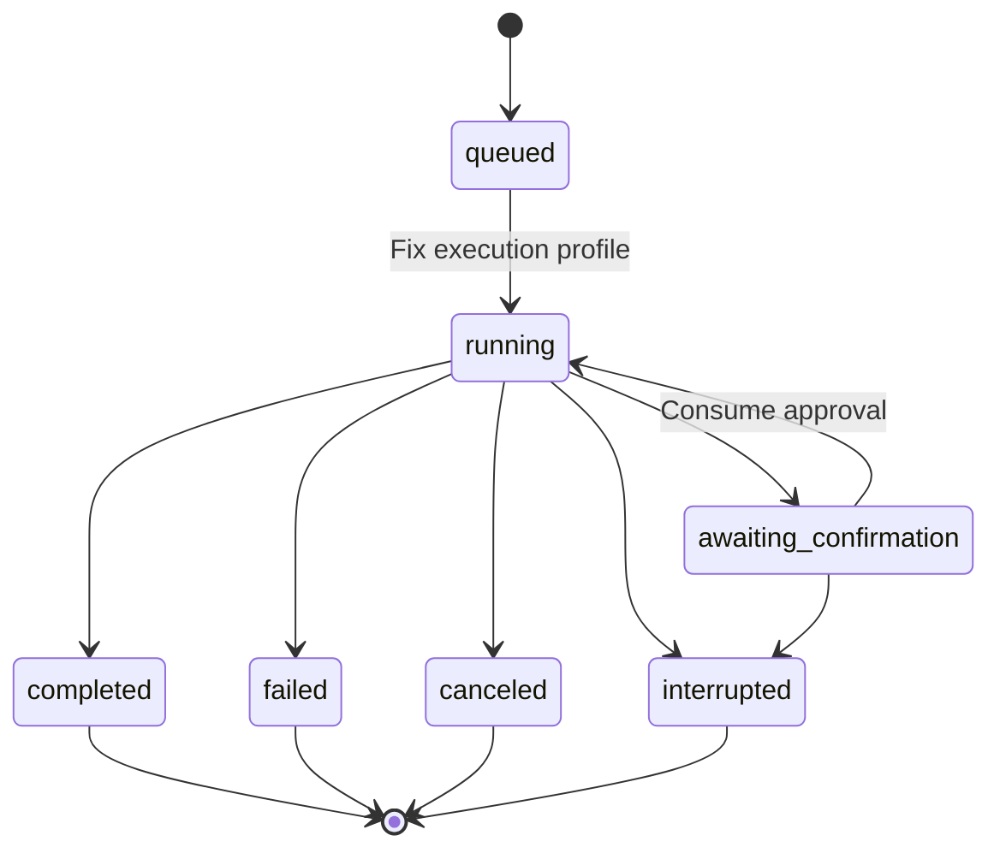
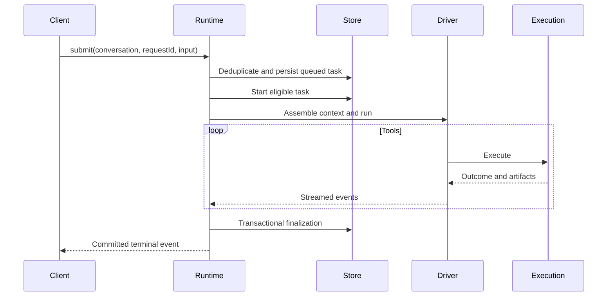

# Task Runtime

## Responsibilities and Boundaries

`packages/runtime/src/` coordinates the Coding backend: task lifecycle, per-conversation queues, model driving, SubAgents, backgrounds and restart recovery. Production Personal uses [its durable runtime](personal-durable.md) instead.

The user queue contains unstarted ordinary owner messages, with persistent `queue_order` and `queue_revision`. The owner may reorder or retrieve any eligible item, or explicitly route it as guidance for the running task. `task_guidance` delivers guidance at the next safe request boundary; a missed target returns the input to the queue head. Answers and internal reports have separate routes. Execution profiles fix identity, write target and access policy at task start.

Runtime owns one-level SubAgent delegation, independent work copies, parent delivery and explicit integration. It also supervises conversation backgrounds and their occupancy. Ordinary Coding side chat has dedicated `open/find/submit_side_chat` entries, no tools or directory occupancy, and at most one unfinished task; it can run alongside its parent.

[Execution](execution.md) owns tool processes; [context](agent-context.md) owns model input; [control](control.md) owns authenticated transport; [channels](channels.md) owns shared IM adapters.

## Public Interfaces

| Entry | Caller | Contract |
| --- | --- | --- |
| `submit` | Clients | Verify `(sessionId, requestId)` and queue a persisted task |
| `cancel` / `interrupt` | Owner/system | Cancel the selected task / persist owner pause before interrupting ordinary Coding execution; preserve unresolved stop facts |
| `switch_mode` | Owner | Change access mode at an eligible safe boundary |
| `resume_queue` | Owner | Resume dispatch; retained terminal occupancy requires separate `stop_confirmed` authority |
| `task_queue` / `queue_reorder` / `steer_task` | Owner | Read user order/revision/eligibility, reorder ordinary input, or route it as guidance |
| `message_recall` | Owner | Retrieve an eligible queued item or recall the latest supported historical input under an explicit purpose |
| `owner_question_answer` / `owner_question_cancel` | Owner | Commit an original-task answer receipt or cancellation, then release its tool wait |
| `work_*` / `subagent_close` | Control | Inspect work, cancel delegation or close an idle child |
| `subagent_delegate` | Main Agent | Assign goal, role and target to a child |
| `subagent_result` | Main Agent | Read child result, artifacts and work messages |
| `subagent_integrate` | Main Agent | Explicitly integrate validated child changes |
| `subagent_cancel` / `subagent_close` | Main Agent | Cancel work / close an idle SubAgent |

Conversation identity determines entry eligibility: ordinary development conversations accept owner input and can delegate; legacy/shared `main` accepts channel input; SubAgent conversations accept assigned work and cannot delegate further; scheduled identities carry fixed sources. Side conversations and retired conversations have their own restricted entry rules, rather than being ordinary development conversations.

## Data and State

`work_delegations` represents the goal and source of a multi-task assignment. `sub_agents` represents the child's persistent identity, conversation and work copy. `tasks` represents individual executions, linked through `parentTaskId`. Completion of one task does not close its SubAgent or finish every possible future assignment.

Directory occupancy excludes competing writers. Task finalization releases it only after required execution-stop verification. Persistent backgrounds retain their occupancy until verified exit.

## Main Flows

Delegation prepares an isolated context/work copy, then registers work, child identity and task facts transactionally. Filesystem work is not part of SQLite atomicity. The child executes independently; completion registers a parent wakeup. The main Agent reviews results and explicitly integrates changes.

Required role/workflow/delegation MCP tools are verified after official registration and before the model starts. Task source eligibility remains pinned; revocation can narrow it, while discovery or SDK restoration cannot enlarge it.

### Coding Scheduled Execution

Due schedules activate independent development conversations from fixed engineering configuration. Their history and results remain available after task finalization; the personal notification outbox is not the Coding conversation's persistence authority.

### Coding Message Recall and Edit/Resend

`MessageRecallRuntime` separates queued retrieval from historical recall using the persisted `purpose`. Queued retrieval transactionally cancels any eligible unstarted ordinary message and restores its text/attachments to the initiating draft. It preserves other queue items, their order and the active/paused state, and writes no history marker. A dequeue race rejects rather than becoming a historical recall.

Historical recall selects the latest effective owner input. A structured answer or Skip is an explicit unsupported candidate, preventing recall from silently skipping back to an earlier requirement. Historical recall saves the prior queue state, pauses dispatch and seals affected sources against new derived work; it then stops the complete execution closure and verifies each subsystem's actual stopping facts.

Once historical execution is quiescent, recall fixes the omission list, appends `context_edit` entries and a completion marker to JSONL, records `completed`, and restores original text and attachments reconstructed from immutable bytes to the initiating client's draft. The queue remains paused for editing (`message_recall_edit`). Unverified stopping enters `blocked`; verify-only retries advance the original request. Recovery verifies historical markers or queued cancellation facts according to the saved purpose. Existing JSONL bytes and task, approval and effect audit records remain; only the effective projection excludes recalled content.

### Questions and Internal Reports

`ask_user` persists one pending batch and keeps its original task, authority and directory occupancy alive while waiting. Answer/cancel/guidance/stop arbitration commits before releasing the waiter. Answers create no task or queue item; their event sequence preserves admission order for historical recall. Guidance atomically cancels the pending question. Ordinary messages and reports do not release it. Old-batch business tools stay blocked until the question result and applicable guidance enter the next request, then normal eligibility returns.

Trusted reports arriving during request N wait for its tools to settle, then enter N+1 of the same task. Report claims preserve each original source and complete fallback group; actual effective input, request binding and an eligible response establish consumption. The receiving task keeps its identity and permissions. When idle, runnable internal summaries precede user messages in the same conversation. Parked or unready groups do not block the user queue.

## Invariants and Failure Handling

- Identical `(sessionId, requestId)` replay returns the original task; changed parameters produce `request_conflict`.
- One execution entity owns a write target at a time; competitors wait or fail.
- Task state, approval invalidation, occupancy changes and corresponding events finalize in one transaction, subject to verified stopping.
- An owner interrupt commits `owner_pause` and stop intent before awaiting stop. Only explicit resume clears that pause; submissions, retrieval, reports and restart cannot. Resumption never reruns the interrupted task or confirms retained occupancy implicitly.
- After backend restart, unfinished shared-runtime work becomes `interrupted` with `backend_restart`; pending approvals and unanswered questions become stale. An existing owner pause remains authoritative. Client disconnection alone leaves waits and work running.
- Side-chat queued tasks also become interrupted, but its queue does not pause or replay input; new submissions are validated normally.
- MCP business-effect uncertainty is separate from resource stopping. An unknown write stops automatic business execution and preserves its ledger; SubAgent reuse still waits for local processes and actual shared resources to stop.

## Design Rationale

- [Detach terminal from task runtime](../../.agents/notes/implemented/architecture/2026-09-19-detach-terminal-from-task-runtime.md)
- [Work delegation subagent task](../../.agents/notes/implemented/architecture/2026-10-03-work-delegation-subagent-task.md)
- [Code scheduled](../../.agents/notes/implemented/feature/2026-10-25-code-scheduled.md)
- [Preserve session history](../../.agents/notes/implemented/architecture/2026-09-19-preserve-session-history.md)
- [Mcp host responsibilities](../../.agents/notes/implemented/simplification/2026-10-26-mcp-host-responsibilities.md)
- [Coding user queue](../../.agents/notes/implemented/feature/2026-10-30-coding-user-queue.md)
- [Same-task owner questions](../../.agents/notes/implemented/feature/2026-10-30-coding-owner-question-wait.md)
- [Next-request report delivery](../../.agents/notes/implemented/feature/2026-10-30-coding-report-delivery-boundary.md)
