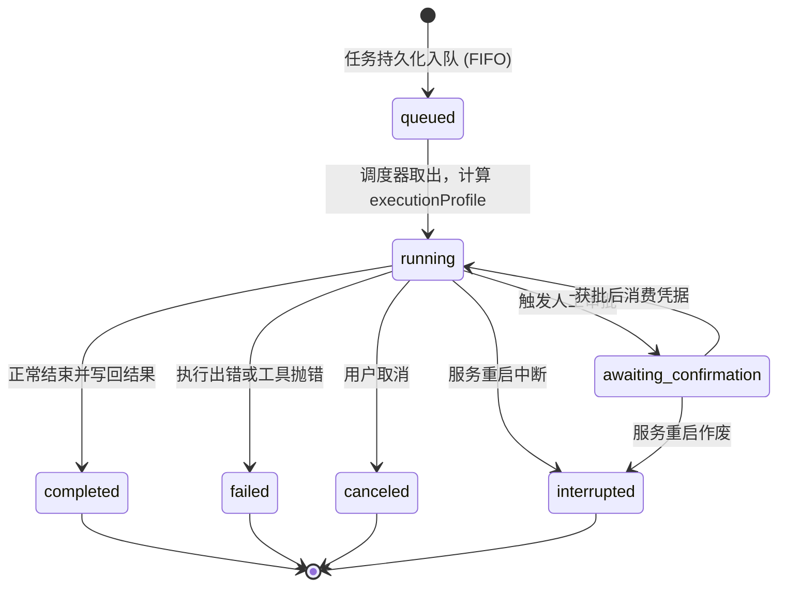
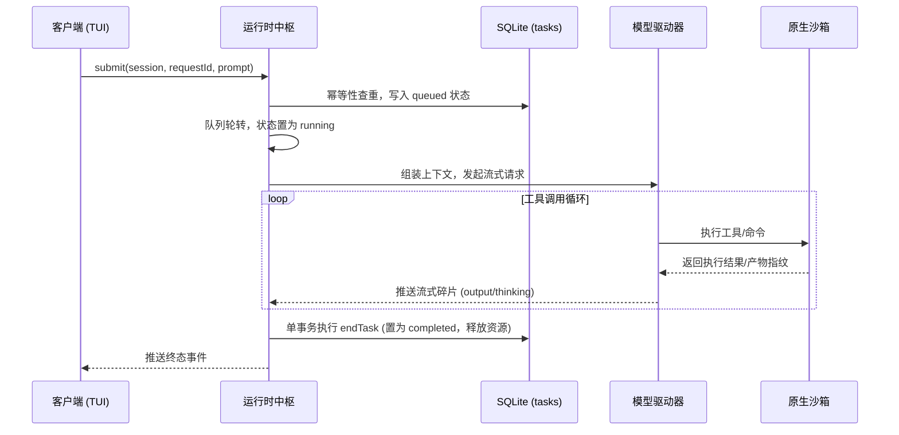

# 任务运行时

## 职责与边界

`runtime` 模块（对应 `packages/runtime/src/`）是 Coding Agent 后台的调度与编排中心。它拥有任务的完整生命周期管理、串行队列调度、模型上下文驱动、SubAgent 层次编排以及后台崩溃恢复机制。

> 注：本篇主要描述 Coding Agent 底座；正式个人 Agent 采用原生的 durable 运行体系，见[个人持久会话](personal-durable.md)。

### 核心职责
- **任务生命周期与串行队列**：将客户端的输入提交转换为持久化任务，按会话维护先进先出（FIFO）队列，保证同一会话内的任务串行执行，终态在单一数据库事务内原子收尾。
- **动态执行画像（`executionProfile`）**：依据会话身份、写入目标与权限模式，在任务开始时计算并固化执行画像，严格限制模型可见的工具集与资料边界。
- **SubAgent 委派编排**：提供单层 SubAgent 派生、独立 Git worktree 隔离、任务执行推进、结果父级唤醒与代码变动合入（`subagent_integrate`）。
- **后台服务进程管理**：支持普通开发会话显式拉起并监督持久后台服务（如测试服务器），核实进程停止与目录占用解除。
- **崩溃自愈与恢复**：当后台进程意外重启时，安全收敛挂起的任务状态与失效审批，避免死锁或孤立执行。

### 边界与非职责
- 工具的实际运行与原生系统沙箱隔离归 [execution](execution.md)。
- 模型上下文组装、Prompt 裁剪与滑动窗口归 [agent-context](agent-context.md)。
- 控制面通信协议与拥有者认证归 [control](control.md)。
- 外部 IM 通道适配归 [channels](channels.md)。

## 对外接口

### 1. 控制面驱动接口

| 入口方法 | 触发来源 | 核心行为与契约 |
|---|---|---|
| `submit` | 客户端（TUI / CLI） | 提交新任务，校验 `(sessionId, requestId)` 幂等性，成功后加入队列 |
| `cancel` | 用户请求 | 取消活动任务；若当前正处于工具执行中，先请求沙箱终止进程并收敛终态 |
| `interrupt` | 客户端 / 系统 | 中断当前正在执行的任务，释放目录占用 |
| `switch_mode` | 用户设置 | 切换会话运行模式（受限审查 vs 完全访问），仅在无正在执行工具的安全边界生效 |
| `resume_queue` | 用户操作 | 在异常重启或暂停后，显式恢复会话的任务调度队列 |
| `work_*` / `subagent_close` | 控制面 | 查询 SubAgent 工作状态、取消委托或彻底关闭空闲子会话 |

### 2. 模型可见的宿主工具

| 宿主工具名 | 分类类别 | 作用说明 |
|---|---|---|
| `subagent_delegate` | SubAgent | 发起工作委托，为子 Agent 分配独立工作目录、角色与任务说明 |
| `subagent_result` | SubAgent | 查看指定 SubAgent 的执行结果、最终产物或工作内消息 |
| `subagent_integrate` | SubAgent | 将子 Agent 在独立 worktree 中生成的代码变更原子合入主分支 |
| `subagent_cancel` | SubAgent | 主动终止正在执行中的 SubAgent 委派工作 |
| `subagent_close` | SubAgent | 关闭空闲子 Agent，释放相关资源 |

### 3. 会话身份体系

Runtime 依据 `classifySession` 纯函数将所有会话严格划分为四类，并赋予差异化的入口权限：

| 会话类别 | 判定规则 | 权限与行为特征 |
|---|---|---|
| **普通开发会话** | 未绑定角色或外部调度的用户会话 | 接受用户提交与计划模式；可作为合法的 SubAgent 委派父会话 |
| **main 会话** | 系统唯一的专属主会话 | 接收外部通道输入；结果与消息通过专用唤醒任务精准送达 |
| **SubAgent 会话** | 由父任务派生出的独立子会话 | 仅串行执行父级分派的任务，不能再派生下一级子 Agent |
| **定时调度会话** | 由定时计划激活的独立运行会话 | 在沙箱快照内执行特定自动化指令，完成后自动收尾并回报 |

## 数据与状态

### 1. 任务队列与生命周期

### 2. SubAgent 三层数据模型

- **`work_delegations`**：记录一次高层委托（委托目标、来源会话、分配角色、状态与合并记录）。
- **`sub_agents`**：记录子代理的生命周期事实（分配的专属子会话 ID、关联的 Git worktree 路径、活动状态）。
- **`tasks`**：实际承载执行的单个任务实体，通过 `parentTaskId` 形成严格的反链追溯。

### 3. 工作目录占用（Occupancy）

为杜绝并发读写冲突，系统对工作目录实行排他锁定：
- 每个任务在执行写操作前必须获取对应目录的 `occupancy` 认领；
- 任务执行完毕后在终态收尾事务中释放占用；
- 会话拉起的后台持久进程独占目录占用，直至进程彻底退出并核验后方可解除。

## 主要流程

### 1. 任务生命周期与流式执行

### 2. SubAgent 委派与合并流程

1. **工作登记**：主 Agent 调用 `subagent_delegate`，Runtime 在单事务中创建 `work_delegations`、`sub_agents` 并为其生成独立的 Git worktree；
2. **异步执行**：子会话独立推进模型循环，在独立分支上编写代码、运行测试；
3. **完成唤醒**：子任务完成后，Runtime 向父会话登记唤醒事件，在主 Agent 的下一轮对话中注入子任务摘要；
4. **变更合入**：主 Agent 检查无误后调用 `subagent_integrate`，系统将子分支变动通过 Git 补丁安全合入主分支。

角色、工作流和委派的 MCP 必需工具在官方注册完成后核实，缺失时在模型运行前报告具体要求。任务内资格固定，当前撤销继续收紧；新发现工具与 SDK 恢复不会扩大原来源权限。

### 3. Coding 定时执行与独立激活

定时任务到期触发时，Runtime 使用预设的工程配置拉起独立的临时开发会话，执行完毕后自动触发收尾并将报告归入发件箱。

## 不变量与失败处理

- **幂等性不可穿透**：以 `(sessionId, requestId)` 为全局唯一键。同键同参重放直接返回原任务，同键异参抛出 `request_conflict` 明确拒绝。
- **单写者单向保证**：一个工作目录在任意时刻只能被一个执行实体占用，任何第二写入者将被队列阻断或拒绝。
- **终态收尾原子事务**：释放目录占用、作废失效审批与更新任务终态必须在单一 SQLite 事务内完成，杜绝资源泄漏。
- **进程重启全面收敛**：服务若被强行重启，所有悬空任务统一标记为 `interrupted`（原因 `backend_restart`），待决审批标为 `stale`，会话队列暂停并需拥有者显式唤醒。

- **业务未知与资源停止分开**：普通 MCP 未知写中断本轮自动业务执行并保留原账本；SubAgent 复用仍等待其本地进程和真实共享资源停止，不能以报告终态代替。

## 设计依据

- [后台任务与终端](../../.agents/notes/implemented/architecture/2026-09-19-detach-terminal-from-task-runtime.md)
- [工作委托、SubAgent 与任务](../../.agents/notes/implemented/architecture/2026-10-03-work-delegation-subagent-task.md)
- [Coding 调度的固定配置与独立会话](../../.agents/notes/implemented/feature/2026-10-25-code-scheduled.md)
- [会话历史与模型上下文](../../.agents/notes/implemented/architecture/2026-09-19-preserve-session-history.md)
- [MCP 宿主职责收缩](../../.agents/notes/implemented/simplification/2026-10-26-mcp-host-responsibilities.md)：官方注册表前置核实与未知写收尾。
