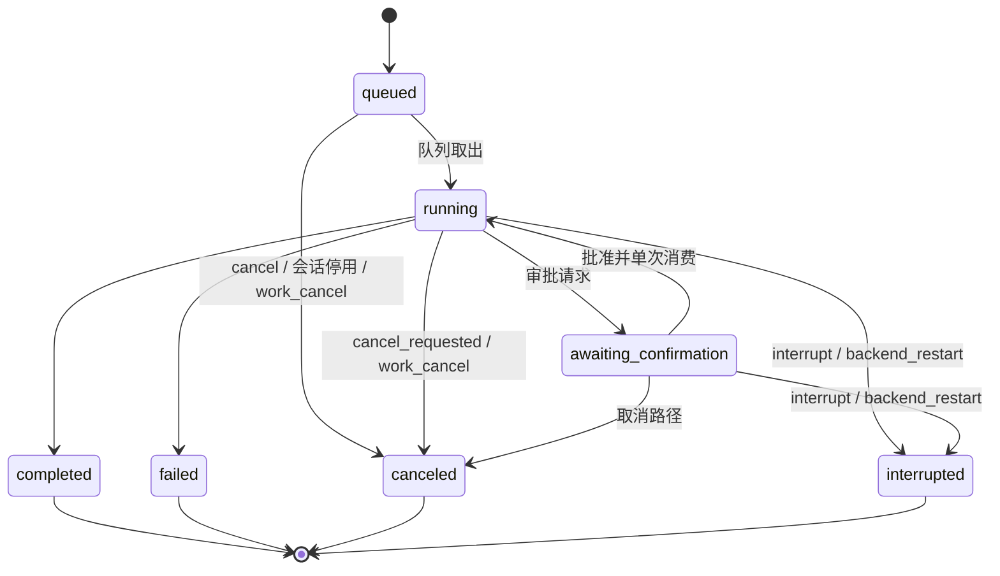
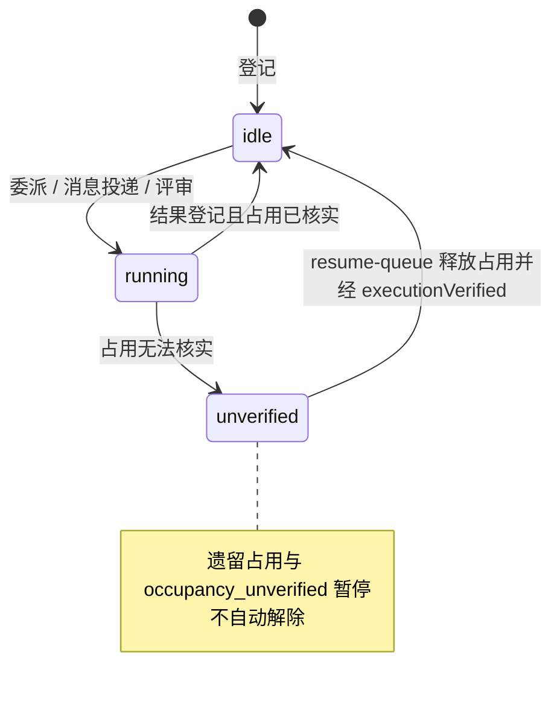
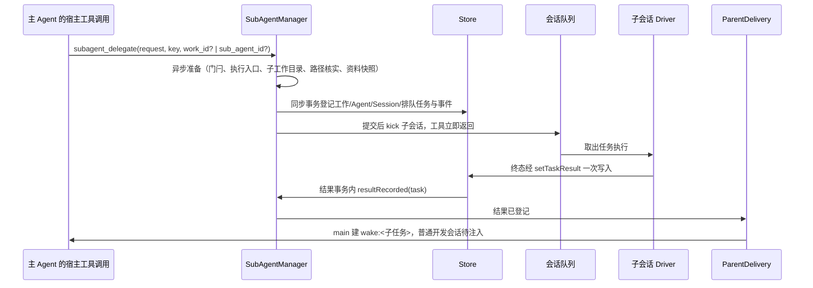

# 任务运行时

## 职责与边界

任务运行时（`packages/runtime/src/`）是后台的编排中心：它拥有任务生命周期与队列、会话身份与执行画像、任务收尾、父级送达、SubAgent 生命周期与全部委派行为、后台崩溃恢复，以及旧实例导入的设计。单个后台进程持有调度、任务状态与事件，每个会话用独立的 pi SDK 实例驱动；交互终端（TUI、CLI、IM 入口、GitHub 事件来源）只提交与观察，断开或关闭不取消任务。

它负责：

- 把一次提交变成持久任务，按会话 FIFO 排队并串行执行，终态在一个事务内收尾。
- 按会话身份决定入口资格，按身份、写入目标与宿主评审算出一次任务的执行画像并钉到任务结束。
- 决定父级会收到什么、何时收到：SubAgent 结果与发给主 Agent 的工作内消息进入主 Agent 模型调用的时机。
- 全部 SubAgent 委派行为：登记、继续、复用、协作加入、工作内消息、整项取消、修改委派、改动汇总、结果与通知、宿主固定评审、重启恢复。
- 后台异常重启后的恢复顺序与人工核实的出口。
- 旧实例导入的设计（源只读、离线、快照、allow-list、回执与回退边界、执行归属交接）。

它不负责：工具的实际执行与执行边界（原生沙箱、容器、挂载、目录身份与 worker init）见 [execution](execution.md)；工具可用性清单、审批闸门、工具操作账本、产物与 MCP 见 [agent-tools](agent-tools.md)；模型上下文的组装、压缩、历史与记忆见 [agent-context](agent-context.md)；控制面 socket 与拥有者认证见 [control](control.md)；IM 平台连接、入站登记与 GitHub 事件来源见 [channels](channels.md)；调度计划与通知 outbox 的发送账本见 [scheduler](scheduler.md)；数据布局、schema 与会话身份的存储原语见 [core](core.md)；命令与配置的操作步骤见 [docs/usage.md](../usage.md)。

## 对外接口

`branchSession` 由产品的 `branchSessions` 能力开放，核实普通开发身份、工作区映射及目录身份后固定来源历史和设置；`findBranchSession` 按持久请求键核实发布结果。创建不提交任务或调用模型。

`Runtime.start(config)` 要求 app 注入 `config.product`（`RuntimeProduct`）：身份用于数据目录登记，IM 与调度能力决定启停，产品工具族由 app 的工厂提供。共享运行时不按产品名装配。具体产品归属见[产品装配](products.md)。

**驱动本模块的入口。** 控制面（[control](control.md) 与 CLI/TUI）提供 `submit`、`continue`、`interrupt`、`cancel`、`resume_queue`、`switch_mode`、`set_session_mode`、`confirm`，以及工作维度的只读查询 `work_list` / `work_get` 与写操作 `work_cancel`、`subagent_close`（CLI 分别对应 `ruukoto work list` / `ruukoto work show` / `ruukoto work cancel` / `ruukoto work close`）。普通控制面的 `submit` / `continue` / `switch-mode` / 会话默认模式不能作用于子会话。channels 与 scheduler 经入站事件与唤醒任务驱动建任务；每个任务带 `source_event_id` 时出队走既有入站门。

**本模块提供给模型的宿主工具。** `subagent_delegate`（登记一次委派，分析或修改）、`subagent_result`（读取结果，省略 `work_id` 时列出本会话 SubAgent 总览，`part=messages` 查看工作内消息）、`subagent_cancel`（整项取消）、`subagent_close`（显式关闭）、`subagent_message`（工作内消息）、`subagent_integrate`（改动汇总）。这些工具属 `subagent` 类别，由 [agent-tools](agent-tools.md) 按执行画像装配；每次调用重新核实宿主任务、会话与身份绑定。

**本模块调用的部件。** Store 的 SQL 原语（任务、占用、工作、Agent、消息、导入回执与账本、事件）；Driver 与 agent-context 组装并流式调用模型；SubAgentManager 是在线 SubAgent 状态、当前工作与当前任务指针的唯一写入者；ParentDelivery 决定结果与消息的送达；编排器负责入站派发、结果回传与角色队列恢复；调度器、IM 入口表（工作最终汇报经 `sendWorkReport` 回调交给拥有者 IM 入口）与执行后端的宿主入口。

**本模块发布与消费的事件。** `task.queued`、`task.started`、`task.completed`、`task.failed`、`task.canceled`、`task.interrupted`、`task.tool_process_unreaped`、`task.mode_switched`、`task.mode_switch_requested`、`task.mode_switch_failed`、`task.awaiting_confirmation`、`task.approval_consumed`、`session.queue_paused`、`occupancy.stale`、`work_delegation.created`、`work_delegation.canceled`、`work_delegation.integrated`、`subagent.closed`、`subagent_message.sent`、`subagent_message.dropped`、`subagent_task.*`、`child_task.*`、`session.history_unreadable`、`*.reply_skipped`。

**会话身份与入口资格。** 身份由 `packages/core/src/session-identity.ts` 一次判定：`Store.getSessionIdentity` 读出会话、角色行与 SubAgent 行，纯函数 `classifySession` 分四种身份。Runtime 各入口按身份一行判定，错误码与文案留在各入口；每次调用的宿主身份重核（main 绑定、委派资格、群结果工具、IM 长期授权）用同一解析，但每次新鲜读取。

| 会话身份 | 判定依据 | 提交与模式入口 | 本模块的相关行为 |
| --- | --- | --- | --- |
| 普通开发会话 | 不绑定角色、拥有者直接对话的用户会话 | 接受提交；计划模式只限此身份 | 委派的合法父会话；结果与工作内消息经下一次任务开始注入 |
| main 会话 | 宿主为 main 绑定的会话 | 接受提交 | 委派的合法父会话；结果与消息经唤醒任务送达 |
| SubAgent 会话 | `sub_agent` 行存在（SubAgent 行优先；会话类别也是 dev） | 提交、改默认模式与切换模式一律拒绝 | 只承接委派、消息投递与评审；不能委派下级 |
| 已退役归档会话 | QQ 群会话、chat/coding 角色会话（附退役原因） | 提交按原因拒绝；队列兜底按原因取消 | 只读归档，不运行任务；`resume-queue` 按身份取 Agent 行 |

委派登记的父会话必须是普通开发会话或 main 会话，两种 `mode` 同一口径。

**执行画像。** 给定任务，`tool-availability.ts` 的 `executionProfile` 由会话身份、任务所属工作是否有写入目标与是否宿主评审算出：会话类别（决定工具类别表与系统提示键）、SubAgent 工具集（只读 / 写入 / 宿主评审，宿主评审另开只读 MCP 并关 `subagent_message`）、是否规划 MCP、资料受限（SubAgent）、计划资格（只普通开发会话）。画像在任务开始算一次、钉到任务结束；装配过滤、任务收窄与 SDK 会话签名同用这一份，工具集变化时重建 SDK 会话。工作区不进画像：占用键与 LaunchSpec 都取 `core/worktree.ts` 的 `taskWorkspaceFor`。SubAgent 的工具集固定为：分析 `read` + `read_artifact`；修改 `read` / `edit` / `write` / `bash` / `read_artifact`（无 `request_file_access`、`http_request`、MCP，不能委派下级）；宿主评审 `read` / `read_artifact` ∪ `effect=read` 的 MCP。工具类别清单与调用门本身见 [agent-tools](agent-tools.md)。

## 数据与状态

**任务（`tasks`）。** 状态集合 `queued` / `running` / `awaiting_confirmation` / `completed` / `failed` / `canceled` / `interrupted`；在线终态只有后四种。字段：`access_mode`（`confirm` 默认 / `full_access` / `auto-review`）、`plan_mode`、`permission_version`、`granted_paths`、`pending_access_mode`、`interrupt_reason`、`cancel_requested`、`effect_unknown`、`error_message`、`history_entry_ids`、`resumes_task_id`、`agent_id`、`parent_task_id`、`source_event_id`、`deadline`、`result_summary`、`result_ref`、`created_at` / `started_at` / `ended_at`；唯一键 `(session_id, request_id)`。

模式绑定任务：任务携带 `accessMode`（默认请求确认）、权限版本与授予路径；模式与范围进入提交幂等比较。切换只在无执行中工具的边界生效，递增权限版本并使等待中的审批失效。切换未核实记专用 `task.mode_switch_failed`。

**目录占用（`occupancy`）。** 键为 `cwd_real`，附带 `cwd_dev` / `cwd_ino`、`session_id`、`task_id`、`acquired_at`。占用键是任务的写入目标（`taskWorkspaceFor`：有写入目标用钉定的 path/dev/ino，否则用会话目录身份），释放统一按 `taskId`（`releaseOccupancy(taskId)`）。

**工作委托（`work_delegations`）。** `id`、所属父用户会话、发起任务、`sub_agent_id`、首次委派键 `request_key` 与参数摘要 `params_digest`（唯一键 `(parent_session_id, request_key)`）、取消三列 `canceled_at` / `canceled_by`（`owner` 或 `agent:<任务ID>`）/ `cancel_reason`、写入目标 `write_target`。工作状态由取消列与任务状态派生，不新建状态机。

**SubAgent（`sub_agents`）。** `id`、父用户会话、独立 Session、宿主生成的独立工作目录 `work_dir`、当前工作指针 `active_work_id`、当前任务指针 `current_task_id`、执行状态 `state`（`running` / `idle` / `unverified`）、关闭两列 `closed_at` / `closed_by`（`owner` 或 `agent:<任务ID>`）。

**工作内消息（`subagent_messages`）。** 工作、父会话、发送方（`from_sub_agent_id` 为空 = 主 Agent）、发起任务、接收方、`request_key` 与 `params_digest`、正文 `body`、投递结果 `delivered_task_id` / `delivered_at` / `undelivered_reason`；幂等键为（工作, 发送方, 键）。

**写入目标（`work_delegations.write_target`）。** 直接写入记 `{kind:"direct", path, dev, ino}`；worktree 记 `{kind:"worktree", repoRoot, commonGitDir, gitdir, path, dev, ino, branch, baseCommit}`；为空表示只读分析工作，不能升级为写入。

**结果引用（`result_ref`）。** 明确 `workId` / `subAgentId` / `taskId` / 原直接父任务 / 所属父会话 / `outcome` / `artifactIds`。

**会话队列。** 每会话一个队列状态：`active`，或 `paused` 携带暂停原因 `backend_restart` 与 `occupancy_unverified`。

**实例导入（`instance_imports` / `instance_import_items`）。** 回执记 `request_key`、源实例与产品、源 schema 版本、源目录、计划摘要、目标备份路径与 sha256、事件区间、报告、状态 `applied` / `reverted` 与回退时间。条目账本主键 `(kind, item_id)`，类别覆盖 `project`、`session`、`sub_agent`、`work_delegation`、`memory`、`grant`、`mcp`、`meta`、`file`、`agent_role`、`schedule`、`platform_config`、`standing_permission`、`credential`。

**任务状态机。**

终态路径只经 `Store.endTask` 的条件更新，只有当前状态仍在起点集合时才继续；重复终态只记一份。

**SubAgent 状态机。** 关闭是独立维度（`closed_at` / `closed_by`），不进入 `state`；已关闭的 Agent 仍可查历史、产物与工作目录。

**请求键与幂等键。** 提交的幂等键是 `(session, request_id)`；首次委派以 `(父会话, key)` 唯一查工作，工作内以 `sdelegate:<workId>:<key>` 查任务；消息投递请求键 `smsg:<消息ID>`；唤醒键 `wake:<childId>`；入站重提键 `evt:<eventId>`；导入请求键由计划文件派生。

## 主要流程

会话分支经 `packages/runtime/src/branch-session.ts` 编排：固定快照与限定来源 → 事务保存准备回执 → agent 独占写入并刷盘、安装独立 JSONL → 同一数据库事务发布会话、独立压缩点、完成回执和创建事件 → 提交后应答及广播。文件与 SQLite 没有跨文件事务；启动恢复只使用原回执和已核实文件，无法核实则记录失败，不发布半成品。原任务、占用、审批、工作和通知继续归来源会话，新任务仍受共享目录占用约束。

连续分支只继承已有且仍可核实的来源集合。来源产物固定字节上限与状态，图片及跨项目资料每次读取重新校验；SubAgent 结果只允许固定的已完成任务和产物，不能扩展到后来执行或复用的结果。来源关系不进入委派、消息、关闭、取消和汇总的归属核实。

### 提交、排队与执行

1. 入口按会话身份放行或拒绝（SubAgent 拒绝、计划模式只限普通开发会话、归档按原因拒绝）。
2. 提交先按 `(session, request_id)` 幂等查重：同键同参重放返回原任务，同键异参报 `request_conflict`；重试先核实原请求，不换键重复提交。模式与范围参与幂等比较。
3. 登记 `queued` 任务并写 `task.queued` 事件；新消息持久化为任务后按会话 FIFO 调度，不使用易失的 SDK follow-up 队列。
4. 任务开始时占用其工作目录（realpath 与 dev/ino 识别，覆盖符号链接与挂载别名），目录已被占用则留在队列等待释放；同目录判定按 dev/ino 相等、realpath 相等或按分隔符边界互为前缀（祖先/子孙）。同一会话一次只执行一个任务；不同会话在目录不冲突时并行。
5. 任务开始时算一次执行画像并钉到任务结束；工具集变化时重建 SDK 会话。
6. 等待审批时任务转 `awaiting_confirmation`，由审批闸门负责决定与单次消费（见 [agent-tools](agent-tools.md)）；模式切换只在无执行中工具的边界生效，递增权限版本并使等待中的审批失效。
7. 终态经任务收尾事务落定。

### 任务收尾

所有在线终态路径先停止并核实受管执行单元，再经 `Store.endTask` 在一个事务内做条件更新：只有当前状态仍在起点集合时才继续，随后清除待生效模式、使未消费审批失效、写入对应 `task.*` 事件并按任务 ID 决定占用。驱动器在这条事务内先交工具账本补记效果未知；停止返回 false 或抛错时显式保留占用并写 `task.tool_process_unreaped`。自然完成的已知结果与退出未核实分别记录，失败、取消和重复收尾同样不能丢掉未核实事实。重启与缺失驱动器的停止路径也保留占用，终态更新的竞争不会产生重复事件。

### 委派登记与执行范围

主 Agent（拥有者的普通开发会话或 main）经 `subagent_delegate` 登记工作委托、创建动态 SubAgent 与独立子会话并派出一次执行任务（只读分析，或修改）。

- **触发来源**：只有拥有者在父会话直接提交的任务，或经 Telegram/QQ owner 入口核实身份的入站任务可以委派；定时唤醒、子任务回报及其他来源拒绝。
- **输入与固定参数**：模型只提供 `request / key / work_id? | sub_agent_id?`（两者互斥）/ `mode?` / `target?` / `read_paths?`（dev）| `materials?`（main）。分析委派能力固定为只读（`read` 与 `read_artifact`），权限模式固定 `confirm`，不继承父任务/会话默认模式、单次批准与长期授权；不提供模型自选角色、执行账户、访问模式、父会话、任意 cwd 或自由工具列表。截止时间固定为父任务开始时刻 + 60 分钟；同一父用户会话最多 3 个活动（queued/running/awaiting_confirmation）执行任务。
- **幂等**：首次委派与复用委派以（父会话, `key`）唯一查工作（`sub_agent_id` 只在提供时纳入参数摘要，保持旧重放摘要不变）；工作内以 `sdelegate:<workId>:<key>` 查任务。参数摘要不包含本次调用的直接父任务 id 与模型选择——跨对话轮次重放核实同一逻辑委派，返回首次记录；同键异参明确冲突；查重先于限额与资料解析，同键同参的重放即使目标已关闭或忙碌也返回原记录。修改委派把 `mode` / `target` 纳入摘要。
- **登记事务**：先异步准备（模型门闩预检、受限执行入口预检、宿主生成的独立工作目录 `<dataDir>/../agent-work/sub-agents/<agentId>`、路径核实与资料快照），再在一个同步事务内重核后登记工作/Agent/Session/排队任务与 `work_delegation.created` 事件，提交后才 kick 子会话；工具在子任务入队后立即返回，不等待子模型结束。准备或落库失败只清理本次产物：新建目录整删，沿用目录时只删本次写入的快照文件。
- **资料与读范围**：main 的 `materials`（1–8 个来源，复用来源解析器）解析为文本快照写入子工作目录 `materials-<workId>-<key>.txt`（按工作 + 执行键命名，复用承接新工作不覆写旧工作的快照），来源引用随任务保存，登记事务与每次向模型发送上下文前按该 Agent 全部历史任务来源引用与本次的并集重新 verify（任一撤销即拒绝登记或阻断发送 `task_sources_revoked`，快照正文不重新解析）；dev 的 `read_paths` 限父工作区内或父任务已授予范围（交集后的只读钉定，保存 realpath 与目录身份，经 LaunchSpec/init 传入 worker），模型参数不能替换；绝对系统路径、保护根、符号链接越界与目录身份变化明确拒绝。
- **上下文**：SubAgent 的模型上下文只含固定任务说明、选定快照与自己的 JSONL——不注入父项目指令、个人共享记忆、技能目录、父完整历史或继续来源；产物只读本次自产（不含 `prompt-snapshot:*`）。

### 继续、复用与关闭

- **继续**（`work_id`）：沿原工作增加新的分析执行；**复用**（`sub_agent_id`）：同一父会话内把相关的另一项工作交给同一个空闲 SubAgent，登记一条新 `work_delegations` 行指向既有 Agent（同一子会话，保留上下文），任务输入带宿主说明「此前的范围不延续」。两者各自登记独立任务记录（id/工作/readScope/结果互不改写），每次执行重新固定读范围、资料、confirm 与截止时间，前次批准不延续。
- **可用性**：继续与复用要求目标 Agent 同一父会话、未关闭、`idle` 且无活动任务（忙碌明确拒绝，不排队），工作目录 realpath 与 dev/ino 和子会话记录一致（目录被删除/替换时报「请新建 SubAgent」）；准备前与登记事务内各核一次。复用另复核该 Agent 历史任务来源引用与本次的并集，任一撤销即拒绝。继续、复用、协作加入、消息登记与冲刷共用管理器的私有资格判断：关闭、跨父会话、宿主固定评审、工作取消或已转做其他工作均明确拒绝或记未投递；委派遇忙碌拒绝，消息遇忙碌或名额满保留待投递。
- **关闭**：`sub_agents.closed_at` / `closed_by` 独立两列（`owner` 或 `agent:<任务ID>`），未关闭的行两列为空，`state` 语义不变。主 Agent 用 `subagent_close` 关闭本会话名下的 Agent；拥有者经控制面 `subagent_close`（CLI `ruukoto work close`）关闭；已关闭幂等返回；有活动任务拒绝并给出任务 id（先取消任务再关闭）。关闭不删除工作目录、会话、JSONL、产物与工作记录；关闭后新委派报「已关闭」，同键同参重放仍返回原记录；发 `subagent.closed` 事件（refs 指向父会话）。关闭保持同步：关闭事务内用同一 `pendingMessageContext` 资格判定清理发给该 Agent 的待投递消息，不异步冲刷其他 Agent；关闭前无活动任务，因此不需要释放名额。
- **竞争**：关闭与新委派在同一个同步事务内定胜负——先关闭则委派报「已关闭」且零新任务，先登记则关闭报「有活动任务」；不存在「已关闭且有活动任务」的中间态。
- **不自动关闭**：任务终态、TUI 退出（控制面断开）与等待都不关闭；空闲零模型/worker 进程；重启后关闭状态与空闲 Agent 的可复用性原样保持。

### 工作内消息与协作加入

同项工作的参与者——主 Agent 与当前承接本工作的各 SubAgent——经 `subagent_message` 交换有来源的消息。

- **协作加入**：`work_id` 与 `sub_agent_id` 同现的委派把一个既有空闲 SubAgent 拉入既有工作登记一次执行任务（任务关联列指向协作方；工作行保持首次承接者，参与者集合经 `tasks.sub_agent_id` 判定）。只读工作才接受协作方——修改工作同一份文件单一写入者；宿主固定评审工作（入站来源）不接受加入；继续/复用/加入的可用性、竞争仲裁与来源并集复核同一口径。协作加入的幂等键按目标 Agent 的会话核实（不同协作方的同键互相独立）。
- **发送方身份**：完全由发起任务核实，模型参数不提供身份——工作父会话的任务 = 主 Agent（此时必须指定 `to_sub_agent_id`），本工作的 SubAgent 任务 = 该 SubAgent（必须从本工作的任务中发送；省略 `to_sub_agent_id` 即发给主 Agent）；其他会话、其他工作的任务一律拒绝。宿主评审 SubAgent 不参与工作内通信。
- **接收方资格**：当前承接本工作（`active_work_id` 正是本工作）且未关闭——复用转做其他工作后旧协作者与迟到的旧消息都失去资格，不把关闭当作重新创建 Agent 的理由；已取消的工作不能投递。按（工作, 发送方, 键）查重先于执行预检：同键同参的重放即使此后已取消/关闭也返回原记录，异参冲突。`message` 异步准备后在登记事务内再次查重并核实当前资格。
- **消息执行预检**：发给子会话或 main 唤醒的消息，在事务外核实模型配置与受限执行入口；事务内执行核实返回的 `check`，并重读当前模型选择与资格。模型选择变动或 `model_config_busy` 等预检失败，整次新消息零新增消息、任务和事件；忙碌或名额满也不能绕过预检。纯 dev 父会话注入不新建执行，无需这道执行预检。`ParentDelivery.messageRecorded(msg, work, selection)` 只用管理器已经核实的模型选择插入 main 消息唤醒。
- **投递渠道**：发给 SubAgent 的投递为它在本工作的一次 `confirm` 执行任务（请求键 `smsg:<消息ID>` 幂等，输入为宿主固定来源首行 + 正文，读范围沿用其在本工作最近任务的钉定——消息不扩大任何一方的工具与资料范围；工具清单仍按工作内容钉版，另加 `subagent_message`）；发给主 Agent 的，dev 父会话经下一次模型调用的宿主参考块 `[工作内消息]` 注入（收集与标记送达同事务，取消的工作不注入），main 父会话经唤醒任务（`agentId=main`、confirm、无截止时间）送达。正文上限 4096。
- **待投递与冲刷**：接收方忙碌或父会话活动任务名额已满时登记为待投递；宿主机在 SubAgent 任务终态（编排器结果登记后）、启动恢复、整项取消、resume-queue 核实完成与模型配置应用结束后 `await flushPendingMessages`：冲刷先核资格，忙碌 / 名额满保持待投递且不做执行预检；可投递时才预检，任意预检失败均保留已登记消息并输出诊断。可投递则在同步事务内投递；异步准备期间可能登记新委派，投递事务必须重核当前工作与资格，旧消息不能进入新工作。资格已失（`moved_work` / `closed:<时刻>` / `agent_missing`）或工作已取消记明确未投递结果并发 `subagent_message.dropped` 事件；登记与投递事件为 `subagent_message.sent`（含投递渠道）。关闭路径只在自身关闭事务内清理该 Agent 的待投递消息，不触发其他 Agent 的异步冲刷。
- **可见性**：主 Agent 用 `subagent_result` 的 `part=messages` 查看本工作消息的来源、投递状态与正文预览；拥有者经控制面 `work_get` 的 `messages` 列表（CLI `work show`）查看；发送调用按工具操作账本以（工作, 发送方, 键）核实 committed/not_committed；跨实例导入随所属工作的账本条目折叠。

### 整项取消

- **入口与状态**：拥有者经控制面 `work_cancel`（CLI `ruukoto work cancel <工作ID> [--reason R]`，停止中拒绝）；主 Agent 用 `subagent_cancel(work_id, reason?)`（回报唤醒轮次也允许，取消只收窄能力）。SubAgent 自身与其他父会话的旧工作一律拒绝。取消用 `work_delegations` 的独立三列 `canceled_at` / `canceled_by` / `cancel_reason`，条件 `canceled_at IS NULL` 一次写入，重复取消幂等返回原记录与当前任务状态；工作状态由列与任务状态派生，不改写已结束任务的结果。取消 SubAgent 名下的其他工作不受影响。
- **一个事务登记，停止在事务外完成**：事务内写取消字段；该工作的 queued 任务直接转为 `canceled`（`errorMessage` 记 `work_canceled`）；running/awaiting_confirmation 任务写 `cancel_requested=1`；追加 `work_delegation.canceled` 事件（`canceledTaskIds` 与 `stoppingTaskIds` 分开记录）。提交后对每个活动任务调用现有 `cancelTask` 停止路径（账本快照、解除审批等待、abort、回收进程组、终态补记），`Promise.allSettled` 等待完成；效果未知的已有操作只标记、不重放；无法回收的执行按现有逻辑保留占用，SubAgent 记 `unverified`。
- **竞争口径**：登记事务与委派登记都是同步事务、天然串行——先登记的任务必然在取消清单内，后登记的字段已写入即被拒。委派在准备前与登记事务内各核一次 `canceled_at`，命中报 `invalid_state: 工作已取消`（零新任务）；同键同参重放的查重仍最先执行，返回原记录不新建任务。新工作与其他工作不受影响；已取消的工作不能再登记新执行。
- **单任务取消窗口**：`Runtime.cancelTask` 的 running 分支先在事务内写 `cancel_requested=1` 再 `requestStop`；`Driver.runInner` 开头读到该标记直接定态 `canceled`、不调用模型——取消要么被启动检查拦下，要么 `requestStop` 已能找到 `currentTask`，「已转 running、未进 Driver」的窗口吞不掉取消。已知上限：超时取消若正好落在该窗口，终态记 `canceled`（不知原因）而非 `timeout`。
- **迟到结果不送达父模型**：终态结果照常经 `setTaskResult` 保存为事实（`subagent_task.*` 事件、`subagent_result` 与 `work show` 可查，头部标明取消时间、发起者与原因），但取消提交后这项工作的结果不再自动送进任何父模型——父级送达在建唤醒前重读工作（已取消不建 wake）；队列循环对 `wake:<childId>` 与 `smsg:<消息ID>` 唤醒启动前检查所属工作（已取消则直接取消该 wake，覆盖取消前已排队、检查后插入与巡检补发的所有唤醒，不调用模型）；dev 的注入查询加 `canceled_at IS NULL`；启动巡检的待唤醒清单排除已取消工作。需要时由主 Agent 主动 `subagent_result` 读取。main 正在运行的唤醒轮次不级联取消（取消所在轮次已有回复）。
- **身份与成果保持**：取消不关闭 SubAgent（任务结束后按占用核实记 `idle` 或 `unverified`，之后仍可复用于其他工作）；工作目录、会话 JSONL、产物、resultRef 与工作记录都不删除。
- **展示**：`work list/show` 的工作对象自然带上取消三列与当前任务状态；TUI 经 `work_delegation.canceled` 事件更新工作字段并追加说明（不新增 TUI 命令）；dev/main 系统提示说明「不再需要的工作用 `subagent_cancel`，已取消的工作不能继续委派」。

### 修改委派与写入目标

- **模式与入口**：`subagent_delegate` 增加 `mode`（`analyze` 默认 / `modify`）与 `target`（modify 必填，父工作区内的目录）。普通开发会话与 main 都能发起；计划模式、SubAgent 自身一律拒绝（已退役的 coding/chat 角色会话本就不接受任务）。管理器从父 Task 的固定 `planMode` 判定计划模式，不接收 `planMode` 入参；计划模式既拒绝显式 `modify`，也拒绝沿已有 `writeTarget` 的工作继续。模型工具清单仍由 `PLAN_TOOL_NAMES` 收窄，未开放 `subagent_delegate`。modify 不带 `read_paths` / `materials`。修改工作固定 `confirm`、经产品配置的受限执行边界运行，不继承父任务的完全访问。
- **写入目标钉定**：`work_delegations.write_target` 在首次修改委派时确定、继续委派沿用；只读工作不能升级为写入，继续委派（`work_id`）不接受 `mode`；复用（`sub_agent_id`）承接新工作时另建副本。
- **Git 目标：每项工作一个宿主生成的 worktree**。位置 `<dataDir>/../agent-work/worktrees/<workId>`（保护根与父工作区之外），分支 `ruukoto/work-<workId>`，基线为委派时仓库 HEAD 指向的提交——父工作区未提交的改动不进副本。仓库根从目标向上纯文件系统查找（不运行 git，不越出父工作区）；共享 Git 目录必须位于父工作区内，否则拒绝。宿主经 `executeWorkCopy` 在受限 confirm worker 内创建副本、永不执行 git；挂载、命令、目录身份下发与 worker init 见 [execution](execution.md)。宿主在 worker 启动前预建空副本目录（0700）；非空目录 = 失败残留，不自动认领或覆盖。
- **临时执行归属**：worktree 创建与改动汇总传递实际发起的父任务 ID，父任务必须正在执行并持有占用；执行单元启动前登记到该任务，并临时取得副本目录占用，参与取消、后台停止与模式变化。核实成功只释放该副本；停止未核实以 `worker_stop_unverified` 上报，保留父目录与副本占用、成果及已收到的 Git 结果，阻止子任务或其他会话在副本开跑，不继续委派或重放 Git；即使尚未登记工作行，也保留副本创建现场。原生 worker 显式收到后台数据、服务凭据、控制面和服务代码的保护根；工作区、SubAgent 读取范围与共享 Git 目录按宿主 dev/ino 下发复核，只有 macOS Docker Desktop 保留 VM 的 inode 例外。
- **不提交规则**：任务首行写明工作目录、分支、基线与「不要 git add/commit，改动留在工作树由主 Agent 汇总」；副本、分支与写入根的改动一律保留——创建失败保留现场（错误信息含路径与分支），任务取消/退出不删除，不提供任何删除副本的入口。
- **非 Git 目标：直接写入父工作区内目录并串行**（写预检按实际执行身份核实写位，执行身份判定见 [execution](execution.md)）。子任务的执行目录与占用键都是写入根；队列启动前复核目录身份，被替换或消失即失败、不自动重建。首次钉定写入目标后，该 SubAgent 的子会话 cwd 对齐到写入根。
- **目录占用升级为祖先/子孙判定**：冲突 = dev/ino 相等（符号链接、挂载别名同命中）、realpath 相等，或按分隔符边界互为前缀；释放统一按 `taskId`，占用键是任务写入目标而非会话 cwd。效果：非 Git 子任务与父会话串行——父任务本轮结束才释放占用，父任务没有阻塞等待子任务的接口，不会持锁空等；排队中的非 Git 子任务被本会话占用挡住时，`subagent_result` 提示「等待本会话释放目录，请结束本轮」。嵌套 cwd 会话同样互相阻塞（`/ws` 与 `/ws/sub` 之间串行）。已知上限：挂载别名的祖先关系识别不出。
- **副本防旁路**：覆盖 `agent-work/worktrees` 或其下位置的读写授予被拒（`validateGrantedPaths`；只读授予仍允许）；worktree 被删除或 `.git` 指向变化后继续委派明确失败（`worktree_gone`），不自动重建。
- **展示**：`work list/show` 与快照自然带上 `writeTarget`；TUI 工作摘要标「worktree 分支 X」或「直接写入」。只加可选字段，协议版本不变。

### 改动汇总

- **入口与范围**：主 Agent 工具 `subagent_integrate(work_id)`（dev 与 main 均装配，回报唤醒轮次也允许；SubAgent、群与固定角色会话经宿主身份重核拒绝）把本会话登记的 worktree 副本相对基线的完整差异套用到父工作区的待提交区——不代提交、`git apply --check` 预检通过才写入（预检失败零写入）。非 Git 直接写入工作没有副本（改动本就就地落盘），调用只如实告知；只读分析工作明确拒绝。拥有者没有专用控制面操作：待处理内容经工具回报与持久事件可知。
- **套用前核实**：工作有活动任务拒绝（busy，副本可能仍在被改写）；副本目录 realpath/dev/ino 与 `.git` 指向的 gitdir 逐项复核（被替换/消失明确失败，不自动重建、不凭钉定记录套用）；仓库根仍在父会话工作区内且 `.git` 可读。汇总只按工作 id 取首次钉定的写入目标——Agent 复用承接新工作（另建副本）后，汇总旧工作仍只落旧工作自己的副本。
- **执行与边界**：复用修改委派的受限 worker 入口（宿主永不执行 git）：副本内 `git add -N --all` 把未跟踪文件纳入索引 → 对基线取完整二进制 diff 与 numstat → 父仓库 apply 预检/套用；fsmonitor 显式关、hooks 走 /dev/null；共享 Git 目录超出父仓库目录树时（父仓库本身是 worktree）按钉定记录补一枚读写挂载。patch、numstat 与错误资料写到执行单元专用 `TMPDIR` 下的随机 0700 目录；各次汇总互不覆盖，停止未核实时保留临时现场。命令、挂载与目录身份的细节见 [execution](execution.md)。
- **冲突与幂等**：四套结论——`applied`（套用成功并登记事件）/ `already`（完整差异已在工作区，`apply --check --reverse` 命中：幂等返回，不重复写入、不重复登记）/ `conflict`（两向预检都失败：零写入，父工作区原改动与副本成果都保留，错误点名冲突文件与待处理说明）/ `empty`（空差异，不登记）。已知上限：汇总后对同一副本又继续委派产生新改动时，再次汇总会命中冲突（已套用的 hunks 挡路），按冲突如实报告——不引入增量汇总状态；busy 检查与实际套用之间登记的新执行可能让副本继续变化，副本原样保留、事件钉定基线与文件清单使现场可核对。
- **记录与关联**：套用成功在一个事务内追加 `work_delegation.integrated` 事件（工作/SubAgent/发起汇总的主任务/分支/基线/父 HEAD/文件清单 ≤64 条与 numstat 统计/patch 字节数）；TUI 经该事件在会话展示汇总规模与来源。工具操作账本按事件存在与否核实；套用落字节与登记是两个步骤，登记缺失时如实报无法核实而不是「未生效」。
- **取消/关闭与汇总**：整项取消与显式关闭本就保留副本与成果，汇总不按取消/关闭状态拦截——取消后、关闭后的成果仍可按工作找回汇总。

### 结果、通知与空闲

- 终态沿用 `setTaskResult` 一次写入与结果提取；结果引用明确 `workId` / `subAgentId` / `taskId` / 原直接父任务 / 所属父会话 / `outcome` / `artifactIds`。编排器在同一结果事务内调用管理器 `resultRecorded(task)`，只在当前任务仍是本任务时按占用记 `unverified` 或 `idle` 并清空当前任务；旧任务首次补记保留结果与事件，不倒写新工作与任务。完成/失败/超时/结果未知如实保存，重复终态只记一份；不自动重试。
- dev 父会话：持久 `subagent_task.*` 事件指向父会话（TUI 可见归属），不产生唤醒任务；下一次父模型调用注入有界的宿主结果摘要与引用（`[SubAgent 结果]` 参考块，注入后标记 `result_delivered_at`，崩溃窗口不丢记录）；main 沿用稳定 `wake:<childId>` 回报键（固定 confirm，不复制原 IM 来源事件）。已取消的工作不再注入、不唤醒。
- **工作最终汇报**：IM（QQ 私聊/Telegram 私聊）来源任务发起的工作，在其 main 唤醒轮次到达终态时由宿主判定收尾并登记一次最终汇报——判定 = 该工作没有 queued/running/awaiting_confirmation 的执行任务，且每条已终态执行任务的 `wake:<id>` 都已存在并记录结果（本轮除外，因此并发或补充委派时由后一个收尾的唤醒汇报）。唤醒输入附宿主固定说明，告知本轮最终回答会成为汇报。汇报经 `owner_reply` 槽登记，发送键 = `<发起事件 id>#work:<workId>:<收尾执行任务 id>`（同键幂等，重复终态与补记只产生一份；补充原工作再次收尾键不同即新的一份），任务引用 = 收尾唤醒任务。目标 = 发起任务来源事件钉版的 `reply_target`（与当前固定目标核对；不从会话最新回答或当前入口推断；续派来自另一入口仍发回发起入口；登记时目标不一致按 `work_report:` 前缀记 `*.reply_skipped`，发送前再核对一次，停用或变化即取消不改发）。正文 = 首行 `[工作 <workId> 最终汇报]` + 该唤醒任务的最终回答；唤醒失败/超时/被重启中断时发宿主固定提示并注明详情见 TUI；两平台均引用原入站消息（来源键按 `#` 截断取原事件）。发送等待、限流重试、结果未知不重发全部沿用 outbox 语义（见 [scheduler](scheduler.md)）；正文与来源经 `ruukoto notify show` 可查。已取消的工作不自动汇报。TUI、定时、群与 GitHub 发起的工作一律不汇报；该路径不新增工具、不扩大 main 的外发授权。GitHub 来源工作继续走固定通知。
- 身份在完成、TUI 退出与等待后仍保留，空闲零模型/worker 进程；任务收尾后释放子会话的 Driver 运行对象（SDK 缓存），释放不等于删除身份。
- `coding_result` 按同一归属窄口兼容读取本会话委派的 SubAgent 执行结果；GitHub webhook 评审经宿主固定 SubAgent。

### 宿主固定评审

- **入口**：PR 入站事件派发时，编排器先建（或复用）固定的 main 父任务（无工具，只确认接收），再**直接调用** `SubAgentManager.delegate`（`hostReview: {sourceEventId}` 入参只由编排器传入，工具层不会产生该字段）。每个修订登记一项新工作、创建一个新 SubAgent，不跨修订复用（新修订用全新上下文，避免旧 diff/旧报告混入新 head 的核对）；幂等键 `ghreview-<事件 id>`，参数摘要只含 `{kind, eventId}`。管理器准备失败（缺执行入口、模型门闩未就绪）时事件保持 `registered`，下次派发重试，不降级回旧 coding 路径。
- **名额与输入**：宿主评审任务带来源事件（`source_event_id`），不计入 main 的 3 个活动委派名额（计数 SQL 排除来源事件任务）；任务输入首行固定为 `[SubAgent 委派 · GitHub PR 评审]`，正文沿用 `GitHubEvents.request`。带来源事件的任务出队时走既有入站门（修订已过期即取消）、终态在同一结果事务内回写入站终态并登记通知。重提命中首次登记（管理器不 kick）或崩溃窗口把排队子会话按 `backend_restart` 暂停时，派发按角色会话同口径补 kick / 恢复子会话队列（占用未核实的 `occupancy_unverified` 暂停不在此解除）。
- **只读 MCP 按任务开放，只给评审任务**：subagent 类会话仅在任务被 `taskMcp` 依赖识别为评审（`subAgentId` 非空且来源事件为 GitHub）时才规划 MCP；收窄为「静态只读白名单（`read`/`read_artifact`）∪ `effect=read` 的 MCP」，装配、发送前检查与调用门同一结论——写与副作用不明的 MCP、bash、下级委派在发送前与调用门两处被拒。owner 委派的 SubAgent、main 自身与开发会话 SubAgent 均拿不到 MCP。会话项目为 main 角色项目，MCP 凭据按项目核对。
- **子身份边界**：评审 SubAgent 空闲后保留（不自动关闭），但宿主不会复用它，主 Agent 也不能用 `sub_agent_id` 把它挪去做其他工作或沿其工作续派——继续/复用的可用性检查对「有来源事件的任务」的 SubAgent 一律拒绝（上下文含不可信 PR 资料）；主 Agent 或拥有者可以显式关闭。
- **结果与唤醒**：终态沿用 `setTaskResult`；`resultData` 识别 SubAgent 评审任务，评审正文完整保存为 `review-draft:<事件 id>` 产物并写入 `result_ref.review`（分页损坏保留 `partial` 与 `captureError`）。main 结果唤醒开放 `subagent_result` 与只读的 `coding_result`；唤醒输入沿用 `GitHubEvents.notice` 修订说明，`subagent_result` 前置同样的修订说明。评审并行运行、不设并发名额；被新修订取代仍在运行的评审会跑完，结果标为过期、不发通知。评审工作不适用最终汇报（IM 入口汇报只认 telegram/qq_private 来源），继续走固定通知。
- 控制面只读查询 `work_list` / `work_get`（agent 对象含 `closedAt`/`closedBy`，work 对象含取消三列）；写操作为 `subagent_close` 与整项取消 `work_cancel`。快照携带工作委托、SubAgent 与其内部会话 ID（普通工作区列表排除）。普通控制面 submit/continue/switch-mode/会话默认模式不能作用于子会话。

### 父级送达

送达指 SubAgent 的结果或发给主 Agent 的工作内消息进入主 Agent 的一次模型调用：main 会话在承载它的唤醒任务开始运行时，普通开发会话在下一次任务开始时的注入；此前只是待送达，建好的唤醒任务与 `delivered_at` 只是投递登记。送达方向按会话身份判定（main 建唤醒，普通开发会话待注入）。`packages/runtime/src/parent-delivery.ts` 的五个入口：

1. 子任务结果已登记：编排器在结果事务后调用一次，main 经 `submit` 建 `wake:<子任务>`。
2. 发给主 Agent 的消息已登记：SubAgent 管理器在消息事务内调用，main 直接插入 `smsg:<消息>`，使用管理器在事务外核实、事务内重检的模型选择。
3. 普通开发会话的任务开始：driver 取待注入的结果与消息，同事务标记。
4. 唤醒任务即将运行：队列循环的放行判定，`wake:` 与 `smsg:` 同一规则——所属工作已取消即按 `work_canceled` 取消、零模型调用。
5. 后台启动：`sweep` 只补建缺失的结果唤醒，消息补建统一由 `SubAgentManager.flushPendingMessages` 完成。

被截住的消息唤醒不改消息行，`subagent_result` 读取时补「（工作已取消，未送达）」。IM 发起工作的最终汇报的到期规则、发送键与正文也归本模块，IM 机制（目标核对、截短、写 `owner_reply`）经 `sendWorkReport` 回调交拥有者 IM 入口表。结果登记本身留在编排器，发给 SubAgent 的投递留在 SubAgent 管理器。

### SubAgent 生命周期写入者

`packages/runtime/src/subagents.ts` 的 `SubAgentManager` 是在线 SubAgent 状态、当前工作与当前任务指针的唯一写入者，Store 保留 SQL 原语；离线导入沿用自己的收尾。编排器在结果事务内调用 `resultRecorded(task)`，只有 `currentTaskId === task.id` 才按子会话占用记 `idle` / `unverified` 并清空当前任务，旧任务首次补记不改当前新工作与任务。Runtime 在 `resumeQueue` 释放占用的事务内调用 `executionVerified(sessionId)`：无活动任务且当前终态任务已有结果，才可在占用释放后回到 `idle`；结果缺失报 `invalid_state`，整笔恢复拒绝。返回的父会话 ID 用于提交后 `await flushPendingMessages`。管理器 `start` 先冲刷消息，再恢复无遗留占用的 `backend_restart` 子会话；角色队列恢复仍归编排器。

### 后台崩溃恢复

后台异常退出后按以下顺序恢复（除恢复前准备外为一个逻辑事务；每一项的失败即整体回滚，不留半恢复状态）：

1. **启动与实例锁。** 后台异常退出后重新启动（systemd 自动拉起、手工启动，或 ruukoto-code 的 TUI 按需拉起——多个终端并发拉起经同一实例锁仲裁收敛为单个实例，败者进程退出后 TUI 侧连到胜者）。启动时先取数据目录实例锁，按 `owner.json` 的 `processIdentity` 核实进程启动身份，不依赖检出目录名：同一活动进程持锁 → 拒绝启动；进程已退出或启动身份不同 → 接管；无法核实 → 保留锁并要求人工处理。旧记录没有此字段时保留命令行兼容判据；获取与只读探测共用核实路径。
2. **恢复事务（单事务）。**
   - 原 `running` / `awaiting_confirmation` 任务 → `interrupted`（原因 `backend_restart`）；其未决确认请求标记 `stale`，失效批准不得再执行。
   - 排队的 SubAgent 执行任务（拥有者/主 Agent 委派，无 `source_event_id`）→ 同定 `interrupted`（原因 `backend_restart`，从未启动）：不自动继续也不当作新委派，由编排器巡检补记一次结果后 SubAgent 回到可用，继续与否由拥有者/父 Agent 决定；宿主固定评审任务（带 `source_event_id`）不在此列，其排队保持——因此有排队任务的 SubAgent 子会话只剩评审会话会按下一步暂停。
   - 结果缺失的工具操作按工具操作账本的分类器补记（见 [agent-tools](agent-tools.md)）：覆盖已终态任务残留的操作；审批未消费 → 记录「已知未执行」结果（批准不跨重启执行）；只读工具 → 未完成且无写入效果；其余 → `effect_unknown` 并发 `task.tool_effect_unknown` 事件（终态任务同时置任务级标记，不重放任何模型调用或工具操作）。
   - 有排队任务的会话暂停自动调度（`backend_restart`），拥有者用 `resume-queue` 显式恢复。
3. **遗留目录占用。** 崩溃时旧后台的原生进程/容器状态无法确认 → 保留占用并暂停会话（`occupancy_unverified`），发 `occupancy.stale` 与 `session.queue_paused` 事件。拥有者核实旧执行单元确已停止后 `resume-queue` 释放占用。systemd `KillMode=control-group` + 按任务容器回收的部署下此窗口通常不出现；容器残留由启动器按任务名 `rm -f` 清理同名遗留后再核实。
4. **会话历史对应关系。** 会话登记的 JSONL 缺失而同 pi session id 的文件存在 → 自动改用最新一份（发 `session.history_unreadable` 事件说明）；损坏的 JSONL 不覆盖、不静默跳过，要求人工处理。
5. **人工继续。** `continue` 创建带 `resumes_task_id` 的新任务，默认请求确认（旧批准不继承；拥有者可显式重新选择完全访问），不补造工具结果、不原样重放旧输入。
6. **产物与审批记录跨重启保留。** 产物按 id 可读；批准的 `consumed_at` 决定恢复时按「已知未执行」还是「效果未知」处理。
7. **编排器恢复（在以上恢复之后）。** 已登记未建任务的入站事件按原请求键（`evt:<eventId>`）核实重提；重启窗口内到达终态的角色任务补记结果并补发 `child_task.*` 事件与有界唤醒（interrupted 一律按结果未知，不自动重放外部副作用）；结果已落库而唤醒缺失的子任务按原幂等键（`wake:<childId>`）补发，重复恢复不重复投递；退役前在途的旧 coding 子任务也在这里补记。编排器恢复角色会话，管理器 `start` 冲刷消息后恢复 SubAgent 子会话：只自动恢复无遗留占用的 `backend_restart` 队列（SubAgent 侧宿主固定评审排队任务继续，其余排队委派任务已在第 2 步经管理器 `recoverQueuedTasks` 定 `interrupted`）；`occupancy_unverified`（旧执行未核实）保留暂停与占用，由拥有者核实后 `resume-queue`——这同时是 SubAgent `unverified` 回到 `idle` 的出口（释放占用事务内经 `executionVerified` 核实无活动任务且当前终态结果已登记才记回 `idle`，结果缺失拒绝；提交后等待冲刷消息）。
8. **调度器恢复准备。** 在第 2 步之前执行（须读到 running 任务的原始状态）：关联任务/发送已终态但运行未关闭的先补关闭；到期计划按正常规则处理——仍未完成的运行吸收漏过区间（不新增补发），其余计划补一次并标记延迟；最后遗留 `sending` 一律 `effect_unknown`（含「已领取、调用前崩溃」窗口），不重发。调度、通知、委派、群结果与应用数据工具未落结果的操作由工具族按宿主操作 ID 核实账本（同库，已登记即已提交、未登记即未提交），不落入通用 `effect_unknown`。编排器启动后才开放调度扫描与发送。
9. **Telegram 入口。** 适配器在编排器启动前创建（巡检补登回复要读固定目标），编排器启动后才开始轮询。结果未落库的 Telegram 来源任务由编排器巡检补记结果并在同一事务补登 `owner_reply`（正文按任务读取）；轮询从持久偏移继续，平台重投命中原外部 id 不重复建任务。

### 旧实例导入

两个产品方向各有一个离线导入流程，机制骨架相同：拥有者先只读预览、在计划文件中确认修订、再应用；预览、应用、回退与列举都要求目标后台已停止（CLI 持目标实例锁运行，不走控制面）。

- **源全程只读。** 源后台存活（或持锁身份无法核实）时拒绝。快照 = 把源库及其 WAL 侧车逐文件复制到临时目录后在副本上迁移，不用 SQLite 连接直读源目录（读 WAL 库会在源目录生成写入侧车）。整个流程源目录逐文件 sha256 不变，任何路径都不删除或修改源资料。
- **目标侧离线、单事务逐行写入。** 目标库先以 `VACUUM INTO` 备份到 `<dataDir>/migration/<导入ID>/target-before.db`（回执记录 sha256），复制文件走临时名 + rename（目标已有同 sha 文件跳过，sha 不同拒绝），最后单事务插入全部行、条目账本与回执；事务失败整体回滚，中断后用同一计划重跑。
- **导入单位是 allow-list，行 ID 原样保留。** 每张表按方向自有的 `TABLE_POLICY` 登记导入或排除与理由，未登记的新表使导入拒绝。开发方向导入源项目内的普通 dev 会话及其任务、工具操作、审批、产物、选择记录、压缩点、事件与 SubAgent 一层（子会话以关闭状态登记）、项目配置、范围内记忆、双端都在导入范围的资料授权、MCP 与 Jev 配置（缺凭据绑定时以停用导入），排除角色绑定会话、QQ 群会话与 main 资料、inbound/调度/通知/长期授权/平台配置、历史索引、目录占用、agentDir 配置与凭据。个人方向导入 main/coding/chat 角色行及其项目与会话、QQ 群会话与群归档、内全部入站事件、调度与运行、发送账本、长期授权、平台配置（含 `last_update_id`）、GitHub 归档与应用数据文件，以及必要凭据（平台配置引用的绑定与 `github_webhook` 用途的绑定；MCP/Jev 凭据不复制）；普通 dev 会话及其项目按开发方向处理，排除历史索引、目录占用、导入账本自身与模型目录。个人方向要求目标是**全新**实例（已有自有角色行即拒绝），角色工作目录在目标按角色重建并取目标身份，角色会话 cwd 随之改写。
- **不重放收尾。** 未终态任务收尾为 canceled（queued）或 interrupted（running/awaiting_confirmation，原因 `migration`），结果未登记且可能已开始执行的工具操作与任务置 `effect_unknown`（审批未消费挡住的操作属已知未执行）；未消费审批 stale；开发方向 `full_access` 会话默认降为 confirm，个人方向 main 会话访问模式原样保留；queued 会话不在目标入队——导入不调用模型、不重放外发。个人方向另把未关闭的调度运行置 `closed_at`、发送账本 pending→canceled（`error_kind=migration`，已知未发送不当作新请求重发）、sending→`effect_unknown`、入站 registered/queued→failed、SubAgent 按关闭状态登记。
- **幂等与回执。** 请求键由计划文件派生：同键同参返回原回执，异参报 `request_conflict`。修订值 = 导入集合（每行整行规范化哈希、文件 sha256）+ 目标冲突状态的规范化哈希：源或目标在预览后变化，应用即报 `revision_conflict`。回执（`instance_imports`）永久保留（`applied` / `reverted`），条目账本标识各项资料属于哪次导入；个人方向对易变资料（调度运行、发送账本、入站事件、群归档、GitHub 归档）不逐行入账，而以回执 manifest（导入行 id 与转换后整行 sha256）管理续跑去重与回退核对——同源 `applied` 回执的 manifest 是「目标行确为本源导入所写」的唯一证据。
- **回退边界。** 回退按账本删除导入的行、事件区间与经 sha256 核对的复制文件（个人方向另按回执摘除导入的凭据绑定）。导入后目标侧的自有活动逐项列出并拒绝回退：导入的会话/项目/记忆有新任务、新事件、新会话、新授权、组织引用或新版本；目标启动后新增入站事件、发送操作、调度或运行、长期授权；导入行被运行时改写（已发送、已 advance、已消费偏移、撤回标记更新）；应用数据文件被写；导入凭据被轮换。阻挡时返回 `ok: false`、`status: applied`，回执与已导入资料保持原状；成功回退返回 `status: reverted`。即：切换期间新增的执行及发送事实是目标侧事实，不能抹掉，回退只在一皆未发生时整体移除。导入写入的产品归属与目标备份不随回退移除——回退回到「已登记该产品的空实例」。整库恢复为手工路径，仅在回退路径不可用且确认无切换后事实时使用，恢复出的旧库不重演备份后的任何发送与调度。
- **执行归属交接。** 个人方向在应用完成后把平台连接与调度的执行归属移到目标：目标以导入的 telegram `last_update_id` 继续消费（入站去重表随行，不看旧事件）、活动调度在目标按恢复语义各触发一次（旧 pending 发送已取消，不产生双发）、长期授权在同机同入口身份下继续有效（不符即在使用侧 fail-closed）。拥有者务必在应用后停止并退役旧实例：不得再启动旧后台消费平台入站或调度，否则两端会各自轮询同一 bot、独立触发同一批通知——这是一次性切换，导入工具不改源实例一字。GitHub webhook 监听地址为启动参数，需要在目标启动时重新给出；GitHub 侧 webhook URL 指向新地址属拥有者的平台外操作。
- **不做增量同步。** 源侧新增只在报告列出，可再次导入；两个方向都复用各自的模块与辅助，不抽象通用迁移框架。

## 不变量与失败处理

**幂等与竞争仲裁。**

- 提交幂等键的唯一范围是会话；同键同参重放返回原任务，同键异参报 `request_conflict`。委派、消息、关闭、取消、导入的查重都先于限额、资料解析与执行预检：同键同参的重放即使目标已关闭、已取消或忙碌，仍返回原记录。
- 工作、Agent 与执行任务三条记录分别核实；一次任务终态不等于工作关闭或 Agent 关闭。
- 关闭与新委派、取消与委派登记都在同一个同步事务内定胜负：先关闭则委派零新任务，先登记则关闭报「有活动任务」；先登记的任务必然在取消清单内。不存在「已关闭且有活动任务」的中间态。
- 参数摘要不包含直接父任务 id、模型选择与提示文案；修改委派把 `mode` / `target` 纳入摘要。

**单写入者与占用。**

- 同一工作目录同时只允许一个写任务；冲突判定按 dev/ino、realpath 或分隔符边界的祖先/子孙关系，释放按 `taskId`。非 Git 子任务与父会话串行；父任务没有阻塞等待子任务的接口，不持锁空等。
- 同一份工作文件只有一个 Agent 写入：修改工作保持单一写入者，宿主评审是固定单 Agent 流程，都不接受协作加入；上下文独立不构成文件隔离。
- SubAgent 的在线状态、当前工作与当前任务指针只由 SubAgentManager 写入。
- 消息、投递任务与读范围不扩大任何一方的工具与资料范围；读范围每次执行重新钉定，前次批准不延续。

**失败分类与不重放。**

- 停止、重启与取消按同一个分类器补记结果缺失的工具操作：审批未消费 → 无写入效果 → 工具族核实 → 效果未知。恢复不重放任何模型调用或工具操作。
- 效果未知的操作只标记、不自动重发；结果未知不当作成功也不当作新委派。
- 取消或重启无法回收的执行保留占用，SubAgent 记 `unverified` 并拒绝新委派（恢复任务不与旧执行并发修改同一资源）；`resume-queue` 是唯一出口，结果缺失时报 `invalid_state` 并整笔回滚。
- 父级送达的四条截断路径（建唤醒前重读工作、队列放行的 `work_canceled`、dev 注入的 `canceled_at IS NULL`、巡检待唤醒清单）保证已取消工作的迟到结果不进入任何父模型；结果作为事实保存可查。
- 校验失败明确拒绝，不静默降级：绝对系统路径、保护根、符号链接越界、目录身份变化、共享 Git 目录越界、worktree 被删除或 `.git` 指向变化、副本目录被替换、导入的目标非全新实例或跨产品目录，都以明确错误拒绝，不自动重建、不自动认领、不覆盖未核实的目标数据。

**上限与时限。** 同一父用户会话最多 3 个活动执行任务（消息待投递与冲刷共用同一计数）；分析/修改委派截止时间为父任务开始时刻 + 60 分钟；main 的 `materials` 1–8 个来源；消息正文上限 4096；改动汇总事件的文件清单 ≤64 条；宿主评审任务不计入 main 的委派名额，评审并行运行、不设并发名额。已知上限：超时取消恰落在「已转 running、未进 Driver」窗口时终态记 `canceled` 而非 `timeout`；挂载别名的祖先关系识别不出；汇总后继续产生新改动会命中冲突，不引入增量汇总状态；套用落字节与事件登记之间没有跨系统事务。

**空闲与保留。** 任务终态、TUI 退出与等待都不关闭 SubAgent，也不要求空闲超时配置；空闲零模型/worker 进程。取消与关闭都不删除工作目录、会话 JSONL、产物、`result_ref` 与工作记录，副本一律保留且不提供删除入口；创建失败保留现场。离线导入沿用自己的收尾规则，不自动继续、不重放、不增量同步。

**恢复需要人工介入。** 后台重启后任务不自动完成：中断的任务由拥有者 `continue`，暂停的队列由 `resume-queue` 恢复，结果不明的操作由拥有者核实；拉起与重连都不构成重新执行授权。宿主固定评审的排队任务是唯一自动恢复的委派队列。

## 设计依据

- [执行单元的停止未核实结果保留到任务收尾](../../.agents/notes/implemented/bug-fix/2026-10-11-preserve-unverified-worker-stop.md)

- [独立历史快照与限定来源](../../.agents/notes/implemented/feature/2026-10-11-branch-session-snapshot.md)

- [任务由后台进程持有，终端只负责交互](../../.agents/notes/implemented/architecture/2026-09-19-detach-terminal-from-task-runtime.md)：任务生命周期独立于交互入口、每会话串行与 FIFO 队列、实例锁、恢复与不重放原则的来源。
- [两个 Agent 产品独立运行，固定 coding 与 chat 角色退役](../../.agents/notes/implemented/architecture/2026-10-02-two-agent-products.md)：两个产品共用一层 SubAgent 模型与任务运行时，固定角色退役后旧身份只读归档。
- [工作委托、SubAgent 与执行任务分开保存](../../.agents/notes/implemented/architecture/2026-10-03-work-delegation-subagent-task.md)：工作/身份/执行三张记录、两级幂等键、登记与调度分离、能力按工作钉定、管理器为唯一写入者。
- [SubAgent 修改委派每项工作使用独立 worktree](../../.agents/notes/implemented/architecture/2026-10-04-subagent-worktrees.md)：写入目标首次钉定、宿主生成 worktree、不提交规则与祖先/子孙占用判定。
- [原生执行沙箱](../../.agents/notes/implemented/architecture/2026-10-10-native-execution-sandbox.md)：按实际后端核实目录身份、保护根与临时单元停止。
- [汇总 worktree 完整差异并保留冲突成果](../../.agents/notes/implemented/feature/2026-10-05-integrate-worktree-results.md)：改动汇总的预检、三套结论、事件登记与取消/关闭不拦汇总。
- [继续、复用与显式关闭 SubAgent](../../.agents/notes/implemented/feature/2026-10-04-subagent-reuse-close.md)：继续与复用的可用性、来源并集复核、关闭的独立列与同步仲裁、不自动关闭。
- [同项工作内的 SubAgent 消息与协作加入](../../.agents/notes/implemented/feature/2026-10-05-subagent-messaging.md)：协作加入边界、发送方身份、消息幂等与执行预检、待投递与冲刷。
- [取消整项工作并保留身份与成果](../../.agents/notes/implemented/feature/2026-10-04-cancel-work.md)：取消三列、登记事务与事务外停止、取消窗口、迟到结果不送达与成果保留。
- [后台重启恢复 SubAgent 并保留执行核实边界](../../.agents/notes/implemented/architecture/2026-10-05-subagent-restart-recovery.md)：排队委派任务收尾、管理器恢复子会话、`unverified` 回 `idle` 的出口。
- [绑定拥有者的 IM 审批与原委托最终汇报](../../.agents/notes/implemented/feature/2026-10-02-im-approval-and-final-report.md)：工作收尾判定、`owner_reply` 发送键与目标核对、取消不汇报的边界。
- [ruukoto 保留普通开发会话](../../.agents/notes/implemented/feature/2026-10-05-ruukoto-keeps-dev-sessions.md)：个人产品仍接受普通开发会话的提交，身份判定不增加产品维度。
- [旧工作区迁移只改变组织归属，保留资料与配置身份](../../.agents/notes/implemented/architecture/2026-10-03-legacy-workspace-org-attribution.md)：保留原 ID 与来源身份、组织归属只作展示的原则，跨实例导入沿用。
- [目标侧离线导入旧实例开发资料](../../.agents/notes/implemented/architecture/2026-10-04-legacy-instance-import.md)：开发方向的源只读快照、allow-list、行 ID 保留、回执幂等、回退阻挡与整库恢复手工路径。
- [向全新个人实例导入资料并交接平台与调度归属](../../.agents/notes/implemented/architecture/2026-10-05-personal-instance-import.md)：个人方向的镜像范围、全新目标约束、易变资料 manifest、凭据动作与执行归属交接。
